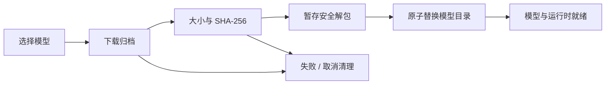
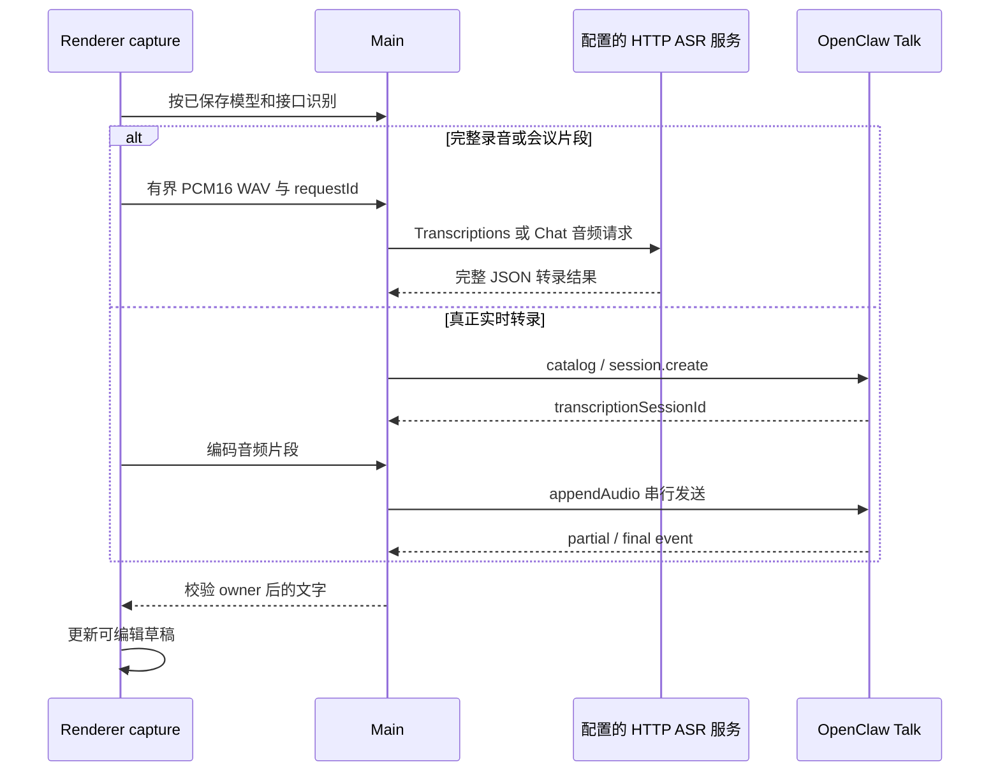
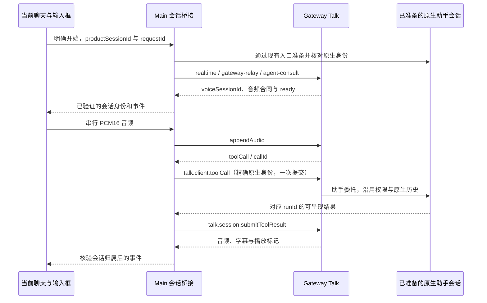

# 语音输入、朗读、附件转录与实时对话

语音是可选功能，分别通过本地运行时、Main 录音 HTTP 请求和 Gateway 原生语音能力执行。当前安装包提供 sherpa-onnx 运行时，离线权重由用户在“设置 → 模型 → 语音识别／语音合成 → 内置模型”按需下载；“安装了应用”不代表模型文件已经就绪。

本地运行时和模型安装当前仅支持 Windows x64；其它平台不能把目录或设置存在解释为本地能力可用。
运行时和模型路径统一由 `src/main/speech/localSpeechPaths.ts` 判定。HTTP 录音识别从已保存的有效绑定解析，不要求 Gateway 就绪；实时转录、实时对话和在线原生合成还需 Gateway 实际注册与准入，配置存在不代表服务已经连通。

## 1. 四条不同使用链路

| 场景                  | 输入/输出                       | 是否自动发送消息   |
| --------------------- | ------------------------------- | ------------------ |
| Composer 语音输入     | 采集或导入音频 → 可编辑文字草稿 | 否                 |
| 回复朗读              | 已完成回复 → TTS 播放           | 不新增 transcript  |
| transcribe_audio 工具 | 模型读取用户附件 → 转录工具结果 | 由原生工具回合管理 |
| 实时语音对话 | 持续双向音频 → 原生助手委托和对话 | 用户明确开始会话；不是听写自动发送 |

录音转写、实时转录、流式 TTS 和实时对话分别声明能力。当前 HTTP 识别/合成采用完整受限响应，不消费 SSE 增量或逐块播放 TTS；使用 WebSocket 的转录也不会自动变成对话脑。

## 2. 用户设置顺序

在语音页选择本地或在线模式。离线模型通过“管理模型”进入模型页下载，再在语音页的下拉框选择输入/输出模型；在线模式选择已在模型页配置的能力目录。模型页只管理列表和下载，不选择当前使用模型。再启用输入或朗读，选择麦克风或支持的系统声音来源，使用诊断/试听确认设备与模型。跳转模型页不自动保存或丢弃语音页草稿。

本地麦克风诊断采集有界录音，显示电平、可回放，并用同一段音频转录，区分无声音、设备路由和识别质量。TTS 试听使用可编辑样本文字与实际选中 provider。

识别模型/接口、朗读模型/音色及实时对话选项均保留在设置草稿中，点击保存后才应用；取消不修改实际配置。当前朗读草稿与已保存的有效输出不一致时，试听提示先保存，不使用旧设置冒充新选择。状态在相应配置变化和引擎就绪后重新读取，迟到结果不能覆盖较新的检查。

模型页按功能保留“语音识别”“语音合成”，新增完整对话的“实时语音”；实时转录放在语音识别内。协议在供应商连接卡中选择一次，其下模型统一继承；消费页面选择模型并展示只读协议，不重复选择接口。旧连接缺少协议字段时仍保留已保存的绑定引用，不自动猜测或切换协议。协议、音色和旧目录的用途语义见[模型管理](../models/model-management.md#语音接口绑定与已有配置)。

语音输入、回复朗读、实时对话及 STT/TTS 齿轮页均不显示接口选择下拉框。未选择模型时隐藏接口行；已有有效选择只读展示，缺少或失效的旧接口提示在模型设置中配置。打开、保存或重复选择同一模型不清空绑定，也不自动修复失效选择。

### 扩展齿轮独立设置

`stt-local-cli` 和 `tts-local-cli` 的启停仅由插件 → 扩展控制，首次安装采用各自扩展清单声明的默认值。语音设置、模型安装、启动及登录/退出同步只更新运行参数，不改变这两个扩展的明确启停选择及已有准入策略；sandboxed 会话不注册 host 转录工具。

两张扩展卡片提供齿轮入口，无论扩展是否启用，都可独立选择本地或在线模式，模型目录与语音页共用。在线模式引用模型页已配置的服务、模型及接口绑定，TTS 再选择该模型中登记的预置音色，不重复填写地址或凭据。选择保存到 `app_config.localSpeechExtensions`，与语音页的麦克风、回复朗读和实时对话分别保存。两种模式保留各自的模型和音色草稿，不自动选择第一项或在配置失效时切换模式。以“管理模型”跳转到对应内置目录或服务，跳转期间保留草稿并隐藏弹窗，关闭设置后可继续选择和保存。下载文件和校验/安装事务共用，离开列表不会取消 Main 中已发起的下载。本地模型就绪或在线模型、绑定和音色选择有效后才能保存；在线模式不依赖本地模型或 Windows 运行时。

保存等待 Main 配置应用成功，保存或下载都不会自动开启扩展。
卡片在确认当前默认模型未就绪时，于齿轮旁显示黄色三角感叹号；提示说明扩展暂不可用，可点击下载或选择模型，并直接进入同一设置弹窗。模型就绪后提示自动消失；模型状态或已保存的选择变化会实时更新提示，读取中及读取失败不作为缺失证据。

### 选择引用与失效处理

STT 依据自己的模式、模型、绑定和应用语言生成附件转录配置。TTS 本地模型与音色保存为 `ttsModelId` / `ttsVoiceId`，在线选择为 `onlineTtsModelRef` / `onlineTtsBindingId` / `onlineTtsVoiceSelection`；STT 为 `onlineSttModelRef` / `onlineSttBindingId`，分别由 `sttMode` / `ttsMode` 决定路径。本地 TTS 继续将数字音色投影为命令的 `--sid`，不转换成在线 voice 字符串。

语音页的输入、朗读和实时对话不覆盖扩展选择，STT 无音色设置。模型被删除会清除对应引用；模型仍存在但显式绑定失效时保留绑定 ID 并撤下执行能力，不把它清成旧目录的隐式默认。失效音色撤下相应输出，保留模式和可解释的模型选择，不能回退本地、其它绑定或另一消费页面。

### 工具 provider 与偏好归属

助手的原生 `tts` 工具固定使用同 ID 的应用自有 [tts-local-cli provider](../../plugins/extensions/tts-local-cli/synthesis.md)；该 provider 同时支持本地命令和配置的在线合成服务，因此禁用扩展也会撤销其在线合成能力。受管 `assistant-speech` persona 只绑定这一 provider，`fallbackPolicy: fail` 禁止借用其它 provider。Gateway 启动环境通过原生支持的 `OPENCLAW_TTS_PREFS` 将工具偏好放在 `stateDir/speech-tools/preferences.json`，并覆盖继承环境中的同名大小写别名，文件仍由原生持有。

顶层持久 `tts` schema 不接受 `prefsPath`；偏好路径通过原生环境变量或独立 API 参数传递，不放入受管 `cfg.tts`，不读取或迁移旧偏好内容。没有新增原生补丁或旧版兼容。

配置同步只发布应用拥有的当前字段，不负责迁移外部写入的旧原生配置。写入成功不等于原生准入成功；含非法旧字段的外部配置仍由原生 schema 与加载校验拒绝，不能靠删除未知字段将其报告为已就绪。测试分别验证合法配置投影和非法输入拒绝，不要求同步器修复任意旧文件。

## 3. 离线模型与安装事务

当前目录包含 SenseVoice Small INT8、Whisper Base INT8、Kokoro、AISHELL3 VITS 和 Piper Lessac 等输入/输出布局。模型 ID 与运行合约在 `shared/speech/`，发布文件、大小和 hash 以 Main 的 `localSpeechModelService.ts` 目录为准，不在多篇文档重复维护下载数字。

这些既有模型继续复用已安装权重、模型目录、语言支持、语速/线程参数和音色 sid；切换本地与服务模式保留各自选择，增加通用接口不会要求把离线模型包装成 HTTP 服务。普通离线 ASR 的会议分段仍是离线转写，不宣称已有模型获得真正流式识别或原生双向对话能力。

模型页的展示元数据位于 Renderer 的 `features/speech/localSpeechModelCatalog.ts`。音色名称及原生 ID 来自已核对的模型资产快照，无需下载后读文件或访问外部服务；模型详情、语音页和 TTS 齿轮共用完整音色目录，不再人为区分可选音色与全部音色。Kokoro 的 103 个音色快照来自 ONNX `id2speaker`，AISHELL-3 的 174 个说话人来自模型的 `speakers.txt` 顺序，Piper 来自单说话人模型元数据。

[Sherpa 官方的 Kokoro v1.1 说明](https://k2-fsa.github.io/sherpa/onnx/tts/all/Chinese-English/kokoro-multi-lang-v1_1.html)提供语言、性别、英语口音和编号映射：55 个中文女声、45 个中文男声，以及 Maple、Sol、Vale 三个英语女声。友好名使用真实源后缀（如 `zm_069` → 中文男声 069），不把原生 sid 92 当作名字；原名和原生编号继续显示。AISHELL-3 没有性别资料，Piper 仅确认美式英语，不编造音质风格。下载大小仍使用 Main 返回的状态，不在展示目录复制。更新内置模型资产时同步核对快照及原生音色范围。

切换本地模型使用新模型的有效默认音色；重复选择当前模型保留已有音色。

### 音色试听的请求生命周期

详情内的筛选、搜索和试听不写入语音设置或插件设置。试听通过独立 `speech-synthesis:preview-builtin` / `speech-synthesis:cancel-builtin-preview` IPC 传递受限请求 ID、内置模型 ID、整数音色 ID 和最多 300 字的文字；Main 校验主窗口 frame、运行时/模型就绪和音色范围，以请求内本地配置复用 `synthesizeLocalSpeech`，不调用 Gateway。每个窗口仅运行一个试听合成，新请求中止并等待旧进程关闭和临时文件清理后启动；旧取消不能影响新请求。窗口导航、销毁或 Renderer 退出撤销请求，返回音频前再次核对归属和模型状态。

Renderer 以请求 ID 和代次丢弃迟到结果，校验有界 WAV，关闭、筛选或切换时暂停音频并回收 URL；合成进程通过 AbortSignal 终止并清理临时文件。

模型在 `<userData>/local-speech-models/<model-id>`。完整已安装模型复用；部分下载和 staging 清理，不能把半个目录标成 ready。包携带相应许可证。

开发环境从 `build/runtimes/local-tts/win-x64/` 读取准备好的运行时；未安装到用户目录的模型可从该目录下复用。安装版运行时仍位于安装资源的 `local-tts/win-x64/`，模型继续从用户目录读取。原始资源见[下载清单](../../offline-downloads.md)，准备和打包命令见[语音模型打包与发布](local-speech-model-release.md)。

### 分段下载、安装与失败回收

下载按 16 MiB 的 HTTP Range 顺序传输，避免单个大响应触及内网代理的传输限制。每段校验 `Content-Range`、总大小和实际接收大小；网络请求或响应流中断时最多尝试 3 次，只重下当前段。当前安装操作中保留已完成段，最终仍对整个归档校验大小和 SHA-256 后才解包。服务端首次请求返回完整 `200` 时兼容单流下载；后续分段返回 `200`、范围不符、完整性失败或磁盘错误均停止安装并清理临时文件。部署服务应支持 Range 才能规避单响应大小限制；重启应用或安装最终失败后不保留断点。

按需安装使用部署方配置的内网更新服务下的模型目录。地址留空时不发起下载，设置页明确提示联系管理员配置；填写后直接使用，不按域名过滤，由部署方保证地址可用。应用冷启动和完整已安装模型的复用不依赖该服务。

Windows 上新解包的模型文件可能被短暂占用。模型目录切换及备份恢复仅对 `EPERM`、`EACCES`、`EBUSY` 做有界异步重试（最多额外 4 次，总等待 1.5 秒）；其它错误立即报告，不重复下载或跳过完整性检查，持续占用仍报告安装失败。

## 4. 离线输入

Renderer 捕获/解码音频并编码单声道 PCM16 WAV，Main 根据已选 Whisper/SenseVoice 布局运行本地命令，结果写入草稿。普通话 zh 采用 OpenCC 规范到大陆简体；自动语言和显式粤语保留模型原文，避免误改其他语言字符。

会议模式按设置的 15–60 秒边界分段，录制继续时排队转录，麦克风与系统输出分别标识和计时。它区分本人与系统播放轨，不做远端说话人分离。

Windows loopback 采集的是系统输出混音，不是某个外部进程。按 PID 的应用音频采集需要另一个原生能力，当前 web-media 路径不能宣称支持。

## 5. 在线输入

### 完整录音 HTTP

`openai-transcription-http` 使用 `/audio/transcriptions` multipart，读取完整转录 JSON。Main 从 `voice.onlineAsrModelRef` / `onlineAsrBindingId` 解析端点与凭据，只接收有界录音、语言和请求身份。当前录音合同为单声道 PCM16 WAV、16 kHz、最多 120 秒；文件导入和会议录音按受限片段依次提交。语言按通用转录字段传递，不附加供应商特有字段或语言限制。

每个应用窗口串行持有请求，绑定主 frame、requestId 和有效配置；新请求、显式取消、导航/销毁或进程退出撤销旧请求，网络使用 AbortSignal 和总时限。编码准备后、代理解析后的实际发送前及返回后重新核验归属和配置，响应有大小边界，不跟随重定向、不重试结果未知的上传，不将服务正文或凭据写入错误。停止并识别会提交最终片段并等待结果；取消才中止请求并丢弃迟到结果。

### 实时转录 Talk

`openai-transcription-realtime` 采用 gateway-relay、brain=none 的 transcription-only 会话，当前使用原生支持的 G711 μ-law / 8 kHz 输入。Main 限定调用 Renderer 所有权，event 按 transcriptionSessionId 匹配；这条链路与完整录音 HTTP 分开准入。设备丢失、权限失败、设置变化、导航或卸载关闭相应原生会话，正常停止按原生约定等待尾音结果，迟到事件不能写入另一草稿。

仅实时转录绑定投影到本地 OpenAI 扩展自有的 `config.transcription`。选择 IPC 只传模型/绑定引用，端点与凭据由 Main 读取；凭据通过声明的 `transcription.apiKey` SecretRef 水合。配置同步、启动及登录退出重建该配置，不依赖可选 `voice-call` 插件。切换为 HTTP、本地、关闭输入或删除所选模型会撤下原生转录配置，不借用附件转录或回复朗读的选择。

适配器通过原生 `resolveConfig` 动态读取自己的输入配置，明确撤下的配置不能回退到其它原生配置或默认模型。Main 按实际输入配置和目录判定准入，在创建 Talk 会话时明确指定适配器和模型。输入框在相关配置或引擎就绪后刷新状态；用户开启输入后保留麦克风入口，暂不可用时禁用并给出设置提示，仍可进入语音设置。旧探测不得覆盖新状态，听写和录音结果始终只写草稿。

适配器的动态配置、音频及原生会话合同由 [OpenAI 插件](../../plugins/extensions/openai/transcription.md)维护。

## 6. 附件转录工具

附件转录与麦克风输入、回复朗读独立。宿主配置自己的本地模型或 HTTP 转写绑定、保存插件启停选择，把外部附件按权限 staging 到项目，并只提交真实附件路径；sandboxed 会话不注册该 host 工具。标准 multipart 识别使用完整响应，工具限制、解码、逐段上传、权限和取消合同由 [STT 插件](../../plugins/extensions/stt-local-cli/transcription.md)维护。

在线目录项必须提供 HTTP(S) 附件转录端点；仅有 WS(S) 实时识别地址时不能作为附件服务，界面应明确说明。切换配置不能静默回退另一模型、本地路径或公共服务。

## 7. 输出与发布资源

本地回复朗读和本地试听由 Main 直接运行 `synthesizeLocalSpeech`，不依赖 Gateway 或工具插件启用。在线回复朗读与助手 TTS 工具通过原生 Speech provider 执行；工具的本地模式仍由自己的 provider 调用本地运行时。输出音频不作为 Redux 或 transcript 新正文，停止普通朗读与停止 Agent 是不同动作。

### 回复朗读的独立配置

在线回复朗读使用独立的 `runtime-services.config.replySpeech` 受管配置。设置只提交模型/绑定引用和 `voiceSelection`，Main 从当前目录解析协议、音色策略、端点及凭据，不覆盖助手工具配置。Main 为完整标准化配置计算非敏感 `configurationId`，包含接口、端点、模型、音色和凭据修订；播放调用发送文字和预期配置 ID，服务只接受当前原生 profile 的匹配 ID。RPC、请求内 provider 与偏好隔离合同由 [Runtime Services](../../plugins/extensions/runtime-services/reply-speech.md)维护。

配置文件写入或同步成功不代表原生配置已经应用；等待重启或仍运行旧 profile 时，合成拒绝使用旧配置，避免向旧端点发送新请求。内存配置代次仍独立校验 A → B → A 与迟到音频，不能只比较配置 ID 恢复旧播放。

标准 Speech 合成当前完整缓冲后校验并播放，协议由 [OpenAI Speech provider](../../plugins/extensions/openai/speech.md)维护；工具的独立委托与启停合同见 [TTS 插件](../../plugins/extensions/tts-local-cli/synthesis.md)。

在线音色使用 `{kind: preset, voiceId}`，音色 ID 由用户填写或服务目录提供；没有有效音色时不执行、不猜默认。旧 `onlineTtsVoice` 在字段缺失时载入为预置选择；显式空选择不恢复旧字符串。废弃的默认音色配置需要用户重新选择。克隆/设计尚未开放，不能将参考音频或描述式模型当作普通朗读。

回复朗读使用独立 persona 和偏好路径，禁用 `tts-local-cli` 不影响它。权限或配置变化后的迟到输出丢弃。原生公开 TTS API 暂无取消信号，停止播放不宣称已经中止该合成请求。

关闭回复朗读会撤下 `replySpeech`，保留产品中的模型和音色选择。Main 在合成返回后再次核对当前有效输出设置，本地或在线的迟到结果均不得在停用或换音色后继续播放。聊天朗读入口在引擎就绪后刷新；输出模型、音色、端点或凭据变化时立即停止旧播放并撤销待播放结果，无关的输入和主题设置不打断朗读。设置页试听采用同一撤销规则。

### 凭据隔离与原生 schema

插件 STT、插件 TTS、实时转录、回复朗读和实时对话的凭据分别发布为现有受限 `extension-secrets.json` 中的 SecretRef。凭据引用绑定端点和密钥版本，配置发布失败不能让旧端点取得新服务的密钥；轮换走既有 secrets 刷新和配置回滚。执行 IPC 不传递原始密钥，原生受管配置也不写入明文密钥。Main 录音 HTTP 请求从当前产品目录读取凭据，仅用于所选服务。

当前 OpenClaw 配置使用 `tts.auto`、能力限定 provider 的协议/音色选择及预置音色的 `speakerVoice` / `speakerVoiceId`。
手动朗读及本地合成工具使用 `auto: off`，provider 参数与扩展启停决定能力是否可用，
不再写 `tts.enabled`；应用朗读开关仍保存在产品语音设置中。设置页的声音输入在 IPC
中保留显式 `voiceSelection`，仅预置音色映射为 `speakerVoice`。应用使用当前规范字段，
不把旧声音别名或 enabled 自动迁移成新值。

聊天中的语音合成使用原生 `tts` 工具，`tts-local-cli` 注册本地 speech provider，不注册同名工具。应用配置不再全局禁止 `tts`，同步时清除旧配置中的该禁用项；插件启用状态和 provider 就绪状态仍独立决定合成是否可用。

### 离线资源发布

模型准备、打包、上传目录、内网服务配置和发布校验统一见[语音模型打包与发布](local-speech-model-release.md)。已发布文件不可原地换字节；模型变更或包装修订使用新身份/文件名并更新编译期大小与 hash，保留旧客户端所需旧包。

## 8. 实时语音对话

“实时语音”模型目录保存 `openai-voice-realtime` 绑定、预置音色和显式 `inputTranscriptionModel`。语音页分别保存 `realtimeEnabled`、模型引用、绑定 ID 和音色选择。启用后，已保存的当前聊天在输入框中显示语音入口，点击直接开始；输入框上方显示圆形状态图标，工具栏提供扬声器、麦克风和结束按钮。它沿用当前聊天上下文，不弹独立对话窗口；文字草稿保持可编辑。听写仍只写草稿，这条实时对话链路不要求或自动开启 STT/TTS 工具插件。

Main 投影独立的 `openai.config.realtimeVoice` 和受管 `talk.realtime`，仅从当前有效选择发布端点和 SecretRef。已注册 provider 的配置、格式、VAD 和传输合同见 [OpenAI 实时语音](../../plugins/extensions/openai/realtime-voice.md)。当前只接入 Gateway relay 的 Realtime 兼容 WebSocket，不开放浏览器直连 WebRTC、SIP 或 managed-room。

首版为 VAD 自动轮次，使用单声道 PCM16 / 24 kHz 输入与输出；没有原生公开提交接口支持的手动 commit 按钮。输入转录模型用于强制助手委托，必须由该绑定明确配置，不能借用 Composer ASR。模型、音色和原生能力需要实际准入；配置完整并不等于端点已经连通。

圆球按实际连接、监听和回复状态显示；回复状态来自原生响应事件，并在本地播放队列消耗后恢复监听，不推测用户正在说话。普通助手任务启动和输入框大小变化不结束现有语音，忙碌状态只限制新会话启动。

麦克风静音和扬声器静音只控制本地媒体。关闭喇叭后仍接收语音字幕并显示文字回复，不取消助手任务或改变独立回复朗读偏好；麦克风静音发送有界静音尾段让 VAD 完成上一句话。原生 `cancelOutput` 和“结束语音”关闭 Talk 都可能请求取消关联助手运行，不能承诺结束语音而后台任务继续。资源已释放或收到关闭 ACK 不代表执行已结算，聊天仍只依据准确原生 whole-run terminal 且 `executionSettled: true` 判断结果。

Main 接手当前语音会话中原生明确发出的工具请求。助手委托按 `callId` 有界去重，通过公开 `talk.client.toolCall` 准入；ACK 前的结果仅在有界临时收件箱中等待精确 `runId` 匹配，不使用“最新结果”。只将匹配的可呈现文本交还该会话的 `submitToolResult`，不另行发送产品 `chat.send`。未知 ACK、超时、连接或配置失效均不补发委托；`chat.final` 这里只用于语音交付，不产生执行成功事实。

同一原生工具协议中的任务控制请求仅调用固定的 `talk.session.steer`，由原生判断当前语音会话所拥有的运行和控制权限，再把有界结果交还对应调用；没有显式模式时由原生分类，不在宿主猜测“取消”或“继续”。执行取消本身仍应得到控制回执，不能因关联助手停止而丢弃；语音 owner 或该工具调用被撤销后则不再交付。咨询、控制和未知工具共用防重复身份，未知工具只返回固定的不支持结果，不转成任意 RPC。

请求绑定窗口/frame、产品会话、准备后的原生身份、Gateway 连接/进程代次和配置代次。Main 返回准备得到的产品 ID、原生 key 和物理 sessionId，Renderer 不能指定这份来源。创建结果未知时保持未知，不重试创建或重放音频。配置撤下、A → B → A 切换、连接变化、离开当前聊天或设备错误撤销旧媒体和请求；修改未使用的模型/音色目录条目或显示名称不取消有效通话。播放与上传队列有界，音频和 mark 按会话归属匹配，取消后的迟到事件不得更新新通话。

用户转录及实际语音回复在原生 Talk 中保存为当前会话的普通消息。通过媒体控制器准入的实时字幕以无缓冲通知交给现有 ChatController，显示在普通消息区；不在圆球下另建字幕区。临时投影绑定当前 call、turn、物理会话、聊天连接及历史代次，最多保留 40 段、每段 8,000 字符。最终字幕携带真实 `transcriptId` 后，按原生消息 `__openclaw.id` 精确接替；原生行先到或字幕先到都不按文本猜测身份。未持久化的片段不进入导出、历史操作或执行结算；结束立即退休未完成片段，已确认的最终字幕等待原生消息接替。这里不新增产品 transcript 表、Main/Redux 正文缓存或重建原生历史。

## 9. 验证与限制

现有定向自动化覆盖模型缺失/损坏、下载取消、设备静音、权限拒绝、接口绑定与用途隔离、失效显式绑定不降级、严格音色策略、草稿保存/取消、分段顺序、草稿不自动发送，以及附件越界和 sandbox 准入。本地五种模型的既有选择、音色 sid 和资源复用保持回归覆盖。

Main HTTP 测试验证 WAV/响应边界、代理准备后发送前复核、请求归属、取消和迟到结果。协议/插件测试通过合成服务或锁定 SDK 验证通用请求、废弃协议/字段拒绝、必需音色、原生 schema/SecretRef 和 provider 委托；不能只调用宽松 resolver 就宣称完整原生加载有效。Realtime 测试验证受管注册、配置准入、会话身份、创建未知、取消换代、媒体 setup 失败清理和并发关闭不会覆盖新通话。

内嵌语音回归覆盖普通消息流式展示与原生历史接替、两个连接的到达顺序、打断后迟到字幕及同轮新响应、喇叭静音仍显示文字，以及输入框大小/任务活动变化不重建媒体。Main 另覆盖助手委托的 ACK 前结果、精确 run 匹配、防重复控制、取消回执、未知工具固定错误和连接/配置撤销；公开 Talk 请求形状通过锁定原生协议 validator 校验，未启动 Gateway 或调用真实模型。

四种通用在线接口另有真实本机 HTTP／WebSocket 假端点测试，覆盖 Main 的录音传输、插件与锁定原生 SDK 的请求收发和代表性失败。协议清单、自动化入口及复测命令见[本机假模型端点验证](speech-protocols.md#本机假模型端点验证)；模拟模型回包不等于已验收真实模型或完整设备链路。

这些验证没有调用真实付费模型，也不证明实际麦克风/扬声器、目标内网服务和代理部署的端到端兼容性、音质或延迟。真实设备和内网协议仍需现场验收。HTTP ASR/TTS SSE、逐块 TTS 播放、克隆/设计、WebRTC、手动音频 commit 和组合式 ASR → 助手 → TTS 自动对话均不在当前已验证能力内。
