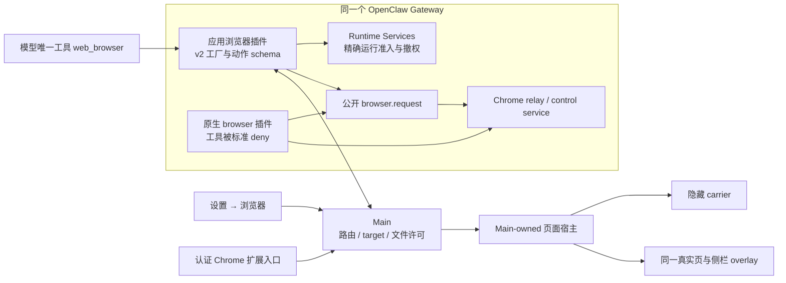
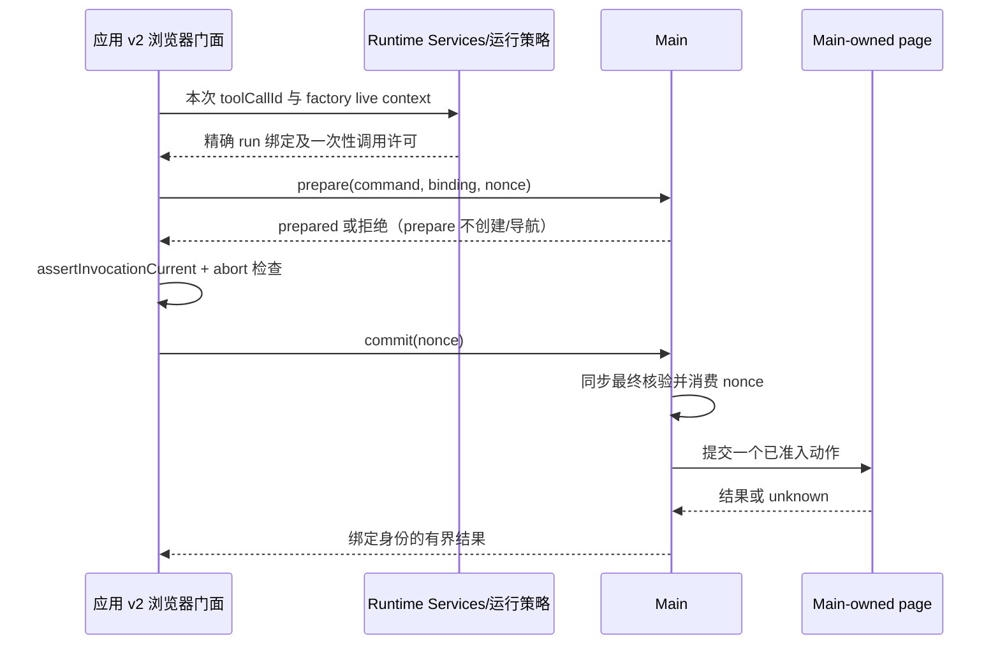
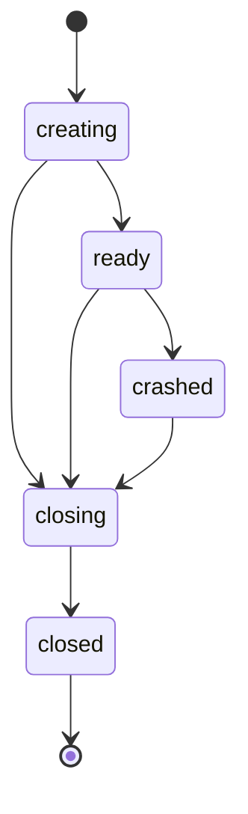

# 浏览器共存、后台运行与侧栏宿主设计

状态：后续 Chrome 共存与同页接管候选方案；**零新增、零调整 OpenClaw patch 是硬约束**。本文下述完整门面/统一宿主方案尚未实施，不代表已支持。

设计日期：2026-10-26。研究基线：`dev@c48a21e69`、OpenClaw `v2026.10.7`、Electron 声明版本 `^42.6.2`。首期内置前后台执行已经实现并整合到[浏览器设置](../features/browser/browser-settings-design.md#内置浏览器的前台与后台执行)与[定时任务](../architecture/08-scheduled-tasks.md#内置浏览器后台执行)：沿用 browser 名称和互斥插件，普通默认侧栏、明确 headless=true 才后台，内置定时任务后台运行。当前实际宿主为隐藏离屏 BrowserWindow，真实 Electron 验证版本 42.7.0；现行限制与未完成验收以功能文档为准。后文 web_browser 改名、Chrome RPC 及统一 WCV 迁移均未实施。

## 1. 后续完整 Chrome 共存候选方案：决策与目标

采用 **一个应用浏览器门面 + 标准工具 deny + 保留原生浏览器服务**：

1. 普通会话和定时任务统一跟随“设置 → 浏览器”，默认内置，保留 embedded/isolated/user/extension 四种模式；Chrome 扩展专属会话固定 Chrome，不受全局模式影响。
2. 模型只看见应用工具 `web_browser`（拟定内部名，UI 仍显示“浏览器”），参数不提供 backend/driver/node 选择。软件确定路由，不能让模型选择两套浏览器。
3. 原生 browser 插件和服务保持启用，使用现有 `tools.deny: ['browser']` 将其模型工具移出有效目录；应用门面名称与被 deny 的原生名不同，因此无需改原生 factory、同名注册规则或工具过滤接口。
4. 内置分支复用当前 BrowserAgentBridge 和真实页面能力；Main-owned WCV 的前后台宿主迁移继续按本文实施。Chrome 分支通过公开 `browser.request` 调用原生控制服务，由应用负责窄动作映射与目标准入。
5. Chrome 扩展继续当前 Main backend 的产品发送、会话和私有上下文链路，控制绑定由应用核验。无需为了调用原生模型工具引入 copilot 发送或改 014。
6. 不引入第二 Gateway、第二 Agent loop、另一份 transcript、Chrome 窗口嵌入或首次使用公网下载。

**可行性结论**：源码分层支持这条零 patch 路线：工具过滤、浏览器 RPC/relay/service 分别工作。它避免上版同名双 factory 必须新增退出门的问题。代价是维护应用工具门面、Chrome 动作适配和权限名过渡；完整运行时、取消排空与页面兼容仍需 POC，不把源码可组合视为端到端已通过。

侧栏用户操作保持原设计：真实页面、地址栏、标签、登录、下载、录制标注、介入和分离窗口。变化主要在工具内部名和资源所有权；历史不改写。旧 custom allowlist 仅允许 browser 的情况不能被假定自动授权 web_browser，见第 6.4 节。

### 1.1 后续完整方案的交付范围

- 桌面聊天的内置浏览器保持真实网页、历史、登录、下载、PDF、查找、标注、录制、人工介入和侧栏分离能力。
- 产品可编辑的、隔离 `agentTurn` 定时任务使用浏览器时继承全局模式；选择内置才使用本设计的后台宿主。沿用任务权限，`systemEvent`、脚本/命令、托管和高级任务不自动获得控制能力。
- 正在运行的后台页面可在侧栏只读查看；需要操作时先停止并取得精确终态，再人工接管。
- Chrome 扩展会话只操作本轮授权并核验的 Chrome 标签，其标签授权不被定时任务继承；定时任务选择 Chrome 时按全局所选 driver 独立准入。

### 1.2 “后台”和“无头”的边界

| 方案 | 能否不显示窗口 | 是否仍排版、执行脚本和绘制 | 同一页面直接放回侧栏 | 本期选择 |
| --- | --- | --- | --- | --- |
| Main WCV + 隐藏 carrier | 可以，待 Windows 实测 | 需要；根据页面和截图发生绘制 | 拟通过移动同一个 View 实现 | 首选 |
| Electron offscreen | 可以 | 需要，输出位图或 GPU 纹理 | 不是仅切换一个显示开关，需另行验证 | 不作为前提 |
| 独立 Chromium headless | 可以 | 仍需要 DOM/layout/JS，截图也要绘制 | 不能直接变成应用 WCV；需另做可视接管 | POC 失败后的独立备选 |
| CSS 隐藏现有 `<webview>` | 可以隐藏 UI | guest 可能继续工作 | 页面已在 UI 中 | 不能解决创建与生命周期依赖 Renderer |

Electron 的 offscreen 文档描述的是绘制输出方式，不能据此推导“没有渲染”。本方案对用户展示“后台内置浏览器”，内部状态保留准确宿主信息，不把 `show:false` 伪装为 Chromium `headless:true`。[Electron offscreen](https://www.electronjs.org/docs/latest/tutorial/offscreen-rendering)

## 2. 当前实现与约束证据

下表描述基线代码，后文标注“拟新增”的类型和接口均尚未存在。

| 当前事实 | 代码/契约入口 | 对设计的影响 |
| --- | --- | --- |
| 两个插件都声明 `browser`，配置按模式互斥 | `plugins/extensions/embedded-browser/index.ts`、`openclaw.plugin.json`；`src/main/openclaw/config/plugins/pluginProjection.ts` | 不能只把两个 enabled 都设为 true |
| 内置 factory 用应用 session-key 形状筛选 | `plugins/extensions/embedded-browser/index.ts` | cron 缺工具；扩展会话也可能匹配。不能靠放宽正则解决授权 |
| Main 命令桥仍请求 Renderer 创建页 | `src/main/browser/browserAgentBridge.ts` 的 `ensureTab()`；`useCoworkBrowserPanels.ts` 的 `onAgentEnsureTab()` | cron 没有产品聊天面板，也无法依赖 UI ready ACK |
| 真实网页是 Renderer `<webview>` | `src/renderer/features/browser/BrowserPanel.tsx` | 生命周期与显示耦合，单改 `headless` 字段无效 |
| 登记要求 webview、可信 host 与正确 partition | `BrowserAgentBridge.parseRegistration()` / `isRegisteredGuestAvailable()` | 新宿主必须替换为精确 Main-owned registry，不能宽泛放行 window |
| 点击/按键等使用 `sendInputEvent()`，部分路径调用 focus | `src/main/browser/agent/browserAgentActions.ts`；`focusGuestForKeyboardInput()` | 后台要验证无焦点输入传输 |
| guest preload / recording 使用 `sendToHost()` | `src/main/browserGuestPreload.ts`；`browser/recording/browserRecordingGuest.ts` | WCV 迁移需要受限 guest→Main 消息路由 |
| 工作区 WCV 承载被动壳，支持同组分离/收回 | `src/main/core/window/workspaceWindowManager.ts`；[分离契约](../features/workspace/detached-workspace.md) | 可复用几何和 View 组管理思想，但当前网页尚未由该宿主管理 |
| 全运行终态与 ACK、final、idle 不等价 | [执行引擎](../architecture/05-agent-engine.md)、[定时任务](../architecture/08-scheduled-tasks.md) | 页面释放、人工接管和任务结果必须分别处理 |
| 只读定时预设排除浏览器自动化 | `src/shared/scheduledTask/permissions.ts` | 新功能不能自动提升旧任务权限 |

Electron 官方要求 `sendInputEvent()` 的承载窗口具有焦点，因此现有前台动作路径不是可靠的隐藏执行路径。[官方接口](https://www.electronjs.org/docs/latest/api/web-contents#contentssendinputeventinputevent)

## 3. 产品场景和路由规则

所有有权限的产品入口最多暴露一个应用工具 web_browser。它按受信来源和已提交设置选后端，不向模型暴露内部选择参数。

| 场景 | 设置 → 浏览器 | 门面后端 | 权限与缺失条件 |
| --- | --- | --- | --- |
| 普通软件会话 | 内置（默认） | Main 内置真实页面 | 仅当前会话/profile 的页面与文件权限 |
| 普通软件会话 | 隔离 / 用户 / 扩展 | 所选原生 driver/profile | 连接/授权缺失则不可用，不切内置 |
| 定时任务 | 内置（默认） | Main 后台内置页面 | 不依赖详情/侧栏打开，沿用任务权限 |
| 定时任务 | 隔离 / 用户 / 扩展 | 所选原生 driver/profile | 独立预检无人值守条件，不能借扩展聊天的标签授权 |
| Chrome 扩展专属会话 | 任意 | 当前授权的 Chrome relay 标签 | 固定 profile/真实 target；缺绑定不控制其他标签 |
| 桌面查看/继续扩展专属会话 | 任意 | 仍为对应 Chrome | 需要有效控制绑定，历史正文不是授权 |
| 非产品入口 | 原有策略 | 须在上线范围中证明既有合法能力的对应关系 | 不借门面取得产品页面或 Main admin 权限 |

优先级：受信扩展专属归属 → Chrome；其他普通/定时入口 → 全局浏览器设置。归属仅选择保护策略，不能授予控制权。任务不另设 provider 或浏览器许可开关；只保存内置 profile/viewport 偏好，工具权限仍由原生策略管理。

目录中只有一个门面，因此后端选择不再依赖原生 factory 看见产品 runId/jobId。factory 可以只提供有界能力 schema，prepare/授权 hooks 后再取得实际调用许可；无绑定纯聊天可以继续，web_browser 的控制操作明确不可用，绝不产生另一个默认浏览器。

每次普通发送/cron 实际触发使用当前已提交设置，不沿用任务创建时快照。活跃运行固定模式/设置 revision/profile；设置更改沿用活跃执行检查和 drain，不热切换、不回放未知动作。原生配置与 Main 未回读一致时暂停新浏览器准入。

“单浏览器”验收涵盖直接 schema、Tool Search、Code Mode、compaction/fallback 重建和 tools.effective。静态 tools.catalog 可保留原生插件的能力描述，但不得把它注入本轮模型有效目录；UI 需区分能力清单和有效可调用工具。

## 4. 总体架构与边界



应用浏览器插件拥有模型 schema、参数解析、Chrome 白名单动作适配和工具结果；Main 拥有产品入口绑定、内置页面与 UI/文件资源。Runtime Services 仅依赖纯契约，维持 run/toolCall 权限，不依赖可选浏览器插件是否加载。Gateway 继续管理执行、原生权限和 transcript。

原生插件保持 service/relay 可用，不改其工具注册源码。Chrome 请求优先在门面的原始工具上下文使用公开 SDK callGatewayTool，不把 Main admin token、任意 RPC/path/CDP 能力给模型。无法证明原调用权限/生命周期时拒绝，不能转用 Main admin 连接突破拒绝。

既有 plugins/extensions/embedded-browser 可作为兼容插件 ID 保留，内部收敛为门面及内置/native 两个适配模块；也可在实现时按现有插件管理契约命名，不能为改名复制第二套工具注册。插件不 import 应用 src，Main 通过认证窄 RPC 协作。

## 5. 身份与授权模型

至少分离五类身份，字段名为设计示意，实施时使用常量和纯共享类型：

| 身份 | 核心组成 | 权威/作用 |
| --- | --- | --- |
| 原生执行 | canonical `sessionKey`、物理 `sessionId`、`runId`、agent/job 归属；原生提供时核验 revision/generation | 原生 API 和可信 hook；决定某轮是否可调用 |
| Main 绑定 | 随机 `bindingId`、host epoch、backend 连接代次、策略 revision、有效期与撤权态 | Main + Runtime Services 双方核验；不可由模型指定 |
| 页面 | `pageId + incarnation`、scope、profile、实际 WebContents 引用 | Main 创建登记；不以递增 webContents ID 代替 incarnation |
| 文档/视口 | document/frame generation、`viewportRevision`、snapshot/ref generation | 导航、布局变更与节点引用时效；拒绝旧坐标和旧 ref |
| 展示 | surface、owner Renderer、workspace/document generation、grant token | 只决定页面显示到哪里、是否可人工输入；不是工具执行许可 |

`targetId` 是有界作用域内的句柄，`profile` 是登录存储选择，产品聊天 ID 是 UI 索引；三者均不能代替原生执行身份。不得从 prompt、标题、`source` 字段、cron session-key 后缀或“当前最新 run”推断权限。老兼容 namespace 可以识别产品入口，但不能独立完成授权。

### 5.1 原生上下文与目录/执行分离

10.7 工具 factory 有 sessionKey/sessionId/agentId/workspaceDir，v2 有真实 assertInvocationCurrent()，没有 runId。可信 agent hook 有 runId/jobId/sessionId/trigger；tool hook 有 runId/sessionId/toolCallId。不能在 factory 补造 ctx.runId、取最新 claim 或传一个 isCurrent:true 代替 live guard。

基础工具/目录先于 prompt prepare hooks 构造。唯一门面不需在这一阶段与原生 browser 竞争；标准 deny 已移除原生工具，factory 仅列出门面 schema，不创建页面或取得执行许可。

随后 agent_turn_prepare 核验确切 job/run/session 与设置 revision，建立 pending claim；requiresToolAuthority:true 的 before_prompt_build 检查 allows('web_browser') 和 assertActive()，才激活本轮使用许可。真正调用仍核验 toolCall 和 v2 live guard。hook 失败/缺失不放行动作。

trusted hook context 不提供任意工具 pluginId，也没有可用于两种 browser owner 的 toolKind。无需再假定它能证明两个 factory 的真实归属：目录只有应用门面，后端由受信 route ledger 固定。跨注册实例共享经原生 runContext/受限服务验证，不假定不同插件 namespace 可互读。

### 5.2 命令提交协议

以下协议约束内置 Main 动作桥；Chrome 分支另用第 6.2 节公开 SDK 派发，原始 v2 guard 留在插件。现有 `{requestId, sessionKey, command}` 事件桥不足以承载后台权限。拟升级为包含绑定、原生身份、`toolCallId`、一次性 nonce、deadline、host epoch、页面及文档预期的有界协议；模型仍只提供动作参数，不提供 authority。



- Main 将所有异步解析、文件权限检查、排队和前置观察放在最终提交之前；真正产生副作用前再次核验本地 binding、page/document、撤权态和 nonce，并立即发出动作，中间不 `await`。
- 插件真实断言只保证其有效同步边界，不能声称跨进程原子撤权。停止协议必须同时关闭两侧准入并 drain 在途操作，之后才能开放人工输入。
- 每个独立副作用都经过相应最终检查。文件上传、创建页、导航、下载和组合动作中的后续副作用不能共享一个无限期许可；原生 `browser` 不被描述为已有 embedded v2 的保证。
- 两侧记录 `prepared / committed / completed / unknown / revoked` 的有界命令 metadata。重复 prepare 可返回同一准备状态；commit 只能消费一次。响应丢失后只查同一次请求状态，不补发导航、点击、提交或上传。
- 不向普通 operator.read 广播许可 nonce、正文或敏感参数。需 POC 证明事件/RPC 的最小可见范围；不能沿用当前通用 requested 广播作为携带控制 capability 的通道。若公开机制不能满足机密性与精确调用关联，G0 阻塞。
- native guard 失效、连接代次变化或返回身份不符时，迟到响应丢弃；不可把旧结果交给新页面或下一轮。

以上是待验证协议，不是实现完成的安全结论。G0 必须走真实锁定运行时，验证 factory、policy、Gateway handler 的共享状态、callback 生命周期与取消时序；不能用测试伪造一个永远返回 true 的 guard。

## 6. 零 patch 门面、原生服务与权限

### 6.1 配置和目录证明

拟投影以下关系，不覆盖无关插件、模型和权限设置：

```text
browser.enabled = true
plugins.entries.browser.enabled = true
应用浏览器门面插件 = 按应用受管浏览器设置启用
tools.deny = 原有有效 deny + 受管 browser 工具遮蔽
模型工具 = web_browser
```

保留原生插件的配置/relay/服务，禁止从模型直接调用其 browser 工具。门面不可被泛化为 RPC 执行器，参数只包含业务动作和当前作用域的页面引用，不接收 gatewayUrl/token、method/path、raw profile/node/CDP target 等选项。

已核对锁定 10.7 控制流：

| 源码入口 | 支持零 patch 的事实 |
| --- | --- |
| src/plugins/tools.ts | deny 参与工具装配，不等于禁用插件 |
| src/agents/tool-policy-pipeline.ts、tool-policy-match.ts | 全局 deny 在工具最终过滤中生效，deny 优先 |
| run/attempt-tool-catalog.ts、harness/prompt-tool-policy.ts | 从已过滤 effective tools 构建/压缩 Tool Search 与 Code Mode |
| extensions/browser/plugin-registration.ts | tool、browser.request、HTTP relay、browser-control service 分别注册 |
| extensions/browser/src/plugin-enabled.ts | service 启用依据 plugins 与 browser.enabled，而非工具 deny |
| extensions/browser/src/gateway/browser-request.ts | admin browser.request 启动/调度控制服务，不要求 browser 工具可见 |
| src/gateway/method-scopes.own-session.test.ts | browser.request 需要 operator.admin，write 不足 |

浏览器开关和门面可用性继续受既有管理保护；服务启用不授予新工具权限。不能用 tools.allow:['*'] 清掉无关限制。静态 plugin manifest 仍声明 browser 属正常现象，验收观察模型真正提交的 schema 和有效 catalog。

### 6.2 Chrome 调用：公开 SDK 与窄动作适配

第一选择是门面 execute 中用 openclaw/plugin-sdk/agent-harness-runtime 公开的 callGatewayTool：

```ts
await callGatewayTool('browser.request', {}, preparedNativeRequest, {
  signal: operationSignal,
  dispatchAuthority: {
    version: 2,
    kind: 'run',
    assertCurrent: assertFacadeInvocationAndLeaseCurrent,
  },
});
```

此为方案示意，仅适用于 G3 已证明保留原始 Gateway caller resolver 的执行路径。preparedNativeRequest 由应用依据当前 route/target/权限组装，不能来自模型任意对象；assert 函数持有原始 v2 闭包及当前一次性调用许可。in-process 路径下真实 signal 和同步断言在准备/dispatch 边界下传，无需复制私有模块。

**无 gatewayUrl/token override 不等于保证 in-process**：callGatewayTool 在 caller resolver 不满足条件时会自行使用 WS transport，并可能解析宿主配置凭据。公开 hasGatewayToolRoutingContext() 只能作为必要检查，不能单独证明不会 fallback。准入必须限定于真实 producer 已证明且运行时仍保留 resolver 的路径；没有可支持的运行时证明就先拒绝，不执行可能落 WS 的调用。G3 负例断言不创建 GatewayClient、不读取配置 token；不使用私有 introspection 补齐。该证明未通过前，Chrome 分支不能宣称已具备完整安全执行条件。

源码依据：公开 SDK agent-harness-runtime.ts 导出 callGatewayTool；agents/tools/gateway.ts 支持 extra.signal/dispatchAuthority；in-process-gateway.ts 保留原 caller、signal 和 guard；server-plugin-in-process-authority.ts 按实际 operator 权限求交，不允许请求合成 admin 越过已有权限。

operator scopes 缺失不能当作 admin：原生 cron/system 可能没有 operator source，必须由受信 job/run、门面最终工具权限和原生 system actor 准入共同验证。无合法路由或 scope 拒绝时返回不可用，禁止用 Main admin 作为 fallback；不使用模型传来的 token 或 scope。

发 host 请求前显式核验 factory 的 browser.allowHostControl 与 sandboxBridgeUrl：host-control 禁止或当前只授权 sandbox 时，不调用 host RPC；尚未适配的 sandbox 后端明确不可用。browser.request 不会自动继承这两个 factory 字段。受信请求固定 target:'host' 且禁止 node/remote，不能触发原生节点自动选择；scope 中有 admin 也不替代此检查。

**不使用会话 dashboard RPC 代替**：browser.dashboard.request 等接口有 requiredTool:'browser'，会被 deny。browser.request 的 admin 权限仅是基础设施访问门槛，不是本轮任务操作许可，门面每次都必须做额外的 exact-run/target/文件约束。

动作映射保持小而显式：

| 门面动作 | 原生路由候选 | 应用必须补的边界 |
| --- | --- | --- |
| 标签列表/新建/聚焦/关闭 | GET /tabs、POST /tabs/open、POST /tabs/focus、DELETE /tabs/:id | 仅所选 profile/本 scope；扩展不能任意开关其他标签 |
| 快照/导航/输入 | GET /snapshot、POST /navigate、POST /act | 固定真实 target；嵌套 act/batch 中所有目标也校验 |
| 截图/PDF | POST /screenshot、POST /pdf | 回传原生媒体/产物，工作区路径与防覆盖约束 |
| 文件/对话框 | /hooks/file-chooser、/hooks/dialog、/download、/wait/download | 明确授权、路径/来源、取消/部分文件清理 |

准确 method/body/query/能力范围以当前原生 client.ts、client-actions.ts、routes 为准，实施建立逐动作 contract tests；不深层 import 原生私有函数或复制完整 browser-tool。模型 schema 可按 route 能力收窄，但永远只有一个门面。宿主管理、profile 导入/删除、全局 stop 等不能作为通用 admin RPC 透传，产品设置入口沿用其明确 UI 权限。已有支持动作不能静默删掉，未适配能力阻止相应功能切换上线。

browser.request 只返回原始 JSON，不包含原生 browser-tool 的媒体与不可信内容封装。门面须用公开 SDK/本地受控实现恢复等价结果契约：截图转成模型可见 image content，执行原生同等图像净化/大小上限及 media.outbound:false 等私密媒体约束；PDF/下载路径必须核验为本次原生操作实际产物、允许来源根和目标工作区，再安全复制/保留引用。不能把返回的任意 path 当授权文件，也不能仅 jsonResult 丢掉视觉输入。

网页正文、标题、console、evaluate/JSON 输出保持 network 不可信标记与注入边界，不能成为可信指令；错误和 metadata 去除凭据、ownership 内部数据、wsUrl/debug endpoint。复用已有应用结果封装，确有缺口再增加受控 helper，不 import 原生私有 screenshot/snapshot wrapper。G3 验证截图确实进入模型、不会自动外发、恶意网页文本不升格及产物路径攻击。

tabScope 仅用于原生登记/结果范围，不是动作执行授权。Main/门面必须固定 profile 和真实 target、核验页面 incarnation、禁止模型嵌套覆盖、拒绝 node/remote fallback，保持目标撤权、导航及复用后的代次检查。原生 tab idle cleanup 不一定在每个 act/snapshot 刷新，须证明活跃门面目标不被误回收；仅清理由本运行实际创建的页。

### 6.3 取消、未知与人工接管

callGatewayTool 的 dispatchAuthority 检查 RPC 发起边界；不能据此宣称浏览器内部每个 CDP 副作用都再执行同一个 v2 断言。传入组合 operationSignal，覆盖原工具取消、精确运行/设置撤权和应用资源关闭；验证原生 handler/Playwright 实际接受并停止后续效果。

普通 GatewayClient.request({signal}) 仅本地 retire pending，不等于服务端停止。因此不把 Main 共用 admin WS 当作默认写操作转发器。专用可关闭连接只能作为需另做 POC 的备选，也不能把断连当作 drain 完成。

即使公开 in-process 调用返回取消，底层 evaluate/click 也可能已经提交。必须保留独立 in-flight 资源登记和真实排空证据；无法确认则保持 unknown 并关闭应用后续控制，不重试写动作、不伪造 native terminal。这里的人工锁只指应用自己的接管/准入 lease：借用的外部 Chrome 不受 Main overlay 控制，用户仍可能直接操作 Chrome，不能声称已经锁住它。若需要有序接管须证明 driver/relay 的真实屏障；否则展示限制，不套用 WCV 同页接管保证。

另一个公开候选 api.runtime.gateway.request 固定走 in-process，但当前 options 无原始 signal/dispatchAuthority，分发也未自动把 scope.signal 交给 browser handler；它不能直接替代上述取消和 guard 保证。若原始 resolver 路径不能证明，则继续评估这一公开服务边界的生命周期方案；未解决时阻止相关 Chrome 写能力上线，不回到新增 patch。

资源登记必须覆盖 **RPC 已返回后的 armed 状态**，不能只计未完成 Promise。原生 file-chooser/dialog hooks 可能 arm 后立刻成功，某些 existing-session dialog 实现会安装稍后生效的一次性页面回调，等待下载也可能跨调用。登记页/文档代次、grant、有效期、触发/消费与 disarm 回执；测试“arm 成功→停止/撤权→后来人工触发”不得继续上传或自动接受确认。公开 API 没有可靠撤销时，不能用“RPC 已 drain”放行，也不能关闭借用页补偿；须在应用可拥有的受支持生命周期内重做该动作，证明等价后才切换相应能力。

### 6.4 权限名过渡与遮蔽来源

这是零 patch 方案的明确成本：原生模型名 browser 被遮蔽，统一工具改名 web_browser。

- Full 的原生 ['*'] 仍可包含门面；只读预设继续没有浏览器。
- 旧 custom toolsAllow:['browser'] 不自动允许 web_browser，不能加通配符或偷加新名。需在既有受信编辑流程明确选择新能力并经原生更新回读；未确认保持旧限制并解释原因。agent/provider/group/sandbox 级精细名单同样逐层处理。
- 用户既有禁止浏览器的政策必须约束门面，不能只识别字面 deny browser。需要在未加入受管遮蔽的原始政策层，按原生 group/glob/plugin 及 agent/provider/channel/sandbox 语义判断；例如 group:ui、group:openclaw、bro* 的限制不能因新工具名而消失。原生 scope、host-control、fsPolicy、MXC/sandbox 仍有效，合法门面调用也不是管理员任意操作。
- 应用添加的 native browser 遮蔽与用户授权/deny 必须保留来源。复用受管配置 owner/投影回执，在原始政策层保留用户意图并生成相应门面限制；不能下一次同步又把应用自己的遮蔽误判为用户全禁，也不能把真实用户 deny 当作遮蔽删掉。首次升级来源不能证明时停止切换并给具体冲突，不覆盖无关政策。
- 历史不改名、不重写；历史、来源提取、活动展示同时识别旧 browser 和新 web_browser。Plan Mode 按真实动作 schema 分类，未知动作/结果保守；不把新工具全部标 replaySafe。
- 不授权原本不允许浏览器的子任务、外部来源和原生渠道。全局遮蔽的覆盖范围须列明；现有合法非产品 native 入口若需继续支持，也必须有等价受信门面/策略契约，否则不宣称全兼容上线。

required Runtime Services 只收紧本产品已认领执行，其他工具原策略不变；认领证据异常不能退成 unowned。精确身份与原生最终工具 authority 是许可，来源标签和模型参数不是。

### 6.5 其他零 patch 路线的比较

| 路线 | 结论 | 不作主方案的原因 |
| --- | --- | --- |
| 两个异名工具 + hook 正向 toolsAllow | 原生确实能同时过滤 schema/目录 | 需要完整“其他合法工具全集”，动态 MCP、channel/provider、恢复目录难证明完备 |
| tools.effective/tools.catalog 生成差集 | 可做有限 POC | effective 有缓存且缺本轮上下文；catalog 未证明覆盖运行时全部工具，不能掉其他能力 |
| 按插件 ID allow 同名 browser | 装配早期可筛插件 | 需排除 '*'、默认插件 sentinel 和裸 browser，还要维护全部非浏览器许可；过于脆弱 |
| 原生工具统一连接 Electron CDP | 技术可组合 | 需安全的每 scope CDP endpoint/Target 代理，不能暴露整个 Electron；重做既有快照/标注/输入兼容，成本更大 |
| 官方 attached helper | 有公开附着能力 | 固定单一 attach-only worker profile、host-control:false、独立产物路径；不是完整三路路由器 |
| 第二 Gateway 只承载浏览器服务 | 零 patch 保底可做 | 增加进程/隔离 stateDir/凭据/端口/生命周期，本方案单 Gateway 已有服务入口 |
| 第二 Gateway/克隆助手执行聊天 | 不采用 | 引入会话/历史/角色所有权维度，不能共享 stateDir 或移动历史 |
| 改原生 manifest/注册 JS、包装私有入口 | 不属于本任务允许方案 | 打包时覆盖同样是原生改动，不能换名叫“零 patch” |

DecisionProvider 只支持当前辅助整组工具保留/裁剪判断，没有最终工具全集/精确 run/provider 选择能力，不能用它模拟目录差集。

## 7. Main-owned 页面宿主

### 7.1 服务职责与内部 API

拟新增 `BrowserPageHost`，作为真实网页唯一生命周期权威；`BrowserAgentBridge` 保留动作与观察适配，向 host 获取经过准入的页面，不接受 Renderer 自报 webContents ID 建立新控制能力。

| 内部方法（拟） | 输入与约束 | 输出 |
| --- | --- | --- |
| `createPage(binding, options)` | 已准入 scope、profile、viewport、幂等 request；先占容量 | page identity；未确认结果可查询 |
| `getPageForCommand(binding, reference)` | 精确 incarnation、profile、owner 和本轮许可 | 内部 WebContents 引用，不跨 preload 暴露 |
| `attachPresentation(page, grant)` | 当前 surface/owner generation | 同实例显示；不新建页或发送动作 |
| `parkPage(page, grant)` | 仅释放对应展示授权 | 移回后台 carrier |
| `revokeScope(binding, reason)` | 立即拒绝新动作，再取消/drain | 资源撤权状态；不是原生执行结果 |
| `closePage(page, reason)` | 等待或终止已准入资源操作，显式关闭 | 精确资源关闭回执 |

页面状态与展示状态独立：



`ready` 页面可处于 `parked / sidebar / detached` 展示位置。控制 lease 分为 `agent / manual / blocked`；presentation 另分 `observation / interactive`，观察者附着不会替换 Agent 的执行 lease。页面存在、显示位置和输入权限均不能代表 native run 成功或结束。

页面寿命归属与当前 run 写权限也独立：桌面普通聊天页是 `conversation-owned`，后续轮次重新取得精确 run 写 lease，轮末保留页面和表单，直到显式关页或会话保留规则释放；cron 临时页是 `run-owned`，默认轮末回收。介入请求在停止前建立 `retained-for-intervention` reservation，精确 terminal 和 drain 后由 Main 原子转换页面及 profile 归属为 manual lease；普通 terminal cleanup 必须跳过该 reservation。显式保留结果页同样先转换 inspection owner，再释放执行权，不能先销毁再尝试恢复。

### 7.2 隐藏 carrier

首选每个活跃运行 scope 一个隐藏 `BaseWindow`，只承载实际网页 WCV，没有额外应用 Renderer；同时验证隐藏 BrowserWindow 作为 P0 对照。页面创建在非零 viewport 下，首次导航前安装安全策略。是否最终用 BaseWindow，以 Electron 42 Windows 实测为准。

carrier 寿命取决于持有的页面资源，不能随 run 结束一并销毁 conversation/inspection/manual 保留页的承载。资源 owner 转交时可保留 carrier，或同实例原子 reparent 到新 owner 的 carrier 后关闭旧 carrier；最后一个页面释放后才关闭空 carrier。

使用 `WebContentsView` 和同一 `View` 重新挂载，而不是销毁后重建或复制 Cookies。一个 WebContents 同时只能由一个 WCV 展示；迁移必须由 Main 串行执行。[Electron v42.6.2 WCV 合约](https://github.com/electron/electron/blob/v42.6.2/docs/api/web-contents-view.md)

BaseWindow 关闭不会自动销毁 WCV 的 WebContents，host 要显式关闭、撤监听并释放 debugger/session 引用；不可只关闭 carrier 当作资源已清完。[Electron v42.6.2 资源管理](https://github.com/electron/electron/blob/v42.6.2/docs/api/base-window.md#resource-management)

### 7.3 前后台、会话切换与分离

- 普通关闭侧栏只移走展示；仍在执行的页面 park 回隐藏 carrier。用户显式关闭页需要先按 lease 规则撤权，不让 UI close 与提交竞争。
- 后台页显示到侧栏、侧栏拆出和收回均保留相同 WebContents、表单、history、storage、导航代次和在途页面状态，不调用 `loadURL()` 恢复现场。
- 迁移时先盖可信遮罩、撤销旧 presentation grant、drain 当前布局敏感操作，再移动组并建立新 grant。旧 Renderer 的迟到 bounds/focus 更新不得操作新 surface。
- 主 Renderer reload/崩溃仅撤销展示和 UI 输入；独立定时运行的页面 park 回后台。主进程退出才销毁资源，不能把页面寿命硬绑在主 Renderer ID 上。
- 分离窗口关闭先收回 View；隐藏、最小化、全屏、切换聊天、应用审批弹窗时都要更新 native clip/occlusion，防止悬浮页层留在错误会话上。
- 后台工具 `action:focus` 只选择 scope 内的逻辑 active page，不打开侧栏、不选中产品聊天、不 show/focus 原生窗口。只有用户明确的 attach/presentation 请求才改变可见 UI；DOM 输入焦点与操作系统窗口焦点分别处理。

### 7.4 原生遮罩和现有 UI

拟用 `browserGroup = pageClipGroup(pageView) + trustedOverlayView`。overlay 为应用同源被动 surface，可复用工作区 portal 机制；无应用 preload、独立 Redux 或 Gateway 连接。主 Renderer 仍持有 UI 状态和 bridge，Main 核验 surface 归属。

WCV 层级不能靠普通 DOM `z-index` 遮住。Agent 执行锁、后台观察模式、人工介入前的锁都必须由真正接收输入的可信 native overlay 实现，并验证鼠标/键盘不穿透；仅 `before-input-event` 不足以证明安全。应用审批出现时统一遮挡或隐藏浏览器组，不能盖住审批。

标注/框选可在持有人工 lease 后隐藏 pageView，以绑定当前文档/viewport 的截图沿用 canvas；结束后显示同一个 page，布局变化即使标注失效。它只是标注的显示手段，不替换真实网页宿主。录制、元素检查、滚动、缩放和焦点路由要保留真实页面事件链，不能静默删功能以简化迁移。

## 8. 无焦点输入、快照与视口

使用已有 `webContents.debugger` 的受管 CDP transport；不向外开放整个 Electron 的调试端口，不让第三方扫描应用所有 targets。统一 debugger owner/domain 管理；DevTools 冲突或 detach 返回明确不可用，不强行夺取后重放操作。[Electron Debugger](https://www.electronjs.org/docs/latest/api/debugger)

| 动作 | 候选实现 | 保留的检查 |
| --- | --- | --- |
| 点击、hover、拖动 | `Input.dispatchMouseEvent` | 页面/文档/视口、遮挡、坐标、按下释放与取消 |
| 按键、Enter、快捷键 | `Input.dispatchKeyEvent` | 键码与修饰键、合成事件边界、release、编辑器结果 |
| 中文/长文本 | 定位并确认 DOM 焦点后 `Input.insertText` 等明确路径 | 输入法/富文本兼容性实测，不能只测 ASCII |
| 滚动 | CDP wheel 或已定义的元素滚动 | 容器与可见性、布局代次 |
| 文件上传 | 受限 chooser / `DOM.setFileInputFiles` | 真实工作区路径、fsPolicy、final-effect、数量与大小 |
| dialog / auth | 绑定精确页的观察和显式决策 | 不展示后台原生抢焦点弹窗，不默认接受 |

CDP Input 是候选无焦点路径，隐藏窗口、锁屏、跨域 iframe、canvas 与复杂编辑器仍需实测。DOM `click()` 或赋值+synthetic Event 不是所有交互的替代品；保留已有经过验证的语义路径，并明确不支持的页面类型。[CDP Input](https://chromedevtools.github.io/devtools-protocol/tot/Input/)

后台初始逻辑 viewport 建议 1280×720，数值为拟定默认，P0 后确定；DPR 与 Windows 缩放分别记录。运行开始后 viewport 固定，观察窗口优先裁切/滚动显示，不为侧栏宽度触发网页响应式重排。若需要完整缩放预览，须单独验证 native view 的变换和坐标映射，不假定 CSS transform 能缩放 WCV。

显式改变 viewport、reparent、跨 DPI/zoom 显示器、实际 bounds 或 CDP device metrics 变化时，都要停止布局敏感动作，核对实际 metrics 并增加 `viewportRevision`，失效旧 refs/截图坐标，重新观察。固定 CSS viewport 不等于固定 devicePixelRatio/canvas/media query；若希望移动时保持 metrics，须先在 G2 证明 Emulation 策略生效。

`capturePage({stayHidden:true})` 为待验证的隐藏截图路径。`backgroundThrottling:false` 仅在活跃执行或受限观察期间启用，不作为永久后台保活；系统睡眠、GPU/renderer crash 不靠该选项解决。

## 9. guest 安全、权限与消息迁移

从 `mainWindowFactory` 提取浏览器页安全安装器，Main 创建页时在第一次 `loadURL` 之前应用：固定最小 preload、sandbox、contextIsolation、webSecurity、禁 Node、禁嵌套 webview、导航/外部协议/metadata 地址防护、代理和已有 local HTML/PDF 特例。WCV 不经过原来的 `did-attach-webview`，不能遗漏这些策略。

session 级 permission、download、proxy、HTTP auth handler 按 profile 安装一次，通过 Main registry 核验具体源页和 frame；不能每次建页覆盖同 session 上其他页的 handler。原先依赖 mainWindow/hostWebContents 的菜单、HTTP auth、permissions 和凭据确认也改用精确 registry + lease 核验，不能只搬 will-attach 配置。未知来源、陈旧文档或非登记页默认拒绝。

guest preload 的 `sendToHost` 改为窄的 guest→Main allowlist：验证真实 `event.sender`、允许的 frame、当前页面/文档代次、消息 schema、长度与 rate limit，再投影必要 metadata。网页不能指定目标 owner 或 arbitrary channel。普通公网页面不得获得 app bridge，凭据 offer/get/fill 仍需可信 UI 的一次性确认。

后台摄像头/麦克风/定位、外部协议、新 HTTP auth、证书选择等需要交互的请求，缺少已明确授权时返回 `requires-user-attention` 并拒绝本次请求，不弹窗、不自动 focus。登录失效、验证码同样报告；不绕过验证，不自动读入密码库。既有合法权限也必须在 live binding 和页面来源约束内使用。

`window.open` 只在现有安全规则允许时，由 Main 创建继承 scope/profile 的子页并占容量。首期保留当前 POST popup 拒绝限制；OAuth/opener 扩展需要另列受控需求，不能为迁移顺手扩大导航能力。

## 10. profile、登录与并发

保留既有 partition：`persist:justdo-browser`、`persist:justdo-browser-imported` 和现有命名 profile 映射；这些只是兼容标识，不是新命名模板。不能改名、迁移 Cookies 或自动复制日常 Chrome 的用户目录。新 profile ID、设置键与 channel 都使用产品中立名称。

产品选择：

- 本节 profile/lease 规则适用于选内置时；原生模式保持其 driver/profile 登录与授权，不复制 Chrome Cookie 到 Electron。
- 现有内置聊天沿用已有 profile，迁移宿主不让用户重新登录。
- 内置模式下任务首次使用浏览器时默认选择**任务专用持久 profile**；提供“打开并登录”，由用户完成一次登录。每轮新建页面、复用登录存储；缺少 profile 偏好只采用该默认，不撤销原生浏览器权限。
- 用户可显式选择复用已有内置 profile；UI 说明桌面切换账号/退出登录会影响任务。不能声称同 profile 的新页实现账号隔离。
- profile 不保存用户密码，也不把 Cookie 发给插件、模型或 Renderer。清数据/删除 profile 前核验活跃 lease，先阻止新使用并完成撤权；历史任务引用显示缺失，不自动转默认账号。

同一 profile 的产品写操作共用互斥 lease，创建与 pending 也计入；覆盖自动化动作以及手工输入、工具栏导航/刷新、菜单、凭据填充、登录、导入、清数据和删除。已有可写 manual page 时，后台 acquire 返回 `profile-busy`；用户可事先明确将它们转成 observation，drain UI 操作并撤销全部写 grant 后再运行任务，不能自动关闭或冻结用户页面。后台持有 lease 期间，同 profile 所有产品页面均不能获得人工写 grant，仅可查看。该锁只能约束产品发出的操作，无法阻止站点 Service Worker/服务器使登录失效。

争用在创建任何页面之前失败，不通过原生“重试整轮”盲目补做。介入 reservation 保留 profile 占用直到原子交给人工或显式放弃；不能在 run 终态到达和人工接管之间让下一任务抢走。只读 observation 不自动恢复写权限，恢复需检查当前 profile owner。清理/保留页与 profile lease 的不同寿命要独立测试。

全局后台 scope/page 上限、已有每会话 tab limit、pending create、popup 都统一计数，不能换 profile 绕过限制。建议首期后台同时活跃 scope 为 2，具体数量与内存阈值由 P0 量测后固化为明确配置；内存压力不能自动关闭他人 Chrome 标签或在未知提交后重试。

## 11. 定时任务准入、设置与持久化

### 11.1 准入顺序

1. 已提交配置保持 native 服务开启、browser 模型工具被标准 deny；原生先构造唯一 web_browser 目录。这里不需要两个 factory 先取得 jobId，也不能由后续 prepare 改写之前的工具构造。
2. agent_turn_prepare 提供 job/run/session 身份，Main 经认证 cron/session API 核验产品归属、任务权限、隔离 agentTurn 范围、工作区和当前模式 revision，建立 pending claim。不能从 cron key 后缀或最新 run 推断授权。
3. 后置 requiresToolAuthority:true 的 before_prompt_build 确认 allows('web_browser') 和 hook lifetime，再激活精确路由。内置预留有界 Main 资源；Chrome 使用原调用者及原生系统/操作员权限，不能借 Main admin 提权。
4. 每次工具调用经 exact run/toolCall/v2 guard。内置 Main 直接创建页面，不需要 Cowork 伪会话或 BrowserPanel；Chrome 经固定原生 RPC 计划执行，不临时换浏览器。
5. whole-run 精确终态后关准入、drain，再按页面 owner 回收/转交；Chrome 仅释放本运行控制及自建页，不关借用标签。取消或资源异常不是终态。

产品内置任务首期只支持隔离 agentTurn。旧 native 任务若需保留，门面须证明其权限和执行等价性；无法覆盖时明确列为切换阻塞，不以保守拒绝冒充兼容。工作区由原生准备/fsPolicy 核验，不借最近聊天 cwd。

### 11.2 用户设置

“设置 → 浏览器”仍是普通/定时共同的提供方入口，默认内置，保留现有 Chrome 方式；扩展专属固定 Chrome。任务编辑器不加第二个 provider 或独立浏览器许可开关，仅管理内置 profile/viewport 偏好。

原生任务权限仍权威：Full ['*'] 在其他条件满足时可使用 web_browser；只读预设保持无浏览器。旧 custom(browser) 维持其约束，但不自动授权新工具名，按第 6.4 节完成明确权限过渡才可切换。缺 profile 偏好本身不等于禁用浏览器。

内置任务可“查看浏览器”，无详情 UI 仍后台执行。原生 driver 预检 Chrome 在线、配对和授权，不自动弹授权或抢焦点；不满足则不可用，不切内置。隔离 Chrome 的后台能力按真实配置验证，不为一次 cron 改全局 headless 或重启他人浏览器。

### 11.3 数据边界

拟用 Main KV scheduledBrowserSettings:v1 的有界记录，仅保存内置 profile/viewport 和偏好 revision，按 native state-root/owner/job 键控；不保存 provider、本地授权副本或密码。原生 job/toolsAllow 继续权威，缺偏好采用第 10 节默认。

任务/偏好不跨 Gateway/KV 原子提交：确认 native identity 后关联偏好；更新先撤旧 lease，回读身份后启用新 revision。未知原生更新只对账、不补发，显式账号更新未确认不能换另一账号。删除确认后清偏好，孤儿/owner 不符不可借用。

clone/import 不复制旧 run/page/lease/nonce，权限过渡沿用原生受信编辑；运行 target/WebContents ID 只在内存，冷启动不恢复控制权。结果沿用原生历史与 metadata receipts，不新增正文缓存或 SQLite runtime migration。

## 12. 产物、超时与异常

本节及第 13 节的 Main 页面回收/展示/接管规则针对内置提供方；选原生时沿用 driver 资源合约，不用 Main 页面清理关闭用户 Chrome 标签，也不承诺把外部 Chrome 原页搬进 WCV。需要的原生停止/drain 证据在 G3/G5 单独验证。

内置下载、PDF、截图默认输出真实工作区 `.agent-tasks/browser-artifacts/`。保留 canonical reservation、防覆盖、精确 guest+等待请求匹配、失败取消和部分文件清理。后台无保存框；缺少可授权工作区明确失败，不退到应用目录或用户 Downloads。上传只允许本轮 fsPolicy 认可的文件；profile 选择不扩大文件权限。

| 事件 | 页面/准入处理 | 原生运行结果 |
| --- | --- | --- |
| 整轮 `executionSettled:true`，精确身份匹配 | 关闭 run 准入并 drain；按页面 owner 回收或原子转给介入/保留 lease | 采用真实终态 |
| chat final、单次 attempt 完成、idle、Stop ACK | 不开放人工写操作，不据此结算 | 继续等待真实证据 |
| 页面 crash / debugger detach | 取消本页后续动作，报告不可用 | 由原生处理错误；不伪造终态 |
| Gateway 断开/连接代次变化 | 冻结旧许可；有界保留隔离资源后回收 | unknown，重连先核验，禁止重放 |
| Main 崩溃/重启 | 原页消失，所有 incarnation/lease 作废 | 按原生证据对账，不凭持久 target 重建现场 |
| 资源 TTL/容量回收 | 撤权并关闭资源，后续工具明确失败 | 不把资源超时写成任务失败/成功 |
| 已提交但响应丢失 | 保留有界 unknown receipt，不补发写动作 | 原生获得未知结果，不能自动重试表单 |
| 应用正常退出 | 先停止新准入、撤权/drain、销毁页面/carrier，再停 Gateway | 仍按真实终态；超时退出保留 unknown |

本地资源超时独立于原生任务 timeout；具体 TTL 随 P0 数据确定，需有上限并可观测。没有原生终态时可为保护资源关闭页，但不宣称任务已停止。重连仅 attach 仍存在且重新核验成功的资源，不能新建后回放输入。

cron 完成默认关闭 run-owned 页，保留 profile 与 artifacts；conversation-owned 页继续按既有聊天保留规则存活。查看历史打开真实原生历史/产物，不创建空白页冒充恢复现场。用户在结束前明确保留页面时，Main 先登记 reservation，轮末转成有上限的 inspection lease 并撤销原运行写权限；不能让结束的 run 保持控制权。

## 13. 查看、人工接管与继续

沿用[人工介入契约](../features/browser/browser-intervention.md)，在 Main 扩展到真实 run scope：

1. “查看”附着真实同一页，可信 overlay 阻止人工输入，原生运行继续。
2. “停止并接管”先建立 intervention token 和页面/profile 保留 reservation，立即关两侧新操作准入，取消并 drain 原始操作，再请求停止精确 native run/相关子执行。此时仍不开放人工输入。
3. 同时满足 drain 完成和精确 whole-run `executionSettled:true` 后，Main 原子将 reservation 转为 manual lease，不销毁原页、不在中间释放 profile 给别的运行。缺终态时保持锁，允许关闭查看和重查，不把确认按钮当终态证据；放弃 reservation 也必须遵守撤权/drain 后清理规则。
4. 首期“完成接管并重新运行”先明确结束 manual lease、drain 人工操作，关闭旧 run-owned 页或将其转为只读 inspection，再释放 profile 控制并仅发起一次新运行。新 runId、新页面、新准入只复用 profile 中持久登录存储，不承诺携带验证码、表单或其他文档态；需要原页继续的站点另做显式 page-owner transfer 协议，本期不隐含支持。启动结果未知只对账，不重复启动、不重放原提交。

前台普通聊天的继续沿用现有明确新轮语义。定时任务需要等待人工时不自动弹出窗口；通知引用任务和资源状态，不能冒充暂停/可恢复的原生调度状态。future 若有公开 suspend/resume 合约，再独立设计等待上限、审批与恢复身份。

## 14. Chrome 扩展：保留发送链路，应用拥有目标绑定

### 14.1 真实目标与双重授权

扩展专属会话仍固定 Chrome。普通/定时选择 Chrome 时独立准入，不继承扩展标签控制权。当前请求的标题/URL/正文不足以证明控制许可，需要扩展受信后台和 Main 增加控制 grant。

grant 关联扩展实例/认证 app-server 连接、真实 Chrome tabId/CDP targetId、已配对 relay/profile、连接代次、用户 Tab Access 授权、页面及运行 incarnation。目标映射来自受信 Chrome API 与真实 relay 列表交叉核验，不从网页自报、URL 相同或 tab-<id> 伪句柄得出。Main 发给插件的是一次性固定计划，不是把 raw grant 交给模型。

页面上下文采集授权和网页控制分别处理；未授权控制时聊天可以继续，但 web_browser 返回明确不可用，不能落到全局默认 profile。标签关闭/撤权/禁止导航/relay 更换使 grant 失效；桌面续聊须重新核验，不从历史继承执行权。

原生 browser.request 的 tabScope 不检查所有副作用 target，也不是原生 copilot binding 的替代品。统一门面负责检查每个 target、profile 和嵌套 act/batch；这些权限逻辑要有真实边界测试，不能只根据参数外观返回成功。

### 14.2 保留 Main backend，不引入 copilot 发送

现有扩展聊天经 Main app-server → Cowork controller → backend Gateway 连接。零 patch 方案继续此路径；模型只使用应用门面，Chrome 控制在门面原调用上下文通过公开 browser.request 完成，不需要 chat.send.toolBindings。

原生 copilot/toolBindings 不作为本方案授权来源。隐藏 native browser factory 后，其内部绑定 schema 校验也不会运行；不能把 Gateway 接纳某个字段当作已经完成目标授权。应用 grant 要自行完整验证，不能伪造 client ID/Origin 或 admin scopes。

现有 beforeNativeSend/发送准备边界用于登记精确 session/run/连接代次和本轮 grant，未知 send 只对账不补发，原有停止/终态/历史权威保持。若这些字段在某 producer 不可得，则拒绝控制而非降级到宽松会话匹配。

### 14.3 页面上下文与已有补丁

保持当前 backend 发送后，可继续使用现有 014 的可信本地私有上下文通道，不新增、不调整 patch。页面文本与合成不可信上下文各自 24,000 字符上限、原始用户 transcript、选区授权和 prompt injection 标记保持。

G4 从“替代 014/coplay 客户端”改为回归现有链路：并发发送、停止/迟到事件、长正文截断、关闭采集、失败与压缩，不跨轮泄漏，不把页面正文写入 Main transcript cache。不另造 next-turn injection 或第二份上下文通道。

## 15. IPC 与文件改动范围

以下均为实施范围建议，命名需服从领域惯例，不要求机械拆出所有文件。

| 领域 | 新增/修改位置 | 主要改动 |
| --- | --- | --- |
| 纯契约 | `src/shared/browser/`、`plugins/extensions/runtime-services/contracts/` | 页面/展示/运行绑定 schema，明确 bridge wire；插件契约不 import app src |
| Main 宿主 | 拟 `src/main/browser/host/browserPageHost.ts`、`browserPagePresentation.ts`、`browserPageSecurity.ts` | 资源权威、carrier、View 移动、安全安装器、registry |
| 动作/观察 | `browserAgentBridge.ts`、`agent/browserAgentActions.ts`、拟 `browserInputTransport.ts` | 删除 Renderer 建页依赖、CDP 输入、refs/viewport、最终检查 |
| guest 事件 | `browserGuestPreload.ts`、`browser/recording/` | 取代 sendToHost、保留检查/录制/凭据确认 |
| 窗口集成 | `core/window/workspaceWindowManager.ts`、workspace surfaces、`mainWindowFactory.ts` | 浏览器 native 组、overlay、clip/occlusion、公共安全策略 |
| 插件 | `plugins/extensions/embedded-browser/` | 单一 web_browser 门面、内置/native 适配、公开 RPC 白名单、v2 准入与动作契约测试 |
| 可信策略 | `plugins/extensions/runtime-services/` 浏览器域 | 公开 hooks、run admission、错后端拒绝、取消/清理；入口保持薄 |
| 配置/权限 | config/plugins/pluginProjection.ts、policies/executionPolicyProjection.ts、Plan Mode | 双插件服务启用、标准 browser deny 遮蔽、权限来源/新名过渡及动作分类 |
| Renderer | `features/browser/BrowserPanel.tsx`、`features/cowork/display/` | metadata 投影、typed UI 操作、bounds、观察/接管；删除真实 webview 生命周期 |
| IPC | browser owning handler、`preload.ts`、`renderer/types/electron.d.ts` | 常量→校验→权限→最小 preload；无 generic webContents 调用 |
| 定时 | `main/scheduler/`、`main/ipc/scheduledTask/`、`shared/scheduledTask/` 与编辑/详情 UI | 本地偏好、原生权限核验、run 页面入口、未知配置对账 |
| 扩展 | `plugins/browser-extensions/browser-assistant/`、Main app-server/Native Messaging | 显式控制 grant、真实 tab/relay 映射，保留当前 backend 聊天 transport |
| 执行适配 | `main/engine/openclaw/`、既有发送准备 | 登记精确 run/grant、保留 backend epoch/未知发送/terminal；不加 copilot 客户端 |
| UI/历史 | 对应 browser/scheduledTask 字典、timeline/来源提取 | zh/en 展示“浏览器”、新旧工具名识别、精细权限过渡说明 |

拟新增 IPC 分为 UI 手动建页、page list/metadata、navigate/close、attach/detach、受限 controls、bounds/occlusion 和单向 state changed。每次请求核验 sender 主 frame、所属窗口/surface、grant、incarnation、schema 和有界参数；metadata event 带 sequence，Renderer 不用晚到事件覆盖新状态。定时建页只走 Main 内部 API，不伪造 UI IPC。

UI 不得传任意 JavaScript、CDP 方法、partition 路径或 webContents ID；guest 与应用 preload 分离。状态读取返回必要 title/url/loading/audio/crash 等有界字段，不向所有窗口广播页面正文或密钥。

## 16. 开源参考与采用边界

调研基于 2026-10-26 可见官方资料；license 仅记录仓库标识，复制代码/分发依赖前还需按实际锁定版本和文件核对。本期优先借鉴设计，暂不加入以下依赖。

| 项目 | 可借鉴部分 | 本期不直接整包改成侧栏的原因 |
| --- | --- | --- |
| [Tandem](https://github.com/hydro13/tandem-browser/tree/3b613cfd4c299609ca7ca415d638c1b71c6ba5de) / MIT | Electron 隐藏 BrowserWindow、profile 共享、显示/隐藏/关闭管理 | 所查 HeadlessManager 主要是 open/content/status 等，不证明完整无焦点动作和同实例 WCV 搬移；遇验证自动 show/focus 不符合本产品后台要求 |
| [BrowserOS](https://github.com/browseros-ai/BrowserOS/tree/3b48c65d721f2bd0b18f44765870d9819ed87355) / AGPL-3.0 | 隐藏窗口跑任务、结束关闭、运行结果入口 | Chromium fork 与独立产品/调度栈；嵌外部窗口增加焦点、DPI、层级和升级负担 |
| [agent-browser CDP](https://agent-browser.dev/cdp-mode) / Apache-2.0 | 快照 refs、确定性动作、已有 Electron/CDP 连接思路 | 已有相似工具基础；新 CLI/daemon 不是宿主问题的最小解，不能开放整个应用调试端口；不引入其可选 chat loop |
| [Midscene](https://github.com/web-infra-dev/midscene) / MIT | 复杂画布的可选视觉定位 | 要有明确内部视觉模型和有界单步接口，不能引入另一套自主规划；放后续能力评估 |
| [Stagehand v4](https://docs.stagehand.dev/v4/configuration/browser) | observe/extract 与上下文隔离思路 | 当前本地连接也涉及运行时扩展加载，Electron 扩展 API 是子集；不能按 v3 假设直接承诺无扩展嵌入 |

BrowserOS 官方明确描述“定时触发→隐藏窗口→执行→保存结果→关闭”，且应用必须打开。这支持产品体验参考，不证明我们的 Electron 动作链已经通过验证，也不采用其 10 分钟任务超时作为本产品执行规则。[官方定时说明](https://docs.browseros.com/browseros/features/scheduled-tasks)

Tandem 的固定 commit [HeadlessManager](https://github.com/hydro13/tandem-browser/blob/3b613cfd4c299609ca7ca415d638c1b71c6ba5de/src/headless/manager.ts) 可作为小范围实现参考。直接移植其整个 browser UI 或 Agent 层不会自动解决本产品的权限、native run 归属和分离侧栏合约。

## 17. 离线交付、日志与资源

首期只使用已交付 Electron 和原生 SDK，避免新增浏览器安装器、Rust/Python 服务或外部模型代理。需要的新静态 overlay/脚本随安装包交付，通过现有 loopback、immutable asset、CSP 与导航守卫加载；不能使用公网 CDN、遥测、自动更新或首次使用下载兜底。若以后引入依赖，其离线下载 URL/文件/准备流程只写入 [offline-downloads](../offline-downloads.md)。

日志使用领域前缀，仅记录 epoch、哈希/截断后的运行定位、资源数、耗时和结构化错误；不记录 Cookie、nonce、auth header、完整页面正文、选区、密码或任务 prompt。允许的 metadata receipt 有界并清理，不借诊断建立 transcript 缓存。

量测 cold startup、页面创建、首个快照、动作耗时、carrier/page 内存、active/pending 数和释放后残留 WebContents；在清空缓存、公网阻断、中文/空格安装路径、100%/150%/200% DPI 下验证。截图和调试产物只保存本机合成页面，避免把真实账号数据写入仓库。

## 18. 分阶段实施与验证门槛

源码证据支持零 patch 主线，但全部实现门槛仍未完成；失败只能改应用适配或缩小已验证范围，不能悄悄新增原生 patch。

| 阶段 | 交付 | 放行条件 |
| --- | --- | --- |
| P0-A / G0 | exact run/工具准入与内置 prepare/commit | 真实 hooks/v2/取消/reset/late commit；工具 schema 不授执行权 |
| P0-B / G1 | Windows Electron 隐藏 host | 无 show/focus/sendInputEvent 的中文、快捷键、iframe、canvas、上传下载、截图及锁屏/睡眠报告 |
| P0-C / G2 | 同实例侧栏与 overlay | WCV/表单/history 保留，DPI/viewport 正确，不穿透、不盖审批，崩溃/陈旧 bounds 安全 |
| P0-D / G3 | 门面 → 原生 RPC 与 Chrome grant | deny 后 RPC/relay 仍可用；原权限/host-sandbox 不扩权；producer 保留 in-process resolver，缺失不取 token/不建 WS；target/batch 固定，signal/撤权/真实 drain 可证明 |
| P0-E / G4 | 扩展现有 backend 上下文回归 | 当前 014 字节不变，24k 边界/并发/关闭采集/停止/迟到响应与历史正确 |
| P0-F / G5 | 单门面目录、配置来源与权限过渡 | 模型 schema/Search/Code Mode/effective 只有 web_browser；Full/readonly/custom/用户 deny 均保留真实语义，非产品入口不误伤 |
| P1 | 门面与配置切换 | G3/G5 后实现显式 Chrome 动作映射、Plan Mode/历史分类、plugin 禁用保护；无 raw RPC schema |
| P2 | Main 宿主与现有 UI 迁移 | G1/G2 后迁移；录制/标注/下载/PDF/查找/凭据/分离均无静默退化 |
| P3 | 内置定时接入 | G0/P1/P2 后，普通/cron 继承全局设置、profile/工作区/并发/终态和资源回收正确 |
| P4 | Chrome 扩展控制 | G3/G4/G5 后；保留 app-server backend 发送，目标授权与正文采集分别验证 |
| P5 | 离线交付与独立审查 | 冷启动、公网阻断、真实站点、崩溃/睡眠、权限负例与多代理 code review |

不以 RPC 返回 AbortError、Stop ACK、chat final 或 idle 解锁人工控制。无法证明底层排空时记录 unknown 并保持锁。公开 in-process 不满足原始权限/信号边界的 producer，不能转用 admin WS 兜底；单独评估有界受支持 transport 后再放行。

### 18.1 必要行为证据

- 有效目录：两个插件 enabled、native browser denied；默认/目录/Tool Search/Code Mode、模型 fallback/compaction、tools.effective 均只含一个门面。静态能力全集不作有效目录证据。
- 路由：四种设置 × 普通/cron/扩展；扩展固定真实 Chrome 标签，缺绑定/并发/关闭/撤权不回落普通 profile。
- 权限：Full 可用、readonly 无浏览器、custom 旧名保持限制；字面 browser、group:ui/group:openclaw、bro*、plugin/agent/provider/channel/sandbox/MXC 禁止均不能被工具改名/遮蔽 receipt 绕过；外部入口逐层覆盖。
- Chrome：所有嵌套目标、外部 node、全局宿主动作、原生 idle cleanup、tabScope 非授权负例；RPC 已返回的 chooser/dialog/download armed 状态撤销；产物路径、模型视觉、私密媒体及网页不可信结果契约。
- 生命周期：原始 AbortSignal、低权限拒绝、reset/config/连接代次改变、已提交未知、底层 RPC/Playwright drain、late result；不重试提交或上传。
- 内置：页面/incarnation/document/ref/viewport 错配、pending capacity、profile 手工并发、guest IPC/overlay、主 Renderer reload、分离/隐藏与恢复。
- 清理：只关闭本运行创建的页，借用 Chrome 不关闭，不删除 native session；退出后无悬挂 host/debugger/listener/部分下载。

### 18.2 本次核查证据与限制

源码核对基线为原生 tag v2026.10.7 的 commit 157d8c2bc3e；未修改该 checkout 的原生文件，也未启动用户 Gateway。三个独立调查分别复核目录策略、原生 RPC 门面和隔离方案，均支持第 6 节的单 Gateway 分层路线。

尝试通过原生官方测试入口运行 gateway.test.ts 和 method-scopes.own-session.test.ts 时，在测试加载前遇到当前依赖 @openclaw/fs-safe/file-lock 缺少 acquireFileLockSync 导出，测试未执行。未修复或重装共享依赖，也不把该环境失败当作方案失败或通过证据。实际 G0–G5、Electron 和安装包 POC 尚未运行。

本次文档检查使用 git diff --check 与相对链接验证。实施时先用随包锁定运行时建立最小真实 POC，再跑所改域必要单测/lint/build/完整检查；源码控制流和已有测试文件仅是依据，不能冒充完整端到端验证。

## 19. 回退与后续文档

上线用领域 feature gate 区分门面/权限过渡、宿主迁移、后台和 Chrome grant。只在无活跃浏览器运行、双方资源 drain 且配置回读后切换目录；门面失败不能临时去掉 browser deny，让旧工具意外恢复控制。回退必须恢复同一受管配置回执对应的工具/政策组合，保留真实用户 deny、profile、历史与产物。宿主回退需重启并新建页面，不把活 WCV 热变回旧 webview，也不重放未知输入。

G1/G2 失败的备选顺序：隐藏 BrowserWindow 对照→在显式受限能力下继续研究 Electron→独立受管 Chromium headless 另案。最后一项会增加安装包、profile、可视接管和升级成本，不属于本方案暗含 fallback。纯 offscreen 与零渲染都不能当作已解决替代方案。

实施完成后，把当前合约分别合入 [浏览器设置](../features/browser/browser-settings-design.md)、[扩展侧聊](../features/browser/browser-extension-side-chat.md)、[人工介入](../features/browser/browser-intervention.md)、[分离侧栏](../features/workspace/detached-workspace.md)、[执行引擎](../architecture/05-agent-engine.md)、[定时任务](../architecture/08-scheduled-tasks.md)、[进程模型](../architecture/03-process-model.md)、[插件系统](../architecture/07-plugin-system.md) 和 [数据存储](../architecture/10-data-storage.md)。确认没有未实施要求后删除本计划；若仍有阻塞，只保留确切剩余需求。
