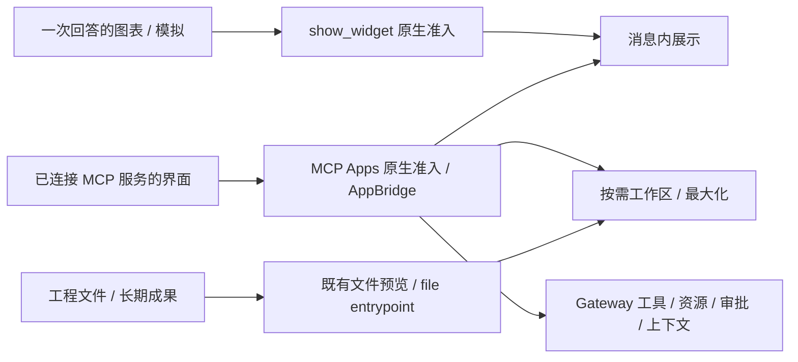
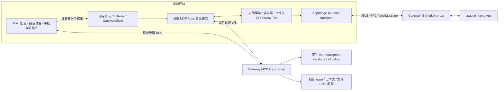

# MCP Apps 桌面宿主接入方案

实施记录（2026-10-17）：已在 `codex/mcp-apps-research` 接入标准 AppBridge、受限聊天会话接口、原生结果准入、消息/工作区视图、全局/会话/文件/设置入口、原生问题、资源搜索、模型上下文、富消息草稿和连接绑定生命周期补丁。现行契约见 [MCP Apps](../features/chat/mcp-apps.md)。下列设计中的跨文档移动由实测修正：Chromium 移动运行中的 iframe 会重载并丢失输入，因此消息 App 在原文档展开，手动/文件 App 从工作区文档开始运行。真实 App SDK 与原生 sandbox 的 Chromium 探针已验证两个父文档中的握手、初始结果、工具调用和展开保留输入。隔离真实 Gateway 的工具、审批、提问、上下文、设置、资源搜索和文件闭环已通过；安装版及真实企业服务等场景仍需人工验收。

状态：实现及自动化验证完成，人工验收待续；下文保留 2026-10-17 的 ChatGPT、Hermes Agent 与开源交互式回答调研及验收矩阵，现行接口以功能文档为准。目标包含模型返回的应用、手动入口、工具与资源交互、上下文附件、文件查看编辑、设置和富表单。最终运行时指纹与验证记录见[升级记录](../openclaw-upgrades/v2026.10.4/README.md#mcp-apps-宿主追加验证2026-10-17)：全量 10,864 项通过、66 项条件跳过；ToolSearch 追加修复后，完整聊天域 1,717 项回归通过。

建议采用 **原生 Gateway 持有 MCP 运行时，现有聊天连接提供受限接口，桌面实现 AppBridge 宿主与产品交互**。保留现有 show_widget 的准入和草稿确认规则。先验证取消、视图回收、原生问题和跨窗口通信，再铺开界面。

产品呈现确定为 **回答中的 App 默认内嵌消息；复杂操作按需进入现有右侧工作区；手动应用和文件入口直接使用工作区**。不因接入 MCP Apps 新增常驻左侧导航，不为每个工具结果自动打开侧栏。完整能力范围保持不变，展示位置按用户任务选择。

## 0. 内网部署约束与内置应用验收（2026-10-17 补充）

用户确认正式软件运行于不能访问公网的公司内网，模型也部署于内网。这是后续选型和交付的硬约束。现已实现默认开启的 draw.io 离线内置扩展，现行资源、权限和使用契约见 [离线绘图](../features/chat/drawio-offline.md)。开发产物的全新 Chromium profile、拦截公网和源文件/PNG/SVG 闭环已验证，正式安装包的企业环境验收仍需按发布流程执行。

- 默认能力的 MCP 服务、Node 依赖、HTML、JS/CSS、worker/WASM、字体、图标和布局引擎必须随安装包提供；确需服务端能力时只使用明确配置的内网服务。用户不需要公网账号、npm/pip 或首次启动下载。构建资源准备与运行时离线分别验收，下载源、缓存及准备命令统一维护于 [离线资源准备](../offline-downloads.md)。
- 应用、MCP 子进程、iframe、worker 和打开的编辑器都属于验收链路。关闭或本地替换公网版本检查、CDN、图标搜索、在线编辑跳转和远程导出；正常启动不以一次联网超时作为前置条件。不增加公网默认值，也不在内网服务失败时回退公网服务或演示数据。
- 保持现有 Renderer loopback、不可变资源校验、CSP、导航和会话权限边界；不能为第三方 App 放宽到任意资源源。离线资源方案需核对当前原生单个 MCP UI resource 的 2 MiB 上限和视图数据的 6 MiB 上限，不能直接把大型依赖全部内联或随意扩大限额。
- 历史调研基线 `jgraph/drawio-mcp` 的 `a06f00a147140131142c73084524c3e557bc3f39` 在设置本地 viewer 后仍执行启动时 CDN 版本检查，默认 HTML 及编辑跳转保留公网地址。因此当前交付采用锁定 Web 编辑器与本地标准 MCP 适配器，消息内直接编辑，未把官方在线入口或只读 viewer 当作完全离线内置能力。
- Tableau、Amplitude、Hex、Box 等依赖公网业务后端的实现作为行业参考，不纳入当前默认能力；只有实际存在且获准接入的内网后端才能作为企业集成候选。前期预算与时间示例仅证明宿主交互，图表候选的 SDK 探针仅证明协议，不构成内置应用选型或离线交付通过。

发布验收使用安装包、全新 profile、空浏览器及包管理器缓存，并在保持明确内网模型/服务可达的同时阻断公网。记录 Main/Gateway、MCP 进程和浏览器/worker 的网络请求：首次启动、XML 绘图、形状库、缩放/图层、编辑、保存/导出和工具回调均应可用且没有公网请求尝试。额外编辑器格式转换、企业模型工具行为与企业安全软件策略分别验收。内网服务断线时明确失败；恢复不能重放结果未知的写操作。开发探针不替代安装包发布验收。

## 1. 基线与范围

- 应用基线：dev 提交 3b58e5a9ea5eeaa3166324c479cb8e87112b55e1；运行时版本由 package.json 锁定为 v2026.10.4。
- 上游源码：E:/workspace/openclaw，HEAD 为 383c124cc32ffee3f8e56f549b88da94d269a4af，工作区无修改。本文上游引用固定到该提交。
- 现行约束：[架构](../architecture/02-architecture.md)、[进程模型](../architecture/03-process-model.md)、[插件系统](../architecture/07-plugin-system.md)、[聊天渲染](../architecture/15-chat-rendering.md)、[数据存储](../architecture/10-data-storage.md)。
- 现有用户流程：[Plugin Hub](../features/plugins/plugin-hub-experience.md)、[交互式回答](../features/chat/interactive-answers.md)、[独立工作区](../features/workspace/detached-workspace.md)。

“完整”覆盖下表中标准宿主和当前原生支持的插件扩展。OpenAI MCP Plugin Extensions 是附加协议，不能要求每个普通 MCP server 都声明它，也不意味着连接 ChatGPT 账号。

| 能力                   | 原生 10.4 状态                                        | 桌面交付要求                                                          |
| ---------------------- | ----------------------------------------------------- | --------------------------------------------------------------------- |
| 模型调用工具后显示 App | 已生成原生 mcpAppPreview 和有界 descriptor            | 实时、历史、Tool Search/Code Mode 嵌套结果均可显示；普通文字不能伪造  |
| 初始化、工具输入和结果 | SDK AppBridge 与原生隔离页面已有参考实现              | 正确握手，一次投递初始结果，不重复执行入口工具                        |
| App 调用工具与读取资源 | 已有同 server、当前策略和视图授权检查                 | 完整透传合法结果、错误和分页；接上原生审批与问题                      |
| 消息与模型上下文       | 已有 ui/message 和 updateModelContext 对接            | 用户确认进入产品输入流程；上下文可见、可移除、按原生回执消费          |
| 手动应用入口           | discover/launch 已有 global/thread/file/settings 类型 | 复用插件/会话菜单、工作区 Tab、文件打开方式和设置动作，不新增常驻导航 |
| 资源搜索与选择         | mention 已有结构化 resource_link 结果                 | 资源选择入口与可删除附件；与人员 @ 提及分开                           |
| 文件查看编辑           | 已有宿主签发 URI、读写、ETag 和订阅                   | 复用文件入口，明确冲突；权限由 Gateway 核对                           |
| 富表单                 | 原生 question.* 和 formResource 已支持                | 表单、默认值、多选、预览、文件/目录选择、过期与取消                   |
| 插件设置与 onboarding  | 已有服务端设置及显式 setup skill 入口                 | 设置不写成 Gateway 配置；安装不自动执行 onboarding                    |
| 重连与历史重建         | 原生可重建只读预览                                    | 不恢复旧工具授权，不重放 launch/callTool                              |
| 主题、尺寸、展示模式   | 原生 UI 已有协商实现                                  | 主窗口、侧栏、全屏和整区拆出一致；仅公告实际支持的模式                |

本期不纳入 IM 频道外部 App 链接、Tailscale 公网发布、远程 worker 文件和外部原生 harness 的新增适配。桌面先覆盖本产品使用的 embedded OpenClaw 会话；其他 harness 以实际公告和运行时能力为准，不退回另起宿主 MCP 连接。摄像头、麦克风、定位等 opaque-origin 下原生不授予的能力继续不公告。文件下载等可选能力须单独接入实际宿主处理器后再公告。

### 1.1 竞品与协议调研

以下网页和 PR 状态核对于 2026-10-17。ChatGPT 的公开文档可确认产品行为和开发协议，不能据此推断其 Intelligent UI 内部实现。两个 Open Intelligent UI 项目是各自作者的开源实现，也不能当作 OpenAI 源码。

| 对象                         | 已核实的方式                                                                                                                                                                                  | 本产品采用的设计                                                                                             |
| ---------------------------- | --------------------------------------------------------------------------------------------------------------------------------------------------------------------------------------------- | ------------------------------------------------------------------------------------------------------------ |
| ChatGPT 交互式回答           | 官方 [Visualizations][chatgpt-visualizations] 展示聊天内图表、地图、计算器和模拟；普通可视化通常是生成时信息的快照，后续提问可能产生替代版本                                                  | 对应现有 show_widget；筛选和计算留在页面本地，继续讨论使用明确输入流程；不把交互卡片解释为实时业务连接       |
| ChatGPT MCP Apps             | [UI 接入指南][chatgpt-ui] 使用标准 ui:// 资源和 MCP Apps bridge；从 inline 开始，地图和编辑画布可扩大展示，持续活动可用 PiP                                                                   | 标准 AppBridge 与 Gateway 数据面；消息内嵌作为默认，保留扩展空间的能力                                       |
| ChatGPT 插件扩展             | [Plugin Extensions][chatgpt-extensions] 明确提供 global 全局侧栏入口、thread 会话侧面板和 file 查看编辑入口                                                                                   | 手动启动应用、文件编辑需要工作区；这些入口属于附加协议，不要求每个 MCP 工具都出现一个面板                    |
| Hermes Desktop 已有实现      | [内嵌预览][hermes-inline] 将工作目录 HTML 放进消息中的 opaque iframe；[成果卡片][hermes-artifact] 由用户点击打开右侧面板；[官方桌面说明][hermes-desktop] 区分 Hide 与 Close，隐藏保留页面实例 | 借鉴轻量消息内容与持续工作区的分工、点击展开、隐藏保活；不移植其文件读取准入、成果正文缓存或隐藏用户消息机制 |
| Hermes MCP Apps 候选         | [PR #75828][hermes-mcp-pr] 描述 sandbox iframe 卡片与桥接，查询时 state=open、merged=false；[功能请求 #61095][hermes-mcp-issue] 仍开放                                                        | 作为交互案例和测试素材参考，不写成 Hermes 已发布完整 MCP Apps，也不以该 PR 替代锁定 OpenClaw 契约            |
| CopilotKit OpenIntelligentUI | [架构][copilot-architecture] 组合原生组件和 generateSandboxedUi，局部控件在 iframe 计算，明确跟进才启动新轮；其可选 MCP assembler 返回 HTML 文本，不等同于整套网页渲染运行时                  | 借鉴按任务选形态、渐进加载、真实可用控件和明确跟进；本期沿用 Gateway，不新增 AG-UI/Deep Agents 执行链        |
| Thesys Open Intelligent UI   | [作者仓库][thesys-iui] 通过 OpenUI Lang 组合受控组件，变量驱动局部计算与界面更新                                                                                                              | 说明丰富交互也可用受控组件完成；不为 MCP Apps 接入引入第二套生成语言或替换现有 Widget Kit                |

Hermes 本地只读 checkout 为 dce1e9b37581dd62e480a9064dc04a709c2940d3（2026-10-09）；另通过 GitHub 获取并核对 2026-10-17 的 main 快照 0ab43d4f67e41be75f4f6c0fa14a86dbcfd3e5b3 中上述内嵌预览、成果卡片与识别文件。当前结论只涉及读到的实现和 PR 状态，不将较旧的 inline 功能请求仍开放理解为主分支完全没有内嵌能力。PR 截图与作者测试声明也不是本产品验收结果。

两种开源交互式回答分别固定到 CopilotKit 8391a94c1c3939c679e40ddd7bfc08a9ef690e70、Thesys 6a4a0ba192ea285b3a5ed39dcc1295d7d4080d6f。它们的 agent/runtime、浏览器本地存储和样例数据策略属于各自产品，不进入本产品的会话、历史或权限所有权。

### 1.2 展示位置和入口决策

**消息区负责就地理解与快速操作，工作区负责持续查看和编辑。** 展示位置由宿主协调，同一 App 仍属于原来的会话；移到工作区不会得到新权限或启动新的模型执行。

| 场景                                   | 默认位置                                     | 扩展方式                                                                                                       |
| -------------------------------------- | -------------------------------------------- | -------------------------------------------------------------------------------------------------------------- |
| show_widget 图表、比较、计算器         | 消息内嵌，沿用现有流程                       | 本期不额外改造 Widget；不能为了共用外壳授予 MCP 工具权限                                                       |
| 模型返回的标准 MCP App                 | 消息内嵌，显示标题、加载和权限状态 | 用户在同一文档展开和返回，不跨文档移动运行中的 iframe |
| 需要边聊边操作的大表格、地图、业务面板 | 内嵌 App 在原文档展开；手动 App 使用工作区 Tab | 工作区可收起、恢复和最大化；普通结果、后台事件和偏好元数据不自行抢占工作区 |
| 手动 global/thread 应用入口            | 用户明确启动后进入当前会话工作区             | global 入口放现有插件详情/主页应用菜单，thread 入口放会话功能菜单；没有手动入口的 server 仍可返回标准 App      |
| file 查看器/编辑器                     | 文件“打开方式”进入工作区                     | 复用文件上下文、只读/可写与冲突处理；原消息只需引用文件或打开入口                                              |
| 服务设置、富表单、资源选择             | 现有插件设置、审批/问题和输入附件区域        | 按能力与任务呈现，不把所有交互都塞入 App iframe 或新建常驻导航                                                 |

ChatGPT 的 [UI 指南][chatgpt-ui-guidelines] 把内嵌卡片用于单一决策和少量操作，复杂导航进入更大视图。本产品借鉴该原则，提供紧凑标题、少量宿主动作、清晰的展开/返回和保留聊天输入；不改写第三方 HTML 强行删控件或重排其内部页面。页面密集、过高时提示展开，由 App 自身适配 host context 的尺寸和主题。

展示容器与协议 displayMode 必须分开：右侧工作区 Tab 是产品布局，不是新协议枚举。10.4 的原生 viewer/协商器只处理 inline/fullscreen；本期只对实际实现并与 App 取交集的模式公告能力。工作区停靠时报告真实嵌入尺寸，真正最大化并实现返回和输入可达性后才报告 fullscreen。不把右侧 Tab 或独立工作区冒充 PiP，不因 ChatGPT 有 PiP 就在产品中虚假公告。只有 fullscreen 可用的 App 直接进入宿主最大化视图，不能用窄侧栏假装满足契约。

同一会话、同一原生 view 只保留一个可操作实例。展开、收起和工作区拆出不能重新执行 launch 或入口工具。Chromium 探针确认跨文档移动 iframe 会重载，因此模型 App 在消息所属文档中展开，工作区 App 在创建 iframe 前进入工作区文档。隐藏保留本地表单，权限随可见性更新；切换会话使旧绑定失效并释放其展示租约，不能把隐藏与会话切换混为一谈。

### 1.3 交互与能力边界

- 本地筛选、排序、缩放和测算不新增模型轮次。App 需要新数据或业务动作时通过绑定的原生工具执行；动作结果由服务确认，不能把按钮点击或卡片更新当成业务成功。
- 选择影响后续讨论时，用标准模型上下文桥接并展示可移除附件；明确“交给助手”才进入产品输入流程。沿用用户确认加入草稿和手动发送，不复制 Hermes 的 hidden 用户轮次。
- 可复用标题栏、加载/失败状态、尺寸、主题和展开控件；Widget 文档、MCP App 和文件仍使用不同的身份与权限准入。共用视觉组件不共用任意 RPC 桥。
- 对自有 MCP 服务采用数据查询与最终渲染工具分离的 [官方建议][chatgpt-ui]，避免每次查询都新开界面。对第三方服务消费其真实契约，不自行推断或重写工具元数据。
- 业务数据与持久状态留在服务及原生所有者；本地输入留在当前 viewer。ChatGPT 的可选 widget-state、Hermes 的成果缓存和 Thesys 的 localStorage 不是本产品新增 transcript/App 状态库的依据。

## 2. 已确认的接入差异

| 差异     | 当前代码事实                                                                                                                                                                                                    | 实施影响                                                                                                                                                |
| -------- | --------------------------------------------------------------------------------------------------------------------------------------------------------------------------------------------------------------- | ------------------------------------------------------------------------------------------------------------------------------------------------------- |
| 配置保留 | [完整同步](../../src/main/openclaw/config/openclawConfigSync.ts)重新构造 mcp 为 servers；最小及合并路径也有同类对象重建                                                                                         | 只手改 mcp.apps.enabled 会被部分同步覆盖。需要统一配置合成并覆盖登录、退出、无模型及普通同步                                                            |
| 消息准入 | [native-canvas](../../src/renderer/libs/openclaw-chat/pipeline/native-canvas.ts)只为真实 show_widget 及其精确核心 dispatcher 结果授予文档读取                                                                   | MCP App 必须有独立 descriptor 准入，不能放宽现有 Widget 校验来兼容                                                                                      |
| 视图宿主 | 当前 [native-widget](../../src/renderer/libs/openclaw-chat/components/native-widget/host.ts)仅展示认证 Canvas 文档并提供受限草稿桥                                                                              | 沙箱地址校验经验可复用；现有组件不是完整 MCP AppBridge                                                                                                  |
| 请求等待 | [聊天 GatewayClient](../../src/renderer/libs/openclaw-chat/gateway/client.ts)没有 signal/逐请求等待策略，普通 RPC 固定 90 秒                                                                                    | 原生审批期限 120 秒，App 工具还可能等待问题；必须按原生工具活跃期限和人类输入等待管理请求，不能仅提高一个固定超时就宣称解决，也不能提前判失败或自动重试 |
| 原生取消 | 上游 WS 客户端 signal 仅退役本地 pending；WS 服务的 cancelOnDisconnect 列表也不包含一般 mcp.app 操作                                                                                                            | 给客户端增加 AbortSignal 不等于取消服务端工具。此处需要隔离探针决定最小原生补充                                                                         |
| 视图回收 | 原生有 releaseMcpAppView 内部函数，但当前公开 mcp.app 方法表没有 view-release/cancel-operation                                                                                                                  | DOM teardown 不等于 Gateway lease、上下文和临时审批已经回收                                                                                             |
| 审批按钮 | [ExecApprovalModal](../../src/renderer/features/cowork/components/approvals/ExecApprovalModal.tsx)对 Plugin 审批仅展示允许一次/拒绝；[shared payload](../../src/shared/security/approvals.ts)未建模原生 actions | 完整体验需表达“本视图内允许”的确切范围，不能复用宿主命令的 allow-session 或泛化成永久允许                                                               |
| 原生问题 | [runtimeGatewayEvents](../../src/main/engine/openclaw/runtimeGatewayEvents.ts)处理产品 ask-user-question 事件；没有 question.requested/resolved 对应产品交互分支                                                | MCP elicitation 不能塞进现有插件答案接口。需单独接原生 question.list/get/resolve 与富资源操作                                                           |
| 跨窗口   | 当前 [messaging](../../src/renderer/libs/openclaw-chat/components/native-widget/messaging.ts)已有实际父文档 realm 的受限发送方案                                                                                | SDK 默认 PostMessageTransport 使用模块全局 window；只替换 ownerDocument 不能解决拆出后的收发                                                            |
| 首页启动 | 原生 discover/launch 要求真实 sessionKey；产品普通创建流程目前与首次发送紧密关联                                                                                                                                | 全局入口仍须绑定普通产品会话，不能伪造一个“全局 main 会话”承载所有 App                                                                                  |

差异来自当前应用和锁定上游源码，不表示这些场景已做真实运行验收。

## 3. 接入路径选择

| 路径                                             | 评价                                                                                                                  |
| ------------------------------------------------ | --------------------------------------------------------------------------------------------------------------------- |
| 嵌入完整原生 Control UI                          | 会带入第二套导航、聊天连接、输入与文件状态，难以复用本产品会话和拆出工作区，不采用                                    |
| 打开原生 standalone shell                        | 有自己的票据和能力子集；具名 requester 不签发 bearer-only 票据，不覆盖完整会话上下文/设置/文件/审批，不作为桌面主方案 |
| Renderer 自建 MCP SDK Client                     | 将连接、OAuth、工具权限和进程清理复制到产品侧，违反原生运行时所有权，不采用                                           |
| **AppBridge + 现有聊天连接的受限 MCP Apps 接口** | **采用。** Gateway 继续持有 MCP transport、catalog、工具授权、视图、问题、上下文和文件资源                            |

上游 UI 锁定 @modelcontextprotocol/ext-apps 2.0.0、@modelcontextprotocol/client 2.2.0，和本应用已有 @modelcontextprotocol/sdk 1.x 并非同一个依赖面。实施时对齐锁定版本与实际 exports，按需加入浏览器依赖，不升级整个 MCP 栈。AppBridge 可使用 null MCP client，通过受控 handlers 转发到原生 RPC。不要把上游 UI 的 ApplicationContext、路由、主题框架整体搬入产品。

浏览器依赖需要 Vite 构建检查，确认不导入 Node/Electron；协议数据在边界验证，保留合法 _meta、structuredContent、二进制内容及空/空白分页 token。标准 MCP 结果尽量复用 SDK 校验；OpenClaw 附加 descriptor 和能力字段由版本契约集中解析。

## 4. 所有权与模块分工

| 责任                                          | 归属与约束                                                                                                      |
| --------------------------------------------- | --------------------------------------------------------------------------------------------------------------- |
| 配置、产品会话、系统文件选择、宿主打开与保存  | Main；用现有串行配置队列和受限 IPC，不把 Gateway token 或任意路径访问交给 App                                   |
| MCP Apps 会话数据面                           | 既有聊天 Controller 内的受限接口；React 消费 typed operations，不取得裸 token、任意 request 或新 Gateway client |
| 入口列表、launch 状态、上下文 chips、App 面板 | Renderer feature 域；只有有界且连接绑定的展示状态                                                               |
| 聊天 descriptor 投影与内联组件                | openclaw-chat pipeline/components；沿用真实原生事件和历史                                                       |
| Tab 排序、选择、收回与拆出                    | Cowork display；App 内容放能力域，文件浏览入口仍归 preview                                                      |
| MCP 连接、工具、授权、视图和文件资源          | Gateway；不在 Main 创建另一套 MCP Runtime                                                                       |
| 持久内容                                      | 原生 transcript / server 自有设置；产品不保存 App HTML、完整结果、form 答案或模型上下文副本                     |

建议实现入口为 renderer/features/mcp-apps/、libs/openclaw-chat/gateway/ 下的会话适配、components/mcp-app/ 和 pipeline/native-mcp-app。共享序列化契约归 shared/plugins/mcpApps；Main 新增逻辑归现有 plugins/mcp、IPC、配置及原生交互所属域。所有新标识用 mcpApps/mcp-app 等能力名称，不增加产品品牌前缀；不把整个 Controller 注入 feature。

每个操作读取实时 context，绑定产品 session ID、canonical sessionKey、原生 session incarnation、agentId、client/连接 generation 和当前 viewId。App 仅提供工具参数或资源 URI；sessionKey、agentId、viewId 由宿主绑定，先剥离 App 输入中的同名路由字段再组装 RPC。异步前后以及提交前重新核对，避免切会话、同 key 换 SID或连接替换后提交旧动作。

## 5. 核心交互链

### 5.1 模型产生的 App

1. 在真实 Tool 事件/历史结果中读取 details.mcpAppPreview；核对 descriptor 的 server/tool/resource/tool-call 归属、view ID 一致和错误状态。
2. Tool Search/Code Mode 从可信原生嵌套结果进入同一解析器，不递归搜索任意 JSON，不接受 assistant 文本、普通 embed 或同名工具伪装。
3. 用绑定的 session 调 mcp.app.view，认证读取 HTML、初始输入/结果及能力；不从 descriptor 拼接 HTML URL。
4. 创建独立 App viewer，等待 proxy-ready、AppBridge 初始化后投递初始 tool input/result。仅 UI 重挂载不再调用入口工具。
5. 刷新和 Gateway 重启后的恢复以原生结果为准；只读重建不提供工具、资源、消息、模型上下文或文件写能力。结果元数据不够时明确提示不可恢复。

默认展示与单实例切换遵循第 1.2 节。frame 真正销毁后的本地表单值不承诺恢复；原生只读重建也不能用产品保存的 HTML 或表单快照绕过。

### 5.2 手动入口与会话准备

应用入口来自 mcp.app.discover，按真实 server/entrypoint 展示，不从 Plugin Hub 的“已安装”推断支持 Apps。同一普通 MCP 即使没有手动 entrypoint，也可能通过模型工具产生标准 App。

global、thread、file 和 settings 入口统一按原生发现结果在已有会话中显示；目录为空时不显示“应用”按钮，首页不提供通用应用入口。用户启动 global/thread 后进入工作区 Tab；不为每个 MCP server 自动增加左侧图标或空 Tab。global 表示入口类型，不表示脱离会话的运行权。入口发现不创建空会话或发起模型请求；具体权限/root 准备仍沿用现有会话流程。

launch 会调用真实入口工具，而且当前原生没有 launch 幂等键。每次用户动作只发一次；React StrictMode、Tab 重挂载、断线恢复都不能重新 launch。超时或失联显示结果待核对，不自动再次打开。已知 viewId 可重新读取；丢失接收结果时不能据此断言入口工具没运行。

### 5.3 App 工具调用、审批和问题

AppBridge 的 tools/call、tools/list、resources/* 仅通过绑定接口进入同 server 原生 owner。App-only 工具不加入模型目录；catalog 元数据不构成权限。原生仍检查当前 server、session toolOverrides、permissionMode、原始视图工具集合与 requester。

审批继续使用现有 plugin approval owner。MCP 视图的 allow-always 只表示“当前视图内的这个 server/tool”，不写持久配置，不授权模型调用。首个 launch 还没有 view，原生仅允许一次/拒绝。UI 和 shared 合约需要保留受验证的原生 decision actions；其他插件与 exec 审批不扩大可选动作。

MCP 工具可在等待中提出原生 question。Main 连接已有 operator.questions scope，可以在其现有交互域订阅 question.requested/resolved、重连 question.list，并通过明确的 get/resolve/formResource IPC处理当前产品会话。沿用原生 question ID、request ID、view ID、questionId 和到期时间；不将它转换为产品 ask-user-question 的请求 ID。取消、工具结束或过期后不能提交默认答案。

富表单要覆盖原生 presentation、defaultAnswers、allowEmpty、lines、多选及资源字段。预览可触发 MCP 工具，不按纯文件读处理；上传仅接受用户选择并经 Main 校验的内容，继续由原生 formResource 及当前问题权限接收。URL/secret 类字段只在对应已有安全交互确实实现时公告，不降级为普通日志或文本缓存。

### 5.4 消息和模型上下文

ui/message 先显示宿主预览并取得用户确认，再进入现有 composer 流程；默认“加入当前草稿”，保留已有正文与附件，最终发送仍由用户操作。返回成功只表示产品输入层已经接管，不能把 DOM 事件发出当作接管成功。target:new 等附加请求需显式选择新会话，并使用正常产品创建流程；不默默切走当前会话。现有 show_widget 草稿确认不变。

updateModelContext 由 Gateway保存有界快照，Renderer只显示按 client/session/view/updateId 绑定的可删除 chips。无需把同一内容再拼成产品私有 prompt 或另存草稿正文。删除调用 removeModelContext并携带当前updateId，不能删除稍后到达的新选择。

原生在实际执行输入处 lease/commit/rollback 上下文：已接收不等于马上消费，排队期间可能变化；UI 依照 hostContextChanged 和重读结果更新，不在点击发送时先清空。必须验证产品 delegated first send、普通续发、排队输入、失败与 Goal 续跑各自的消费时点，保证用户看见的选择与实际输入一致，旧提交不能清除更新的选择。

### 5.5 文件查看、编辑和设置

现有文件树/预览的“打开方式”按 discover 的 file entrypoint 筛选。宿主只提交当前产品会话内选定文件；Gateway prepareMcpAppHostFile 签发 openclaw-file:// opaque URI，App不能据此读取整个工程。读、写、订阅和 openFile 继续核对精确 session/root/requester；不走产品通用任意文件 IPC。

支持文本和 blob，传递 writable、ETag 与 resourceUpdated。App 提供 ifMatch 时原生返回 saved/conflict/too-large；没有 ifMatch 是原生允许的无条件保存，不能伪称所有第三方编辑器都具备冲突保护，也不偷偷替第三方补写版本。内置示例和验收 App 必须验证条件保存。与现有 Monaco 草稿同时编辑时保留未保存内容，由文件预览 owner提示外部修改。

settings 的 read/update/tool 由 server 自己拥有。产品只渲染其已公告的有界 schema/layout，不把这些值写进 mcp.servers 或产品设置。onboard 只在用户明确选择“运行设置向导”时走已准备会话和正常运行回执；发现、安装和重新打开 App 均不自动调用。

## 6. RPC 与宿主边界

| 宿主操作           | 原生接口                                                                            | 必须保留的语义                                                                                     |
| ------------------ | ----------------------------------------------------------------------------------- | -------------------------------------------------------------------------------------------------- |
| 能力发现/启动      | mcp.app.discover / launch                                                           | session 必填，按公告 entrypoint；discover 也是 operator.write 和 session-scoped 操作，可能准备连接 |
| 设置/资源搜索/向导 | mcp.app.settings / mention / onboard                                                | server-owned 设置；结构化资源；向导属于真正 chat.send，携带原生幂等与运行回执                      |
| 读取视图           | mcp.app.view                                                                        | HTML/初始结果/能力只在绑定 viewer内存中；只读恢复不能升级权限                                      |
| 工具与资源         | mcp.app.callTool / listTools / listResources / listResourceTemplates / readResource | 保留 _meta、isError、合法内容和原生分页；只访问 owning server                                      |
| 上下文             | mcp.app.updateModelContext / modelContext / removeModelContext                      | 精确 updateId、原生消费回执；6 MiB 为原生 runtime 级上限                                           |
| 文件               | mcp.app.writeResource / subscribeResource / unsubscribeResource / openFile          | opaque URI、读后写准入、可选 ifMatch、事件解除                                                     |
| 交互               | plugin.approval._、question._、mcp.app.formResource                                 | 审批和答案由原生 manager 拥有；原生 allow-always 不等于产品 allow-session                          |
| 变更事件           | mcp.app.hostContextChanged / resourceUpdated、config.changed                        | 校验当前 client/session/view；重连以重新读取收敛                                                   |

接口表是已存在的10.4能力，不含尚未实现的取消/视图释放RPC。具体 operator scopes 以原生 core-descriptors为准。产品 Main处理审批/问题；不为方便把 operator.approvals/questions token或任意RPC能力交给 iframe。

## 7. 沙箱、SDK 与跨窗口

沿用原生专用 sandbox listener 和双 iframe结构。默认端口可能为Gateway端口加一，但实际加载必须使用认证 view响应中的sandboxPort/Origin，不自行计算。独立origin不能是产品主页面origin；沿用严格 URL、path、csp/version 参数和无凭据校验。App HTML上限2 MiB，CSP由原生资源元数据决定；不通过给Renderer加unsafe-inline、开放任意导航或给App加preload解决加载问题。

SDK v2的PostMessageTransport在start/close中直接使用全局window，send也从调用realm发出，并包含完整消息的debug输出。产品侧栏是同源workspace文档中的portal：主Renderer模块的window和iframe真实父窗口可能不同。建议复用SDK AppBridge，但提供符合其Transport接口的McpAppFrameTransport：

- 在frame.ownerDocument.defaultView上监听并核对source、准确的proxy origin和当前mount；JSON-RPC使用SDK schema验证。
- 发送从实际父文档可信模块执行。为MCP App建立按frame/mount注册的受限通道，不将当前只接受四类Widget消息的helper扩大为任意跨窗口postMessage入口。
- 在可信宿主模块内完成SDK协议/请求表管理，不让App提供Gateway方法名、连接凭据或目标窗口。
- transport不记录RPC正文；同时审计SDK其他日志入口，不通过全局替换console掩盖泄漏。MCP凭据与OAuth继续由既有原生连接和Main配置管理，不进入App/frame通道。
- OwnerDocumentContext负责观察器、焦点、确认条、主题和尺寸；拆出/收回移动同一viewer，不重新launch。
- 导航、重连、切会话、真正Tab关闭后撤销旧mount，拒绝迟到消息。产品全屏沿用工作区最大化，补齐当前聊天输入可达和返回动作；未实现前不公告fullscreen。协商和布局按第1.2节处理，不把停靠位置或拆出窗口当作新模式。

App请求外链继续走现有受控打开策略；拒绝javascript、file、凭据URL和宿主导航。App相对deep link只在原生公告且通过当前绑定验证时路由，不把普通链接解释为应用命令。

## 8. 生命周期与需要先验证的原生缺口

S0先以产品现有的token/device握手验证discover/launch取得原生sessionAccessAuthority。上游将这些方法声明为profileAccess required与session-scoped写操作；本地operator.admin作用域不能被当作已经取得会话授权的证明。保留当前原生system/operator身份路径，不为接入增加伪造profile或绕过session权限的fallback。

原生视图是固定十分钟内存lease；每视图最多四个并发请求，每分钟120请求/30工具调用。视图总数32、单视图数据6 MiB、全局64 MiB。产品不复制这些限额为另一套授权规则，UI只提供有界挂载与清晰错误。

| 事件                              | 产品行为                                                                        |
| --------------------------------- | ------------------------------------------------------------------------------- |
| Tab 暂时不可见                    | 保留已打开App本地状态；不允许其抢占输入、打开文件或发起消息确认；不新增后台轮询 |
| 工作区拆出/收回                   | 保持同一个展示与视图身份；监听和发送归实际文档                                  |
| 视图到期/原生拒绝                 | 标记不可交互，撤销旧确认；提供明确用户发起的重新打开，不重试入口工具            |
| Gateway断连/替换                  | 停止新操作，所有旧响应失效；只读重建或用户重新启动，不重放有副作用请求          |
| 原生同key换SID、权限或catalog变更 | 旧操作不得取得新owner；重新发现及准备，保留实际失败                             |
| 真正关闭App                       | 停止本地桥与订阅，结束对应确认；尝试移除已知精确上下文；临时授权和视图按原生租约回收            |
| 工具响应超时且可能已执行          | 显示结果待核对；不重试工具/launch/保存，不用chat.abort扩大停止范围              |

S0必须在独立Gateway与合成MCP server中回答两个问题：

1. **请求取消是否到达原生工具和问题等待。**当前证据表明WS本地abort仅结束等待，而standalone HTTP的断开传播有独立实现，不能将后者的测试结论套到桌面WS。需要覆盖等待审批、等待问题、catalog刷新和工具执行中的取消，区分已提交副作用。
2. **关闭view能否撤销“本视图内允许”和待消费上下文。**当前UI teardownResource只是AppBridge握手，公开RPC无release，内部lease仍可存活。不能把关闭frame等同于释放原生授权。

2026-10-18 已完成源码与公开 SDK 审计，并按用户选择移除原 MCP Apps 生命周期补丁 030，接受原生生命周期：关闭停止本地交互并尝试精确上下文清理，已发出操作可能继续；临时授权和视图由原生租约到期回收。普通 MCP Apps 功能继续使用原生 WS，不切换到缺少富扩展的 standalone HTTP。具体契约、证据和每次升级核对项见 [现行功能文档](../features/chat/mcp-apps.md#原生接口与插件替代审计)。多窗口不采用宿主私有释放器；关闭一个视图不宣称撤销其他展示。

## 9. 配置、数据与发布

mcp.apps.enabled 使用显式产品设置和现有 Main 配置/KV、串行应用流程；读取并保留已有明确的原生 enabled 选择，未配置时开启以支持内置 draw.io。设置只控制宿主交互能力，手动入口仍由 MCP 服务声明，不绑定 Widget Kit 插件开关，也不新增必须安装的产品 MCP 代理插件。

统一合成mcp对象，覆盖完整、最小、登录/退出及恢复分支：管理enabled，保留sessionIdleTtlMs、既有server和明确的可选状态。sandboxPort/Origin由受支持的宿主配置和原生结果决定，不加入公网默认值。已有自定义但当前桌面不支持的origin应明确报错，不默默改写为可用。

gatewayConfigReloadMonitor已将mcp.apps列为restart。保存后沿用现有配置应用、重启与回读确认，活动执行期间不以静默重启换取即时生效。端口冲突、Apps关闭或listener未启动须区分，不以Widget沙箱曾经可用判断MCP Apps就绪。

不新增App状态数据库。产品可保存开关和必要的UI入口偏好；App HTML、工具输入结果、原生问题、上下文快照和临时授权不能进入产品SQLite/Redux持久缓存。tab内存保存入口与view引用仅用于当前连接，不把十分钟lease序列化成跨重启有效的授权。

发布检查包括SDK浏览器包、原生sandbox shell、静态资源哈希、CSP、loopback来源、中文/空格路径和安装版workspace入口。不得仅以开发Vite页面成功宣称安装版可用。

## 10. 分阶段实施

各阶段累积到第1节的完整范围；完成前两阶段不能称为完整MCP Apps。

| 阶段                  | 交付                                                                                                        | 结束条件                                                               |
| --------------------- | ----------------------------------------------------------------------------------------------------------- | ---------------------------------------------------------------------- |
| S0 契约与生命周期探针 | 版本契约、合成server/App、WS取消/视图回收/跨realm原型、展示切换与表单保留、普通会话无发送准备               | 原生缺口与iframe重载有直接证据及确定处理；无需接真实企业账号           |
| S1 标准App闭环        | 配置、真实结果准入、AppBridge、消息内嵌/用户展开/最大化协商、工具/资源、原生审批与基础elicitation、只读恢复 | 一次入口/多次交互/断连恢复可用，业务动作不重复，旧frame不能影响新会话  |
| S2 插件入口与输入     | discover/launch、现有菜单与工作区Tab、settings、mentions、上下文chips、确认到草稿、显式onboarding           | 手动与模型入口共用owner；无常驻新导航和自动抢占；不丢原草稿            |
| S3 文件与富表单       | 文件打开方式、读写/冲突/订阅、资源预览/上传、完整问题生命周期                                               | 文件权限及并发编辑通过；表单过期和取消无迟到提交；原生持续授权范围清楚 |
| S4 桌面与企业验收     | 安装版、拆出工作区、真实业务server与内网模型、故障恢复及文档归档                                            | 用户关键场景逐项留证，更新现行功能/架构并移除已完成计划                |

不估固定工期：S0的原生取消/展示lease结果会直接改变改动范围。其余主要工作在Renderer宿主、现有配置与交互适配，后端工具执行不重建。

## 11. 验证矩阵

实现阶段按改动执行focused Vitest及构建检查；非trivial合入前执行仓库要求的lint/build/test。原生探针必须使用独立state、端口和合成内容，不连接或启动用户Gateway，不直接读取用户transcript。

| 场景                        | 必须观察的结果                                                                                 |
| --------------------------- | ---------------------------------------------------------------------------------------------- |
| 标准App，无OpenAI扩展元数据 | 模型工具可产生App；无手动入口不误报不兼容                                                      |
| 展示模式和入口              | 默认内嵌；fullscreen-only可显式打开；不公告PiP；模式请求返回真实结果；后台结果不自动打开工作区 |
| 局部交互和跟进              | 筛选、计算不新增模型轮次；业务操作经过原生策略；交给助手只进入可见且确认的输入流程             |
| 展开、返回、隐藏和关闭      | 同一可操作实例；返回消息锚点；不重复launch；保留本地输入需实测，隐藏不冒充原生回收             |
| 入口工具与重挂载            | 初始化收到原始input/result；StrictMode/拆出/Tab切换不重复调用                                  |
| descriptor伪造              | assistant文字、同名MCP工具、任意JSON、错server/toolCall/session被拒绝                          |
| 工具策略                    | App-only不暴露给模型；换server、禁用server、撤销grant和旧SID均拒绝                             |
| 审批                        | 一次/视图内/拒绝的作用域准确；过期和关闭不变成允许；其他exec行为不变                           |
| 原生问题                    | 断线重读pending；重复/过期答案拒绝；资源预览与上传只属于精确问题                               |
| 首页文件 App 原生问题       | 待实现；以窗口+预览 requestId 查验自有原生会话，再接入列表、回答、资源预览/上传及侧栏问答；不新建产品聊天，不接收任意 sessionKey；当前两插件无此依赖 |
| 等待与取消                  | 超过90秒的人类等待不被旧客户端期限截断；分别验证本地退出和原生收尾                             |
| 模型上下文                  | 更新、移除、发送、排队、失败、Goal续跑、重连；旧updateId不清新选择                             |
| 文件                        | 文本/二进制、ifMatch冲突、只读、越界、链接、root变更、超额、订阅清理                           |
| 视图恢复                    | 十分钟到期、32视图淘汰、缺失_meta和Gateway重启；恢复只读且不重新调用工具                       |
| 启停与配置                  | 完整/最小/登录/退出同步保留正确配置；关闭Apps后没有旧功能继续公告                              |
| 独立工作区                  | 实际点击与表单、主题、尺寸、主窗口最小化、往返移动；同一App不会重新launch                      |
| 安装版                      | packaged HTTP/ASAR/不可变资源/端口冲突/中文与空格路径全部走真实链路                            |

可参考上游已有测试场景，但不能将上游通过记录写成本产品通过：
server-methods/mcp-app-extensions.test.ts、mcp-app-host-files.test.ts、mcp-app-reconstruction.test.ts、
mcp-app-tool-approval.test.ts、server-methods/mcp-app.elicitation-timeout.test.ts，
以及ui/src/e2e/mcp-app-conformance.e2e.test.ts。后者混合Control UI与standalone传输，尤其需要逐场景核对适用范围。

## 12. 源码证据与当前结论

### 12.1 锁定运行时

上游均为383c124cc32ffee3f8e56f549b88da94d269a4af：

- [原生能力、授权与限制][oc-guide]；[标准MCP Apps概览][mcp-overview]。
- [RPC与view能力返回][oc-rpc]；[发现、启动、设置和资源搜索][oc-extensions]；[方法scope表][oc-methods]。
- [view lease、限制和原生上下文消费][oc-view]；[上下文快照与commit/rollback][oc-context]。
- [工具审批][oc-approval]；[工具/资源执行与elicitation][oc-operations]；[文件读写和订阅][oc-files]。
- [历史重建][oc-restore]；[富表单资源][oc-forms]；[插件扩展元数据][oc-metadata]。
- [上游viewer][oc-ui-view]、[bridge handlers][oc-ui-bridge]；[UI依赖版本][oc-ui-package]。
- [WS本地pending取消][oc-pending]、[WS请求生命周期][oc-dispatch]；[standalone票据及HTTP取消][oc-standalone]。
- [SDK v2.0.0 AppBridge][sdk-bridge]与[默认postMessage transport][sdk-transport]。

### 12.2 公开产品与参考实现

- ChatGPT：[交互式可视化][chatgpt-visualizations]、[MCP UI接入][chatgpt-ui]、[UI指南][chatgpt-ui-guidelines]和[插件扩展入口][chatgpt-extensions]。网站内容以2026-10-17读取结果为准；没有用第三方复刻推断ChatGPT内部协议。
- Hermes：[官方桌面文档][hermes-desktop]、固定main快照的[内嵌HTML][hermes-inline]与[成果卡片][hermes-artifact]，以及查询时未合并的[MCP Apps PR][hermes-mcp-pr]与[需求][hermes-mcp-issue]。
- CopilotKit：[固定版本架构][copilot-architecture]和[交互行为][copilot-behavior]。Thesys：[固定版本README][thesys-iui]。两个项目是不同实现；它们都不构成本产品已接入标准MCP Apps的证明。

公开产品结论来自文档、协议和源码调研，未运行 ChatGPT/Hermes 的账户界面验收。实现已加入现有 worktree；SDK 与两个父文档的 Chromium 探针已通过，针对性测试已通过，完整回归与人工验收分别留证。030 生命周期补丁已按用户选择移除，使用原生关闭语义；此前补丁测试不再代表当前实现。完整运行时重建与真实 Gateway 集成已通过；全量检查及安装版/企业服务场景分别留证，未完成项继续保留在本矩阵，不能将源码实现或原型探针替代验收。

[oc-guide]: https://github.com/openclaw/openclaw/blob/383c124cc32ffee3f8e56f549b88da94d269a4af/docs/cli/mcp/apps.md
[mcp-overview]: https://modelcontextprotocol.io/extensions/apps/overview
[oc-rpc]: https://github.com/openclaw/openclaw/blob/383c124cc32ffee3f8e56f549b88da94d269a4af/src/gateway/server-methods/mcp-app.ts
[oc-extensions]: https://github.com/openclaw/openclaw/blob/383c124cc32ffee3f8e56f549b88da94d269a4af/src/gateway/server-methods/mcp-app-extensions.ts
[oc-methods]: https://github.com/openclaw/openclaw/blob/383c124cc32ffee3f8e56f549b88da94d269a4af/src/gateway/methods/core-descriptors.ts
[oc-view]: https://github.com/openclaw/openclaw/blob/383c124cc32ffee3f8e56f549b88da94d269a4af/src/agents/mcp-ui-resource.ts
[oc-context]: https://github.com/openclaw/openclaw/blob/383c124cc32ffee3f8e56f549b88da94d269a4af/src/agents/mcp-app-model-context.ts
[oc-approval]: https://github.com/openclaw/openclaw/blob/383c124cc32ffee3f8e56f549b88da94d269a4af/src/gateway/mcp-app-tool-approval.ts
[oc-operations]: https://github.com/openclaw/openclaw/blob/383c124cc32ffee3f8e56f549b88da94d269a4af/src/gateway/mcp-app-operations.ts
[oc-files]: https://github.com/openclaw/openclaw/blob/383c124cc32ffee3f8e56f549b88da94d269a4af/src/gateway/mcp-app-host-files.ts
[oc-restore]: https://github.com/openclaw/openclaw/blob/383c124cc32ffee3f8e56f549b88da94d269a4af/src/gateway/mcp-app-reconstruction.ts
[oc-forms]: https://github.com/openclaw/openclaw/blob/383c124cc32ffee3f8e56f549b88da94d269a4af/src/gateway/mcp-app-form-resources.ts
[oc-metadata]: https://github.com/openclaw/openclaw/blob/383c124cc32ffee3f8e56f549b88da94d269a4af/src/agents/mcp-app-extension-metadata.ts
[oc-ui-view]: https://github.com/openclaw/openclaw/blob/383c124cc32ffee3f8e56f549b88da94d269a4af/ui/src/components/mcp-app-view.ts
[oc-ui-bridge]: https://github.com/openclaw/openclaw/blob/383c124cc32ffee3f8e56f549b88da94d269a4af/ui/src/components/mcp-app-bridge.ts
[oc-ui-package]: https://github.com/openclaw/openclaw/blob/383c124cc32ffee3f8e56f549b88da94d269a4af/ui/package.json
[oc-pending]: https://github.com/openclaw/openclaw/blob/383c124cc32ffee3f8e56f549b88da94d269a4af/packages/gateway-client/src/pending-request.ts
[oc-dispatch]: https://github.com/openclaw/openclaw/blob/383c124cc32ffee3f8e56f549b88da94d269a4af/src/gateway/server/ws-connection/authenticated-request-dispatch.ts
[oc-standalone]: https://github.com/openclaw/openclaw/blob/383c124cc32ffee3f8e56f549b88da94d269a4af/src/gateway/mcp-app-standalone.ts
[sdk-bridge]: https://github.com/modelcontextprotocol/ext-apps/blob/v2.0.0/src/app-bridge.ts
[sdk-transport]: https://github.com/modelcontextprotocol/ext-apps/blob/v2.0.0/src/message-transport.ts
[chatgpt-visualizations]: https://learn.chatgpt.com/docs/visualizations
[chatgpt-ui]: https://developers.openai.com/plugins/build/chatgpt-ui
[chatgpt-ui-guidelines]: https://developers.openai.com/plugins/concepts/ui-guidelines
[chatgpt-extensions]: https://developers.openai.com/plugins/build/extensions
[hermes-desktop]: https://hermes-agent.nousresearch.com/docs/user-guide/desktop
[hermes-inline]: https://github.com/NousResearch/hermes-agent/blob/0ab43d4f67e41be75f4f6c0fa14a86dbcfd3e5b3/apps/desktop/src/components/assistant-ui/inline-preview-directive.tsx
[hermes-artifact]: https://github.com/NousResearch/hermes-agent/blob/0ab43d4f67e41be75f4f6c0fa14a86dbcfd3e5b3/apps/desktop/src/components/assistant-ui/artifact-card.tsx
[hermes-mcp-pr]: https://github.com/NousResearch/hermes-agent/pull/75828
[hermes-mcp-issue]: https://github.com/NousResearch/hermes-agent/issues/61095
[copilot-architecture]: https://github.com/CopilotKit/OpenIntelligentUI/blob/8391a94c1c3939c679e40ddd7bfc08a9ef690e70/docs/architecture.md
[copilot-behavior]: https://github.com/CopilotKit/OpenIntelligentUI/blob/8391a94c1c3939c679e40ddd7bfc08a9ef690e70/docs/interactive-answers.md
[thesys-iui]: https://github.com/thesysdev/open-intelligent-ui/blob/6a4a0ba192ea285b3a5ed39dcc1295d7d4080d6f/README.md
