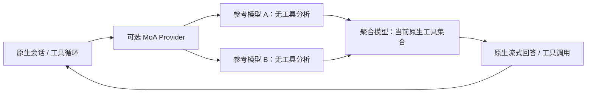

# MoA 独立扩展实施与交接方案

状态：待实现。公开 SDK 接口曾做源码与打包声明核对，尚未完成 MoA 原型；实施前重新核对当前锁定版本。

## 1. 接手方式与目标

实施前读取本文和仓库 AGENTS.md，依据当前分支与 `package.json.openclaw.version` 确认基线，在独立 worktree 验证公开 Provider SDK 完整调用链后再实现默认关闭的扩展。本文路径相对仓库为 `docs/plans/moa-extension-plan.md`，不依赖某台机器的绝对工作树路径、已合并提交或仍在开发的旧分支。不要顺带修改 Team 工具、群调度、数据库和 UI。

以下 `src/plugins/`、`src/plugin-sdk/`、`extensions/deepseek/` 指锁定 tag 的上游 OpenClaw 源码路径，不是本应用 `src`。上游 checkout 位置由实际环境决定；同时核对发布包 SDK，不修改用户正在使用的运行时。

目标：让用户按需把一个模型选择替换为“多个参考模型分析，再由一个聚合模型回答”的预设。普通会话可以使用，助手和团队可以复用；不创建群聊，不新增 Agent Team 模式，不引入 Hermes 运行时。

## 2. 用户操作与界面

1. 插件 → 扩展中提供“多模型聚合（MoA）”，默认关闭，明确它会额外调用参考模型。
2. 扩展配置页创建预设，如“方案比较”“复杂诊断”。每个预设包含稳定 ID、名称、参考模型列表、聚合模型及失败策略。P0 建议限制 1–3 个参考模型，拒绝重复或递归的 MoA 模型引用。
3. 模型选择器显示已启用且可用的预设，清楚标为 `MoA · 预设名称`。聚合模型是实际执行模型，显示其名称与提供方，不能让用户误以为原模型的订阅或费用仍覆盖整个执行。
4. 选中预设只影响后续模型调用，不重写历史、迁移会话、改变权限或创建另一个 main。开启扩展本身不自动切换当前模型。
5. 主会话保留一个最终回答。可展开本轮参考意见及状态，显示哪些模型成功、失败或取消。没有获得真实用量时显示“用量不可用”，不能用聚合模型单独的 usage 冒充总费用。
6. P0 先做预设选择。单次 `/moa` 是后续便利入口：仅本次用户回合启用，之后恢复原选择；必须沿用原生会话与命令能力验证，不通过改写用户正文实现隐藏切换。

配置编辑不会改变正在执行的调用：每个原生 run 绑定配置快照与版本。删除或禁用预设后，历史仍可读取；后续使用不可用预设要明确报错，不悄悄切换模型或再次发起已执行的任务。

## 3. 执行语义

- 参考模型只接收明确投影的必要上下文，P0 采用用户/助手文本；不默认转发完整 system prompt、密钥、工具结果或插件内部状态。需要工具证据时先明确设计受控投影，不能靠扩大隐式上下文解决。
- 参考模型没有执行工具，输出全部作为不可信参考材料。保留提供方和模型归属，将其放入独立的当次尾部上下文，不能伪装成用户新授权、系统规则或正式会话发言。
- 聚合模型保留当前原生 system prompt、工具集合、审批与会话身份；只有它的输出可生成工具调用。参考文本中的工具 JSON、指令或审批话术不具备执行意义。
- 默认每个用户回合征询一次，后续工具循环复用当轮参考意见。缓存仅限对应原生 run/用户回合的内存，停止或结束即释放；不重写前缀历史，不建立 Main/Redux transcript 缓存。
- “用户回合”必须来自原生执行身份，不能用用户文本散列、最近一条消息时间或 sessionKey 猜测。若公开 Provider 回调无法获得该身份，P0 不能宣称一次征询语义已成立：先验证公开 run context，必要时采用明确的一次调用能力并说明边界，避免自动退化为每工具迭代重复收费。
- P0 不实现多层辩论、自动轮询、自动选择贵价模型或参考模型执行任务。多参考模型不保证答案更正确，要保留分歧和信息缺口。

## 4. OpenClaw 扩展接入候选与验证门槛

v2026.9.8 源码 `src/plugins/provider-plugin.types.ts` 提供 `createStreamFn` / `wrapStreamFn`，公开插件支持注册 Provider。`src/plugins/provider-transport.types.ts` 描述 transport 创建与封装；原生 DeepSeek 扩展演示了 `defineSingleProviderPluginEntry` 与 `wrapStreamFn`。打包 SDK 中也存在这些声明。

推荐候选是独立 `openclaw-extensions/moa/`，注册虚拟 Provider，预设作为虚拟模型映射。优先使用公开 SDK 完成模型解析、鉴权与聚合模型 transport；把聚合模型正常的协议、重放策略和工具兼容保留下来。不要仅复制其 modelId 并假设不同提供方协议等价。

公开签名存在只证明可尝试，不证明下列链路成立。实施第一阶段必须用真实打包 Gateway、本地 fixture Provider 验证：

| 门槛       | 必须验证的事实                                                                                                  |
| ---------- | --------------------------------------------------------------------------------------------------------------- |
| 模型与鉴权 | 虚拟 Provider 能解析参考/聚合模型，各自使用已配置提供方鉴权，支持有效 SecretRef；不会用虚拟鉴权覆盖真实模型凭据 |
| 协议与工具 | 聚合模型保留正常工具流，工具调用仅执行一次；参考模型不能发起工具；不误递归进入 MoA                              |
| 回合身份   | 获得原生 run/用户回合身份，默认一次参考征询在多次工具迭代中成立，两个并发会话不共用参考结果                     |
| 流式输出   | 参考阶段进度、聚合 token、thinking、tool-call 增量与最终终态遵循原生合同，首 token 等待不伪装为失联             |
| 停止       | 用户停止传播至全部参考请求与聚合请求，延迟返回不能重新执行或覆盖新 run                                          |
| 使用量     | 所有成功/失败调用的可用 usage 有明确归属；没有真实计费证据时不能显示虚构总成本                                  |
| 权限       | Plan、只读会话、禁用工具总结等仍按原生当前策略限制聚合模型，不能恢复完整工具集合                                |

本计划目标是不新增运行时补丁。如果公开 SDK 无法满足关键门槛，先记录具体缺口和可复现探针，不导入私有 `dist` hash 模块、不修改 Gateway 源码，也不把未经证明的方案标为完成。

## 5. 产品与数据边界

- 扩展拥有 MoA 算法、原生 Provider 注册及服务生命周期；Main 拥有产品配置同步、启停、必要状态投影和凭据引用。Renderer 只使用 preload，不直接调用模型 API。
- 配置继续复用现有提供方与模型选择机制，用户无需为同一模型再录入一套密钥。秘密留在已有主进程安全存储与 restricted SecretRef 文件中，不写进扩展普通 JSON、日志、Redux 或 IPC 返回。
- 将 preset 配置与实时 run 状态区分开。使用版本化配置和封闭状态字段，校验模型 ID、数量、递归、超时边界以及禁用状态。
- OpenClaw 拥有 durable transcript。参考输出的长期展示必须先证明公开的原生消息/扩展投影能力；若无法安全挂靠原生 run，则 P0 只提供本轮临时展示，刷新后明确不可用，不另建产品正文表。
- 不从 transcript 文件或原生 SQLite 私自读写。不要把 API Key、完整请求头、prompt 原文或参考意见写进诊断日志。
- 原生历史中虚拟模型身份与实际聚合模型的关系需要可追踪，但不改写旧消息。扩展禁用后现有历史与诊断仍可读。

## 6. 失败、取消与费用策略

P0 显式选择两种失败策略：`strict`（任何必需参考失败就结束）与 `partial`（至少一个参考成功才继续，并声明缺席模型）。全部参考失败时默认失败；“退回纯聚合模型”如提供，必须独立显式配置和明确显示，不能默默执行。

参考模型调用可以并行，数量有上限。单请求沿用提供方原生超时/取消语义；MoA 如设等待预算，需要区分忙碌与失去进展。失败不是重新生成所有成功参考的理由。凭据失效、未知模型等终态错误不反复重试。

聚合请求若已经输出工具调用或产生未知外部副作用，不能因为参考失败、连接断开或 UI 重试而自动重放整个任务。沿用 OpenClaw 原生 run/retry 合同，并测试重试是否会重复征询参考模型。

界面提示增加延迟与额外模型调用。费用展示以实际调用 usage 和可用价格为依据，价格未知或订阅不可计价时明确标识。使用与停止策略不能依赖模型自行遵守。

## 7. 分阶段实施

1. **SDK 原型**：一个参考模型、一个聚合模型、本地 fixture，无 UI。通过第 4 节全部关键门槛后记录机器结果。
2. **扩展与配置**：默认关闭、预设管理、模型选择器映射、SecretRef、打包清单、禁用/删除处理。核对资源同步与插件裁剪规则。
3. **用户可见状态**：参考阶段、聚合阶段、失败、取消、部分结果和真实 usage；本轮意见展开。不得为展示重建 transcript。
4. **集成**：普通会话、助手、工具循环、Plan、群聊只读、自动总结无工具及工作区/项目并发验证。
5. **收益评估**：固定任务集比较单模型与 MoA 的任务通过率、时延、token 和成本。先报告实测，再决定推荐预设与额外 cadence。

## 8. 必要测试与验收

- 配置校验：重复模型、无效引用、循环引用、禁用提供方、预设变更快照、SecretRef 缺失及输出脱敏。
- 行为：两参考并行、不同顺序完成、部分/全部失败、严格策略、停止前后迟到返回、两会话并发、请求重试、扩展热禁用。
- 工具与权限：恶意参考输出不变成工具或授权；聚合合法工具流只执行一次；Plan 和无工具总结不能被 MoA 扩权。
- 回合与历史：同一用户回合多工具迭代只征询一次；新回合重新征询；新 run 不复用旧参考；原生历史归属不变；禁用扩展仍可读。
- 费用与 UI：真实多调用 usage、缺失 usage、失败调用费用未知、长等待、窄窗口、键盘可访问性、两语言、停止及模型选中状态。
- 仓库检查：lint、Main/Renderer/打包 SDK 类型检查、生产 build、相关 Vitest；非平凡合入前运行全量测试。共享 worktree node_modules 时使用隔离 Node SQLite 依赖，避免重建别人正在使用的 Electron ABI。

验收记录区分源码核对、fixture Gateway 验证和真实模型质量评估。不得以“注册成功”代替调用链验证，不承诺未经测量的提质比例或无额外费用。

## 9. 文档同步与协作约束

实现时更新 `docs/architecture/07-plugin-system.md`、相关模型管理说明及涉及的 `05-agent-engine` / `15-chat-rendering`。SQLite 仅在确实新增产品配置 schema 时更新 `10-data-storage`。扩展始终保留用户明确的启停状态，产品名通过现有 metadata 读取，所有界面文案维护中英文。

MoA 分支独立实现；不要顺带修改 Agent Team、原生决策模型 TypeSafe、现有模型提供方 transport 或跨项目会话规则。两分支共享模型配置入口时，通过小范围明确接口协调后合并，避免大范围重构。

## 10. 参考与结论边界

- [Hermes MoA 官方文档](https://hermes-agent.nousresearch.com/docs/user-guide/features/mixture-of-agents/)：虚拟 Provider、参考模型无工具、聚合模型执行、默认每用户回合征询及不同 cadence。
- 本地 OpenClaw v2026.9.8：`src/plugins/provider-plugin.types.ts`、`src/plugins/provider-transport.types.ts`、`src/plugin-sdk/provider-entry.ts`、`extensions/deepseek/index.ts`。

截至本文写成，只完成候选接口核对，没有实现 MoA，也没有进行付费真实模型调用。若开始实施，先完成 SDK 原型的关键门槛，再推进产品接入。
