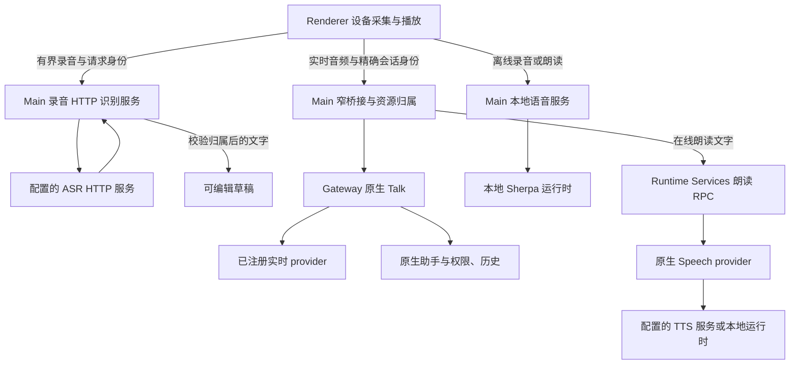

# 多协议语音与实时对话设计

状态：候选设计，尚未实施。当前语音生命周期修复已单独提交为 `43fe35403`；该提交不包含 MiMo 协议适配或实时语音对话。

现行能力仍以[语音功能](../features/models/local-tts.md)和[模型管理](../features/models/model-management.md)为准。本计划定义接下来要实现的产品行为、接口边界和交付顺序，不以模型名称或底层框架中存在某个 API 作为已支持的证据。

## 1. 问题与目标

当前模型目录主要保存地址、凭据、模型和音色，执行路径却隐含选择不同协议：输入框在线识别使用 Realtime WebSocket，附件转录使用 HTTP `/audio/transcriptions`，在线朗读使用 `/audio/speech`。填入模型、查到模型列表或打开功能开关，都不足以证明所选服务支持这条路径。

MiMo 的识别和合成均使用 `/chat/completions`，两者的请求及返回内容又不同。其识别接口提交完整音频，SSE 控制文字结果的返回方式，不能据此声明支持持续麦克风输入。[MiMo ASR API](https://mimo.mi.com/docs/zh-CN/api/audio/Speech-Recognition)

目标是让用户知道自己配置了哪种能力、当前会使用哪条接口，以及失败在哪个阶段；让相同服务可通过多种协议接入，而不把厂商、模型、地址和协议混为一个选项。

## 2. 产品分为三项

| 产品功能 | 子能力 | 用户操作与结果 |
| --- | --- | --- |
| 语音输入与转录 | 录完转写、会议分段、实时听写 | 输入框语音生成可编辑草稿；附件转录工具返回原生工具结果；听写不自动发送 |
| 语音合成与朗读 | 回复朗读、试听、助手合成工具 | 将明确的文字合成为声音；回复朗读不新增聊天正文 |
| 实时语音对话 | 持续收音、语音回复、轮次检测、插话打断 | 用户主动开始语音对话，由原生会话管理对话和工具委托 |

三类“流式”分别描述输入音频增量、输出文字增量和输出音频增量，必须分别声明。上传一段录音后用 SSE 返回文字属于响应流；流式 TTS 也只是音频输出，均不等于双向语音对话。

实时语音对话还要区分两种架构：

- **组合式对话**：ASR → 当前助手 → TTS。便于复用独立识别和朗读模型，但需要管理三段延迟、轮次和取消。
- **原生语音对话**：实时语音模型直接处理音频，通过受控原生委托调用助手能力。需要独立的实时模型与会话协议。[OpenAI Realtime 对话](https://developers.openai.com/api/docs/guides/realtime-conversations)

本计划优先接通现有 Gateway 支持的原生语音对话。组合式桌面对话单独评估，不因已有 ASR 和 TTS 就自动开放；初期始终保留“听写 → 人工确认发送 → 手动朗读”的现有用法。

## 3. 用户界面

### 3.1 模型页管理服务和协议

保留语音识别、语音合成目录，新增实时语音目录。相同供应商可以添加多条能力绑定，分别选择接口类型和模型；同一 API 地址不会让所有模型自动获得全部能力。

添加流程为：选择用途 → 选择接口类型 → 填写服务基础地址和认证 → 添加或发现模型 → 配置该模型的参数 → 保存。接口名称使用可识别的标签，例如“OpenAI 录音转写接口”“MiMo 语音识别接口”“OpenAI 实时转录接口”，帮助文字显示对应路径。

协议选择是配置人员判断服务兼容性的必要信息。普通输入和朗读操作只展示服务、模型与就绪状态，不要求每次操作重新理解协议。

模型发现仅补充 ID 和服务实际返回的元数据。接口类型、音色要求和实时能力不能通过 ID 前缀、供应商显示名、域名或 `/models` 成功来猜测。没有发现接口的服务仍能手填模型。

### 3.2 语音页选择实际用途

建议提供独立“语音”设置页，界面语言继续放在原语言设置。语音页依次展示：

1. **语音输入**：开关、设备、录音转写/实时听写、服务和模型、语言、录音测试；会议分段作为输入模式的独立选项。
2. **回复朗读**：开关、本地/在线、服务和模型、符合模型要求的音色选项、试听。
3. **实时语音对话**：实现并验收后开放模型、音色、轮次检测和设备设置；没有实际注册能力时显示未接入说明，不提供可启动的开关。

页面只选择已保存目录中的能力绑定。未完成配置的模型可以显示，并说明缺少的字段；不会因为没有音色就从整个目录消失。未知或未实现协议不能准入执行。

保存统一提交草稿，成功应用后才影响录音和朗读；取消保留原有效设置。试听沿用现有“先保存，再试听”规则，并说明试听会请求配置的模型服务。打开页面、保存目录或发现模型不触发付费推理测试。

### 3.3 聊天入口与状态

启用语音输入后，麦克风入口保持可见；缺模型、引擎启动中、权限被拒绝或协议不支持时禁用并给出具体原因和设置入口。关闭语音输入时隐藏。这样能区分用户关闭和功能暂不可用。

“语音输入”只改草稿。“开始语音对话”使用独立入口和显式开始动作，显示持续收音状态、当前语音模型、字幕及结束按钮，避免用户为听写而意外进入持续对话。

状态区分“未配置”“已配置，尚未测试”“运行时准备中/不可用”“测试成功/失败”和“本次请求失败”。保存成功不显示为已连通；历史测试结果标注对应配置版本，不永久缓存成就绪状态。错误区分设备、配置、原生准入、认证、限流、格式与服务故障，并提供可理解的操作提示。

## 4. 首批协议与能力矩阵

下表为目标范围，当前状态列只描述代码中的已有路径，不代表特定第三方服务已经实测。

| 协议/运行方式 | 输入与返回 | 适用能力 | 当前状态与计划 |
| --- | --- | --- | --- |
| 本地 Sherpa | 本地音频/文字 → 转录/音频 | 录音、会议分段、朗读、工具 | 保留现有路径与离线资源边界 |
| OpenAI HTTP transcription | `/audio/transcriptions` multipart → 文字 | 完整录音、文件、会议片段 | 附件工具已有；补输入框录音路径 |
| MiMo chat transcription | `/chat/completions` 音频 JSON → 文字/文字 SSE | 完整录音、文件、会议片段 | 待实现；不能选择为实时听写 |
| OpenAI Realtime transcription | Realtime WebSocket 音频事件 → partial/final | 持续输入、实时听写 | 已有 Talk 转录路径；需按能力和格式重新准入 |
| OpenAI HTTP speech | `/audio/speech` 文字 JSON → 音频字节 | 朗读、试听、合成工具 | 已有；纳入显式协议与统一验证 |
| MiMo chat speech | `/chat/completions` 合成 JSON → Base64 音频/音频 SSE | 朗读、试听、合成工具 | 待实现；先完整音频，再评估流式播放 |
| 原生 Realtime voice | 双向音频和会话事件 | 连续语音对话、原生助手委托 | 框架已有，本地 provider 未注册，需独立验证接入 |

先提供上述明确的协议适配器。后续厂商协议通过新增适配器接入；不提供任意 JSON 模板、通用 URL 替换或失败后试探多个接口的执行器。

协议使用能力专属标识，例如 `openai-transcription-http`、`mimo-transcription-chat`、`openai-transcription-realtime`、`openai-speech-http`、`mimo-speech-chat` 和 `openai-voice-realtime`。它们与原生插件/provider ID 分开，不能仅凭 `openai` 表示兼容所有语音接口。

## 5. 配置与音色模型

### 5.1 三层信息与解析结果

- **服务连接**：用户配置的基础地址、认证方式和凭据引用；可引用相同连接信息，现有分类目录不强制合并为一个全局供应商表。
- **能力绑定**：稳定本地身份、协议标识、模型 ID、服务连接引用，以及已声明的模型参数限制。一个模型可有多个绑定，分别支持录音或实时通道。
- **用途选择**：输入框、回复朗读、附件 STT 工具、合成工具和实时对话各自引用能力绑定，分别保存开关和参数。

每次执行由 Main 或原生配置投影生成一个确定的有效配置：用途 + 绑定身份 + 协议 + 模型 + 端点 + 凭据版本 + 参数。Renderer 提交绑定/模型引用和有界参数，不为执行传递任意端点或密钥。

能力描述区分适配器支持、用户声明和运行时实证。输入格式/采样率、语言、录音大小/时长、输出格式、输入流、响应流、音色策略和原生委托能力分别校验；用户不能通过手工勾选让适配器支持未知协议。可执行范围不超出适配器和所选绑定的能力，Gateway 路径另需实际注册及准入。网络尚未测试的有效 HTTP 绑定可以进行显式测试或实际调用，不把一次既有连通测试设为执行前提。

现有设置缺少协议字段时，按原消费用途保留已有语义：麦克风为 Realtime transcription、附件工具为 HTTP transcription、TTS 为 HTTP speech，不根据现有 MiMo 模型名自动改协议。已有引用与模型 ID 保留；改用新协议需显式保存能力绑定。未知协议必须给出错误，不能回落标准 OpenAI。

旧目录中的同一 provider/model 可能同时被麦克风和附件工具引用；缺协议时的解析限定在各用途，不向这个共享对象补写一个协议而覆盖另一用途。引入新绑定后，使用结构化身份明确选择，保留各消费页面已保存的选择。

保存、启动、登录/退出同步、导入导出和模型目录归一化都要保留协议、绑定及音色元数据。当前会重建对象的归一化和导入白名单必须一起更新，避免保存后字段消失。模型 ID 含斜杠时仍保留完整身份，不新增模糊的字符串拼接解析。

### 5.2 音色是模型能力

音色策略至少区分预置音色、允许服务默认、参考音频和描述式音色。策略必须由明确的模型能力配置确定；未知模型缺少音色时仍提示补充，不能静默省略字段。

MiMo 基础 TTS 允许省略 voice 使用服务默认；克隆模型需要参考音频；设计模型使用描述且不支持 voice 字段。因此不能把所有 TTS 都套进必填音色下拉框。[MiMo TTS API](https://mimo.mi.com/docs/zh-CN/api/audio/tts)

一期仅开放基础朗读所需的预置音色和显式“服务默认”选项。后者仅在绑定声明允许且用户选择时省略 voice，不伪造音色 ID。音色克隆和设计保留为后续独立流程；没有实现参考音频/描述参数的绑定应明确显示不支持，不能拿来做普通朗读。

“服务默认”必须贯穿目录归一化、原生配置、provider 解析与实际 HTTP 请求验证；不能被现有标准 TTS 的默认音色补值逻辑重新填入另一个音色。不同音色策略使用明确的配置形态，不以空字符串兼任所有状态。

## 6. 进程与适配器边界

**完整录音识别由 Main 管理 UI 资源。** 新增有界、可取消的 HTTP 转录服务，与现有本地识别具有一致的调用身份和生命周期。HTTP 音频保持受支持的 PCM/WAV 等格式，不为了复用实时接口强制降为电话音质。会议模式按有界片段排队，不把此路径命名为实时音频流。

**真实流式识别与语音对话由 Gateway Talk 管理。** 沿用公开 API、原生会话归属、工具准入和历史。当前转录路径是 `mode=transcription`、`transport=gateway-relay`、`brain=none`；当前实时对话 relay 要求 `mode=realtime`、`brain=agent-consult`。`talk.catalog` 顶层列出的模式不是 provider 可用证明；以具体注册与准入结果为准。

当前应用的 OpenAI 插件注册了实时转录和 Speech provider，未注册 realtime voice provider。实时对话阶段先验证本地注册、受管独立配置、SecretRef 和锁定 SDK 合同。当前原生转录有最终结果等待期限，不能通过伪装一个“收到 close 才执行完整 HTTP 请求”的 realtime provider 接入 MiMo。

首个实时对话版本限定 Gateway relay 和显式配置的内部 WebSocket 服务。保留的上游 provider 文件不代表可直接重新注册：需要审计其中的环境凭据、公共端点和浏览器认证回退。浏览器直连 WebRTC、managed-room 和 SIP 均留待独立评估。现有听写音频 pump 的电话编码也不能直接用于双向音频；按锁定原生 descriptor 验证采样率和编解码，再绑定采集与播放。

实时对话绑定当前已准备的原生助手会话，独立保存语音模型/音色，不依赖可选电话插件的配置。首版优先验证强制助手委托路由，让实际任务沿用当前助手的权限、审批和执行生命周期；不能因为实时模型能够调用工具，就绕过原生准入另建一套工具执行器。

**在线 TTS 协议集中在原生 Speech provider。** Runtime Services 的在线回复朗读继续以请求内配置调用公开 `synthesizeSpeech`；在线协议在对应 provider 内选择。本地回复朗读和本地试听继续由 Main 直接运行 `synthesizeLocalSpeech`，不因引擎或网络不可用而失效。`tts-local-cli` 在线工具优先通过公开 provider 注册表委托同一实现，保留自己的 provider 身份、独立选择和启停准入，不导入其它扩展源码；其本地工具路径仍由原生 provider 调用本地运行时。若锁定 SDK 无法保持隔离则先给出证据并调整设计。

**协议编解码只做小规模实际复用。** Main 录音识别与 STT 扩展共同依赖独立纯协议模块，建议置于 `plugins/sdk/speech-protocols/` 并在构建时静态打入各制品。只包含协议常量、路径规范、请求/响应结构与 Base64 规则，不含网络、凭据、文件系统、DOM 或应用状态。Main 不导入可选插件，插件不导入应用 `src`。权限、代理、传输取消和临时文件仍由各自宿主管理，不建设第二套插件框架或统一网络客户端。

附件转录继续由 `stt-local-cli` 和原生文件权限管理。相同协议不意味着可以复用输入框授权读取附件；sandbox、workspace/fsPolicy、文件大小和工具取消校验仍独立有效。

不修改原生 runtime。未来确有 SDK 缺口时，先验证应用或 Runtime Services 能否解决，并按仓库补丁规则单独设计和交叉评审。

## 7. 请求、配置与取消

所有录音、试听和播放请求绑定窗口/frame、用途、requestId、配置代次；原生实时通道另绑定精确的 native session、连接身份、进程 incarnation 和 lifecycle generation。A → B → A 也产生不同代次，不仅比较模型名。

原生会话创建结果未知时不再次创建，不重放未确认的音频；恢复只使用原生明确支持、且能够确认归属的恢复接口。连接恢复不推断上一轮输入已经接收或执行完成。

每次发送前和结果返回后重新核对有效配置及授权。切换模式、模型、端点、音色、认证版本，禁用能力，设备断开，窗口导航/销毁或原生重连，都使旧消费失效。会议队列串行且有长度上限；失败片段明确标识，未经用户操作不自动重发。

网络请求只访问用户配置的服务，支持明确配置的内网 HTTP(S)/WS(S) 地址；拒绝 URL 中的账号密码和未定义参数。按协议规范化完整端点时保留部署路径及版本前缀，不反复追加 `/v1`。认证由适配器声明支持的方式选择；凭据轮换沿用端点与版本隔离的 SecretRef，不借用聊天/环境凭据。

新 HTTP 路径使用产品非浏览器网络策略，Gateway 路径使用原生受管出站策略。所有传输都拒绝跨站重定向和公共服务兜底，不在未知结果后自动重试音频提交。请求体、音频和编码膨胀、返回 JSON/Base64、解码后的音频、响应时长和会议排队均设边界。错误不回传原始认证头或未经处理的服务正文，不记录音频和转录全文。

停止、取消与静音分别定义，界面必须说明实际效果：

| 操作 | 作用与证据 |
| --- | --- |
| 停止并识别 | 结束录音后提交完整音频；实时听写停止采集后按原生约定有界等待 final，保留有效结果 |
| 取消录音/转写 | 释放设备、中止本地 HTTP 请求或关闭对应转录会话并丢弃迟到结果；远端可能已处理或计费 |
| 静音、暂停本地播放/停止回复朗读 | 控制本地资源；无取消接口的原生合成只能撤销等待和播放，不宣称远端合成停止 |
| 实时对话打断/结束 | 使用原生 Talk 取消/关闭；当前实现可同时中止关联助手运行，ACK 不等于执行已经结算 |

实时对话的“麦克风静音”和“扬声器静音”是本地操作；“打断本轮”和“结束语音”使用不同动作。当前 `cancelOutput` 会收回关联的原生运行，普通 `session.close` 也走 abort；公开 close RPC 没有 detach 参数，不能承诺结束通话而后台任务继续。

语音资源关闭后仍按原生 whole-run terminal 且 `executionSettled: true` 确认执行结果。原生历史继续是唯一聊天正文来源；产品只存用途偏好和必要回执，不新增语音 transcript 数据库或 Main/Redux 正文缓存。

## 8. 实施顺序与门槛

| 阶段 | 交付内容 | 完成条件 |
| --- | --- | --- |
| P1 配置与能力基础 | 显式协议/绑定、目录与用途分离、导入导出保真、音色策略、就绪状态与可解释入口 | 旧选择保留语义；未知协议被拒绝；保存/取消和配置换代全链路一致 |
| P2 录音识别与基础朗读 | OpenAI/MiMo HTTP ASR、标准/MiMo TTS；输入框与工具分别接入，保留本地路径 | MiMo 可录完转写和正常朗读；两类消费独立；有界请求、凭据与取消通过验证 |
| P3 流式体验 | 真正实时听写的格式/延迟验证；有服务证据的 ASR SSE、TTS SSE 和有界播放队列 | 确认输入流与响应流；停止/换代无串音或重复文字；不退化为伪实时 |
| P4 原生实时语音对话 | provider 注册、独立配置和聊天入口、VAD/手动轮次、打断、原生会话与助手委托 | 锁定运行时 POC 先通过；权限/历史/取消结算保持原生语义，再开放产品入口 |

优先完成 P1 与 P2，解决“模型已配置但接口不匹配”和“可见却无法使用”的问题。P4 需要实证后才能承诺支持的传输、音频格式和工具委托；不先做一个无法连接的功能开关。克隆、音色设计和组合式自动对话不纳入首批交付。

## 9. 验证与交付边界

使用本地合成服务和锁定原生 SDK 做主要自动验证，不以访问公共服务或真实付费调用作为日常测试前提。

| 验证层 | 代表性用例 |
| --- | --- |
| 配置 | 缺协议的原有用途语义；未知协议；多绑定与含斜杠模型 ID；导入导出；音色策略；删除/撤下与独立用途 |
| 协议 | multipart 与 chat JSON 的真实请求/响应；部署前缀与完整 URL；错误/空响应/错误 Base64/错误音频；编码前后边界 |
| 生命周期 | 请求在发送前撤权；A → B → A 迟到；设备断开；导航销毁；会议串行与队列上限；取消/超时/未知提交无自动重试 |
| 原生集成 | 完整与最小配置 schema；SecretRef 轮换；provider 实际注册；Talk 会话身份和事件归属；插件禁用与工具准入 |
| 交互 | 保存/取消；未保存试听；缺配置仍能解释的麦克风入口；听写不自动发送；本地静音与原生中止的区别 |
| 实时对话 | 原生准备会话、音频格式、轮次/打断/重连；关联工具取消与准确终态；历史不重建、不重复写入 |

新传输需验证所配置内网代理以及无公网回退；不重复执行与本变更无关的安装或全制品巡检。真实设备音质、实际部署模型兼容性和内网端到端延迟由相应阶段现场验证，自动测试通过不代替这些结论。

实施后将已经成立的契约归入模型与语音功能文档；本计划只保留剩余未实施部分。
