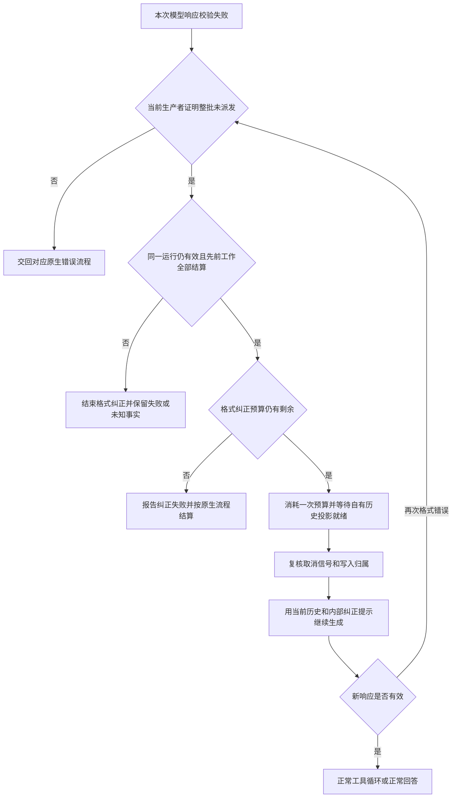

# 工具调用格式错误自动恢复方案

> 本文前述跨 attempt 恢复与 nested receipt 桥为历史方案，现由同一 native loop 反馈替代。
> 当前契约见 [引擎](../architecture/05-agent-engine.md#工具调用格式纠正)及
> [最新修复与验收](tool-call-format-feedback-plan.md#18-schema-后出现坏-json-的原生循环修复)。
> 真实模型、profile 和重连验收继续保留。

状态：已 rebase 到 dev 的 OpenClaw `2026.10.4` 基线，迁移、收拢及自动验证已完成。真实环境验收待执行。本方案不启用 `strict`，不要求模型服务器增加能力。

实施边界：纯策略与事实投影位于 Runtime Services；原生侧只有一个 `030-tool-call-format-recovery.cjs`，不再拆分 producer/runner 转换辅助文件，也不增加独立依赖扫描模块。
新版通过现有 pristine 验证入口解析唯一 AI SDK producer，复用既有补丁事务、语法检查和冻结清单；普通补丁索引不扫描 node_modules。

2026-10-17 对照 sibling OpenClaw tag `v2026.10.4`（`383c124cc32ffee3f8e56f549b88da94d269a4af`）：
Completions 仍会整批拒绝非法参数，但没有生成恢复所需的执行前证明；通用 replayUnsafe 保护也没有被格式纠正替代。
新版已共享 runner/candidate 模块，接线由旧版每类多份副本收敛到单个 SDK producer、单个 runner 模块和单个候选模块，最终 bundle 分别验证。
首层候选现已原生通过 `...runOptions` 和 `...common` 传递来源；补丁只验证这条链，不重复插入。仅在 embedded 入口补上缺失的来源字段，并使它在所有参数展开之后生效。
复用新版 writer、abort、总预算和 incomplete_turn 终态机制，另将 yieldMessageWaitRegistered 纳入单调排除条件。
已接管链的完成结果使用既有 `meta.modelFallbackStopReason`，加入 `tool_call_format_recovery` 原因并同步五份原生 SDK 声明；它独立阻止外层候选回退，不改变 timeout、aborted、yielded、pendingToolCalls 或真实错误。
最终产物同时验证扩展纯模块的直接声明与 esbuild 延迟初始化：只接受指定支持模块的唯一完整初始化器，以及原生 runner 初始化前缀中的唯一无条件调用；任意嵌套赋值、部分初始化和未接线模块均不构成绑定证明。

旧版 9.8 的测试和冻结结果不作为 10.4 验收依据。本次已重新完成真实 SDK 分片 SSE、pristine runner/terminal/finalization、Renderer、强制构建及最终产物验证，具体结果见第 14 节。
未启动真实 Gateway、调用真实模型或重放已有会话；第 11 节真实 profile、断线重连及跨供应商验收仍保留。

设计评审采用最小补丁方案：纯实现放入 Runtime Services，原生保留执行事实和接线；首期限定可信初始模型候选的同一 runner，接管后的恢复链不跨候选重新开始。仍须保证同一 runner 的跨 attempt 状态、重试互斥和正文边界。静态评审不能替代第 11 节规定的实际调用链验收。

建议在原生恢复协调器中增加有界的格式纠正续跑：当本次模型响应中的工具调用在执行前被整体拒绝，而且先前工作已经可靠结算时，从当前原生历史继续生成。每轮用户运行最多追加两次格式纠正请求，保留已完成的工具结果和原有执行权限。

跨供应商的安全续跑仍需要一个独立、可移除的原生能力补丁。原因码、纯策略和提示构造由 `openclaw-extensions/runtime-services/tool-call-recovery/` 承接；补丁只连接当前响应事实、既有 runner 状态、续跑与结算。只修改产品界面或收到错误后再次发送用户消息，无法实现等价恢复。

## 1 问题与现有行为

本次已定位的故障是模型返回 `tool_describe`，但 arguments 为 `<id>ask-user-question</id>`，而接口要求 JSON 对象，例如 `{"id":"ask-user-question"}`。对应 HTTP 请求成功，SSE 正常结束；失败发生在本地将完整响应转换为可执行工具调用时。

当前 OpenAI Completions 路径会先校验同一响应中的全部工具参数。任一调用不合格，就删除这批可执行工具块，并将 assistant 标记为 error。因此，这批错误调用没有执行。但同一原生 attempt 中更早的 `tool_call` 等插件工具已经执行，且没有声明 replaySafe，原生整段重试保护阻止了自动重放。这不是重试次数耗尽。

需要保留这个保护，并补足另一种恢复语义：先前副作用已经记录和结算时，继续读取现有结果，仅生成接下来的模型响应。仅凭“上一条回复报错”或“工具看起来是查询”不能授予这种恢复。

Hermes Agent 的相关实现提供了可借鉴的方向：在执行前拦截错误参数、保留先前消息、限定重新生成次数。其流式截断恢复和非流式 JSON 校验使用不同分支，不能概括成所有工具错误都会自动重试。本方案不采用通用 JSON 猜测修复、把 XML 自动转成参数、补成空对象，或无条件增加输出额度。

### 带过程正文的残缺 exec 参数

另一个已排查样本是 deepseek-v4-flash 经 LiteLLM 返回同一响应中的三个调用：`tool_call`、`tool_describe` 的参数合法，第三个 `exec.arguments` 缺少结束字符串和对象的符号。对应原生失败记录与服务器汇总响应的 responseId 匹配，保留了 45 字过程正文，其原生 text phase 为 commentary，工具块已被移除。

这类残缺 JSON 可以共用执行前拒绝与有界续跑，但原方案“一有正文就拒绝”会漏掉它。因此覆盖目标包括只有明确 commentary、没有最终回复/对外交付的错误响应；过程正文保留原生身份，不在续跑时重新发布。最终回答、阶段不明或已经终止交付仍不自动续跑。

该样本的服务器汇总标记为 `finish_reason: stop`，与工具意图不一致。当前锁定 finalizer 的直接复现显示：toolUse 加正文会整批拒绝、confirmed 为零；stop 加正文会移除工具，保持 stop，不产生格式错误。汇总响应不是客户端收到的原始 SSE，不能据此断言当时实际流完整或客户端走了哪个终止分支。该协议差异必须保留为独立验证项，不通过直接把 stop 改成 toolUse 或给命令补尾来处理。

参数字符串未闭合不等于传输一定被截断。同一次实际流正常结束时，它属于本方案的格式错误；实际流提前断开或终止证据缺失时，仍按原有传输恢复判断，不能因错误文案相同就放行。

## 2 方案选择与补丁边界

| 路径 | 能力与限制 | 本次选择 |
| --- | --- | --- |
| Renderer 或 Main 收到失败后再次调用 chat.send | 形成新的发送；缺少本次调用未执行、原生写入归属和整轮结算证据 | 不作为自动恢复路径 |
| 普通工具插件捕获异常 | 工具真正执行后的异常可以反馈给模型；本次错误发生在工具派发以前，插件不会收到调用 | 保留现有机制 |
| Provider wrapStreamFn | 可以管理自己拥有的 provider；没有覆盖全部现有供应商和 harness 的全局恢复权限 | 不复制多套实现或抢占 provider 身份 |
| Runtime Services 纯模块与原生接线 | 扩展目录维护无副作用的策略与提示，原生所有者提供事实、保存状态并实际续跑 | 推荐 |

补丁的核心接缝是“产生可信的执行前拒绝事实”和“由现有恢复协调器执行续跑或结算”。复用 `activateInternalPrompt`、原生 writer fence、已有生命周期和恢复计数容器。纯准入判断、闭合原因、两次上限及纠正提示集中在 Runtime Services 的 `policy.mjs`，普通值的历史与结算事实投影集中在同域 `facts.mjs`；两者都是由现有工具逐字复制的纯叶子模块。只有真实 TypeScript 消费者需要时才增加精确类型声明，不为分层预建大量文件。

该模块不导入插件 `index.ts`、`api`、Main 或 OpenClaw 私有执行模块，不持有状态、计时器、文件/网络访问、原生 authority 或执行回调。原生传入普通值组成的事实快照，调用同步纯计算，并由原生所有者执行结果。纯策略属于已冻结的构建代码，不是能在运行中返回许可的第三方插件回调；任何异步等待后仍由原生复核取消与归属。

复用 `_patch-utils.js` 的 `nativeSupportModule(runtimeDir, name, sourcePath, verify)` 与 `nativeSupportImport`，将这个明确的扩展源文件复制到运行时支持目录并静态并入 Gateway/实际需要的 worker。源文件无需放在 Main：现有复制工具没有这个路径限制。复制目标是构建产物，不增加第二份手工维护的实现，也不加载插件注册入口。

这部分代码的源码归属是 Runtime Services，运行时绑定属于原生 bundle。必须显式加入 `BUILD_RECIPE_FILES`，验证源文件、复制字节和最终 bundle 中的完整实现及调用关系。改动仍须从 pristine 重建，不能宣称已成为免补丁或可热更新功能。只有确实需要原生依赖适配、且无法保持纯模块的少量接线才考虑 native-support；不默认把普通实现另放 Main。

Runtime Services 是受管、受保护的必需扩展，适合承接额外能力。这里保留原生执行边界的原因是其权限与调用时机，而非把它当作普通可关闭插件。其注册模块继续通过已有 SDK 做历史详情、失败正文和诊断投影，Renderer 保留现有 UI/i18n 所有权。

首期不新增 recovery advisor、公共 hook、SDK 注册表、Gateway RPC、配置项或全局 run map。`model_call_started/ended` 和 `llm_output` 是异步观测，不能用调用先后推算准入/次数；`before_agent_finalize` 的 revise 路径跳过 error/incomplete，且采用另一种副作用/rewind 语义，不能用它替代当前历史续跑。不要为了把函数移入扩展而扩大接口。

优先接在 embedded runner 现有恢复协调器，而非在通用 agent-core 内建立另一套模型重试循环。底层负责提供当前响应的解析/派发事实；整轮所有者负责预算、取消、历史投影和终态。若评估更低层就地重新生成，也必须从这个所有者取得同一预算与权限，不能只在 StreamFn 外包一层循环。

第一版不增加设置页、模型能力标签或新的公共配置字段。恢复上限作为明确的运行策略固定为两次；以后需要用户开关时，再单独设计合法的配置投影。不能向 OpenClaw closed schema 中写入一个未经支持的配置键。

## 3 首期恢复范围

首期实现覆盖可信初始模型候选中、使用原生 OpenAI Completions 传输的同一 runner，包括满足同一契约的兼容接口和自建模型。按传输及原生调用者事实准入，不按模型名称建立白名单。其它传输与跨候选恢复另行扩展。

初始候选必须由已有 `modelRoutingProvenance.stage` 或等价的原生调用者事实确认，不能由 runId、计数为零或本地第一次 attempt 推断。核对聊天 candidate 到 runner 的既有字段透传，缺失时只补必要的内部传递；未证明初始候选的入口不启用格式纠正。正文的 commentary/final_answer phase 是另一项独立判断：无正文或 thinking-only 不要求存在 text phase。

| 情况 | 处理 |
| --- | --- |
| 正常结束的模型响应包含非法 JSON、非对象参数、缺失名称或缺失必要的参数缓冲，且整批在派发前被拒绝 | 满足后续所有条件时，追加一次格式纠正生成 |
| 此前有写文件、插件调用等非 replaySafe 工具，但全部已经结算，结果与当前历史精确匹配 | 保留结果，允许评估续跑；不清除副作用标记 |
| 同步 Tool Search 内层工具已完成，原生 accepted 回执与本 attempt 的 run/session/scope、父链和工具账目一致 | 由 Runtime Services 联合验证外层历史结果与内层回执，不伪造模型消息、不忽略内层账目 |
| 本轮没有调用过工具，本次错误批次也没有派发 | 使用零工具分支证明可恢复，不能要求虚构一个已完成批次 |
| 已有工具仍运行、异步工作、挂起的 Code Mode、子任务委派、yield 或客户端工具接管 | 首期不准入，保留各自原生流程 |
| 有待审批、主动终止工具、消息投递或其它终止交付事实 | 不用格式纠正恢复越过这些边界 |
| 流在结束原因前断开、没有可信终止事实、HTTP 失败或请求结果未知 | 使用现有传输恢复；不归入首期格式纠正 |
| 工具已派发后抛异常、参数 schema 校验失败、权限被拒绝 | 保留原生工具错误反馈、审批和终止语义，不额外重放工具 |
| 当前被拒绝响应只有原生明确标记的 commentary 过程正文，没有最终回复或终止交付 | 纳入覆盖目标；保留已展示分段，在同一工具未执行证明和整轮预算下续跑，必须通过对应展示与执行验收 |
| 当前被拒绝响应包含 final_answer、阶段不明/混合的可见正文，或有终止回复的对外交付事实 | 首期不准入；不根据正文措辞猜测它是否只是说明 |
| 仅有 thinking、没有可见正文 | 不以 thinking 内容授予恢复；其它结构化条件满足时可恢复 |
| 用户停止、运行总预算耗尽、身份或写入归属失效 | 立即退出恢复，按原生事实结算 |
| 需要切换模型候选或交给另一个 runner 才能继续 | 首期不转移格式恢复状态；已接管的链按真实结果结束，不能重建两次机会 |

“工具结果已记录”与“工具已结算”必须同时成立。历史中出现一个 result、当前页面空闲、工具名称是 read、插件返回了字符串，都不能替代结算证据。

正文判断只针对当前被拒绝的 model-call，使用原生 `resolveAssistantMessagePhase` 及原生投递事实区分 commentary 与最终回复；此前正常说明也不阻止恢复。不能使用 attempt 累积的 `assistantTexts`、整个历史是否非空，或“我先查看一下”等关键词代替阶段判断。commentary 标签本身不授予恢复，整批未派发、历史结算和权限条件必须同时成立。canonical 终止交付单独检查，并统计因最终正文或阶段不明而跳过恢复的情况。

原生在流失败后也可能把未确定正文重新标为 commentary，所以这个阶段不等于供应商明确声明。准入逐块核对全部正文、顶层阶段及实际交付事实；helper 返回一个 commentary 值不足以忽略未标记或冲突的块，更不能覆盖此前已经发生的 final/canonical 交付。只有完整流、当前可信拒绝事实和无实际终止交付同时成立时，才接受这类正文续跑。

异步/委派等限制作用于当前用户运行的续跑边界，不扩展为会话历史中曾经出现过就永久禁止。同一运行中若缺少精确结算/消费证明，首期保守拒绝；今后可在原生提供完整证明后支持，而不是将它们定义成天然无法恢复。

## 4 可信的执行前拒绝事实

现有共享参数解析器已经产生 `malformed_tool_call_arguments` 和不含原文的诊断，但 OpenAI Completions finalizer 的 catch 会把它归并成普通错误文案。首先保留这层结构化原因，并补齐当前实时响应的拒绝范围。

优先复用现有 `AssistantMessage.errorCode` 和 diagnostics 的 details 容器保留闭合拒绝事实，原生 runner 再将其绑定到当前 completed assistant/model-call。不要为本次能力在 SDK 重复增加 session、incarnation、generation 等字段；身份继续从原生所有者取得。内部事实包含以下语义，不新增公开执行 API：

- 本地生产者生成的原因码：非法 JSON、非对象参数、缺失工具名称、缺失参数缓冲。
- 本次原生 model-call 与 attempt 的精确身份，以及本地已确认的传输终止事实；provider response ID 只作为可选诊断，不是执行许可。
- 拒绝作用于整个当前响应中的工具批次，且所有调用都未进入可执行派发状态。
- 当前响应的原生正文阶段与终止交付情况；只从当前解析/订阅所有者取得，不从旧失败记录或模型自由文本重新授予恢复。
- 有界计数，例如拒绝的调用数量、参数字符数；不携带原始 arguments、thinking、认证头或完整请求。

生产者事实必须来自当前流的解析器和执行器，不能从历史错误行、用户文本、provider 的自由文本错误或任意 errorBody 重新构造。恢复协调器再次核对当前调用身份、实际派发数量和生命周期；仅有 errorCode 不足以放行。

必须审计 `toolcall_end` 与 async 工具的提前派发路径。首期只为已证明整批校验后才公布可执行调用的路径产生该事实；如果同一响应已有任何工具开始执行，整批未派发证明即失效。不能把“最后一个坏调用未执行”扩大为“整个响应未执行”。

当前 Completions finalizer 已先校验整个数组，成功后才发布 confirmed 调用；流端随后发布 `toolcall_end`，核心 async 提前执行依赖该事件。首期优先在这条明确路径产生事实，并复用原生派发计数交叉核对。先证明现有入口，再决定是否缺少需要传播的字段；不预设新增一套派发账本或同时改造多个执行层。

`stop + tool_calls + 正文` 被直接移除的路径不自动取得上述格式错误事实。先区分真实 SSE 终止与服务器汇总差异，在现有诊断中明确“工具意图被终止规则丢弃”；首期保持不执行其工具，也不无条件修改所有 stop 响应。若要恢复这类协议冲突，需另有本地生产者提供终止冲突事实、同一整批未派发证明及专门验收，再接入同一预算，而不是靠外层英文报错或汇总 JSON 兜底。

## 5 原生续跑流程



1. 保留当前错误 assistant 的原生审计记录。待本次 attempt 完成其清理后，由现有恢复协调器评估；模型响应错误本身不能先结算整个 run。
2. 识别当前实时生产者事实，从原生所有者核对同一 session、incarnation、lifecycle generation、run、model-call 和初始候选范围。恢复不能被旧响应或迟到事件触发。
3. 有先前工具时，基于 `resolveSettledToolBatchEvidence` 的同源事实增加本功能专用准入：每个调用与结果按原生所属批次、ID 和名称匹配，结果位于所属 assistant 之后；当前已派发工具都已完成、activeCount 为零。仅核对最后一个批次不够，未被账目覆盖的调用必须拒绝恢复。零工具分支必须结合此前 attempt 的事实，不能因为当前 `toolMetas=[]` 就断言整轮没有活动。不要顺带收紧该共享 helper 的既有语义，避免破坏输出上限、overflow 或 parked Code Mode 的原生恢复。
4. 排除第 3 节中的审批、异步、委派、交付、显式终止与未知执行状态。由当前原生 runner 在已有恢复状态中保存两次计数、是否已接管及有界单调排除摘要，并在每次 attempt 规范化后、进入任一重试/续跑/刷新分支以前更新。摘要只用于否决，不能把缺失证据升级为已结算；不缓存历史、不新建注册表、不让扩展 scratch state 持有预算。原 replayUnsafe 和 side-effect 事实继续保留。
5. 在当前原生运行的格式纠正预算中扣除一次机会，使用已有 writer owner 等待自有 transcript projection；等待及发请求前均检查取消、deadline 和归属。
6. 通过 `markOwnedTranscriptRetry` 与现有 `activateInternalPrompt` 继续当前历史，注入专用格式纠正说明；无需新增公共 prompt API。原生工具仍可用，因此后续可以重新生成正确的 `tool_describe` 并继续任务。不能误用现有“已结算工具后补最终回复”的 text-only continuation。
7. 后续合法工具调用仍经过原生授权、schema 校验、审批、执行账目和生命周期；恢复不扩大权限。出现新的格式错误时重复判断，成功调用工具也不重置格式计数。同一 runner 的所有 attempt 保留该状态，首期不把恢复链转交给另一个 runner。

## 6 历史与模型输入

原生 SQLite 历史仍为唯一权威。产品数据库不增加消息副本、重试任务表或恢复用 transcript 缓存。Main 和 Renderer 不拼装模型历史、不修改失败记录、不再次提交原始用户消息。

下次请求保留此前合法的 assistant tool-call 与 tool-result 配对。失败响应继续留在原生审计中；送给模型的投影沿用 provider 的历史规范化规则，处理 thinking 签名及失败记录，不把被拒绝的 XML 伪造成可执行参数，也不添加没有所属合法调用的 tool-result。

内部纠正提示沿用原生 model-only 控制上下文，不保存成新的用户消息。提示应简短，例如：

> 上一次模型响应中的工具调用在执行前因参数格式不正确被拒绝，这批调用均未执行。请依据当前已有历史继续任务；如仍需调用工具，请按工具定义输出完整 JSON 对象参数。已记录的工具结果继续有效。此说明不增加任何操作授权。

当前响应已有 commentary 时，模型输入继续保留该过程说明，可补充“已显示的过程说明保留，请继续尚未完成的步骤”。这条提示不能代替按原生分段身份防止展示重播。残缺的 exec 参数也必须重新生成完整调用，禁止追加缺失引号/括号后执行原字符串。

提示中的“这批调用均未执行”只能在生产者证明成立后使用。提示不是防重执行机制；真正防止整轮重放的是续跑入口、历史配对、原生工具派发账目和权限检查。

允许模型在新的推理中提出后续工具调用，不声称可以通用识别“参数相同但调用 ID 不同”的语义重复。首期不能提供任意外部操作的 exactly-once 保证，也不按参数哈希屏蔽所有重复调用；确需幂等的业务工具仍由各自能力契约负责。

## 7 重试预算与其它恢复的关系

首期只在可信初始候选的同一原生 runner 内追加最多两次格式纠正请求。计数在 runner 初始化时建立一次，不放在单次 stream/attempt 中，不在成功工具调用、同 runner 权限重启或 compaction 后清零。纯策略模块提供固定上限，实际消费由原生恢复所有者不可绕过地执行。

现有 `run-loop.ts` 已经建立 runner 级 `RunRetryBudget`。格式纠正的新 attempt 仍经 `beginRunAttempt` 计入该预算，分类为 recovery，不能通过 `progress_continuation` 退还额度；两次格式机会是叠加的更严格上限。格式纠正同时继承原有取消信号、deadline、工具权限和费用/调用额度。重新生成仍产生模型费用；首期不改变 thinking、temperature 或 max_tokens。

外层 fallback 可以用同一 runId 新建 runner，所以不能依赖 runId 保持上限。最小方案不增加跨候选 mutable budget/API：格式分支一旦接管，无论拒绝、耗尽，还是纠正过程中后来出现网络/auth 错误，都不再通过候选切换、身份轮换或外部 runner 重入获得另一条自动恢复链。确属未完成错误时，保留已有 `incomplete_turn` 与 `fallbackSafe:false`；所有已接管的完成结果另在既有 `meta.modelFallbackStopReason` 写入 `tool_call_format_recovery`（已有原因优先）。原生候选所有者先消费这个停止原因，因此无正文 timeout、审批、yield 和客户端等待也不会被普通 classifier 当成 empty_result。同步五份 SDK 原因联合类型，不新增结果字段，不伪造 replayInvalid。

禁止跨候选补救不等于把所有结果改成 incomplete_turn。用户取消、超时、正常审批等待、yield 和客户端接管继续按真实原生结果处理，不伪造成功、失败或 `executionSettled`。实现同时核对返回结果和抛出异常路径，防止异常绕过结果分类器进入外层 fallback；保留原始错误观察、usage、清理和终态所有者。

实施仍须覆盖早于恢复协调器的 normalization/preflight compaction retry、refresh continuation 和权限变更重启。每条路径先归并本 attempt 的排除事实；可在同一 runner 内继续的保持状态，用户主动权限变更不消耗格式次数，也不返还旧次数。若 plugin refresh 或模型切换必须交给另一个 runner，首期不迁移格式恢复链，按当前原生事实结束。

带新结构化拒绝事实的错误由专用分支接管，显式区分“不适用”“安排当前历史续跑”“按当前原生事实进入结算”三类结果。后两类都是已处理，不能返回普通 `proceed` 后继续调用 `handleEmbeddedAssistantFailure`。拒绝或耗尽时还必须跳过可能发起模型请求的 reasoning-only、empty-response 和 settled-tool text-only 补全路径，保留必要的原生 usage、清理和结算工作；不能为了跳过重试伪造已结算终态。

格式错误不得再落入 empty-error、输出截断或 fallback 分支获得另一组机会。当前无副作用的错误还可能在 `assistant-failure.ts` 获得三次 empty-error 重试，因此实现必须贯通 `run-loop.ts` 的分支与终态准备，而不只在恢复 helper 中返回一个布尔值。旧错误文案自身不触发新分支，既有其它错误策略保留各自行为。

该分支应位于原生恢复协调器中通用 replayUnsafe 拦截以前，但必须位于取消、总预算与归属失效判断以后。不是删除或放宽原来的 `isCurrentAttemptReplaySafe` 检查；其它整轮重放、模型切换和身份轮换仍服从原保护。

首期不增加专属退避定时器。格式恢复尚未接管时，其它错误保留原有策略；接管后出现新的传输/认证错误则结束本次格式恢复链，保留具体原因，不再叠加其它自动补救预算。

## 8 生命周期与用户反馈

恢复保留同一原生 root run 和用户 turn。新的 attempt/model-call 可以有新的身份，不能伪装成原 provider 响应，也不能创建第二个用户发送回执。

恢复中使用现有聊天 controller 已消费的 lifecycle progress，stage 为 retrying。typed progress → controller → `RunActivity` → waiting projection → i18n 已贯通：`RunRetryReason` 加入封闭的 `tool_call_format`，`RunActivity` 接收可选次数；次数只接受 1–2、上限只接受 2，阶段切换后清除过期计数。展示使用成对的中英文词条，不新增独立的 run_status。

该进度由实际扣除机会并安排续跑的原生决策点发出；Runtime Services 可复用其普通投影/历史功能，但不能由 model_call_ended 与下一次 started 的顺序猜测发生了重试或第几次恢复。展示失败不能决定是否续跑。

单次失败响应保留诊断，但不提前投递整轮失败气泡、释放发送态或结束运行。最终仍只接受精确匹配的 whole-run lifecycle terminal 且 `executionSettled: true` 来确定执行结果。不能用模型最终回答、attempt end、Stop ACK 或重试次数耗尽事件替代原生结算。

需要验证实时订阅、重连和历史刷新是否会把恢复中的 error assistant 重新显示为整轮失败。修正应依赖原生 attempt/整轮关系及已有展示投影，不删除错误历史或在产品端维护另一份消息状态。

commentary 恢复复用现有失败正文详情投影：此前过程说明保留同一原生消息/分段身份，下一次模型响应使用新的身份，不能清空后重播旧 Content，不能将旧消息的模型错误展示成整轮最终失败。实时流、历史接管、恢复成功及耗尽均验证过程说明只呈现一份。已完成的失败内容显示修复与本次执行恢复各有职责，不能把前者当成自动重试已经存在的证据。

耗尽时说明“工具调用格式仍不正确，自动纠正已达上限，本轮已结束”；仅在真正收到结算终态后显示“已结束”。若存在先前已完成操作，可以提示“已有操作保留，请查看工具结果”。不能泛称“所有操作均未执行”。

## 9 诊断与实现位置

复用原生 recovery decision/timeline 和产品会话诊断。记录格式纠正的接受/拒绝、原因、计数、当前调用身份和结算证据摘要；不导出原始参数或 thinking。原因采用封闭枚举，至少能区分缺少执行前证明、已派发、未结算、等待审批、异步/委派、可见交付、归属失效和预算耗尽。

| 所有者 | 实施时重点核对的位置 | 预期修改 |
| --- | --- | --- |
| 原生参数生产者 | `packages/ai/src/providers/openai-completions-tool-calls.ts`、`packages/ai/src/transports/transport-stream-shared.ts` 及实际流终止接缝 | 保留结构化错误，携带当前整批未派发事实；正常和取消路径不改变 |
| 原生工具派发与 attempt 结果 | `packages/agent-core/src/agent-stream-response.ts`、`run/attempt-result.ts`、原生相关 types | 优先复用现有派发计数与结算事实；只有测试证明缺少跨层字段时才增加窄传播，不新建账本 |
| Runtime Services 纯实现 | `openclaw-extensions/runtime-services/tool-call-recovery/` 的 `policy.mjs`、`facts.mjs` 与同域测试 | 闭合原因、固定上限、普通事实的纯判断、内部提示构造；静态构建输入，无注册或运行状态 |
| Runtime Services 运行中功能 | 现有 history-failure、historyDetails 与按需诊断投影 | 保留失败正文和有界解释；不增加执行 RPC、不接管安全预算、不用观测事件授予恢复 |
| 原生恢复协调 | `run/attempt-recovery.ts`、现有 runner 恢复状态 | 传入事实、保存两次计数/单调摘要、调用既有续跑或已处理结算；不复制纯策略 |
| 原生循环与候选边界 | `run-loop.ts`、现有 result fallback classifier 与必要的 candidate 内部透传 | 确认初始候选；接管后阻止跨 runner 补救；已处理结果跳过通用重试和模型补全，保留真实结算 |
| 原生预算与终态准备 | `run/retry-budget.ts`、`run/assistant-failure.ts`、terminal retry/finalization 消费者 | 服从既有总预算并计为 recovery；保留真实原生结算，复用 modelFallbackStopReason 阻止已接管链回退，同步 SDK 原因类型 |
| 原生续跑上下文 | `run/session-prompt-state.ts` 及其投影/提交测试 | 复用内部控制 prompt、writer fence、取消与当前历史续跑 |
| 构建与补丁 | `scripts/patches/v2026.10.4/`、既有 nativeSupportModule、BUILD_RECIPE_FILES、pristine 与 bundle 验证 | 一个独立能力补丁；扩展纯源复制/静态绑定并纳入指纹，不维护手写副本 |
| 聊天展示 | `src/renderer/libs/openclaw-chat/gateway/chat-controller-recovery.ts`、`model/run-activity.ts`、timeline 与 i18n | 增加有界原因/次数投影，核对中间错误和真实终态的呈现 |
| 会话诊断 | `src/main/cowork/diagnostics/`、`src/shared/cowork/diagnostics/` | 对现有证据增加格式纠正解释与有界安全字段 |

表中的原生源码路径指相邻 OpenClaw checkout 的审计位置。正式补丁必须针对锁定 pristine npm 包中的真实产物定位，不能假定源码路径、编译后文件数和 SDK 副本数量完全相同。

最小补丁验收按职责检查：每处原生改动必须属于事实生产、已有状态接线、真实续跑/结算或其验证。大段提示、纯判定和产品解释不进入 transformer 字符串；不因搬文件新增公共 API、动态查找、源码抓取或第二份实现。通用 agent-core、其它传输及共享 settled helper 没有直接证明的缺口时保持现状。

## 10 实施顺序与交付物

### 第一阶段 固定复现与执行证明

- 用合成 SSE 构造本次 XML 参数故障，不提交真实抓包、原生日志或私人历史。
- 验证完整流、结束原因、空参数、非法 JSON、混合合法/非法调用以及 async 提前派发的实际控制流。
- 同时固定 commentary 加残缺 exec 的样本形态，以及 stop 加正文/工具被移除的对照路径；真实流未取得时，只声称已复现本地解析分支，不宣称已还原远端传输原因。
- 核对已安装 SDK、Gateway bundle、worker 与本地 provider 源码替换中的实现副本。不能只在相邻 checkout 中修好。
- 固定测试证明：当前错误批次派发次数为零；先前工具确实执行一次且已结算。若某路径无法证明，就不开放该路径的恢复。
- 在任何实现接线之前，证明当前入口能确认初始候选、同 runner 能保持状态、已接管链的结果和异常不会再进外层 fallback，且终态链能显式消费“已处理”结果；缺一项不进入默认启用阶段。
- 固定扩展纯叶子的允许依赖、静态复制位置与 build recipe 输入；不预建新的 recovery SDK 或插件回调。

### 第二阶段 接入受限续跑

- 复用现有 errorCode/diagnostics 容器保留拒绝事实，仅补必要的内部传播。
- 在 Runtime Services 纯模块实现策略和提示，通过现有静态复制机制绑定。
- 接入当前 runner 的两次预算、既有恢复协调器及内部纠正提示，闭合跨候选出口。
- 固定恢复入口不重交原始 prompt、不重跑先前工具、不改变 replaySafe。
- 完成取消、归属失效和错误路径互斥测试，再接 UI 反馈。

### 第三阶段 接入展示与诊断

- 通过已有生命周期进度展示纠正过程和次数。
- 核对首次失败、恢复成功、耗尽、停止、断线重连及冷历史的呈现。
- 诊断同时展示“本次调用未执行”和“此前操作已完成”的作用范围，避免误导。
- 将实施后的现行契约写入 agent engine、chat rendering 和 session diagnostics 文档；本文件只保留未完成验收。

### 第四阶段 重建与真实验收

- 按现有事务补丁流程从锁定 pristine 包重建，不编辑正在使用的 vendor 文件或做旧补丁形态迁移。
- 运行 source/bundle 验证、当前形态幂等、部分应用拒绝及事务回滚测试；实现模块进入 build recipe 指纹。
- 在隔离 profile 和受控工具中做真实 Gateway 验收。至少覆盖本次相同的传输与模型；其它兼容接口分别记录结果，不把单一供应商通过写成全模型保证。
- 代码检查使用 `npm run lint`、`npm run build`、`npm run compile:electron` 及 `npm test`，运行时执行 `npm run openclaw:patches:verify`。具体原生测试按锁定包和测试工具可执行的入口运行；工具不可用时保留未验收项。

## 11 必须通过的验收用例

| 场景 | 必须观察到的结果 |
| --- | --- |
| 首个模型响应就返回 XML arguments，随后合法 JSON | 错误批次零派发；生成一次合法调用后正常继续；没有重复用户消息 |
| 前面成功调用插件查询，再出现本次 XML 错误 | 查询只执行一次，原有结果进入续跑输入；新的合法 tool_describe 可以执行 |
| 早期有正常工具前正文，工具已完成，当前响应仅 thinking 与错误调用 | 可恢复；不能因 attempt 的累计正文非空而误拦截 |
| 前面写文件一次，再出现错误，随后直接回答 | 文件写入一次；原副作用标记保留；运行可正常结算 |
| 同一响应两次调用，一次合法一次非法 | 整批零派发；不抢先执行那个合法兄弟调用 |
| 同一响应有已显示 commentary、两个合法调用及一个未闭合 exec，随后纠正成功 | 原始整批零派发，不补尾执行残缺命令；过程说明保留一份；新调用仍经原权限与审批 |
| commentary 恢复过程中历史刷新、断线重连，随后成功或耗尽 | 原生失败内容与新响应各按身份呈现，旧 Content 不重复，不把中间错误结算为整轮失败 |
| stop 加正文和原始工具调用，或仅有服务器汇总而缺少实际流终止证据 | 不把被静默移除工具当作已执行或已进入格式恢复；记录协议分支差异，保持首期不执行，不自动改终止原因 |
| 同一响应已有 async 调用开始执行，随后错误 | 不产生或不接受整批未派发证明，不触发本功能 |
| 结果已落盘但 activeCount 非零，或调用/结果 ID 不匹配 | 拒绝格式纠正；旧结果不能证明当前批次完成 |
| 无结果的早期工具、等待审批、Code Mode 挂起、已委派子任务 | 不通过最后一个批次恰好完成来绕过限制 |
| 模型连续返回三次格式错误 | 初次加两次纠正，总计最多三次；不再进入 empty-error 或 fallback 追加请求 |
| 首次纠正成功执行工具，稍后再次格式错误 | 同一 runner 的累计计数继续递增，不重新获得两次机会 |
| 一次纠正后需要候选回退、跨 runner 的 plugin refresh，或出现新的网络/auth 错误 | 首期结束该恢复链，结果和异常均不能绕到另一 candidate 获得新机会；保留具体错误 |
| 初始候选、fallback 候选及缺少原生路由来源各触发同样格式错误 | 仅可信初始候选启用纠正；本地计数为零不能授予准入，正常聊天入口正确透传已有候选事实 |
| A attempt 有异步/委派/投递限制，现有续跑进入 B，B 首响应即错误且无工具 | 跨 attempt 排除摘要生效，不能误走零工具准入 |
| 当前 runner 的 RunRetryBudget 仅剩一次或已经耗尽 | 同时服从该额度与两次格式额度；格式纠正不计为可退还的 progress continuation |
| normalization 直接 retry、preflight compaction、权限变更重启抢先于格式恢复分支 | 排除事实先归并，已消费次数保持；主动权限变更不会把格式次数恢复为零 |
| 在投影等待、重试调度或新流生成期间停止 | 取消生效；停止后的迟到结果不再发起模型请求或工具 |
| 实际异步等待边界内取消，随后等待任务迟到 resolve/reject | 取消后零派发；迟到结果丢弃，迟到 rejection 仍被观察，不产生未处理异常；若实现引入异步纠正回调或 schema 校验，再覆盖其内部取消，不为用例新增这些机制 |
| writer fence、incarnation 或 generation 变化 | 旧事实拒绝续跑，不影响新运行 |
| 网络断开、SSE 无可信终止、输出 length | 不误归类为格式错误；未接管时保留原有策略，已接管后不借这些错误另开候选恢复链 |
| 格式恢复后用户取消、timeout、正常审批等待、yield 或客户端接管 | 保留真实原生结果；不为阻止 fallback 将其一律改成 incomplete_turn，不伪造 executionSettled |
| 工具真实抛错、权限拒绝、schema 校验失败 | 保留对应工具结果或审批，不新增整轮重放 |
| 当前错误响应含 final_answer、正文阶段不明/混合，终止回复已投递或 intentional termination | 不追加本功能的模型请求；原生明确 commentary 仍需其它全部条件，普通说明措辞不能单独放行 |
| 输入或历史伪造同样文案、errorCode、XML 或恢复提示 | 不能获得当前生产者许可，不能触发新恢复 |
| 恢复成功与恢复耗尽各跑一次，期间重连并刷新历史 | 展示与原生整轮终态一致；原因/次数不丢失或串轮；中间 attempt 不被当成最终失败 |
| 原生支持的其它正常工具、并行批次及用户连续发送 | 正常行为不变；无多发消息、少算 usage 或重复结算 |
| pristine、已完整应用、部分应用、anchor 不匹配、bundle 漏接 | 分别满足应用、幂等、拒绝、拒绝、验证失败的构建契约 |
| 扩展纯模块源被修改、复制模块陈旧、bundle 未绑定、插件注册入口未加载 | 前三项冻结/行为校验失败；纯模块静态绑定不依赖插件注册，不产生第二份运行预算或实现 |

最关键的安全用例使用执行计数器、临时文件和原生回执验证，不能只断言恢复函数返回 true。测试工具必须可控，不用真实发送消息、付费下单或其它不可撤销操作来证明幂等。

## 12 发布与后续范围

首期上线条件是完整 SSE 格式错误可恢复、先前工具不会被运行时重新派发、预算和停止可靠、构建产物验证通过。真实模型持续输出错误时允许明确失败，不能为了提高恢复率放松执行证明。

回退通过移除该独立能力并从 pristine 重建完成，恢复现有原生失败处理；不回滚用户历史，不删除数据库。实现不要求新增数据库 schema，避免形成恢复迁移负担。

后续可按同一证据契约扩展 Responses、Anthropic、流中断以及跨候选恢复。跨候选能力需要另行证明原生所有者能够承接预算与排除事实，不能因沿用同一 runId 就开启。每类传输分别证明终止与派发边界，不能只匹配英文错误。`strict`、工具 schema 优化和模型适配是减少出错概率的独立工作，不是本方案恢复正确性的前提。

当上游提供等价的结构化整批执行前拒绝事实、保留历史的工具可用续跑、统一预算与取消/归属保护，且本文件验收用例在未打本地补丁时通过，即可移除此能力补丁及不再使用的支持代码。

## 13 同类实现与采用边界

以下对照基于 2026 年 10 月 16 日核对的官方源码快照，固定链接对应审计版本，不代表所有发布版本、传输或默认配置行为都相同。

| 实现 | 错误处理与历史 | 预算与本方案取舍 |
| --- | --- | --- |
| Hermes Agent，`dce1e9b` | 完整流组装后尝试修复参数；无法修复时标为 length，重新请求当前生成，坏响应不入消息。非流式中疑似截断直接结束；其它非法 JSON 前两次重新请求，第三次追加原 assistant，为坏调用补错误、合法兄弟补 skipped 结果，再重置计数继续 | 流式截断最多重请求 4 次，正常工具批次后可重置。借鉴保留先前结果和执行前拦截；不照搬宽松修复、length 归类或重置策略 |
| PydanticAI，`7396b65` | 参数 JSON/schema 错误或 ModelRetry 转成绑定调用 ID 的 RetryPromptPart；同批合法兄弟可执行，结果和错误反馈一起进入下次请求 | 按工具名控制重试，成功后可在后续 step 清除计数。借鉴明确错误类型和已完成结果保留；不能直接套到 OpenClaw 当前整批删除的语义 |
| LangGraph ToolNode，`e77a5cb` | 参数校验错误可转成 error ToolMessage；合法兄弟并行执行。节点读取 tool_calls，原始非法 JSON 的 invalid_tool_calls 不是同一入口 | ToolNode 本身没有专属格式纠正上限。借鉴调用级错误反馈；不能据此宣称能自动恢复全部 malformed JSON |
| Vercel AI SDK，`a4b0940` | repairToolCall 可在解析失败后运行自定义修复或 re-ask；返回值重新校验。未配置回调或修复失败时保留 invalid/error；普通工具执行错误使用 tool-error 反馈 | 回调本身不等于有界的整轮自动恢复。借鉴分层和修复后再校验，必须把回调等待、校验和执行准入全部接入取消信号 |

Hermes 的[流组装](https://github.com/NousResearch/hermes-agent/blob/dce1e9b37581dd62e480a9064dc04a709c2940d3/agent/chat_completion_helpers.py#L3306-L3387)、[截断重请求](https://github.com/NousResearch/hermes-agent/blob/dce1e9b37581dd62e480a9064dc04a709c2940d3/agent/turn_truncation.py#L400-L445)和[非流式校验](https://github.com/NousResearch/hermes-agent/blob/dce1e9b37581dd62e480a9064dc04a709c2940d3/agent/turn_tool_validation.py#L157-L235)是不同分支；“重试两次”不是其所有路径的统一退出条件。

PydanticAI 的[工具管理与校验](https://github.com/pydantic/pydantic-ai/blob/7396b65c3ac69668c006742bd9e8309695f90fcf/pydantic_ai_slim/pydantic_ai/tool_manager.py#L210-L260)和[批次结果保留](https://github.com/pydantic/pydantic-ai/blob/7396b65c3ac69668c006742bd9e8309695f90fcf/pydantic_ai_slim/pydantic_ai/_tool_execution.py#L842-L933)体现逐调用恢复；任意业务异常不自动变成 ModelRetry。LangGraph 的[ToolNode 错误处理](https://github.com/langchain-ai/langgraph/blob/e77a5cb08c1f3ff306d997dd76fc7169afdab5ea/libs/prebuilt/langgraph/prebuilt/tool_node.py#L930-L1029)与[有效调用读取](https://github.com/langchain-ai/langgraph/blob/e77a5cb08c1f3ff306d997dd76fc7169afdab5ea/libs/prebuilt/langgraph/prebuilt/tool_node.py#L1291-L1300)同样不能替代传输层原始 JSON 恢复。

Vercel 的[工具调用文档](https://ai-sdk.dev/docs/ai-sdk-core/tools-and-tool-calling#tool-call-repair)提供 re-ask 策略，[解析器源码](https://github.com/vercel/ai/blob/a4b0940b75f06b20722ccd5e1211379f1bdd73bc/packages/ai/src/generate-text/parse-tool-call.ts)在修复等待、返回值校验后和异常传播时处理 abort。其官方 [20938 问题](https://github.com/vercel/ai/issues/20938)曾复现取消后迟到修复仍执行工具，说明只把 signal 传给模型不够；第 11 节据此要求覆盖实际异步等待与迟到 resolve/reject，若实现确实引入异步纠正回调或校验，再验证其中的取消，不为模仿 SDK 增加新机制。

本方案采用未执行响应的有界重新生成，保持 OpenClaw 现有整批拒绝。逐调用执行合法兄弟、为坏调用补成对错误结果、专门模型修复参数可以以后单独评估；不能将这些语义混入本次补丁。首期在初始候选同一 runner 内累计两次、不重置且不跨候选补救，是控制恢复链成本与补丁范围的产品取舍，不宣称是行业统一标准。

## 14 本次 10.4 自动验证记录

2026-10-17，Windows x64、Node 24.21.0、Electron 42.7.0；应用基线为 dev `4241027a6a8a48a0fe8a469964ad7338f018b841`。本次从锁定 pristine 包强制构建，不沿用 9.8 的冻结记录。本节是 `b5d80fab0` 的基线记录；后续 P1 修正及最新产物见第 15 节。

| 检查 | 结果 |
| --- | --- |
| `npm run lint`、`npm run build`、`npm run compile:electron` | 通过；新增原生测试的 ESLint 也通过 |
| `OPENCLAW_FORCE_INSTALL=1 npm run openclaw:runtime:win-x64` | 完整流水线退出 0；源码与最终 bundle 的 29 项补丁均通过，扩展预编译零错误，完成资源同步及裁剪 |
| `npm run openclaw:patches:verify`、current/win-x64 冻结检查 | 通过；29 项补丁、5 个 SDK 依赖文件；运行时恢复到工作树后再次通过，指纹一致 |
| 最终产物专项 10 文件 | 合计 362 项通过、1 项 pristine-only 条件跳过，包含实际 SDK 分片 SSE、原生 runner/terminal/completion、SDK 声明与 bundle 绑定；producer 的逗号夹具修正后单独复跑 33 项全部通过，其余 9 文件未修改 |
| Renderer 三文件 | 184 项通过，覆盖 controller、运行进度与时间线 |
| `npm test -- --maxWorkers=1 --testTimeout=30000` | 10,924 项通过、70 项跳过；唯一失败是既有浏览器历史用例的准备钩子超过默认 10 秒。该文件增加 `--hookTimeout=60000` 独立复跑，4/4 全通过；合并覆盖 10,928 项通过、66 项条件跳过，922 个文件中 917 个通过、5 个条件跳过。两轮均恢复 Electron ABI 146 |

全量回归独立于本次构建执行，采用串行文件执行与 30 秒单测上限。首次并发回归在既有用例等待超时后中止。浏览器历史的独立复跑耗时 7.97 秒，未修改该文件的代码或断言。

最终产物 SHA-256：

```text
gateway-bundle.mjs  203174c478ad9d17149cb842480fa09eb1f64e1a1f8c1437200da0fbe0ea4985
gateway.asar        88c1e98cab27dccb02afddae23165652d2f0cbb1827c7ec823763aa94f2c392e
patch set           8867e2660b47300554704560d9fef794194fab0b4152c3fb5373c66847831d72
build recipe        2237d2193d2bce576949e31691cc9c6a43a4477d58740d6cb4dbcc26f13c5fb6
```

本节记录自动验证，不替代第 11 节的真实 Gateway、模型、profile 与重连验收；未调用真实模型、启动真实 Gateway 或重放既有会话。

## 15 轮末拒绝草稿的恢复回归

2026-10-17 的独立 review 发现：格式恢复后的答案被 `before_agent_finalize` 要求 revise 时，原生已抑制交付并 rewind，但保留的 completed assistant 仍可被 terminal preparation 投影。029 的提前完成分支绕过了原生 revision 消费，可能重新交付该草稿。

修正在现有 029 的 terminal 接缝完成，不新增补丁或公共字段：存在原生 revision reason 时清除正文 payload、`finalAssistantVisibleText`、`finalAssistantRawText` 及草稿的静默/显式完成投影。普通完成通过既有 `completeEmbeddedRun` 返回 `incomplete_turn`、`fallbackSafe:false`，保留原生结算与已接管链的 fallback stop；取消、超时、审批、yield 和客户端接管保持原生结果。首期不为 hook revision 追加模型请求，不开放其它通用重试。

新增回归先在旧实现上确认草稿泄露，再从锁定 pristine 函数应用当前补丁验证：真实 terminal/completion/candidate 的八类结果（含静默草稿及局部绑定改名）均不包含草稿；真实 runner 的“首次格式拒绝 → 一次纠正 → hook revise”链只派发两次、只生成一次纠正提示、只结算一次，不进入通用恢复或其它候选；两个弱化草稿清理的变体被严格校验拒绝。共新增 11 项回归；029 保持 599 行，符合现有补丁预算。

最终 bundle 的严格校验曾捕获 esbuild 将局部 `attempt` 改名后，重建保护仍使用旧局部名的差异；改为通过函数实际参数的 `.attempt` 读取原生状态，并补上应用补丁后再改名的校验与执行回归，未放宽完整形态证明。修正后由两个 agent 分别复核恢复安全性与补丁范围，并追加复核变量改名适配，均未发现新缺陷。独立验证包括 pristine 变换、当前形态零字节幂等、压缩后的语义一致性、拒绝旧补丁形态及四类保护弱化。

| 本次 P1 验证 | 结果 |
| --- | --- |
| 定稿源码与 pristine 契约 | 六文件 255 项通过；应用 lint、两个测试文件 lint、CJS 语法及 diff 检查通过 |
| 强制 Windows x64 pristine 重建 | 完整流水线退出 0；源码/最终 bundle 的 29 项补丁通过；扩展 9 项编译、18 项跳过、零错误，资源同步和裁剪完成 |
| 最终实际产物专项 | 十文件 373 项通过、1 项 pristine-only 条件跳过，包含新增 11 项回归、真实 SDK SSE、原生 runner/completion/candidate、SDK 声明、共享语义与 manifest |
| 官方补丁校验与冻结证明 | `openclaw:patches:verify` 通过 29 项；恢复到工作树物理目录后 current/win-x64 冻结检查再次通过，5 个 SDK 依赖文件和指纹一致 |
| 工作树内实际导入 | 恢复后 support/SSE 两文件再跑 59 项全部通过，官方 29 项补丁校验再次通过 |
| 修正后的 agent review | 两个 agent 独立复核及追加变量改名复审，未发现新缺陷 |

构建临时缓存已恢复为工作树内的物理运行时，`current` 指向同目录的 `win-x64`；产物内没有依赖临时缓存的目录链接。最新 SHA-256：

```text
gateway-bundle.mjs  c48fc1178613727cef679e184941550d56bd8e7231d673b0a0c8c2f974897100
gateway.asar        29e3488456db4754a6f02ed7ef0b09a76f5d0ceaf15359d493f3e6584008d8e3
patch set           b1f9fa0dd1750248304d04cbcb9b55b02d89f64f89ee8b35178aa42854a5bb0d
build recipe        9876c57ab57ba4c9b92ae22582db2628b88113f44226953a34fbb15b9e95a869
```

本次是 P1 相关专项验证，没有重跑第 14 节的全量应用测试；真实 Gateway、模型、profile 与重连仍待第 11 节验收。

## 16 再次同步 dev 后的组合验证

2026-10-17，功能分支再次 rebase 到 dev `068d55e24b59d29c197c4710b9d7415ffecf511c`，仍保持一个功能提交。dev 的 `029-reasoning-completions-streaming.cjs` 保持原编号；本功能顺延为 `030-tool-call-format-recovery.cjs`。第 14、15 节中的 029、29 项补丁及其产物指纹均为此前构建的历史记录。

此次沿用 dev 的显式依赖快照、共享索引、语法检查和回滚，不保留另一套依赖事务。生产者、reasoning partitioner、包身份及三个公开导入边界共同进入既有 `patchDependencyArtifacts` 的六文件证明；Windows 归档验证复用同一精确清单。恢复的原生身份、预算、取消、审批及轮末拒绝草稿保护保持原有契约。

新增真实 producer 上两种补丁应用顺序的组合与零字节幂等回归；归档、篡改检测及索引断言同步到新的统一依赖所有者。本节记录此次组合验证，未重新进行第 14 节的全量应用回归，也不替代第 11 节的真实模型和重连验收。

工作区内构建暴露了此前临时目录构建未覆盖的编译器形态：`__esm` 初始化函数可能带有首行 `use strict`。共享校验器只额外认可单个精确的首行指令，仍逐一核对常量赋值、声明、完整实现和 runner 的唯一无条件初始化；重复指令、其它指令、括号表达式与副作用均被拒绝。真实 esbuild 的严格模式产物与四类负例共新增五项回归，失败产物上的只读 026/030 校验也已通过。恢复补丁本体仍只有编号变化。

| 此次源码与应用验证 | 结果 |
| --- | --- |
| 核心策略、原生接缝、029/030 组合和依赖证明 | 九文件 527 项通过，包含新增严格指令回归 |
| 原始包审计 | 12 项上游契约、30 项 retained gap 均通过 |
| 聊天 controller、进度、时间线与展示 | 九文件合计 356 项通过；两个展示文件首次 worker 启动超时、首次 Mermaid 用例超时，依赖加载完成后以 30 秒单测时限复跑 31/31 通过，未修改测试断言 |
| 应用与测试静态检查 | 应用 lint、完整 `npm run build`、修改测试的 lint、CJS 语法与 diff 检查通过 |

新构建缓存使用工作树源码与完整 build recipe 的字节快照，构建前核对两侧 recipe/patch 指纹一致。此前失败或中止清理的运行时不补写证明、不作为最终产物；最终冻结与专项结果记录如下。

| 最终实际产物验证 | 结果 |
| --- | --- |
| 强制 Windows x64 pristine 重建 | 完整官方流水线退出 0；源码与 bundle 的 30 项补丁通过；9 个扩展编译、18 个跳过、零错误，资源同步和裁剪完成 |
| 恢复到工作树后的实际产物专项 | 显式选择最终运行时后，十三文件 622 项通过、1 项 pristine-only 条件跳过；包含原生发布、真实 SDK 类型与 SSE、流式正文、恢复安全性、严格指令及归档证明 |
| 官方补丁及冻结证明 | `npm run openclaw:patches:verify` 通过 30 项；current/win-x64 冻结检查通过；统一依赖证明 6 个文件 |

最终运行时已恢复到工作树内的物理目录，`current` 指向同目录 `win-x64`，产物没有依赖构建缓存的目录链接。新 SHA-256：

```text
gateway-bundle.mjs  4d06589100a5fdcfd2cd4e98ae3152e2adfa4e718ea631848b5572db1b27b737
gateway.asar        ad7e3366d3115b55913c176111291b2cd5f9330692e7a52ee06d4d8899747e32
patch set           82f7217a854431af1489ab1361404e0e58f52e0b8d37be0b7667243d7b5f7a61
build recipe        e70719de84f7dabe6b204f8ec32ef064d70d00c998521e21ffcc9779b4000691
```

## 17 同步 dev 后续七个提交

2026-10-17，功能分支 rebase 到 dev `92da9f218af22a15fd6f73d3b630211194578324`，包含第 16 节基线之后的七个提交，仍保留一个功能提交。此次无合并冲突；rebase 前后的功能提交经 range-diff 核对一致。原生恢复、共享校验器和 Runtime Services 的实现没有变化，030 补丁本体字节保持不变。

dev 调整了聊天过程展示、原生 Widget、会话分支、模型切换及运行时启动器。合并后聊天 controller、事件、过程和展示十文件 379 项通过，启动器 11 项通过。应用构建发现 dev 新增 MCP 测试的两处 `Array.at()` 不符合当前 ES2020 lib；改用 Vitest 的 `mock.lastCall`，原 34 项 MCP 测试、文件 lint、应用 lint、完整 `npm run build` 与 Electron TypeScript 编译通过。没有增加运行时补丁，也没有扩大执行恢复权限。

启动器属于 build recipe，因此本次从锁定 pristine 包重新构建，旧冻结运行时不作为此次验证产物。完整应用测试及真实 Gateway、模型、profile、重连场景未重跑，仍按第 11 节验收。

| 最终运行时验证 | 结果 |
| --- | --- |
| 强制 Windows x64 pristine 重建 | 完整官方流水线退出 0；30 项源码和 bundle 补丁通过；9 个扩展编译、18 个跳过、零错误，资源同步和裁剪完成 |
| 工作树内实际产物专项 | 显式选择新运行时后，十三文件 622 项通过、1 项 pristine-only 条件跳过，覆盖恢复、流式响应、SDK、轮末拒绝草稿和归档证明 |
| 官方补丁与冻结证明 | `openclaw:patches:verify` 通过 30 项；current/win-x64 冻结检查通过；6 个统一依赖文件的证明与源码一致 |

新产物已恢复到工作树物理目录，`current` 指向同目录 `win-x64`，产物内没有指向构建缓存的目录链接。SHA-256：

```text
gateway-bundle.mjs  600a4e078ac40f69a32352f92e3cb0849f6402d9ded0b35011d1d35e227c7604
gateway.asar        ad7e3366d3115b55913c176111291b2cd5f9330692e7a52ee06d4d8899747e32
patch set           82f7217a854431af1489ab1361404e0e58f52e0b8d37be0b7667243d7b5f7a61
build recipe        0ec2c4fe522b522225c117de7a00552177bb95ab770782504fb0132378158653
```

## 18 同步嵌套工具的结算回归

2026-10-18 的复审发现：Tool Search 同步内层调用进入同一 subscription 的工具账目，但其结果使用原生 accepted custom activity，且原生 result normalizer 不保留父调用 ID。只在模型历史中匹配工具记录，会把已完成的内层 `read`、`write`、`show_widget` 都误判为未结算。三项正例先在旧实现上确认失败，再修复该 P2；不能简单忽略内层 metadata。

030 仅增加已有 attempt settlement owner 的读取接线。Completions attempt 在原生 cleanup 前，通过现有 `abortable` 读取当前 attempt 已接受的嵌套 activity 范围，沿用原生 session/target 前后校验。读取失败或取消只留下不可恢复的空证据，不改写执行结算。Runtime Services 投影只保留 run/session/scope、工具 ID/名称、父属和结果状态，不保留参数或输出。它联合验证原始 subscription metadata、规范化账目、accepted 内层结果和终止于外层历史结果的完整父链；未知、异属、重复、循环或未完成的调用继续拒绝恢复。

普通投影和图校验仍在扩展纯模块；没有新补丁、SDK 字段、数据库、配置或恢复回调。原生回执 owner 和 runner 都必须无条件初始化同一完整事实模块；旧的单 owner/部分形态在任何写入前拒绝。030 保持 637 行，单项审计预算为 650 行，其它补丁预算不变。

新增回归覆盖三类成功内层工具、缺失/错误 run/session/scope/父属、重复和循环、未完成活动、原生读取失败与会话替换、原始父属被规范化丢弃后的真实接线，以及不保留参数/输出。完整回执也不能越过已投递 Widget、消息、媒体、异步、Code Mode 暂停、委派、yield、审批或客户端接管的既有排除。真实原生取消函数的 pending-read 回归先取消等待，再释放读取，确认晚到成功不能补写 evidence。

三个 agent 分别复核恢复安全性、补丁范围和 dev 兼容性，未发现新的确定缺陷；兼容性建议的 11 个组合反例及取消时序补充均已加入并复审。应用 lint、完整 build、修改测试的 lint、JavaScript 语法和 diff 检查通过。真实模型、profile、重连与真实 SQLite 慢读竞争仍按第 11 节验收；内存 manager 的原生函数回归不替代这些场景。

首轮 fresh bundle 的严格校验拒绝了 esbuild 将原生局部 `attempt` 改名后的接线形态。改为通过函数实际参数读取原生上下文，仍审计原生属性、accepted reader、可取消等待和 cleanup 前位置。新增局部变量及参数改名后的校验与执行回归；失败实际 bundle 中的原生 owner 也经只读内存重建确认，失败产物不补写证明、不作为最终运行时。安全性和补丁范围 agent 追加复核这处调整，未发现确定缺陷；补丁 agent 独立复跑原生回执与依赖证明两文件 69 项通过。最终重新进行完整 pristine 构建。

| 最终运行时验证 | 结果 |
| --- | --- |
| 强制 Windows x64 pristine 重建 | 完整官方流水线退出 0；源码与 bundle 的 30 项补丁通过；9 个扩展编译、18 个跳过、零错误，资源同步和裁剪完成 |
| 工作树内实际产物专项 | 显式选择新运行时后，十四文件 669 项通过、1 项 pristine-only 条件跳过；覆盖新增嵌套结算、原生取消、变量改名、既有恢复边界、流式响应及 SDK 类型和 SSE |
| 官方补丁与冻结证明 | `openclaw:patches:verify` 通过 30 项；current/win-x64 冻结检查通过；6 个统一依赖文件的证明与源码一致 |

新运行时已恢复到工作树物理目录，`current` 指向同目录 `win-x64`，产物没有指向构建缓存的目录链接。SHA-256：

```text
gateway-bundle.mjs  42fb7297505860b44ffe0c11535e770e3793497ac976a840037e7ec18fde9642
gateway.asar        8f1a68ab8e5f70d5d4811f37834fa424488a7a6389efadc854461d2131a2cafa
patch set           87de263851b9d13a36574e0ecec684f573edeaffea7efd3c49d11a464c95e2b1
build recipe        478fd9c370c7d364781ded688374a776a45dcec8748630a2c0aaf5b1df5c5e98
```
