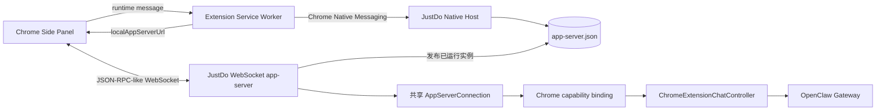

# Chrome 扩展内部接口

本目录是扩展和桌面端维护者的参考，覆盖 Native Messaging 实例发现、app-server 的 Chrome 附加能力和网页桥内部契约。
第三方业务网页通过随包 SDK 接入，步骤见[网页接入指南](../website-sdk.md)。

## 文档导航

| 要查的问题                             | 参考                                                                             |
| -------------------------------------- | -------------------------------------------------------------------------------- |
| 如何发现已启动的应用？                 | [Native Messaging](native-messaging.md) 中的注册、消息帧、握手和 rendezvous 文件 |
| WebSocket 如何鉴权？有哪些方法和通知？ | [WebSocket app-server](app-server.md) 中的初始化、请求和订阅                     |
| 消息、线程、页面上下文有哪些字段？     | [数据模型](data-models.md) 中的 Thread、Turn、富显示 Item、状态映射和输入        |
| 如何判断运行结束？断线后如何恢复？     | [生命周期、错误与恢复](lifecycle-errors.md) 中的停止、结算、错误码和重连顺序     |
| 网页按钮如何经过授权、草稿和单次发送？ | [网页关联操作](webpage-launch.md) 中的内部方法、来源与回执                       |
| 集成方必须提供哪些标准能力？           | [宿主接入要求](../protocol-contract.md) 中的文本／图片、模型、归一化和限制       |
| 兼容范围和发布验收怎么核对？           | [兼容性与测试](compatibility.md) 中的固定基线、已实现子集和验收步骤              |

## 协议分层

| 层          | 传输                                                 | JSON-RPC 标头                | 用途                               |
| ----------- | ---------------------------------------------------- | ---------------------------- | ---------------------------------- |
| Native Host | Chrome Native Messaging，4 字节小端长度 + UTF-8 JSON | 必须为 `"jsonrpc":"2.0"`     | 版本协商、发现已运行实例的动态地址 |
| app-server  | `ws://127.0.0.1:<port>/app-server?token=<token>`     | 按 Codex app-server 约定省略 | 会话、消息、运行状态与通知         |

Chrome、通用本机 WebSocket 与 CLI 的 app-server 共用 `AppServerConnection` 解析、初始化和路由，两类 WebSocket 也复用同一传输。
基础 Thread／Turn／Item 共用同一协议。Chrome 仅访问 `source: chrome-extension` 的会话，Native Messaging、`chrome` 字段和网页桥仅由 Chrome binding 提供。
各入口独立管理凭据、会话归属和断开策略。详见[宿主接入要求](../protocol-contract.md)。

`chrome/thread/stream` 提供实时消息，`chrome/thread/updated` 校准富历史，标准 Item 通知按共享协议输出。

## Chrome 发现协议版本与身份常量

| 名称                 | 当前值                             | 说明                                |
| -------------------- | ---------------------------------- | ----------------------------------- |
| Chrome extension id  | `jboajogplelmaahjbomgflnfngpolgcb` | 由 `manifest.json` 固定公钥稳定派生 |
| Native Host name     | `app.chrome_extension`             | Chrome 注册表和扩展必须一致         |
| manifest schema      | `2`                                | Native Host 握手版本                |
| native host protocol | `2`                                | `codexRuntime/*` 方法版本           |
| app-server protocol  | `4`                                | rendezvous 与扩展期望版本           |

表中版本号用于 Chrome Native Messaging 与 rendezvous。修改 Chrome 协议版本时，须同步更新桌面端、扩展、测试和本目录文档。
新增可选字段可保持当前版本。删除字段、改变字段含义或改变时序需要提升相应版本。

app-server 以 Codex 公开 JSON-RPC v2 形态为基线，当前只实现列出的子集。官方来源及 Schema 导出版本见[兼容性基线](compatibility.md#对照依据)。
Native Messaging 启动协议来自对本机 ChatGPT 扩展 `1.26.901.11451` 的静态分析，属于私有参考协议。
历史协议参考基线为 2026-09-18。当前支持范围以本目录和仓库实际注册代码为准。

## 包内实现与宿主要求

客户端模块位于 `conversation-overlay/modules/`，侧栏入口为 `conversation-overlay/sidepanel.js`，网页 SDK 入口为 `conversation-overlay/chrome-assistant.js`。
宿主需提供发现、鉴权、会话来源与原生执行校验。详见[宿主接入要求](../protocol-contract.md)。
