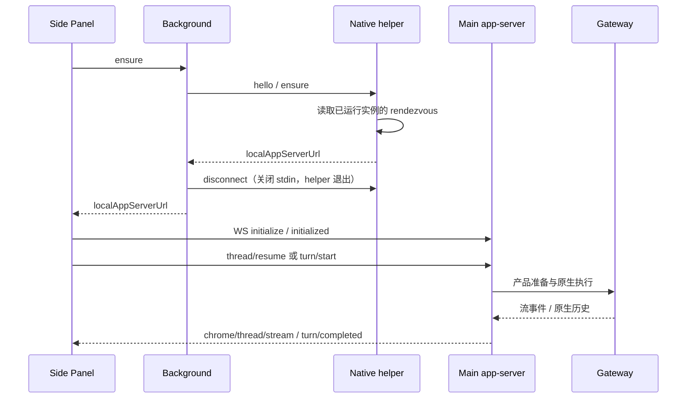

# Chrome 扩展侧栏对话

在 Chrome 工具栏点击扩展图标，即可打开侧栏聊天。你可以新建对话，或继续从扩展发起的会话。网页也能用按钮在侧栏准备一份独立草稿。

## 1. 用户入口与范围

| 你想做什么     | 从哪里开始                                                                                                                                               |
| -------------- | -------------------------------------------------------------------------------------------------------------------------------------------------------- |
| 开始普通聊天   | 点击 Chrome 工具栏里的扩展图标。在侧栏顶部选择「新对话」或扩展已有的会话，在底部输入消息并发送。                                                         |
| 处理网页请求   | 点击业务网页上的对话按钮。首次使用该网站时，在侧栏输入框上方核对来源并点「允许连接」，然后核对草稿和发送方式。见[网页入口](website-launch.md#用户流程)。 |
| 管理已连接网站 | 点击侧栏右上角的「连接设置」，在英文设置页的 **Connected websites** 区域调整发送、分享权限，或撤销网站连接。                                             |

侧栏的会话列表只显示扩展创建的会话。在桌面应用中，这些会话位于「Chrome」分组，也可在桌面继续。工具栏的[模型、权限与附件](#5-模型权限与附件)适用于普通聊天。需要附带当前网页内容时，查看[页面上下文](#4-页面上下文的明确授权)。

「连接设置」也管理自动化的 Automatic connection、Manual connection 和 Tab Access。自动化配对与侧栏聊天是两条独立连接。聊天连不上桌面应用时，先检查应用是否已经启动。Background color 的选择会自动保存，设置页和已打开的侧栏都会应用该颜色。

维护者可查阅下文的[建连和生命周期](#2-建连和生命周期)及[Chrome 接口](protocol/README.md)。

## 2. 建连和生命周期

### 发现已启动的桌面应用

侧栏经扩展后台发现桌面端的 app-server，然后直接与 app-server 建立聊天连接。

Native helper 只负责 framing 和实例发现，Electron GUI 不直接承担 Chrome stdin/stdout。app-server 每次启动随机 loopback 端口和 capability；退出清理发现信息，客户端重连重新取得地址，不能长期缓存旧 URL。

每次发现独立创建 Native Messaging 连接，在同一条连接完成 `hello / ensure`。
成功、协议或地址校验失败、断连和超时均释放该连接，helper 在 stdin 关闭后退出；
并发侧栏和自动配对的发现互不影响。取得地址后，侧栏和自动配对直接连接 Main 的
WebSocket，不保留 helper 作为后台常驻进程；再次发现由 Chrome 按需启动。
helper 文件名为 `<productName>-chrome-extension-native-host.exe`，保留产品名但不含协议版本号。

### 连接恢复与自动化配对

开发版和安装版统一仅连接用户已经启动的实例；实例未运行或收到扩展重启请求时返回提示，
不会启动应用、重启 app-server 或删除已有发现信息。连续连接失败只重新发现和连接，
不会升级为重启请求。开发态运行日志保留在启动终端，安装版日志写入应用日志目录。
应用尚未运行的结构化错误映射为原生可重试配对结果，避免进入需要人工重置的永久失败状态；
用户稍后启动应用后，watchdog 可继续发现实例并完成自动配对。

侧栏连接按发现、WebSocket 打开、协议初始化分别设置期限；打开前断连也必须释放等待。
每次尝试有独立代次，旧 socket、迟到发现和已销毁面板的响应不能接管新连接。
原生错误码保留到侧栏，用可操作的中英文提示区分 host 缺失、应用未启动、连接超时和初始化失败。
扩展声明必需的 `http://127.0.0.1/*` 本机访问权限；网页上下文的广域权限仍按用户操作单独申请。
固定 extension Origin 和随机 capability 继续是 app-server 的准入条件，端口可达不代表授权。

自动化 relay 负责控制已授权网页。Automatic connection 通过同一个产品 Native host 发现 app-server，再经独立的 `chrome/extension/pair` 方法取得锁定运行时生成的本地 Gateway 配对信息。它复用发现与鉴权，不调用聊天 Controller，也不新建线程或发送消息。配对仍由上游原生状态机应用，Disconnect 可撤销迟到结果，手动配对不能被自动结果覆盖。重新配对 relay 不会修复 Native host 发现失败。

扩展设置页独立于上游 relay 基线，固定使用英文。界面品牌从产品元数据注入，扩展图标复用应用图标。

## 3. 当前协议子集

侧栏聊天与 CLI、通用本机 WebSocket app-server 共用 `main/clients/appServer/protocol/AppServerConnection` 的请求解析、握手、方法路由、错误与通知出口。Chrome 与通用入口也复用 `AppServerWebSocketServer` 传输实现。两类入口各自保有凭据和能力 binding。Chrome 使用自动发现和固定扩展 Origin，通用原生客户端使用设置页复制的 Bearer 配置。

浏览器服务负责鉴权和生命周期。浏览器能力 binding 负责历史投影、订阅共享和运行校准，客户端请求不能改变绑定的能力或会话范围。浏览器专属方法、通知常量及网页关联错误映射定义于 `src/main/chrome/chromeAppServerProtocol.ts`，由浏览器 binding 使用固定白名单注册到通用 `extensions`。公共 app-server 目录不引用浏览器模块。客户端依赖及执行围栏见[宿主接入要求](protocol-contract.md)。

初始化、model/list、thread/start/resume/list/read/loaded/list/name/set、历史 Turn/Item 分页、退订、turn/start/interrupt 与标准 Item 通知均使用共享协议。浏览器特有输入位于 params.chrome，当前选项和授权图片分别使用 chrome/composer/options、chrome/thread/image；富历史与原生增强流另由 chrome/thread/updated、chrome/thread/stream 提供。不宣称实现官方的全部能力。

Main 复用 Cowork 身份、权限、模型和原生历史。流直接转发原生生成事件，历史轮询只用于快照校准和终态确认；扩展本身不建立另一份持久 transcript。

扩展通过 thread/start 新建的产品会话保存 `source: chrome-extension`。
桌面会话列表按此来源自动归入“Chrome”分组，默认收起、显示会话数量，
选中其中的会话时自动展开；组内按最近活动排序，置顶仍保留在来源分组内。
该分组由列表投影生成，不写入用户分组表，也不提供改名、删除或移出操作。
扩展会话仍可在桌面继续、重命名、删除和搜索。扩展的列表、历史、图片、订阅、模型/权限选择、发送与停止均在 Main 按产品会话的 `source: chrome-extension` 核验；传入其他来源的产品 ID 也不能接管会话。
来源在重启后保留。此前未记录来源的会话保持原有列表归属，不依据标题或消息正文推断来源。

### 空历史与待处理输入

用户气泡只呈现正文和附件，宽度随内容收缩，并限制在消息区可用宽度以内；正文末尾不保留 Markdown 段落的额外空白。
发送、准备和结果核对沿用输入区上方的运行活动条。原生待处理输入的「等待处理／已取消／已中断」或「内容未完整加载」以所属气泡下方的独立次级说明展示，不参与气泡宽高计算；完整说明仍用于悬停及可访问描述。这些输入状态不代表整轮执行结果。
仅待处理元数据变化时保留原正文与图片节点；消费回执移除状态说明，不预留空行，也不据此重发输入。

新建产品会话可能尚未创建原生会话或 transcript，此时 `chat.history` 合法返回不带游标的空页，甚至没有 `sessionId`。Main 再次读取并确认空页和身份未变化后返回空历史，不发布正文快照；读取失败、非空但缺少身份/游标、待处理输入不完整时仍报错，不能当作新会话。已有历史的完整页使用顶层 `sessionId`，增量页使用 `sessionInfo.sessionId`；分页、回执和最终确认均校验同一物理身份。

首条输入已接收但尚未创建 transcript 时，正式历史也没有游标，`pendingInputs` 可以非空。Main 在同一物理会话内读取待处理分页并用不带游标的 `inputRunIds` 请求核对回执，确认正式历史仍为空、每个待处理页的身份、状态及可见性未变化后返回临时投影。取消或撤回旧页输入也可能不改变总数，不能只确认第一页。若期间输入已消费、状态改变或正式历史出现，则重新读取完整快照；待处理正文仍不进入 Main 历史快照。

## 4. 页面上下文的明确授权

需要让助手参考当前网页时，勾选输入框下方的「包含页面上下文」。授予读取权限后，扩展会在发送时采集当前页标题、URL、选中文字及一段可见正文。关闭开关后，发送时不采集网页。页面导航后，原快照只代表采集时的页面。

页面正文及最终不可信上下文分别限制 24,000 个 UTF-16 code units。这是发送时的快照，模型无法通过它在稍后按需读取整页。

Main 将上下文放入仅限认证本地客户端的 `justdoUntrustedContext`，原生只加入本轮 Agent 输入。持久用户消息保留原始文字，无需 Renderer 隐藏注入前缀。网页可能包含 prompt injection，其中的指令属于不可信数据。

## 5. 模型、权限与附件

在输入框下方选择模型和权限。启用「完全访问」需要额外确认。选项加载时暂时无法发送，加载完成后可以继续编辑原草稿。

通过「+」菜单添加附件，最多 5 个，原始总大小上限 4 MiB。可只发送图片或文档。图片需要当前模型支持视觉输入；切换会话会清除未发送附件，避免夹带到另一场对话。

`chrome/composer/options` 完成宿主准备并返回当前模型和权限，再由标准 `model/list` 分页读取可用模型。模型目录以原生实际能力为准，已保存的会话和助手引用不能补充缺失模型。加载完成只恢复草稿，用户仍需确认发送。

图片通过标准 image/data URL 输入，文档保留 `chrome.attachments`。只发送附件时保留空文本。入站 WebSocket 上限 8 MiB，Main 再次校验输入。发送成功表示原生接收，运行结束另由运行事件确认。

### 侧栏审批

命令和实验插件审批在侧栏独立面板显示，包含真实命令、工作目录、原因和明确选项。
实际发送连接在 Main 捕获原生身份后拥有审批，观察者不接管；早于 ACK 的审批等精确 ACK 确认后才呈现。
命令可允许本次、拒绝、取消；安全条件满足且服务端明确提供时，可授权同连接同会话的相同命令。
该选项要求实验能力协商，并按命令／环境／执行计划指纹匹配；每次仍向原生回传 allow-once，
不写永久命令规则，身份、连接或退订范围变化立即撤销。
原生 bundle-mcp 明确提供 App 持久 action 时，插件确认才出现“始终允许此 App”及其实际范围说明。

审批不默认选首项；标准问答 UI 的 Secret 使用密码输入，侧栏不把答案写入草稿、日志或本地存储。
Secret 是客户端展示能力，当前原生插件确认不发送 Secret 问题；原生结构化问答使用下面的独立桥，不套用插件权限确认格式。
审批早于发送响应时，响应返回不会将焦点从答案输入框切回普通草稿；表单撤回时清空密码值。
切换会话、断线、过期、停止或 serverRequest/resolved 立即撤回交互，迟到选择不能授权。
Cancel 先拒绝本审批，再停止精确所属运行；普通退订／断线仍只撤观察和交互，不自动停止工作。
计划审核和独立文件变更审批仍沿各自契约，不伪造成命令审批。

### 工作目录

输入区的“+”菜单提供附件和工作目录入口，目录项显示当前目录；点击后以与桌面相同的说明展示当前目录、浏览文件夹及近期目录。
近期列表仅取默认目录与 Chrome 来源会话，不枚举其他来源会话的路径。
新会话省略选择时沿用全局默认；明确选择只作用于当前草稿，不创建空会话或修改全局设置。
Main 系统选择器或服务端近期目录校验签发绑定当前连接及草稿／会话的短期单次凭据，
切换、断线后的迟到选择不得修改当前界面。网页 SDK 不获得选择目录的能力。

已有会话更换目录复用桌面的领域校验：本会话及后代须确认空闲，未知发送、停止、
目录准备、计划处理及托管会话均不得绕过；保存前比较原目录与身份。
保存只改变产品期望 cwd，下一轮发送仍准备并回读原生 mode/root；发送全程保留最初
工作根并在最终准入时复核。历史与文件不迁移，已有终端保留原目录。

### 原生结构化问答

普通 Chrome 会话的 `ask_user_question` 弹窗由宿主构建适配复用桌面问答向导，
支持逐题导航、单选／多选、选项补充输入、其他答案和跳过，保留真实题目／选项 ID。
超时策略与提示来自原生请求，不预选默认答案或由侧栏计时代答。
当前不接管插件托管或子执行的问题；来源不明时不按父会话或显示文本猜测归属。

侧栏在显式订阅后读取经过 Main 精确来源和原生身份检查的待回答请求。
变化通知只使快照失效，重连重新查询，不从历史工具卡片生成可回答表单。
提交复用桌面的统一回答锁和原生确认流程；桌面和多个侧栏可展示同一问题，
首个确认的回答撤回全部视图，结果未知时先核对 pending，不能自动重发答案。
切换会话、关闭侧栏或断线仅清理界面；显式取消表示取消本次问答，按原生语义继续处理，
不等于停止运行。命令／插件审批优先显示并暂存问答草稿，审批完成后恢复焦点。
问答草稿不写普通输入框、本地存储或日志；历史继续使用只读问答展示。

## 6. 展示和中止

输入框上方的活动条显示当前运行阶段和已用时间。要停止本次运行，使用输入框右下角的「停止」按钮。收到停止请求后，侧栏继续等待执行结束确认。连接中断时可在恢复后查看原请求状态，避免重复发送。

### 发送接纳与未知结果

发送时只保留一份乐观用户气泡：会话创建和页面上下文采集期间使用临时占位，会话准备好后立即交给流投影并移除占位。后续运行确认、流事件和正式历史更新不会再次追加它；历史读取失败仍保留流中的用户输入与回复。连续发送相同文字仍分别显示。

每次提交在侧栏预先生成 `clientTurnId`，服务端保存同一输入身份；成功接收、发送结果未知及明确未发送分别处理。
提交等待期间最多暂存 64 个流事件、100 万 UTF-16 字符，取得显式 `nativeRunId` 后才通过原 reducer
投影该运行的帧；同会话迟到的旧运行不能抢占新输入。超限丢弃整条临时缓冲，本轮余下展示只读取权威历史校准，
不显示缺前缀的 delta；被动查看已有会话仍沿原生历史和流准入，不为此建立发送绑定。
未知提交保留原消息投影与身份，冻结该会话的再次发送；恢复连接后通过
`thread/resume({threadId,excludeTurns:true,chrome:{includeDisplay:true,turnId}})` 重建观察并核对。
单独 `thread/read` 仍可核对，但不建立订阅。
只有明确 `requestSent:false` 才撤回乐观输入并恢复可编辑草稿；不自动重发请求。

运行层确认该输入的发送 owner 已关闭且未发出原生消息时，准备失败或取消也归入明确未发送，
清理本次输入的待接纳状态；前序未知运行和停止等待仍由原有保护约束。

### 停止、断线与精确结算

停止绑定当前 turn 与确切原生运行，不因面板切换取消另一会话。Stop ACK 只进入停止等待；
idle、Chat final、读取失败和轮询超时均不结束运行。只有同一执行的原生 whole-run 结算证据
才能产生标准 `turn/completed`；增强 `chrome.activeTurn` 另带 `executionSettled:true`。断线保留已知身份并暂停操作，重新发现、初始化与读取原生历史后核对。

公共原生事件有意省略内部 `lifecycleGeneration`，不能把该字段设为收到整轮回执的前提；
同一原生 run、物理 session、原生序列和 Main 连接代次仍须精确匹配，出现显式代次时继续拒绝冲突。
明确 timeout 保留为失败，不能把模型超时触发的机械 abort 当作用户停止；yield 继续等待核对。

错误正文仅使用已收到的原生或路由公开原因；缺少原因时仍保留已核验的失败状态和
`executionSettled:true`，不补写原生失败摘要。历史消息按真实角色、`stopReason` 和来源
身份保留展示事实，不因正文恰好等于某条失败文案而隐藏普通回复。

#### 终态补查与冷重启限制

若错过 live 终态，Main 仅在仍持有本进程发送准备的原生身份绑定时，补查该 run 的
`agent.wait(timeoutMs:0)`；前后会话描述、当前连接代次、原生 run 映射与来源须保持一致。
合法整轮终态必须有有限 `endedAt`，超时但没有结束时间、运行中、yield 或身份变化都保持未知。
已核验结果保留为最多 100 项无正文的终态元数据，连续轮询及替换面板仍重新核对身份，
不会因原生短期回执过期而把已确认结算改回未知。冷重启后没有原发送绑定的旧运行仍不能靠当前描述、
正文回复或 idle 证明完成；刷新只核对，不自动重发消息。

### 消息与过程展示

Markdown 使用扩展离线 bundle，仅允许 `details` / `summary` 折叠结构（仅保留 `details` 的 `open` 状态），其内部继续渲染 Markdown；其它原始 HTML 保持转义，标签事件和样式属性不透传。代码块和行内代码中的标签保持字面展示。安全链接在外部 Tab 打开，不从 CDN 动态载入脚本。
消息展示分为三个独立的浏览器模块：`sidepanel-messages` 拥有稳定 DOM、披露与阅读位置，
`sidepanel-activity` 拥有运行活动条和界面时钟，`sidepanel-i18n` 提供中英文案；
`sidepanel.js` 继续拥有连接、发送、停止和会话订阅，不另建执行控制器。

输入区上方的运行动态使用 11px 单行展示，优先保留当前阶段与耗时；工具详情、计数和最近更新说明在剩余空间内省略，悬停可查看完整内容。窄侧栏不增加状态行数，显示取舍不改变原生活动或执行结算语义。

#### 阅读布局与复制

侧栏采用阅读优先布局：用户输入使用右对齐、随内容收缩的浅色气泡，助手正文占满阅读区，
不设置独立头像列或回答卡片。助手以小型角色标题标识，正文使用 15px / 1.65 的排版；
段落、列表和轮次分别留白，窄栏减少边距与轮次间距，不缩小正文。Markdown 标题按层级
限制在 20px 以内，列表缩进保持紧凑，长链接可断行；代码及宽表在各自区域内横向滚动，
不撑宽侧栏。亮、暗、暖、蓝四套主题共用此布局，过程入口使用次要文字色，真实工具状态
保留颜色及形状差异。

助手回答下方常驻可键盘操作的复制图标，悬停提示与读屏名称为“复制回答”。复制内容来自与显示相同的原生消息归一化，
仅保留本条消息的正文文本，不包含工具过程、附件内部数据、角色标题或复制控件。
代码块提供独立语言栏和复制按钮，复制该代码块的原文；宽代码在标题栏下滚动。
复制结果就地提供成功／失败反馈，不以剪贴板失败触发重发或其他会话操作；正文更新、
会话切换或界面销毁后，旧复制请求不能恢复过期反馈。

回答底部同时展示可确认的原生消息时间和实际回复模型。时间简写为本地时分，悬停或读屏可读取
完整日期、时分秒；它表示消息记录时间，不表示整轮执行结束。模型仅使用该条原生助手消息的
模型／提供方身份，过滤 Gateway 内部注入标记，不使用输入框选择或会话默认模型填补。
缺失或非法的时间、模型分别隐藏；元数据补全不重建正文或打断复制反馈。
侧栏暂不展示整轮结束后的耗时：当前消息分段不能替代精确运行回执，不使用相邻消息时间差估算。

输入框减少阴影，附件、网页上下文、权限、模型与圆形发送／停止按钮位于同一工具栏。
标准操作优先使用图标，模型与权限选择显示当前值；工具栏保持单行，长模型名在可用
宽度内省略，不因模型名称或运行阶段变化反复换行。页面上下文开关使用网页图标、选中底色、
悬停说明与读屏名称，仍只按原有显式授权与发送时采集规则工作。

#### 与桌面共用的过程折叠

侧栏通过宿主构建适配导出的 `foldChromeExtensionEntries` 复用桌面的
`foldCompletedProcessRows`，不在插件中复制历史收拢规则。以用户消息和明确阶段边界分段，
将最后正文前连续的已结束 Thinking、Tool、中间正文、压缩标记和进度回执合入同一历史过程区域，
最后正文整体保持可见；缺少最终正文、正文后的过程、未结束或状态未知的工具继续直接显示。
明确的原生失败回复、`stopReason:error/aborted`、媒体与交互内容保留为可见边界，
工具失败、取消或中断本身不阻止其它已结束过程收拢。

结构化 `ask_user_question` 与桌面使用同一个只读问答组件。等待、已回答、超时默认及取消／中断／失败
均归入现有「展开处理过程」默认折叠，即使末尾轮次受保护或缺少最终正文，也仅收起问答项。
最终正文与其它活动工具继续遵循原规则。有最终正文后，问答与邻接过程合成一组，不叠加处理过程入口。
人工提交右侧展示原问题与回答；超时默认逐题显示实际答案及系统归属，未采用默认值时不编造答案。

外层区域使用与桌面相同的历史图标和“展开处理过程／收起处理过程”入口，无汇总次数、
背景或边框。内部连续 Thinking/Tool 使用过程摘要，默认一次只展开一个摘要；
展开后 Thinking 正文直接可读，不增加第三层 Thinking 披露。原始工具 Input/Output
仍可独立展开。活动 Thinking 直接可见，工具活动保持独立，不等待整轮结算才显示。
关闭的历史区域首次打开才挂载正文；已挂载项目在活动、摘要、历史外组之间移动时复用
可核对身份的节点，保留焦点、工具内部阅读位置及用户选择。
偏好按产品会话保留在最多八个临时作用域中，不写入原生历史或产品数据库。

#### 批量展开与选择保留

标题栏提供与桌面同图标、同文案的“展开所有过程详情／折叠所有过程详情”按钮，
同时更新 `title`、读屏名称和 `aria-pressed`。批量操作同步展开历史外组和内部过程摘要，
并覆盖此前的过程单项选择；之后仍可单独展开或折叠，后续流和历史更新保留该选择。
批量展开后可同时打开多个摘要，也可逐项关闭。再次批量折叠时历史过程收起，
当前活动 Thinking 和工具反馈继续可见；
原始工具 Input/Output 详情保留独立选择，不因批量操作自动打开或关闭。
切换会话将批量模式恢复为默认收起，不把上一会话的批量展开带入另一会话。

提交等待、发送结果未知、已接纳但未结算、停止等待及尚有活动流的末尾轮次受保护，
不会因 Chat final、Stop ACK、idle 或某个工具完成而被包入历史外组；较早轮次仍可收拢。
该保护只控制展示，不产生或替代执行终态。

#### 来源身份、问答与不支持的交互

Main 仅透传经过白名单筛选的 `display` 信息，保留原生失败、停止原因、压缩和阶段边界。
问答另透传经插件纯契约验证的 `questionResult`（题目快照与实际响应）；认证原生历史的完整 JSON
工具结果正文可在自定义 details 被过滤后恢复该投影，不解析英文、不增加正文缓存或改写原生角色。
原生 `sourceId`、同消息 `sourceIndex` 与 commentary `sourceSegmentId` 用于区分显示来源；
未知重复形状另保留局部 occurrence，不把它升级为原生身份。实时到历史已有可靠对应的行
使用有界、仅保存 ID 的本地显示映射；没有真实对应时不按重复正文猜测另一条消息的身份。

压缩内容直接复用桌面展示器和样式，保留原生 token 指标、摘要独立展开及终态原因；
`progress_card` 回执复用桌面的轻量文案投影。实时压缩只有在原生提供实际 marker/message
时才显示对应记录；没有正文的压缩占位继续由执行活动条反馈，不制造摘要或完成状态。
纯未支持的交互内容只保留“此内容请在桌面应用中查看”的可见边界，不加载未知 HTML，
不为 Widget、MCP App 展示或未适配的审批类型伪造准入；已支持的命令／插件审批使用独立标准请求面板，
不会从历史工具卡片恢复审批或借用过期选择。

#### 动画、活动条与阅读位置

消息入场、折叠高度/透明度及工具状态采用本地 CSS 动画，以持续星芒与文字流光反馈运行。
Windows 关闭系统动画或请求 `prefers-reduced-motion: reduce` 时仍保留这些效果。
正文直接绘制最新准入文本，不排队逐字播放。

输入框上方的活动条显示真实启动、工作区准备、等待模型、思考、回复、工具参数生成、
工具执行、压缩及重试阶段，并显示观察耗时。阶段和原生计数复用桌面聊天的纯投影：
工具进度文本与输出字符数独立于最终结果，只有原生提供的计数才展示，不计算完成百分比或剩余时间。
活动先通过同一 run、物理会话、generation 与序号准入；旧快照可补工具正文而不能倒退阶段。
每秒时钟更新不重建活动节点，读屏只播报阶段变化，不反复播报耗时与计数。

用户向上滚动、触摸或使用阅读按键时立即暂停输出跟随；工具内部已经消费的滚动不接管外层。
后续更新保留阅读锚点，用户回到底部或点击悬浮的“返回最新消息”才恢复跟随。

工具参数的流式预览和无正文进度状态不创建执行中的 Tool 卡片；收到真实工具 start 后才显示执行卡，随后由原生结果更新完成状态。

## 7. 安全边界

Native manifest 只允许固定公钥派生的扩展 ID。app-server 校验 capability、精确 extension Origin、path 和消息大小；Gateway token 和 relay key 不返回 Side Panel。Origin 不是单独凭据，随机 URL capability 也不能写日志。

页面内容、附件和协议 payload 都要验证。新增方法必须明确 owner、取消、权限和消息持久化边界，而不是把 Gateway RPC 通配透传给扩展。

## 8. 维护、测试和未交付范围

### 源码与构建

本包的 `openclaw/` 保留锁定上游 relay，`conversation-overlay/` 提供侧栏与客户端模块，`scripts/` 和 `tests/` 保存本包组装及验证入口。桌面运行时、Native Host 及共享聊天构建适配由集成宿主提供；本包迁仓不表示这些宿主依赖已经实现独立构建。

宿主浏览器适配集中在 `src/renderer/chrome/`：`chat/` 复用聊天库提供流、活动、
显示、时间线和富内容适配，`questions/` 复用桌面问答向导并维护侧栏专属样式。
宿主 `scripts/chrome/` 保留构建与 Native Host 准备入口，将适配器构建为本包的离线模块；
本包不直接导入应用 `src`。桌面扩展管理页面和文案仍归桌面功能，不属于侧栏客户端。

`chrome-extension:prepare` 从该包生成 `build/chrome-extension/chrome-extension/`，安装包继续交付到 `resources/chrome-extension/chrome-extension/`，显示名称从产品元数据注入，扩展 ID 与配对身份保持既有值。详见[构建与发布](integration.md#构建与发布)。

产品组装保留锁定上游的 `manifest.version`，不将应用发布版本注入扩展 `version_name`。桌面“扩展版本”仅读取实际组装产物的 `manifest.version`，用户可在 Chrome 扩展管理页 → 详情 → 版本查看已安装版本并核对。应用版本与扩展版本分别维护；版本号不参与协议兼容判定，版本相同也不能代替连接验证，桌面不据此推断已安装扩展版本。

日常 UI 修改在 conversation-overlay，relay 基线由锁定 OpenClaw 版本更新，构建接缝单独审查。回归包括 Native host 未安装、实例未运行、禁止启动与重启、旧 rendezvous、非法 Origin/token、初始化前调用、流与历史重合、停止、超限附件和页面上下文分离。

共享聊天解析或 stream reducer 变化时，先运行 `chrome-extension:build-markdown` 与 `chrome-extension:build-stream`，提交对应生成物，再执行 `chrome-extension:prepare`。后者只组装已有模块，不替代前两项生成；侧栏 DOM 回归直接加载提交的模块，必须验证参数流不会提前显示 Tool 卡片。

### 验证路径

标准图片、审批面板和失效选择也纳入回归；单元／隔离浏览器夹具与真实原生链路的验证范围统一见
[兼容性与测试](protocol/compatibility.md)，不以表单测试代替 Native 权限生效或模型视觉验收。

安装连接验收分开验证实际编译的 Native host framing/发现链和隔离 Chrome 的 loopback
WebSocket/侧栏流程；中文和空格路径、无公网依赖、冷连接失败后恢复也必须覆盖。
fixture 和本开发机通过不代表已复现用户安装现场；真正安装器、Chrome 安装与内部模型的整链验收仍需使用最终发布包执行。

### 当前能力边界

当前不能将手动 Chrome 加载验证扩展为所有 Chromium 浏览器/商店发布承诺。右键提问、YouTube transcript、tab mention 等未接通能力不列作现有功能；新增时需同步[兼容规范](protocol/compatibility.md)。

折叠的分组和主要操作复用桌面规则，仍有协议能力差异：当前没有完整的原生物理会话／
历史 generation 显示作用域，不能承诺所有无可靠来源 ID 的历史更换都保留节点和选择；
明确 reset 会隔开过程，但尚未复用桌面在非计划 reset 时清除旧显示前缀的完整投影。
侧栏也不提供桌面 Widget／MCP App 的完整展示与工具交互、计划审批、Monaco 工具差异和完整历史定位能力。
原生明确提供的 App 权限确认已可通过标准审批面板处理，不等于支持 MCP App 的完整 UI。

## 上游来源与验证范围

relay 的来源提交、校验和及覆盖位置由扩展组装脚本维护。升级须核对锁定运行时的完整原始基线，并在安装版中验证 Native Messaging 与 relay。组装脚本位置见[宿主集成](integration.md#源码入口)。

历史来源记录不作为当前产物的端到端通过证据；本包的已验证与未验证范围见[兼容性说明](protocol/compatibility.md)。
