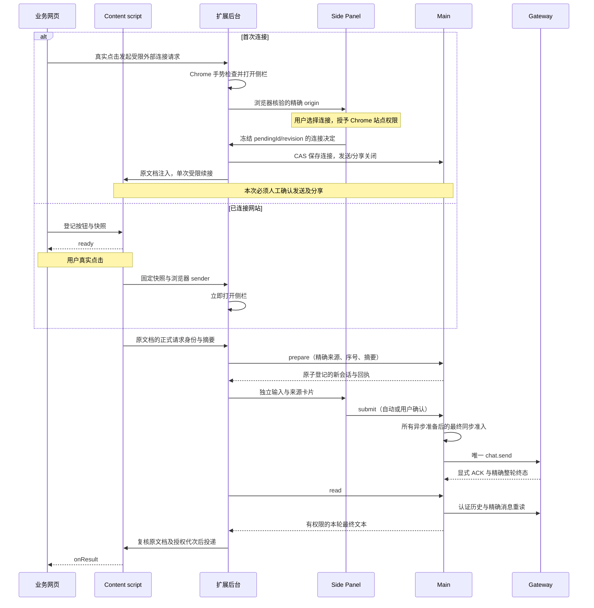

# 网页按钮发起扩展对话

点击业务网页上的对话按钮，可以在 Chrome 侧栏发起独立对话。第一次使用某个网站时，先在侧栏允许网站连接，再核对原请求带来的草稿。已经连接的网站按你授予的发送和结果分享权限处理后续请求。

业务开发者可从[网页 SDK 接入指南](website-sdk.md)开始。维护者可查阅[扩展内部接口](protocol/webpage-launch.md)。

## 用户流程

### 第一次使用一个网站

1. **启动桌面应用，然后点击网页上的对话按钮。** Chrome 打开扩展侧栏，在输入框上方显示「允许此网站连接？」卡片和当前网站地址。
2. **核对网站地址，点击「允许连接」。** 地址包含协议、主机和非默认端口，例如 `https://business.internal:8443`。Chrome 若另行询问是否允许访问该网站，请在浏览器提示中确认。选择「拒绝」会结束本次请求。
3. **核对草稿。** 连接成功后，刚才点击时提供的消息直接填入侧栏底部的输入框，输入框上方显示「网页发起的对话」卡片。网站提供了额外材料时，可在卡片中展开「网页提供的上下文」。
4. **确认发送和分享。** 可以先修改草稿。网站请求回传结果时，卡片会勾选「将本轮结果返回此网站」，并显示「发送并返回结果」。若只想在侧栏查看结果，取消勾选，再点「仅发送」。网站只请求对话时，直接点「仅发送」。批准网站连接后，本次消息仍等待你发送。

如果侧栏没有打开，可先点击 Chrome 工具栏的扩展图标检查连接，再回到网页点击按钮发起新请求。

这份草稿会进入独立对话。若侧栏已留有草稿、附件或正在读取附件，扩展会保留这些内容。先处理已有草稿，再回到网页发起新请求。

可用仓库中的示例网站体验第一次连接、核对草稿和回传结果。运行方法见[最小可用示例](website-sdk.md#2-最小可用示例)。

### 后续使用与撤销

网站连接会被记住。只有网站请求直接发送、你授予了该网站直接发送权限，且其他发送条件均满足时，后续请求才会自动发送。网站请求返回结果但尚无分享权限时，侧栏会等待你确认。草稿模式始终由你发送。

草稿卡片可能显示「今后允许此网站直接发送」或「今后允许此网站读取结果」。勾选对应选项并确认发送，可以为后续请求保存这项许可。

在 Chrome 侧栏右上角点击「连接设置」，在扩展设置的 **Connected websites** 区域管理网站。**Allow direct sending** 控制直接发送，**Allow returning this request’s result** 控制结果回传，**Revoke website access** 撤销连接。设置页固定使用英文。

| 你想做什么         | 在侧栏怎么操作                                                 |
| ------------------ | -------------------------------------------------------------- |
| 放弃还没发送的草稿 | 在「网页发起的对话」卡片点「取消网页请求」。                   |
| 保留文字自己接着聊 | 点「继续普通聊天」，解除该请求与原网页的关联。                 |
| 发送后关闭回传     | 分享开启时，点「关闭结果分享」。已交付的网站数据无法收回。     |
| 停止已发送的任务   | 在侧栏点「停止」。停止请求发出后，侧栏还会等该轮执行确认结束。 |

返回给网站的正文限于获准分享的首轮最终文本。后续追问留在对话里。答复可能包含助手获准读取的信息，确认分享前请核对接收网站和草稿。

若连接申请已过期，请从原网页重新发起。若发送结果未知，先在侧栏查看原请求，避免重复提交。普通侧栏操作见[侧栏对话](side-panel.md)。

## SDK 与真实点击

将组装产物中的 `chrome-assistant.js` 复制到业务站点，随站点本地部署，不使用 CDN。示例、参数、句柄返回形状和错误处理见[网页 SDK 接入指南](website-sdk.md)。

网页参数相互独立，默认 `draft + none`：

| 参数              | 行为                                                                 |
| ----------------- | -------------------------------------------------------------------- |
| `mode: 'draft'`   | 打开独立草稿，用户编辑并确认发送；已有直接发送授权也不自动提交。     |
| `mode: 'send'`    | 站点已获直接发送授权且所有准入检查通过时自动发送，否则等待侧栏确认。 |
| `result: 'none'`  | 只反馈本次请求的最小状态，不查询或返回正文。                         |
| `result: 'final'` | 请求分享本轮最终文本，须单独获得本次或站点授权。                     |

首次连接续接始终要求人工确认，即使参数是 `send + final`。连接只保存精确 origin 的使用许可，直接发送和结果分享分别授权。字段过滤无法判断自然语言正文是否包含敏感信息。

每次被接纳的网页操作创建 `source: chrome-extension` 的新产品会话。外部输入使用默认模型和 `ask` 权限。已有会话的输入、附件、模型、Full access 或自动整页采集不随请求带入。同一 Chrome 窗口只接纳一个未结束的网页请求，普通聊天可以在自己的会话中继续执行。

编辑文本、上下文、模型或权限会撤销本次自动发送，必须人工确认实际内容。重新打开未发送的外部草稿同样重新确认并恢复默认模型和 `ask`。切换聊天或转普通聊天需解除关联；外部请求不能携带本地附件。网页不支持斜杠命令、指定模型/助手/工作目录或既有 thread ID。

普通侧栏已支持标准图片输入，不扩大网页 SDK 的输入范围；网页入口仍只接收上述文本快照。
站点的连接、直接发送与结果分享授权，也不授予工具执行、命令会话授权或 App 持久权限。
任务需要的原生权限仍由宿主已接入的审批入口单独核验，网页回执和真实按钮点击不能代替工具审批。

### 绑定与接续

首版仅支持 HTTP(S) 顶层 light DOM 内已连接的 `type="button"` 按钮。SDK 用一次性 DOM 定位标记登记；content script 持有真实 Element 和不可变配置版本、预计算摘要。按钮元素不跨 world 序列化，定位标记和请求 ID 不是授权凭据。

已连接网站的 content script 在 capture 点击链核验真实事件、用户激活和按钮引用，冻结已登记参数并生成 requestId 与文档单调点击序号。未连接时 SDK 在真实点击链同步调用受限外部入口；外部入口不能调用任意 RPC，Chrome 的侧栏用户手势检查必须通过。普通 `postMessage`、自定义事件、程序 `.click()` 和定时器不能触发运行。更新登记期间禁用旧绑定；异步业务数据须在点击前准备。

首次连接待确认有独立绝对期限，同一窗口只保留一个。拒绝、超时、解绑或原文档导航会关闭本次连接操作，不能从旧快照恢复运行。用户确认后，仅允许原文档、原绑定版本、原输入摘要进行一次受限续接；content script 分配正式 requestId 和单调序号，Main 在原子准入中核验连接后的全局策略 revision，并强制人工发送/分享确认。不是重新触发点击，也不会回放未知 prepare/submit。SDK 的 `onConnection` 表达连接进度，正式任务句柄仍只由 `onRequest` 提供。

后台顶层同步注册内部和外部监听器，在收到点击消息后立即调用 `chrome.sidePanel.open()`，之后才等待存储、Native discovery 和 Main 权限。打开失败结束本次操作并提示检查扩展；不通过创建新标签页绕开用户手势限制。应用未启动时显示错误，不自动启动、重启应用或悄悄重试发送。

`onRequest(handle)` 先于该请求的状态/结果回调。句柄提供只读 requestId、bindingRevision、接纳后的 launchId，以及 `read()` 和 `cancel()`。句柄仅在原有效文档内使用；不能序列化成跨页面凭据。`update()` 只影响未来点击；`unbind()` 关闭自身绑定及其句柄，并请求撤销未发送输入或分享，其 Promise 完成不证明后端撤回已确认，也不停止已发送执行。

网页收到的结果须以文本展示，不直接交给 `innerHTML`。回调可能重复，SDK 按回执 revision 和输出身份去重；站点仍须自行处理业务幂等，不承诺网页副作用恰好一次。

## 身份与权限边界



来源取自 Chrome MessageSender 的 browser/window 实例、tab、顶层 frame、documentId、active 生命周期及精确 origin，另加通道代次。不能信任网页自报的来源、会话或运行 ID。切到其他 Tab 不改变原请求来源；不使用当前活动 Tab 推断回传目标。

已有 Native discovery、relay 和 Tab control 内部消息同时要求可信扩展页面 sender；content script 的相同 extension ID 不足以访问它们。网页桥仅允许有限的登记、查询和取消，不代理任意 RPC。地址 capability、Gateway token、relay key、产品/原生内部 ID 不进入网页、DOM、错误或日志。

Manifest 的 `externally_connectable` 只允许 HTTP(S) 网页与上述连接入口通信，不授予网页读取权限；省略 `ids`，其他扩展不能走此入口。必需 host permission 仍仅为 loopback，网站访问在连接卡的真实点击链请求。来源拒绝 iframe、非 active 文档、缺失 documentId 和自报 origin；查询/取消必须仍来自原文档。待确认状态与已接纳 Main 文档租约分开，不能以连接重置已撤销的旧租约。

Chrome 的网站访问权限与 Main 的网站连接许可分开管理。Main 按包含协议、主机和端口的完整 origin 核验。撤销网站连接时，保留页面上下文等功能共用的 Chrome host permission。

站点策略是 Main 权威。授权修改提升 revision；最终发送、异步结果读取后和扩展投递前均重新核验。Main 向当前连接发送无正文的 `chrome/webLaunch/changed`，后台重新读取策略并作废旧投递代次。撤权先于 Main 释放正文则不返回；已释放到传输层或已交付的数据无法撤回。

导航、刷新、关闭、pagehide、BFCache 冻结、撤权及主动解绑终止原分享租约，不按相同 origin/tab 恢复。BFCache 返回也需新真实点击。只有单纯传输中断或 service worker 重启，在原文档仍 active、原租约有效且未终止撤销时，才可用新通道只读恢复观察；不重新 prepare/submit。

撤销站点连接或 Chrome 网站权限后，扩展停用旧点击绑定，网页的新真实点击可以重新申请连接；旧请求与旧草稿不因此恢复。尚未建立过扩展文档状态的已绑定页面，首次点击可能仅报告 `SITE_NOT_ALLOWED` 并停用旧绑定，下一次真实点击再显示连接卡；失败点击不自动重放，也不要求刷新。

## 回执、发送与停止

### 草稿和回执的存储

Main 使用现有 SQLite KV 的 `chrome.web-launch.v1` 保存站点策略、文档租约/序号高水位、元数据回执和原生结果引用。`prepare` 在同一连接同步事务中消费点击序号并创建产品会话；提交后才发布变更。Main 不保存 prompt、上下文、最终正文或第二份 transcript。

扩展 `storage.session` 只保存有界未发送输入及关联元数据；发送、取消、解绑和过期后移除输入，不存结果正文。service worker 休眠不依赖长期 Native Messaging 或 offscreen 保活。完整 Chrome 重启更换实例身份，不提供旧网页请求恢复入口。

### 发送确认、取消与停止

`submit` 原子认领唯一 owner/clientTurnId，随后才做异步准备。所有模型队列与会话核验结束后，在实际 `chat.send` 前同步复核 owner、输入版本、期限、文档和策略；中间没有 await。越过该围栏只记录派发尝试，不证明原生接纳。只有显式 raw ACK runId 与 prepared SID、opaque lifecycleRevision、连接代次相符，才建立原生绑定，不能用 rootRunId/clientTurnId 回退猜测。

自动准入期限 120 秒；进入草稿/人工确认时一次性切换为 15 分钟绝对期限。编辑、重开和重连不延期。围栏前取消且 owning sender 证明未发出才释放；围栏后网页 `cancel()` 返回 `TOO_LATE` 并撤回结果分享。未知发送不重试，不依据超时推定失败。

可信侧栏 Stop 保存停止意图：准备中关闭 owner，已派发但 ACK 未到时等精确绑定再 abort。Stop ACK、chat final、idle 和 owner 变化都不证明整轮结束。导航或关闭侧栏不自动停止已发送工作。

### 容量与未知执行

最多 100 个活跃观察，未知执行不靠 TTL 结算。可信侧栏/设置可“解除关联并放弃观察”，关闭/fence 旧续体后释放观察容量；仍保留防重高水位，执行继续 unknown。同来源另起任务须明确确认旧任务结果未知。完整回执被淘汰也不能让旧点击重建；持久文档高水位有界，满时明确拒绝，不删除保护来接纳新任务。

Main 还限制完整回执 300、站点 128、文档租约 256、文档哈希高水位 8192，总 KV 编码不超过 4 MiB；达到上限返回 CAPACITY_EXCEEDED。扩展 session 同样限制观察与文档元数据及总字节，缓存淘汰不能改变 Main 的防重规则。

## 执行、结果与投递分别表达

| 层   | 状态                                                                                                      |
| ---- | --------------------------------------------------------------------------------------------------------- |
| 请求 | drafted / awaiting-confirmation / submitting / submitted / rejected / cancelled / expired                 |
| 执行 | not-started / running / unknown / completed / failed / interrupted；只有精确整轮终态设置 executionSettled |
| 输出 | not-requested / awaiting-consent / pending / available / empty / unsupported / unavailable / withheld     |
| 投递 | connected / revoked；保留类型中的其他状态不代表已有网页业务 ACK 协议                                      |

执行 completed 时输出仍可 pending/unavailable；不能倒推执行失败，也不等于业务动作必然成功。输出 `none` 不读取正文；`final` 仅分享精确首轮文本，不含 Thinking、工具 I/O、历史、媒体字节或下载凭据。后续手工追问、Goal 后继轮和其他运行都不属于此按钮。

结果读取使用认证 Gateway 的精确整轮终态与 live `terminalReply` 候选，按 nativeRunId/物理会话核对历史，再以 `chat.message.get` 重读同一消息及摘要。工具前正文和工具调用可能拆成共享原生消息 ID 的多个片段，必须合并核验后排除。历史迟到保持 pending；缺失、冲突或无法证明归属为 unavailable；不读取“最后一条回复”代替结果，silent 也不自动等于成功空文本。

Live 候选只在内存保留最多 15 分钟；最多 10 次历史就绪查询仍不能可靠绑定时返回 unavailable。已经确定的结果引用可按原生消息重读，不从本地正文缓存恢复。

输入上限为 prompt 16,000 字符、context 24,000 字符、请求 UTF-8 128 KiB；最终文本 UTF-8 256 KiB。上下文最终原生编码包含说明、JSON 与 `<>&` 转义，共享 24,000 字符预算；超限报 `CONTEXT_TOO_LARGE`，不截断。错误只返回闭合公开码和安全文案键，不透传底层堆栈、路径、URL 或原始错误。

## 验证范围与限制

自动化验证分为 SDK/content script/后台来源和真实点击限制、侧栏/设置交互、实际 SQLite 原子回执、发送 owner 竞争、原生 adapter 最终围栏与显式 ACK、精确最终结果投影。包内 `tests/web-launch-*.test.ts` 验证客户端；SQLite、发送 owner 与原生准入测试由集成宿主提供，不能替代完整 GUI 验收。

首次连接还需覆盖：无已授权 host 时绑定就绪、外部入口方法白名单与真实 sender 校验、拒绝/过期/导航、权限拒绝、策略竞争、一次性原文档续接，以及 `send + final` 在连接后仍需人工确认。首次连接的真实浏览器正向点击及 Chrome 授权对话框尚待目标环境验收；已有 content script 唤起探针的证据不覆盖外部消息首次接入。

### 显式浏览器探针

以下命令从集成宿主仓库根目录执行，不纳入普通测试发现：

```text
node plugins/chrome-extensions/chrome-assistant/scripts/verify-webpage-launch.cjs --chrome <existing-Chrome-for-Testing-executable>
node plugins/chrome-extensions/chrome-assistant/scripts/verify-webpage-launch.cjs --review-report <report.json>
```

`--chrome` 使用已存在的 Chrome for Testing 程序，创建隔离的有界面浏览器与 loopback fixture，
等待两次真实操作者点击。DevTools 只观察或停止 fixture worker，不提供 UI 输入。
原 worker 正常回收后，第二次点击可以启动新 worker，不要求复用原 worker。

`--review-report` 只复核已保存的 fixture 哈希、点击/open 身份和清理记录，并另写
`assessment.json`；原 report 的状态和错误保留，事件复核与全新的完整浏览器运行分别表达。
探针不使用已有用户 profile、用户 Gateway、真实公司模型或 transcript 文件读取。
报告保存在 `.agent-tasks/browser-artifacts/`，私有 fixture 状态位于 `build/`。
这是能力探针，不能作为生产网站/扩展集成测试的通过证据。

### 历史证据与剩余验收

2026-11-05 隔离 POC 使用完整性校验的锁定 `v2026.10.7 / win-x64` 随包 Node 24.22.1，验证整轮 terminalReply、工具前正文排除、后继轮隔离和消息重读。`NO_REPLY` 的 failed/silent 不能证明成功空结果。此历史探针由集成宿主提供，不在本包中，不能作为独立包的执行命令。重试、压缩、媒体和跨进程恢复没有完整生产端到端验收，证据不足时保守返回 unavailable。

历史宿主报告保留 strictCurrentSourceProof:false，只证明所选冻结运行时，不是当前完整源码重建证明。

同日 Chrome For Testing 157.0.8103.38 两次人工真实点击确认冷 worker 唤起侧栏及 worker 更换后的再次唤起；timer 和程序 `.click()` 负向控制被拒绝。原 harness 错误要求同一 worker，原 report 保持 failed；`--review-report` 仅对保存事件生成 `capability-confirmed-from-recorded-events`，明确 `freshFullRun:false`。记录位于 `.agent-tasks/browser-artifacts/`，不宣称为修正版全新 GUI 全链路通过。

首次正式业务接入仍需在目标 Chrome、安装产物和内网站点完成四种参数组合与真实模型回传验收。无需公网运行依赖；不支持 iframe、Shadow DOM、页面无操作弹出、回调 URL、跨刷新分享或网页停止执行。

Chrome 依据：[Side Panel 用户手势](https://developer.chrome.com/docs/extensions/reference/api/sidePanel#programmatically-open-the-side-panel-on-user-interaction)、[MessageSender](https://developer.chrome.com/docs/extensions/reference/api/runtime#type-MessageSender)、[storage.session](https://developer.chrome.com/docs/extensions/reference/api/storage#property-session)。
