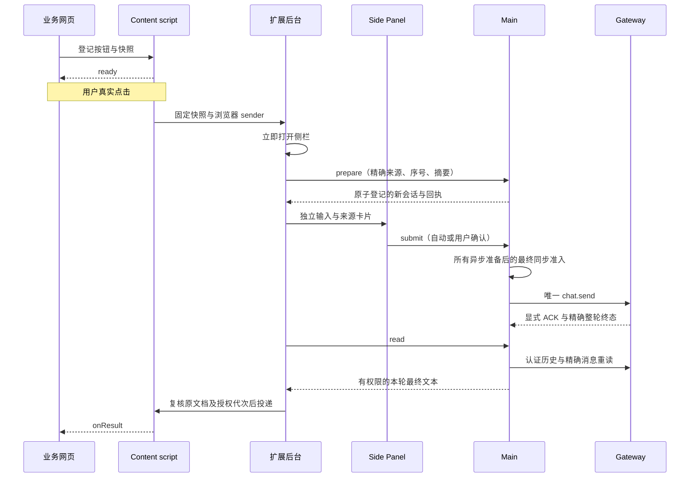

# 网页按钮发起扩展对话

业务网页可通过随扩展交付的本地 SDK 绑定按钮；用户真实点击后打开 Chrome 侧栏，准备独立对话，并按授权决定发送与结果分享。第三方开发步骤见[网页 SDK 接入指南](website-sdk.md)，普通侧栏聊天见[侧栏对话](side-panel.md)，内部方法见[扩展内部接口](protocol/webpage-launch.md)。

## 用户流程

首次使用先在扩展设置的站点管理中添加精确 HTTP(S) origin。设置页在用户点击链请求 Chrome host permission，Main 保存允许接入、直接发送和结果分享三个独立授权；成功后刷新已打开的业务网页。Chrome 权限匹配范围不能替代包含协议、主机、端口的业务 origin 校验。撤销此功能不删除页面上下文等功能共用的 Chrome host permission。

网页参数相互独立，默认 `draft + none`：

| 参数              | 行为                                                                 |
| ----------------- | -------------------------------------------------------------------- |
| `mode: 'draft'`   | 打开独立草稿，用户编辑并确认发送；已有直接发送授权也不自动提交。     |
| `mode: 'send'`    | 站点已获直接发送授权且所有准入检查通过时自动发送，否则等待侧栏确认。 |
| `result: 'none'`  | 只反馈本次请求的最小状态，不查询或返回正文。                         |
| `result: 'final'` | 请求分享本轮最终文本，须单独获得本次或站点授权。                     |

侧栏展示浏览器核验的 origin、实际待发送文本、可展开上下文及分享说明。用户可修改文本、拒绝分享而仅发送，或取消。记住发送和结果权限分别选择。分享的自然语言可能包含模型获准读取的信息，字段过滤不保证正文不含敏感内容。

每次操作创建 `source: chrome-extension` 的新产品会话，不接管已有会话。外部输入使用默认模型和 `ask` 权限，不继承普通输入框的文本、附件、模型、Full access 或自动整页采集。输入框已有文本、附件或附件读取时拒绝覆盖；同一 Chrome 窗口只接纳一个未结束请求。普通聊天执行可继续，网页任务使用自己的会话。

编辑文本、上下文、模型或权限会撤销本次自动发送，必须人工确认实际内容。重新打开未发送的外部草稿同样重新确认并恢复默认模型和 `ask`。切换聊天或转普通聊天需解除关联；外部请求不能携带本地附件。网页不支持斜杠命令、指定模型/助手/工作目录或既有 thread ID。

普通侧栏已支持标准图片输入，不扩大网页 SDK 的输入范围；网页入口仍只接收上述文本快照。
站点的连接、直接发送与结果分享授权，也不授予工具执行、命令会话授权或 App 持久权限。
任务需要的原生权限仍由宿主已接入的审批入口单独核验，网页回执和真实按钮点击不能代替工具审批。

## SDK 与真实点击

将组装产物中的 `chrome-assistant.js` 复制到业务站点，随站点本地部署，不使用 CDN。完整示例、参数、句柄返回形状和业务错误处理统一见[网页 SDK 接入指南](website-sdk.md)。

首版仅支持 HTTP(S) 顶层 light DOM 内已连接的 `type="button"` 按钮。SDK 用一次性 DOM 定位标记登记；content script 持有真实 Element 和不可变配置版本、预计算摘要。按钮元素不跨 world 序列化，定位标记和请求 ID 不是授权凭据。

Content script 在 capture 点击链核验真实事件、用户激活和按钮引用，冻结已登记参数并生成 requestId 与文档单调点击序号。普通 `postMessage`、自定义事件、程序 `.click()` 和定时器不能触发运行。更新登记期间禁用旧绑定；异步业务数据须在点击前准备。登记 5 秒无响应返回 `BRIDGE_UNAVAILABLE`，不延后重放点击。

后台顶层同步注册监听器，在收到真实点击消息后立即调用 `chrome.sidePanel.open()`，之后才等待存储、Native discovery 和 Main 权限。打开失败结束本次操作。应用未启动时显示错误，不自动启动、重启应用或悄悄重试发送。

`onRequest(handle)` 先于该请求的状态/结果回调。句柄提供只读 requestId、bindingRevision、接纳后的 launchId，以及 `read()` 和 `cancel()`。句柄仅在原有效文档内使用；不能序列化成跨页面凭据。`update()` 只影响未来点击；`unbind()` 关闭自身绑定及其句柄，并请求撤销未发送输入或分享，其 Promise 完成不证明后端撤回已确认，也不停止已发送执行。

网页收到的结果须以文本展示，不直接交给 `innerHTML`。回调可能重复，SDK 按回执 revision 和输出身份去重；站点仍须自行处理业务幂等，不承诺网页副作用恰好一次。

## 身份与权限边界

来源取自 Chrome MessageSender 的 browser/window 实例、tab、顶层 frame、documentId、active 生命周期及精确 origin，另加通道代次。不能信任网页自报的来源、会话或运行 ID。切到其他 Tab 不改变原请求来源；不使用当前活动 Tab 推断回传目标。

已有 Native discovery、relay 和 Tab control 内部消息同时要求可信扩展页面 sender；content script 的相同 extension ID 不足以访问它们。网页桥仅允许有限的登记、查询和取消，不代理任意 RPC。地址 capability、Gateway token、relay key、产品/原生内部 ID 不进入网页、DOM、错误或日志。

站点策略是 Main 权威。授权修改提升 revision；最终发送、异步结果读取后和扩展投递前均重新核验。Main 向当前连接发送无正文的 `chrome/webLaunch/changed`，后台重新读取策略并作废旧投递代次。撤权先于 Main 释放正文则不返回；已释放到传输层或已交付的数据无法撤回。

导航、刷新、关闭、pagehide、BFCache 冻结、撤权及主动解绑终止原分享租约，不按相同 origin/tab 恢复。BFCache 返回也需新真实点击。只有单纯传输中断或 service worker 重启，在原文档仍 active、原租约有效且未终止撤销时，才可用新通道只读恢复观察；不重新 prepare/submit。

## 回执、发送与停止

Main 使用现有 SQLite KV 的 `chrome.web-launch.v1` 保存站点策略、文档租约/序号高水位、元数据回执和原生结果引用。`prepare` 在同一连接同步事务中消费点击序号并创建产品会话；提交后才发布变更。Main 不保存 prompt、上下文、最终正文或第二份 transcript。

扩展 `storage.session` 只保存有界未发送输入及关联元数据；发送、取消、解绑和过期后移除输入，不存结果正文。service worker 休眠不依赖长期 Native Messaging 或 offscreen 保活。完整 Chrome 重启更换实例身份，不提供旧网页请求恢复入口。

`submit` 原子认领唯一 owner/clientTurnId，随后才做异步准备。所有模型队列与会话核验结束后，在实际 `chat.send` 前同步复核 owner、输入版本、期限、文档和策略；中间没有 await。越过该围栏只记录派发尝试，不证明原生接纳。只有显式 raw ACK runId 与 prepared SID、opaque lifecycleRevision、连接代次相符，才建立原生绑定，不能用 rootRunId/clientTurnId 回退猜测。

自动准入期限 120 秒；进入草稿/人工确认时一次性切换为 15 分钟绝对期限。编辑、重开和重连不延期。围栏前取消且 owning sender 证明未发出才释放；围栏后网页 `cancel()` 返回 `TOO_LATE` 并撤回结果分享。未知发送不重试，不依据超时推定失败。

可信侧栏 Stop 保存停止意图：准备中关闭 owner，已派发但 ACK 未到时等精确绑定再 abort。Stop ACK、chat final、idle 和 owner 变化都不证明整轮结束。导航或关闭侧栏不自动停止已发送工作。

最多 100 个活跃观察，未知执行不靠 TTL 结算。可信侧栏/设置可“解除关联并放弃观察”，关闭/fence 旧续体后释放观察容量；仍保留防重高水位，执行继续 unknown。同来源另起任务须明确确认旧任务结果未知。完整回执被淘汰也不能让旧点击重建；持久文档高水位有界，满时明确拒绝，不删除保护来接纳新任务。

Main 还限制完整回执 300、站点 128、文档租约 256、文档哈希高水位 8192，总 KV 编码不超过 4 MiB；达到上限返回 CAPACITY_EXCEEDED。扩展 session 同样限制观察与文档元数据及总字节，缓存淘汰不能改变 Main 的防重规则。

## 执行、结果与投递分别表达

| 层   | 状态                                                                                                      |
| ---- | --------------------------------------------------------------------------------------------------------- |
| 请求 | drafted / awaiting-confirmation / submitting / submitted / rejected / cancelled / expired                 |
| 执行 | not-started / running / unknown / completed / failed / interrupted；只有精确整轮终态设置 executionSettled |
| 输出 | not-requested / awaiting-consent / pending / available / empty / unsupported / unavailable / withheld     |
| 投递 | connected / revoked；保留类型中的其他状态不代表已有网页业务 ACK 协议                                      |

执行 completed 时输出仍可 pending/unavailable；不能倒推执行失败，也不等于业务动作必然成功。输出 `none` 不读取正文；`final` 仅分享精确首轮文本，不含 Thinking、工具 I/O、历史、媒体字节或下载凭据。后续手工追问、Goal 后继轮和其他运行都不属于此按钮。

结果读取使用认证 Gateway 的精确整轮终态与 live `terminalReply` 候选，按 nativeRunId/物理会话核对历史，再以 `chat.message.get` 重读同一消息及摘要。工具前正文和工具调用可能拆成共享原生消息 ID 的多个片段，必须合并核验后排除。历史迟到保持 pending；缺失、冲突或无法证明归属为 unavailable；不读取“最后一条回复”代替结果，silent 也不自动等于成功空文本。

Live 候选只在内存保留最多 15 分钟；最多 10 次历史就绪查询仍不能可靠绑定时返回 unavailable。已经确定的结果引用可按原生消息重读，不从本地正文缓存恢复。

输入上限为 prompt 16,000 字符、context 24,000 字符、请求 UTF-8 128 KiB；最终文本 UTF-8 256 KiB。上下文最终原生编码包含说明、JSON 与 `<>&` 转义，共享 24,000 字符预算；超限报 `CONTEXT_TOO_LARGE`，不截断。错误只返回闭合公开码和安全文案键，不透传底层堆栈、路径、URL 或原始错误。

## 验证范围与限制

自动化验证分为 SDK/content script/后台来源和真实点击限制、侧栏/设置交互、实际 SQLite 原子回执、发送 owner 竞争、原生 adapter 最终围栏与显式 ACK、精确最终结果投影。包内 `tests/web-launch-*.test.ts` 验证客户端；SQLite、发送 owner 与原生准入测试由集成宿主提供，不能替代完整 GUI 验收。

2026-11-05 隔离 POC 使用完整性校验的锁定 `v2026.10.7 / win-x64` 随包 Node 24.22.1，验证整轮 terminalReply、工具前正文排除、后继轮隔离和消息重读。`NO_REPLY` 的 failed/silent 不能证明成功空结果。此历史探针由集成宿主提供，不在本包中，不能作为独立包的执行命令。重试、压缩、媒体和跨进程恢复没有完整生产端到端验收，证据不足时保守返回 unavailable。

历史宿主报告保留 strictCurrentSourceProof:false，只证明所选冻结运行时，不是当前完整源码重建证明。

同日 Chrome For Testing 157.0.8103.38 两次人工真实点击确认冷 worker 唤起侧栏及 worker 更换后的再次唤起；timer 和程序 `.click()` 负向控制被拒绝。原 harness 错误要求同一 worker，原 report 保持 failed；`--review-report` 仅对保存事件生成 `capability-confirmed-from-recorded-events`，明确 `freshFullRun:false`。记录位于 `.agent-tasks/browser-artifacts/`，不宣称为修正版全新 GUI 全链路通过。

首次正式业务接入仍需在目标 Chrome、安装产物和内网站点完成四种参数组合与真实模型回传验收。无需公网运行依赖；不支持 iframe、Shadow DOM、页面无操作弹出、回调 URL、跨刷新分享或网页停止执行。

Chrome 依据：[Side Panel 用户手势](https://developer.chrome.com/docs/extensions/reference/api/sidePanel#programmatically-open-the-side-panel-on-user-interaction)、[MessageSender](https://developer.chrome.com/docs/extensions/reference/api/runtime#type-MessageSender)、[storage.session](https://developer.chrome.com/docs/extensions/reference/api/storage#property-session)。
