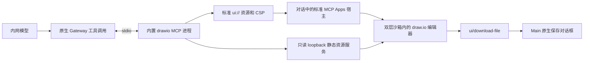

# draw.io 离线绘图

本文由 draw.io 插件维护；源码和测试路径以本包根目录为基准，宿主只需实现文中列出的通用集成合同。

draw.io 是默认启用的系统内置扩展，提供标准 MCP Apps 工具 `create_diagram`。它使用锁定的 Apache-2.0 draw.io Web 编辑器和本地 MCP 适配器；不使用公网 MCP 端点或 draw.io Desktop 的 Electron 外壳。

已有画布的连续修改使用插件工具 `drawio_diagram`，详见[当前画布连续编辑](current-canvas.md)。发送前读取真实当前内容；优先修改选中的侧栏画布，空白画布可直接生成，同一图的后续回复只展示当前图入口，不再创建完整编辑器。一次 AI 修改可一次撤销；生成期间的手工变化会触发冲突，保留用户内容。不建设历史版本列表或独立图表数据库。

## 使用

在普通对话中输入，例如“用 draw.io 画一张采购审批流程图，可以直接编辑”。模型通过已有工具发现机制获取绘图工具，提交 XML 后，图表出现在对应工具结果下方。修改文字、移动图形、连线、形状库、页面、缩放、布局均由本地 draw.io 编辑器处理。

也可直接说“画一张请假审批流程图”，无需点选应用或写出工具名称。插件的
`skills/drawio-diagrams/SKILL.md` 由原生技能发现机制按需提供：流程图、架构图、
UML、ER 和网络图使用实际可用的绘图 MCP 工具；先搜索目录，再按返回的真实工具
身份调用。

原生紧凑工具目录不展开 MCP 工具说明，不能假定模型已经看到
`create_diagram`。写出 `.drawio` / HTML 文件不等于成功展示交互界面。
这份指导随插件启停，不向应用公共提示或运行时加入 patch，也不扩大工具权限。

消息外框的默认标题显示服务名称，保留原生提供的自定义标题，避免向用户展示工具标识与 `UI` 后缀。

### 保存、导出与未提交文字

右上角提供保存 `.drawio`、PNG 和 SVG。保存源文件时实时读取当前编辑器；原生保存对话框选择本机目标路径。编辑器自身的导出菜单也走同一通道，隐藏未适配的网页发布、直接下载、PDF 和联网帮助入口。PNG/SVG 导出当前页面，源文件保存全部页面。展开/返回在同一文档完成，保留当前编辑和撤销状态；主题变化更新当前编辑器，不重建 iframe。

放大后的右上角“×”只返回消息，不关闭编辑器；可反复展开、返回并继续编辑和导出。
在消息内主动关闭应用后，标题栏保留重新打开图标，通过认证读取恢复最近可核实的图表。

顶部保存和导出先向当前编辑器提交正在编辑的单元格文字，再按同一请求 ID 接收确认并执行序列化；不要求用户先按 Enter 或点击画布。过期或重复确认不会触发另一次导出。

桌面宿主发送前通过 draw.io 独立认证通道取得当前图表，模型读取本轮快照；切换模型不要求关闭画布，也不恢复旧原生 App 工具授权。其它宿主公告支持时仍可使用标准原生模型上下文接口。对话内容不能替代文件保存。工作区画布切换聊天时保留同一编辑器及未保存修改、撤销栈；关闭应用、重载页面或运行时失效后，不承诺恢复未保存的本地编辑，保存后的文件仍由用户持有。

### 历史恢复与未保存草稿

重启后打开历史消息，优先恢复同图最近成功写入原生工具结果的内容，没有修改回执时恢复原始图表，仍可本地编辑和保存/导出。未保存手工草稿和回执未知的候选不参与恢复。
对于当前锁定运行时原生视图重建仍未覆盖的 ToolSearch 嵌套历史格式，插件使用公开 SDK 读取
当前分支的原始调用结果并创建新原生视图，不重新调用模型或绘图工具。
恢复视图没有工具授权，不恢复旧上下文；原始结果已被截断或插件关闭时不猜测内容。

### 手动打开空白画布

在“插件 → MCP → 系统内置”管理 drawio 的启停和连接测试。名称旁的“APP”文字标签表示支持交互界面；该标识不等于在线或已连接。用户明确关闭扩展或 MCP Apps 宿主时，配置同步不会重新打开。

已有会话在侧边栏首页的“应用”区选择 draw.io，可直接打开空白画布，无需发消息或调用模型。图标由 draw.io 的 MCP 服务通过原生 `icons` 提供，随服务内嵌离线 SVG，不由宿主按插件名称指定。
这是插件的 `open_editor` 工具声明的 global 手动入口；工具仅向 App 开放，不进入
模型绘图目录。空白画布和模型生成的图表使用同一离线编辑器、保存/导出和沙箱。
手动打开的编辑器进入工作区标签；标签栏下方仅保留一行图表标题和保存/导出工具栏，关闭和放大使用标签栏已有操作，不重复显示宿主标题栏。聊天首页输入框不另设通用应用按钮，应用入口位于侧边栏首页的“应用”区。
切换到其他会话再返回并选中该标签时，宿主暂停并核对原生身份后继续使用同一画布，
不重新读取视图、不执行 `open_editor` 或调用模型，未保存修改和撤销栈保持不变。

会话首页也可从侧边栏首页的真实应用目录选择 draw.io；运行时就绪后按全局工作目录和助手后台预热首页目录，当前显示已有会话时也开始准备。打开侧边栏首页复用结果，点击后才启动画布。加载或读取失败时显示相应状态，避免把尚未完成的读取表现成入口缺失。
首页与会话页使用固定位置的画布容器，切换时不移动已运行的 iframe 子树，避免浏览器重建内部文档而出现白屏或丢失编辑。

### 打开已有文件与首页首发

点击首页或会话文件树中的 `.drawio` 文件，以及消息中的本地 `.drawio` 附件，会通过
同一原生发现目录进入插件的 App-only `open_file` 文件入口。Gateway 校验文件属于
当前会话工作区后，把绑定当前视图的 `openclaw-file://` 资源引用传给编辑器；插件
沿标准 AppBridge 读取 UTF-8 XML，不在 MCP 进程中按任意路径读取文件，也不新开
本地文件服务。支持未压缩图表及由 draw.io 解码的压缩 `mxfile`，文件上限为 1 MiB；
无效 XML、DTD、超限或读取失败显示打开失败提示。打开不改写原文件，编辑后仍通过
现有保存对话框保存 `.drawio` 或导出 PNG/SVG。

“MCP Apps 交互界面”是宿主能力开关，不负责安装应用或创建目录入口。
当前仅提供“启用／关闭”；无有效当前运行配置时整份采用默认配置，其中该开关启用。有效配置中的明确关闭保留。打开宿主开关不等于安装或启用 draw.io 扩展。

在新对话首页打开并编辑 draw.io 后，可直接发送首条消息。宿主沿用画布所属的原生会话
创建普通对话，在实际发送边界提交仍在输入中的节点文字并等待当前 XML 的认证画布快照回执。
画布、未保存修改和撤销栈保留；不会重新调用 `open_editor`、重读初始图表或要求先保存文件。
同步失败时不发送该消息，保留草稿和画布。页面重载或运行时重启的未保存恢复限制不变。

## 运行边界



Gateway 拥有 MCP 进程、工具目录、执行、权限和原生视图。Main 不再连接第二个绘图 MCP，Renderer 不获得 Node 或文件系统权限。原生 `mcpServers` 声明使用相对资源路径，由原生插件加载器转换为当前安装路径，支持包含空格和中文的目录。

`restore.ts` 提供已有图表的恢复和认证当前快照查询，`restore-result.ts` 核对原生子调用证据，`update-result.ts` 核对成功修改收据；恢复
通过公开的 `prepareHarnessNativeMcpAppPreview` 复用同一标准沙箱。它与正常 MCP
服务共用 `editor-resource.mjs` 的离线资源生成器，不创建额外 MCP client 或消息存储。

HTML 资源保持在原生 2 MiB 上限内，绘图脚本不塞入工具结果或消息缓存。桌面已准入画布使用插件服务持有的静态资源，避免模型/MCP runtime 更换时关闭资源；其它 MCP 宿主仍使用服务进程的资源。两者都在 `127.0.0.1` 随机端口提供打包资源，URL 含随机能力路径；仅允许 GET/HEAD、精确 Host 和根目录内真实文件。不存在文件写入、代理、配置读取或图表内容 HTTP 接口。

### 本地资源监听与 CSP

随机端口在发布资源 URL 和 CSP 前，必须通过 Chromium/WHATWG 的禁用端口检查。
操作系统可能分配到 `6000` 等浏览器拒绝访问的端口；此时先关闭监听，再重新分配，
最多尝试 32 次，耗尽则明确报错。只重选静态资源监听端口，不重放工具或画布启动，
也不通过浏览器参数放开禁用端口。否则外层 MCP App 即使握手成功，内部编辑器仍会
因 `ERR_UNSAFE_PORT` 无法加载。

编辑器、形状库、布局、数学公式资源和字体文件随构建产物提供。HTTP CSP 限制脚本、样式、字体、图片、worker 和连接为本机资源（必要的 data/blob 除外）；云存储、插件加载、在线图标和更新流程关闭。外部图片、远程字体等内容不会由代理或公网 fallback 补齐，图表应使用内置形状、本机字体或内嵌图片。编辑器 iframe 的消息只接受精确发送窗口；Opaque sandbox 下的 `*` 目标用于与自己创建的父/子窗口通信，不替代宿主 AppBridge 的来源检查。

## 构建和验证

上游仓库、固定提交、归档 SHA-256 和许可证以本包 [upstream.json](../../../../plugins/extensions/drawio/upstream.json) 为准。维护者必须取得匹配的归档并验证哈希；运行时不下载、不安装包、不检查公网版本。分发产物携带完整生成资源和许可证。

### 构建产物与校验

插件专属资源准备、打包校验脚本位于 `scripts/`，单元测试与 XML 样例位于 `tests/`。目录职责见[插件说明](overview.md)。本包的 `assets:prepare` 和 `assets:verify` npm 脚本分别准备、核验资源。

当前准备脚本由集成构建工作区调用，依赖其已安装的 `tar`、`esbuild`、MCP SDK、MCP Apps SDK、`saxes` 和 `zod`，并读取对应版本作为构建指纹。仅在本目录运行依赖安装不构成完整构建环境。独立维护本包时，构建工作区须显式提供这些工具、固定源归档和输出目录；不能靠运行时下载或未声明的相邻仓库文件补齐。

准备脚本先验证归档哈希，使用构建工作区已安装的 Node `tar` 严格解包到构建工作区 `build/` 下每次独立创建的暂存目录，不依赖 Windows 系统 `tar`，也不复用上次残留目录。仅提取锁定源码的 Web 编辑器子树和许可证，拒绝链接；成功或失败后清理本次暂存目录。随后构建 MCP 服务和标准 App SDK bundle，生成每个文件的 SHA-256 清单并保留第三方许可证。

组装和打包同时检查源码及构建依赖指纹、缺失文件、多余文件和逐文件内容。未准备、陈旧或不完整的资源使构建失败，不能退回在线版本。适配器、来源锁定与构建脚本进入 OpenClaw build recipe。

### 分层验证入口

本包单元测试由集成工作区提供 TypeScript/Vitest 环境后执行：

- `tests/server.test.ts` 覆盖 XML、DTD、体积限制、HTTP 路径和 CSP；`tests/ports.test.ts` 覆盖禁用端口、关闭后重选、重试上限与失败清理。
- `tests/assets.test.ts` 覆盖资源损坏与缺失；`tests/source-extraction.test.ts` 覆盖无系统 tar 的中文空格路径解包、精确子树筛选和链接／路径越界拒绝。
- 连续编辑状态、冲突与恢复覆盖见[当前画布验证](current-canvas.md#6-必须通过的验证)。

包内原生探针位于 `plugins/extensions/drawio/scripts/test/`，仅显式执行。
先将 `APP_PLUGIN_HOST_ROOT` 设置为集成宿主仓库的绝对路径；缺失或无效路径会在创建隔离状态前失败。
插件源码、资源及 XML 样例从探针所属插件读取，证据仍写入所选宿主的 `.agent-tasks/drawio/`。
宿主须已经安装构建依赖并准备完整运行时，探针不安装依赖或重建运行时。

```powershell
$env:APP_PLUGIN_HOST_ROOT = '<host-repository>'
node plugins/extensions/drawio/scripts/test/native-smoke.mjs
& '<prepared-runtime>/node-runtime/node.exe' plugins/extensions/drawio/scripts/test/home-model.native-smoke.mjs '<prepared-runtime>'
```

`native-smoke.mjs` 检查所选宿主 `vendor/openclaw-runtime/current` 中的捆绑插件发现、工具物化与原生 App 准入，不请求模型。
`home-model.native-smoke.mjs` 从显式宿主提供的 `tests/openclaw/runtime/native-smoke-target.mjs` 读取冻结产物校验规则，
并使用该宿主已安装的 esbuild；必须用所选运行时自带的 Node 执行，可继续通过参数或 `OPENCLAW_TEST_NATIVE_RUNTIME_DIR` 指定运行时。
该探针使用隔离 Gateway、合成模型及编辑器 ACK，验证模型切换后的同一画布与精确终态；不能代替真实 iframe 或企业模型验收。

宿主集成验收需要另行提供真实 Gateway、MCP Apps 宿主、原生保存接口及受支持的浏览器。应按下列层次记录环境与替代边界，而不把包内单测当作完整宿主验收：

| 层次             | 必须覆盖                                                                                                                                                     | 不能替代的事实                                                              |
| ---------------- | ------------------------------------------------------------------------------------------------------------------------------------------------------------ | --------------------------------------------------------------------------- |
| 原生准入         | 隔离状态下发现插件和工具，正常物化结果、App-only 空白／文件入口、精确视图文件读取；拒绝跨视图和工作区外文件，手动入口不生成聊天消息                          | 不调用模型的探针不能证明模型工具选择                                        |
| 真实编辑器       | 全新浏览器 profile、原生双层沙箱、公网阻断；源文件／PNG／SVG、展开、主题、窄窗口、空白图、普通及压缩 `mxfile`、修改后保存                                    | 替代文件 fixture 和保存目的地的 UI 探针不能证明原生文件准入或 Main 保存权限 |
| 端口与资源       | 强制首次分配真实禁用端口后重选，编辑器能加载和保存；不放开浏览器端口策略                                                                                     | 操作系统监听成功不能证明浏览器可访问                                        |
| 发布资源         | 实际目标平台打包、解包后核对完整资源集合和许可证；各平台复制／裁剪不能破坏哈希集合                                                                           | 开发目录不能替代最终安装包                                                  |
| 模型与产品时间线 | 经明确授权，使用隔离原生会话和虚构任务；保留正常工具政策及完整插件／技能目录，不强制绘图工具；核对精确整轮终态、实际模型和原生绘图结果，再由认证历史生成界面 | 合成模型、合成编辑器 ACK、历史模型通过记录不能代表企业模型能力              |

真实模型验收只使用操作者明确配置并授权的端点和凭据，不读取已有聊天或工作区，不添加模型 fallback。实际编辑器要修改单元格并确认源文件保存该修改，同时验证 PNG/SVG 和展开；编辑器零公网请求与模型端点网络访问是两项独立检查。

已有分层演练覆盖自然语言工具发现、产品时间线展示、编辑、保存／导出、零公网编辑器请求及保留原生状态后的恢复。这些是历史覆盖说明，不构成本次文档整理重新执行的声明；当前企业模型、最终安装包和企业安全软件策略必须另行验收，记录产物身份、通过项及未验证项。
