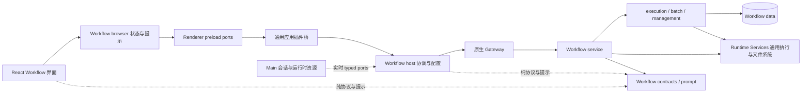

# Swarm Workflow 宿主接入与视图

本页维护本插件的模块边界、公开宿主能力、状态观察和 UI 寿命。用户操作及执行规则见[普通流程](workflows.md)，业务数据见[持久化](persistence.md)。

## 模块归属与依赖

Workflow 专属 UI、样式与会话连接由插件维护，不与原生 `subagents/` 控制树混合。
通用宿主提供共享 UI 和历史能力，原生插件服务拥有持久 DAG 与执行状态。

流程协议、提示、配置与视图由插件维护。Main 协调和完整 React UI 分别在包内 `host/`、`app/browser/`，通过独立清单和公开 App SDK 注册。宿主只提供通用插件桥、元数据及资源生命周期，不需要 Workflow 专属 IPC/preload 或编译期业务引用；依赖和构建入口见[包 README](overview.md)。

`execution/` 拥有 DAG 推进、规划、策略、介入和结果提交；`batch/` 拥有输入冻结、单项目录、结果分页及批次存储操作；`data/` 管理插件流程库；`management/` 提供主会话工具与通知。`service/` 绑定这些能力与原生 Gateway：context 提供身份、权限、当前引擎和原生会话准备，state 保留进程共享状态，lifecycle 管理启动实例的代次、循环与停止，hooks、gateway、tools 各自注册原生入口。

插件流程库统一位于 `stateDir/plugin-data/swarm-workflow/flows.sqlite`，其 SQLite
WAL/SHM 文件也留在同一目录。Native 通过公开 SDK 验证宿主预备的保留型目录，
Main 在资源核验及关闭后的清理作用域通过 SDK 只读定位同一目录，并以只读连接
检查未结算的流程、节点和执行租约。目录采用卸载后保留策略，新版本不迁移或
回退读取旧路径。批次冻结输入、单项尝试及输出继续位于项目的
`.agent-tasks/swarm-workflow/`，不纳入插件数据目录。

`index.ts` 仅组合注册，域模块通过同一个 context 访问实时状态，不复制引擎或服务代次。各助手注册实例仍共享同一服务，同时保持独立调用授权。

原生 managed-subagent 的通用运行终态/清理契约、文件准入和执行准入通过公开 `@runtime-services/sdk` 分发，不再导入相邻 Runtime Services 实现。Workflow 专属的未调用启动本地证明归 `execution/launch-admission.ts`，引擎和生命周期复用同一 class 身份，不以错误名称推断未发送。

Runtime Services 不识别 Team 或 Workflow，也不持有流程库；同步投影只表示精确来源执行通道的通用占用，Workflow 自己决定是否可以启动。规划状态由 App SDK 的纯 planning 契约解释。执行 facade 仍调用 Workflow 原有作用域的原生 executor，保持 owner、whole-run 与 tool cleanup 语义。

没有经过验证的运行能力时明确拒绝，不以仅能编译或方法存在宣称兼容。本插件不导入宿主源码，构建工具从安装的公共包解析依赖和主题。

产品会话仍由 Main 持有，插件通过 SDK 实时端口读取真实会话、runtime 和产品助手名单。`host/config.ts` 保持启用/软删除过滤，不能用原生名单替代。原生、Main 和 Browser 入口独立，插件不导入应用实现。包变更必须确认实际 Gateway 停止后再后台重新启动，软件保持打开；普通启停撤回并重建 epoch。

插件 `app/browser/` 拥有全部 Workflow React 组件、图形/批次/详情/介入状态、轮询、输入选项及双语翻译；SDK 提供真实共享 React、UI primitives、只读产品元数据、草稿/导航效果及原生历史视图。业务不读取 `window.electron` 或导入宿主实现。投影只随当前挂载保留，原生正文继续归 Gateway。

流程列表通过 Gateway 插件事件刷新，不再每 2.5 秒定时查询。FlowStore 在创建、更新和批次展开事务成功提交后发布 `plugin.swarm-workflow.changed`，只携带父会话键、流程 ID 和 revision；回滚不发布。Workflow 的 Main 插件校验通知并映射真实产品会话，经通用应用插件事件桥转发无正文变更通知。

首次进入和切换会话先订阅、再读取快照；同会话连续通知在 50 毫秒窗口内合并，旧 revision 和其他会话通知不触发读取，读取途中再有变化则串行补读，旧响应不能覆盖最新状态。插件服务启动和 Gateway 连接恢复发送全量失效通知，补齐断线期间遗漏的变化；查询失败保留原有失败呈现，等待下一次通知或手动刷新。

工作流面板与摘要分别观察完整列表和轻量数量，同类观察共享订阅与在途读取。节点详情和批次分页仍保持各自按需读取契约；事件不替代原生运行终态证据。

宿主从真实产品会话解析原生身份后，按插件与 Gateway 共用的父键契约去重、筛选；通道、外部和工作节点会话键不作为 Workflow 父身份发送，不改写或猜测托管键。已解析身份但没有受支持父键的会话，列表直接返回空流程及非活动状态，避免侧栏观察产生无效 RPC 和失败重试；详情、控制、介入和批次操作仍拒绝。产品会话缺失、原生身份未知或 Gateway 不可用继续返回失败，不能伪造空结果。Gateway 的父身份与流程归属校验保持不变。

关闭 Workflow 后，应用立即隐藏摘要入口并退休已打开 Tab，browser discovery 清空当前投影、取消订阅和待处理刷新并拒绝旧响应。每次 disable revision 也使快速关开时的旧快照失效；重新启用后重新读取保留的流程。同一业务 epoch 的读取暂时失败保留最近成功数量；失去 Native 运行证明则撤回整个业务 epoch 和 Tab，仅保留通用宿主最后确认的活动正证据，不能从断线推断流程已停止。插件停止并不证明原生运行已取消，现有 DAG 和未知运行证据继续保留，恢复时仍不自动重放不确定派发。原生 collector 快照和子任务控制继续走独立 subtasks 入口。

完整清单确认 Workflow 已卸载或源码/包已移除后，通用宿主撤回其 Main/Browser 和资源参与者，仅解除该 owner 的宿主保护关联，不影响普通聊天、普通会话删除、Agent Team 或其他插件。流程库、批次与节点记录、原生助手和会话均保留，重新安装后通过原有身份读取找回，不重放未知启动或控制请求。整体运行时不可用及损坏包不作为明确卸载证据。此契约与 Agent Team 共用通用宿主和构建退休流程，不依赖另一个可选插件。

源聊天的普通 Stop 和 Workflow 图中的停止是两个操作：停止源聊天或准备下一条消息，不自动停止其既有 Workflow。Workflow 没有 Team 式 Main 发起收据，不能借通用提交参与者去取消源会话下的所有流程。用户明确在 Workflow 中停止时，仍通过精确父身份、流程及 revision 走原生控制；删除源会话和改包继续检查全部流程与未清理节点，未结算时保持保护。同包启停不重启 Gateway，关闭后的旧聊天文本由独立纯展示入口保持格式，不恢复业务入口。

## 活动、摘要和完整列表

- 当前聊天的插件常驻观察者在窗口可见时通过 `swarmWorkflow.summary` 读取全部历史的流程数量与活动标记，关闭的摘要也能发现入口并沿用每会话一次的自动展开规则；不读取节点、结果或批次项。发现新流程时自动打开当前聊天的 Workflow Tab；相同流程的修订刷新不会重新打开已关闭的 Tab，历史静态流程也不会抢占当前视图。切换聊天或插件退休后，旧发现响应不能触发导航。数量不受完整列表最近 20 条的展示上限影响。点击摘要条目打开 Workflow Tab，完整流程只在可见面板中加载；历史流程保留入口，暂时查询失败保留最后成功数量，切换到无流程会话时隐藏。选择输入框标签本身不查询工作流。

- Workflow Tab 可见时才通过 `swarmWorkflow.list` 读取最近 20 条完整流程；切换到其他 Tab、隐藏窗口或关闭面板即撤销完整列表观察。再次打开先核验原生状态；切换聊天后丢弃旧响应，断连保留旧图并禁止基于旧状态控制。关闭界面不停止后台调度、重启核验或原生工具清理。

- 会话列表通过一份 `swarmWorkflow.activity` 轻量快照观察后台活动，不遍历普通历史会话或读取完整流程。覆盖运行中／停止中，以及暂停或阻塞后仍有准备中、运行中或结果未确认节点的流程；批次按实际执行项状态统计。Main 只向仍存在且精确拥有原生父 key 的产品会话投影活动标记。变更通知同时支持持久绑定与普通聊天的派生 key，后者仅提取候选会话 ID，再核对当前 runtime 的完整原生 key；不能仅靠 key 内的 ID 认定归属。该投影不参与主输入框执行状态或发送准入。

- 活动快照仅返回活跃父 key，每页最多 128 条、最多读取 128 页；所有页必须属于相同服务代次与已提交变更版本，分页中发生更新、游标重复或超过上限均保留未知，不用部分结果清空活动。没有活动工作流时只读一页，与普通历史会话数量无关。活动与数量查询在原插件 SQLite 中投影，不 hydrate 完整流程或批次结果，不新增持久缓存或 schema。

- 三种投影分别共享同类观察，先订阅变更再读取快照，按事件合并刷新而非定时轮询；重连或服务重置后重新核验。最多 4 个同类并发读取，退出观察撤销排队请求；失败以 1／2／4 秒最多重试三轮。读取途中到达新变更则丢弃旧响应并重读；手动刷新仍请求原生状态。节点详情和批次页只在可见时刷新，结束后的静态结果停止轮询，但流程修订变化或连接恢复仍触发核验，避免兄弟节点或主聊天操作使控制版本过期；在途更新串行合并，不反复取消慢请求。重试后的详情以实际响应状态决定是否续查，不让选中项的旧终态阻断新尝试；隐藏节点历史时释放原生连接。

- 停用插件只撤销观察，不能证明已经接纳的原生执行结束。列表保留最后已知活动，直到重新启用后的成功读取确认结束；右侧功能入口仍按原有禁用契约隐藏。旧运行时未提供全历史汇总时，截断列表只能提供正在活动的正证据，不能用其未包含活动流程推断空闲。

## 插槽、摘要发现与活动正证据

本插件通过公开 Browser SDK 注册 workspace、composer、插件设置、会话摘要／展示和常驻 application.page 等贡献。主输入、工作区和摘要容器只组合这些贡献；插件自行拥有流程、图、批次、详情和介入状态。原生历史由宿主提供的原生历史视图按精确绑定读取，不建立插件 transcript 副本。

常驻 observer 在窗口可见时读取摘要元数据，不要求用户先展开摘要。插件通过 `session.presentation.summaryAvailable` 和上下文变更通知报告当前会话存在流程；宿主仅据此执行每会话首次有意义条目的单次自动展开，不聚焦或切走当前 Tab。手动关闭摘要、选择条目或后续修订不会再次触发自动展开。新的流程发现可打开当前聊天的流程 Tab；相同流程刷新不重新打开已经关闭的图。

插件通过 `publishSessionActivity` 发布已成功读取的完整活动 ID 集合。宿主只保留该插件最后确认的活动正证据；关闭业务贡献、初始空投影、读取中或读取失败都不证明运行已停止。只有当前插件取得完整成功快照后才替换集合，其他插件的集合互不覆盖。这只是界面提示，不能授权发送、取消或建立执行终态。

工作区面板可保持挂载以保存草稿，以 `AppViewContext.active` 判断实际可见性；隐藏时撤销完整列表、详情和历史观察，不停止原生调度。宿主设置页遮盖、切换聊天、普通导航或插件 epoch 失效时，旧异步结果不能恢复交互或跳回旧流程。

## 元数据事件与重新准入

Main 只发布有界、瞬时、无正文元数据事件。公开宿主桥为消息绑定 owner、产物身份和业务 epoch；Browser 只接收当前相同产物的事件，关闭、换包或重新准入后旧监听失效。插件自行校验原生父 key、流程和 revision，先订阅再读快照、合并在途变更；Gateway 重连后重新读取权威状态，不重放控制命令、未知启动或完成投递。
