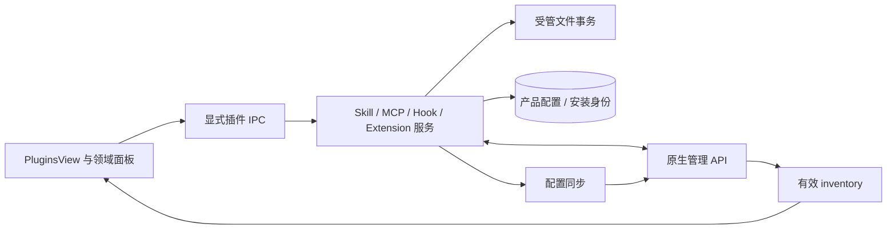
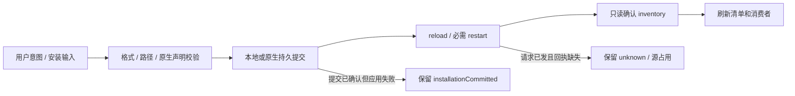
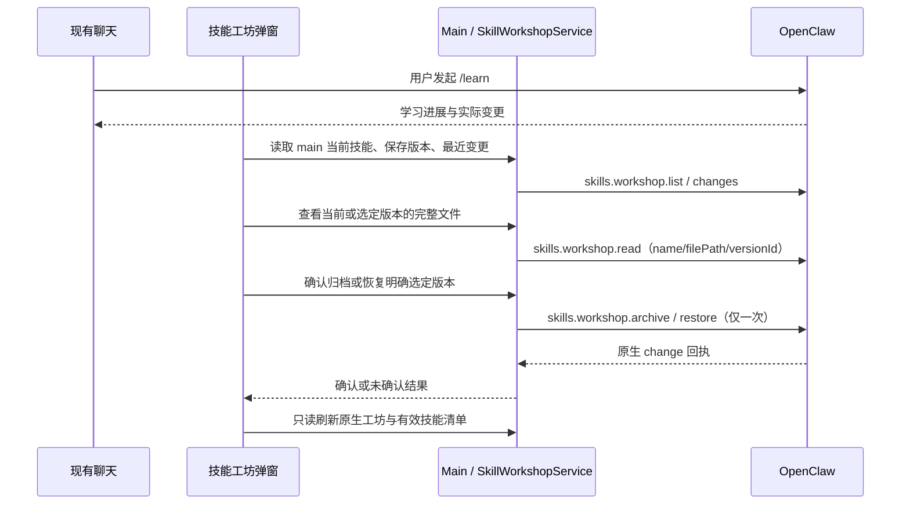
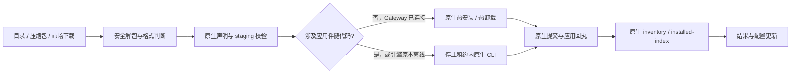

# 插件系统：读取、变更与原生应用

插件管理不是一份安装目录清单。用户配置、文件提交、原生配置应用和当前 Gateway inventory 是不同事实，必须分别确认。本页按读取和变更的调用链组织；桌面 Main/Browser 代码的公开 SDK、审核与加载另见[应用插件宿主](app-plugin-runtime.md)。

## 按问题定位

| 要核对的问题                                 | 维护位置                                                               |
| -------------------------------------------- | ---------------------------------------------------------------------- |
| 插件类型、源码和构建产物归谁管理             | [分类与归属](#1-分类与源码所有权)                                      |
| 清单读取、查询代次和受管项如何判断           | [读取与投影](#2-清单读取与界面投影)                                    |
| 安装进度、提交与应用成功如何区分             | [变更调用链](#3-变更调用链与完成证据)                                  |
| Skill 文件、同名来源及 Workshop 如何处理     | [Skill](#4-skill身份文件与状态确认)                                    |
| MCP 和 Hook 如何发布配置、补偿失败           | [配置与文件事务](#5-mcp-与-hook配置及文件事务)                         |
| Extension 热／冷安装、未知提交和凭据如何处理 | [Extension](#6-extension审核提交与未知结果)                            |
| 必需服务、可选业务与能力保护如何划分         | [受管扩展](#7-受管扩展与可选业务)                                      |
| 出站 Header 和原生状态单例如何保持边界       | [出站请求头](#8-出站请求头与信任)、[构建单例](#9-构建与运行时状态单例) |
| 应运行哪些回归，哪些真实环境仍未验收         | [失败与验证](#10-失败处理与验证)                                       |

## 1. 分类与源码所有权

| 类型        | 运行权威                          | 产品负责                              | 主要限制                                   |
| ----------- | --------------------------------- | ------------------------------------- | ------------------------------------------ |
| Skill       | Gateway skills.status/update      | 用户文件导入删除、列表投影            | 文件存在不等于 eligible                    |
| MCP         | 原生连接与工具调用                | 用户配置 Store、发现与配置同步、probe | 扩展默认定义只读，覆盖留在原生配置         |
| Hook        | 原生 hook runtime                 | 本地包、产品开关和受管同步            | 与 Extension 的 hook capability 不混为一项 |
| Extension   | plugins.list/setEnabled/uninstall | 审查、受控导入、产品保护规则          | 运行代码进入 Gateway 信任域                |
| Marketplace | 各类型安装器及 inventory          | 公司 SDK 适配、来源/版本身份          | 不是另一份运行态清单                       |

Plugin Hub 有四类插件概念；市场当前只开放 extension、skill、mcp 三种 catalog kind。共享 PluginKind 中有 hook，不代表 Marketplace 也支持安装 Hook。仓库默认未注册业务市场 provider。

### 源码和构建归属

内置插件源码统一位于仓库根目录的 `plugins/`，按 `extensions/`、`skills/`、`mcp-servers/`、`hooks/`、`browser-extensions/` 分类。OpenClaw 扩展位于 `plugins/extensions/<plugin-id>/`，独立技能及筛选清单位于 `plugins/skills/`；扩展自带的技能保留在所属扩展内部。`mcp-servers/`、`hooks/` 当前仅预留目录，尚无内置加载逻辑。

构建仍将 OpenClaw 扩展和选中技能组装到原生的 `dist/extensions/`、`skills/`、`custodian-skills/`，开发源码发现读取对应扩展目录。应用图标和原生文档模板位于 `resources/`；下载缓存使用仓库根 `cache/`，工具运行时准备和打包中间产物使用 `build/`，不反向写回资源源码目录。现行 OpenClaw 冻结运行包仍位于 `vendor/openclaw-runtime/`，具体以[构建链](../../architecture/12-tech-stack.md#5-openclaw-供应链)为准。源码与资源约定见[内置插件说明](../../../plugins/README.md)和[资源说明](../../../resources/README.md)。

`plugins/sdk/` 保存公开 App SDK 和构建工具开发包，使用 npm workspace 或打包制品接入；扩展发现仍只扫描 `plugins/extensions/`。源码位置、发布和消费契约见[应用插件宿主](app-plugin-runtime.md)。

Browser Assistant 位于 `plugins/browser-extensions/browser-assistant/`，由 Chrome 安装和加载，不进入 Plugin Hub 的 OpenClaw 扩展管理。它保留上游基线及产品侧栏补充，自有组装脚本、Markdown 源码和单元测试随包维护；复用应用聊天代码的构建适配与 Native Messaging helper 留在宿主，Main 继续拥有连接、权限和会话。

构建生成 `build/browser-extension/chrome-extension/`，打包后位于安装资源目录的 `browser-extension/chrome-extension/`；此安装目录不是仓库 `resources/` 下的源码。显示名称和固定扩展身份独立于源码包目录。详见[侧栏对话](../browser-extensions/browser-assistant/side-panel.md)。

插件专属的工具、界面、资源、构建/校验脚本和单元测试归 `plugins/extensions/<plugin-id>/` 所有。主工程保留通用 MCP Apps 宿主、权限与保存桥、配置/打包接入，以及验证宿主边界的集成测试；插件不能反向导入应用 `src`。根 npm 命令和打包流程只委托插件自己的脚本，draw.io 的目录约定见[插件说明](../extensions/drawio/overview.md)。

## 2. 清单读取与界面投影

读取只观察当前权威状态，不因列出卡片而安装、启用或重启运行时。配置 `enabled` 和当前运行态分别显示。

Renderer 显示 loading/error、操作能力和运行结果；不能通过自行扫描目录决定安装状态。启停成功后重新读取 inventory；同名条目的来源变化也需要呈现，不能只把旧卡片布尔值翻转。

### 查询队列和旧响应

扩展清单查询先等待此前应用设置的保存与失败补偿完成，随后释放配置队列再等待
Gateway 和原生清单发现。慢速列举不能阻塞后续 `app_config` 读取或偏好保存，否则
普通启动中先挂载的扩展订阅会让 Renderer 配置初始化耗尽自己的 30 秒预算。
在途读取只共享原生发现结果；最终本地配置和受管能力在短配置队列内重新读取，
因此发现期间发起的设置保存或失败补偿也必须完成后才能展示。已持有该队列的
变更通知直接投影，不嵌套排队，也不与外部查询共享配置投影。
TypeSafe 的实际配置和启停变更继续在应用配置队列内串行执行；配置读取仍等待
此前变更应用或回滚，不绕过事务读取未确认的设置。

页面展示清单还需要隔离迟到响应。Extension 页进入和收到已有变更通知时重新查询，只有当前挂载页面的最新查询可以更新列表或提示错误；卸载后回包失效。成功清单同时替换已打开的扩展详情，条目消失时关闭详情。Skill 与 Hook 页也订阅父扩展变更，强制重读附带能力，Hook 更新或关闭已打开的详情。用户 MCP 的查询与操作回包、Hook 的导入/删除/启停回包使用 Renderer 查询代次保护，操作成功使旧查询失效；操作回包跨越新代次时重读权威清单，避免旧全量结果覆盖后续修改。

MCP 保存、删除、启停和市场更新在提交前使已有测试结果与在途测试代次失效，迟到测试不能附到新配置。普通 MCP 清单来自产品 Store，目录 Hook 的原生状态每次重新发现；它们没有技能发现缓存的同一刷新限制，不增加对应的运行时补丁。后台运行态应用与界面列表更新是不同的完成条件。扩展提供的 MCP 清单错误独立保存，自建 MCP 的成功操作不会清除该错误；只有提供方清单实际读取成功才清除，重读期间也不误报空列表。

生产扩展目录读取也必须只观察现有 Gateway：固定客户端、进程及代次，不调用自动启动/恢复入口，也不以读取为由执行 `plugins.refresh`。无连接或读取失败明确返回不可用，不能用仅含用户安装目录的局部清单覆盖内置卡片或广播伪造的禁用状态。页面和共享启用状态保留最近确认的清单；仅在读取不可用时，通过应用插件就绪通知补读，已有请求代次与卸载保护继续生效。因此热启停的收尾通知及界面重读也不会间接触发 Gateway 重启。

输入框功能入口通过 `extensions:changed` 观察实际启用状态。Main 在启停尝试完成后
串行重读权威目录并通知全部仍存在的窗口；已保存但运行时重启失败时也发出实际
状态，不用请求值假定成功。导入/市场安装和卸载同步通知；通知读取失败保留操作
结果且不伪造状态。Renderer 按插件合并在途开关，关闭版本使快速关闭/开启后的
旧标签选择失效。详见[输入框功能菜单](../../features/chat/composer-feature-menu.md)。

### 分组、排序与管理权限

插件页的扩展、技能、MCP 和 Hook 在用户安装与系统内置分组内使用固定 `zh-CN`
名称排序，忽略大小写并按数字自然排序；名称等价时以精确 ID 升序打破平局，
不依赖原生发现顺序或当前界面语言。用户 MCP 与用户扩展提供的 MCP 合并后排序。
系统内置扩展仍按当前开关权限将可手动切换项放在加锁项前，各类内部使用同一名称排序。
锁定图标的提示及详情展示管理来源：模型、视频、决策模型、浏览器、电脑操控、运行参数、
执行模式或应用基础组件。

Renderer 根据 Main 返回的管理权限解释来源，不按插件名称自行限制操作。
Main 在扩展目录清单中为原生 `bundled` 条目补齐实际存在的随包目录，复用 `installPath` 和 `revealInFolder` 能力提供文件夹入口；该只读入口不改变系统托管的启停、配置或删除权限，也不保存另一份目录配置。

OpenAI Provider 和 QuickJS Code Mode 是应用托管适配器，通用插件入口禁止启停、配置和删除；
完整、最小及登录状态同步均保持已打包适配器启用、加入 allowlist，并移除这两个插件的 deny，
保留其他配置和权限。模型、图像及语音功能仍由各自设置与凭据控制；Code Mode 是否使用由运行参数控制。

Document Extraction 和 Web Readability Extraction 保持上游默认启用，允许用户关闭；
协作、记忆和本地语音可选插件继续保留用户明确禁用状态。TypeSafe 仅在决策模型设置具有有效默认选择时托管；
没有默认选择时，扩展页可手动配置和启停，后续同步保留这些原生设置。取消默认保留扩展当前配置和开关，
只撤销此前确切投影的原生默认引用，不按模型名称推测来源。首次接管失败通过显式回滚上下文恢复最新手动快照。

TypeSafe 配置、启停及扩展清单读取与应用设置事务同序，等待保存或补偿完成后再检查管理权限。
视频由同一个 OpenAI 适配器提供；清空默认视频模型只停止视频使用，不关闭整个插件。

## 3. 变更调用链与完成证据

一次写操作按以下顺序推进：准备输入 → 校验文件/能力 → 持久提交 → 原生应用 → 只读确认 → 刷新消费者。已提交但应用失败、已发送但结果未知必须与未提交区分。

### 进度和失败反馈

插件变更的等待包含安装源准备、文件校验与发布、全局配置队列、原生应用或重启、
状态确认和清单刷新；它们有不同的完成证据，不能通过提前返回成功来缩短等待。
扩展完整清单还可能解析本地 manifest、启动只读包归属子进程，因此通知和页面并发
查询会重复消耗资源。Main 只合并同一变更代次的在途扩展清单读取，变更开始和结束
使旧读取失效；不保存已完成清单，不跨变更复用结果。

Hook 变更前后的权限、目录和
身份核对直接读取 `hooks.status`，仅最终展示清单查询父扩展来源，减少无消费的
`plugins.list`。Renderer 市场对账和更新检查只随相关身份、版本、路径或显式刷新
变化，不因普通开关和数组引用变化重复调用市场接口。

变更 IPC 可在最后传入有界 `PluginOperationContext.requestId`，Main 以
`plugins:operation:progress` 仅向原请求窗口发布闭合的 kind、action、stage 和
elapsedMs。阶段在实际开始执行时报告，排队等待保持 queued；事件不携带路径、
凭据、SDK 输出或插件正文，也不授予权限或确认结果。Main 记录各阶段耗时到
`[PluginOperations]`，以单行 JSON 保留操作编号、类型、动作、阶段及阶段／累计耗时，
用于区分队列、原生应用、确认和下载适配器的实际耗时。
窗口销毁、进度发送或观察失败不能改变变更结果；结束后忽略迟到回调。

Renderer 在调用前登记操作并订阅，在完整操作及清单刷新结束后释放；只接纳同一
requestId、kind 和 action 的通知。这个会话内 owner 仅持有操作元数据，切换分类
或离页不释放在途变更，重新进入页面可继续展示。计时只更新已用时，不推进阶段
或生成百分比；最终成功、失败、已提交和待确认仍取自原调用及权威清单。

变更响应通过 `PluginOperationFeedback` 补充失败处冻结的 `failedStage`，以及确有
证据的 `installationCommitted`、`installSourceInUse`、`operationUnconfirmed`
或 `refreshWarning`。失败阶段在补偿回滚、清理和最终刷新之前记录，后续进度不能
覆盖原业务失败；后置清单读取失败也不能反向否定已经完成的文件或配置变更。
Renderer 不从错误关键词或最后一条进度推测提交和未知状态。

扩展包卸载在宿主明确持有停止 Gateway 的包变更租约时，直接执行一次原生离线
CLI，不通过 RPC 尝试启动受租约保护的 Gateway；策略仍按删除后的配置收敛，
租约释放后的引擎恢复由包变更 owner 负责。没有该租约时保留原生 RPC 优先及
明确未发送才允许离线回退的边界。正常的 ready／Gateway stopped 状态不构成
卸载错误或提交证据。

原生卸载成功回执，或 CLI 成功且本次捕获的确切包目录已消失，确认卸载完成。
之后出站请求头策略同步、允许加载列表清理或引擎恢复失败时，返回已完成卸载的
结果和 `refreshWarning`，冻结真实失败阶段并保留原因；不能改称卸载失败或重发
卸载。原卸载本身失败时保留首因和阶段，恢复错误只追加。超时、断线后的原有
权威清单与原安装路径对账规则保持不变，无法确认时仍返回待确认。

原始变更具有干净成功回执后，恢复过程单独携带 `mutationCompleted`；只有 Main
识别到准备被替代、运行代次变化或仍在启动的有类型结果时才附加
`runtimeRecoveryPending`。两者不改变原有 success、installationCommitted、源占用
或就绪准入语义。Renderer 仅将这类已完成变更的恢复待确认提示放到右下角，不能
由错误文字、最后进度或当前清单推断成功；实际错误与原生未知结果继续进入错误弹窗。
这类历史提示在只读重取后的 Main 准入与引擎状态均就绪时结束恢复等待展示，
Renderer 的 `runtimeRecovered` 仅冻结这一展示事实，不修改原始回执标记；补充错误
继续保留，未知变更与市场重复提交保护不受影响。单独的进程 running 不满足该条件。

同一个操作 owner 分开保存活动进度与有界失败队列。服务在收到失败响应或异常时
显式登记错误，待本次收尾结束才入队；同一请求不重复入队，页面的 mounted/代次
检查仅限制清单写入，不能吞掉后台失败。Plugin Hub 根组件统一展示队首结果，
切换分类或重新进入插件页仍可看到未关闭的错误。批量导入由调用方汇总一次，
保留每项真实阶段和已提交/待确认提示。关闭结果只移除展示记录，不解除市场版本
锁或重新提交变更；错误详情按既有敏感字段规则脱敏并限制大小。

MCP 操作将相同 requestId 显式透传到配置同步的 start/done 广播；界面仅在精确
匹配时交由该操作的最终结果弹窗负责，避免同步失败和操作失败重复弹出。没有关联
ID 的后台同步继续保留原错误提醒，不根据“当前有某个 MCP 操作”猜测归属。

市场安装调用没有收到结果回执时也保留待确认保护，并先尝试只读对账。普通列表
刷新或同目录 manifest 出现不证明未知原生命令已经终结，因此不能据此释放重复
提交保护；这类保护在当前 Renderer 会话内保留，不随报错关闭或反馈记录裁剪释放。

市场 Provider 的 `prepareInstall` 默认整体显示“获取插件信息并下载安装包”。
适配器可通过可选 context 回调报告真实的闭合阶段，不提供细分回调时不会假定
下载进度、转换步骤或文件大小。类型安装器的已有阶段继续向上透传；来源释放时
才报告临时资源清理，原生仍可能读取的来源继续保留。

首次市场安装显式落实启用
意图，Skill 按原生有效来源和精确安装目录取得实际 skillKey 后开启并确认；
Extension 仅在原生安装后仍显式关闭时补原生开启，不跳过必需配置校验；
首次安装因缺配置被关闭也明确返回已安装但无法启用，不能静默报告全部成功。
带 App companion 的包保持禁用安装。用户主动安装／更新授权本次确切产物的代码信任，
Main 在同一停止租约内核对已安装路径、原生绑定及产物 hash 后登记，不再要求二次确认；
显式启用仍独立进行，市场来源、清单存在或原生能力令牌不能替代代码校验。
MCP 首次创建保持启用。市场升级保留已有开关；已安装但后续启用失败继续携带
installationCommitted，不能作为未安装再次提交。

## 4. Skill：身份、文件与状态确认

内置 manifest 有 8 个默认启用项：data-analysis、diagram-design、frontend-design、docx、pdf、pptx、skill-creator、xlsx。v2 manifest 通过 `openclaw.skills` 和 `openclaw.custodianSkills` 显式选择上游技能：分别保留 `coding-agent` 和 `diagnose-gateway`，其余上游技能不打包。

系统维护技能留在原生 `custodian-skills/`，仅由系统 Agent（应用配置为 `main`）发现。安装和打包共用同一筛选逻辑，所有选中源校验通过后才清理目录；缺失上游技能时必须从锁定的原始包重建运行时，不能静默跳过。打包资源必须与 manifest 一致；数量不应散落在 UI 常量中。

独立技能保留上游正文及配套资源，仅调整实际宿主与内网约束。manifest 的 `upstream` 字段记录维护基线，不参与原生状态判断；具体来源和适配见[内置 Skill](../skills/builtin-skills.md)。Python 可选依赖只使用已配置的内网源或离线 wheel，不要求安装外部系统应用。绘图 HTML/SVG 默认使用本地字体，PNG 通过已安装的 Edge 离线导出；未执行的渲染、重算和视觉检查不得报告为已通过。

技能列表和详情使用 Gateway 状态，详情提供有权限的启用／关闭入口，并在更新后显示最新状态与缺失依赖。若原生技能要求显式开启自身的 `skills.entries.<skillKey>.enabled`（如 `coding-agent`），Main 在该条件缺失时显示未启用，即使原生 `disabled` 为 false；其他缺失依赖只影响可用性，不改变启用状态。

用户启用仍通过原生 `skills.update` 保存，系统预装与普通导入不为绕过原生 opt-in 要求默认开启；市场首次安装按明确安装意图通过同一原生接口开启，仍保留全部依赖校验。
该开关同样适用于 `plugin-skills` 中由扩展提供的技能：只更新原生 `skills.entries.<skillKey>.enabled` 并回读确认，不写产品 Store，也不修改扩展文件；其删除和文件配置权限仍由父扩展保留。扩展 Hook 则受原生策略限制，仍以父扩展为启停 owner。

Renderer 的缺失依赖徽标和详情提示不重复列出该技能自身的启用条件，由开关表示；其余程序、环境变量、配置和系统要求保持原生结果。原生 `missing.anyBins` 表示任选一种工具即可满足的要求，计为一个缺失依赖组，列表提示和详情明确说明“至少安装一个”；开启技能不会清除该依赖提示。原始 Gateway 状态不受展示过滤影响。

TypeSafe 扩展声明决策模型提供方；原生 `decision_evaluate` 工具按 Agent 的 `decisionModel` 自动提供。9.8 不再注册专用评估工具或 skill，Boolean、Choice、Score 输入由提供方翻译。具体接入见 [Jev evaluations](../extensions/typesafe/decision-evaluation.md)。

内网发行版通过 `plugins/extensions/prune-policy.json` 声明当前 OpenClaw 版本内置扩展的保留和移除清单，排除 Anthropic、ElevenLabs、
GitHub、Kie、Z.AI 和 Novita 插件；运行时资源准备与安装包构建共用该剪裁策略。

同一策略裁剪 `admin-http-rpc` 和 `file-transfer`：应用管理通过 Gateway WebSocket RPC，
没有接入额外的 HTTP 管理端点、已配对节点的文件传输或远程工作空间映射。
本地附件与文件操作使用既有能力；全局工具策略继续禁用 `file_fetch`、`dir_list`、
`dir_fetch`、`file_write`，避免用户另行安装插件后意外开放未接入的远程能力。

保留 OpenAI 插件作为内网兼容接口的协议适配器，在线语音设置显式提交内网服务地址、
模型及凭据；保留插件不代表必须连接 OpenAI 公网。实时识别需要兼容 Realtime
Transcription（PCMU 8 kHz），朗读需要兼容 Audio Speech。模型目录仍由用户配置，
不会以插件内置模型元数据填充语音设置。ElevenLabs 不再列入受管语音提供方。

视频服务由本地 `plugins/extensions/openai` 注册 `video-openai` provider，
由同一插件的完整替换、预编译和裁剪保护流程打包。设置页保存后由 Main
配置同步器投影 `agents.defaults.mediaModels.video`；模型 ID 和基础地址由用户填写。

`models.providers.video-openai` 独立于聊天和图像配置；非空 API Key 写入受限的
`extension-secrets.json`，通过 file SecretRef 引用；空 Key 不发布凭据引用。
原生 `video_generate` 工具负责权限、参考图片读取和结果交付，插件只实现 multipart
提交、状态轮询和视频内容下载。

三阶段共用总超时与原生有界响应读取；使用配置地址和
HTTP 策略、允许显式配置的私有网络地址、拒绝重定向和不确定提交的重试，没有公网地址或凭据回退。

视频设置只支持本地 OpenAI 适配器；Kie、Z.AI、Novita 的目录和配置支持已移除，
安装对应插件也不会加入视频选项。配置同步按 OpenAI 插件库存清除缺失的视频选择，
不写入对应新凭据。
完整和最小同步遵循相同规则。新视频插件通过原生 provider 扩展接入，不恢复 9.6
旧自定义视频配置或迁移。具体协议与输入限制见 [模型管理](../../features/models/model-management.md)。

skills.status 提供 effective source、eligibility、disabled、缺失依赖和安装选项。产品文件服务只管理用户导入目录；它不能从 SKILL.md 自行重建运行元数据。受管根使用原生 stateDir/skills，避免重复 extraDirs 引入同一路径。

同名技能遵循原生解析赢家。关闭赢家不等于自动切换到下一来源；赢家目录删除后的 fallback 是另一种变化。没有原生 variants contract 时，UI 不展示臆测的 shadowed 数量或逐来源 toggle。

Extension 发布技能的 scope 表示父插件管理，ownershipScope 表示产品展示归属；两者不能合并推导删除能力。系统内置与用户 Extension 的技能均可能由父插件托管。

### 用户文件变更

导入验证结构与精确目标，复制到受管根。删除先原子移入同卷 `.justdo-skill-trash/delete-*`，避免递归删除中途留下半残 live skill。机会式清理仅处理已知 trash 子目录，不能扫描删除未知项目。

技能导入、同名覆盖更新与删除保持 Gateway 运行；文件服务显式关闭 ManagedDirectoryOperationCoordinator 的 runtime 停启恢复，只保留串行变更与文件锁诊断。Windows Gateway 启动环境使用原生支持的 `CHOKIDAR_USEPOLLING=true`，避免长期目录句柄阻止原子重命名；移除继承的轮询间隔，由各原生监听器采用自己的默认值：技能目录为 30 秒，配置文件为 100 毫秒。

不能用统一的短间隔反复扫描所有技能目录，否则会持续占用事件循环并拖慢历史加载和页面请求。外部技能文件变化通常在下一次目录轮询后发现，繁忙、扫描和文件稳定性检查可能延后；技能清单和实际执行仍由原生 API 及准入校验决定。该设置传给 Gateway 及其 worker，不修改应用或 CLI 的基础环境；其他平台保留原生监听方式。外部程序占用或权限问题按真实失败提示，不停止 Gateway 或杀进程。

删除后重新查询原生技能清单，成功弹窗明确显示“已删除”。技能消失是删除的预期结果；只有同名技能实际解析到另一个来源时，才追加来源变化说明。批量导入只要有成功项就刷新清单，部分失败弹窗保留成功、失败数量与逐项原因。

技能文件删除已提交后，原生清单刷新失败不会改报删除失败。Main 仅从本次操作前的原生清单投影中移除确切匹配 key、来源和目录的已删除条目，保留其他原生元数据；不缓存清单或猜测同名回退，后续查询仍以原生清单为准。

文件变更之后的首次 `skills.status` 可能仍命中原生发现缓存；原生监听还要经过轮询、文件稳定检查和 debounce，`skills.changed` 通知会随 remote-bin-refresh 延后。直接使用标准 `skills.status` 和原生文件监听，允许发现结果短暂延迟，在页面订阅期间对成功导入、市场安装/更新和删除进行最多 5 次、约 5 秒窗口的自动重读，连续操作合并、离页停止；不再通过补丁扩展刷新参数，不将目录存在或普通查询成功当作同目录覆盖已被原生重新解析的证明。

Renderer 用查询代次隔离旧响应，避免操作前的在途请求覆盖新结果。首次查询失败或断线后，只要页面仍订阅清单，每 3 秒通过现有连接重读；实际查询成功或离页后停止，不以引擎 running 代替 RPC 就绪、不启动 Gateway，也不重放失败的开关修改。变更重读和失败恢复共享在途请求，避免重复并发。

Main 的文件变更串行队列同时覆盖操作后的原生清单查询，供不同窗口和市场安装共用；文件服务自身的配置/目录锁仍独立，不嵌套同一锁。Renderer 的删除/启停回包如果跨越了更新的查询代次，也会重读当前原生清单，避免迟到的全量旧清单覆盖新版。

### 技能工坊：当前技能、版本与变更

学习直接使用现有聊天中的原生 `/learn`，遵循原生工具能力、会话权限与技能配置。
技能页的“技能工坊”入口仅在打开后读取主助手（main）的工坊；关闭后不发后台请求。
`openclaw-workshop` 来源仍展示为助手提炼技能，不走导入目录删除逻辑。

OpenClaw 2026.10.7 的技能变更立即生效；旧 `skills.proposals.*` 虽仍在方法目录中，
handler 已固定返回退役错误。应用完整采用 `skills.workshop.list/changes/read/archive/restore`，
不把旧批准/拒绝按钮伪映射为归档/恢复，也不在 Main 建立技能文件、版本或变更账本。

随包 `skill-creator` 遵循当前 `skill_workshop` 的原生 authoring owner 与实际 schema：
普通 Workshop 修改立即生效并保留可恢复版本，个人库能力仅在实际提供时按技能 ID、
revision 和当前用户授权发布。技能正文不创建待审核提案或要求额外人工 apply，
也不直接改写已安装技能目录。

界面分别展示当前技能、已保存版本和最近最多 200 条变更。原生 `archived[].live:true`
表示该技能仍有当前副本且保留历史，不能标成已归档；`live:false` 才表示没有当前副本。
版本/当前副本都支持读取 `SKILL.md` 与完整支持文件。变更的 `versionId` 指向**该次变更前**
的快照，可用于撤销；restore 回执的备份 ID 不等于用户选定的恢复目标。
原生 changes 只有排他时间戳 `beforeMs`，没有完整分页 cursor，本界面不宣称展示全部历史。

归档先显示用途及可恢复提示，并允许填写原因；恢复必须查看并明确选择具体版本，再确认替换当前副本。
原生没有 `expectedRevisionHash` 前置条件，界面明确说明其他任务也可能修改技能；
归档作用于执行时的当前副本，恢复前由原生保存当前副本，应用不伪造 CAS。
读取需要 `operator.read`，归档/恢复需要 `operator.admin`；Main 固定 main 归属、校验文件/版本参数，
序列化同一技能的变更并检查原生回执 agent/name/action。

原生文件发布与变更记录可能在不同阶段失败。包括 `INVALID_REQUEST` 在内的未确认写入，
均保留“可能已生效”提示，不自动重试、不反向补偿；清除详情后只读刷新，要求用户重新核对和选择。
即使原生变更成功、产品技能列表刷新失败，也分别显示已确认变更和刷新失败，不提示重复提交。
写入期间禁用关闭；异步读取带本地 generation，刷新/卸载使迟到内容失效，不保存转录副本。

验证分层：service/UI 行为测试覆盖当前/历史区分、支持文件、显式恢复、单次写入、未知结果和迟到读取；
`management-protocol-native.test.ts` 直接执行目标 TypeBox schema、scope 目录及退役 handler，
避免旧 proposal mock 掩盖原生实变。真实企业内网模型学习、Electron 窗口和安装版文件操作另行验收。

### 保存后确认与页面恢复

Skill 的 `skills.update` 回执确认配置已保存，原生运行态配置仍可能异步发布。Main 将启停和导入/删除放入同一操作队列；保存只执行一次，随后通过现有 `skills.status` 有界确认目标开关状态（含显式 opt-in），匹配后才返回完整原生清单。确认只读取已有 Gateway 客户端，等待客户端自身重连，不进入启动/健康恢复路径；30 秒内对旧状态和短暂断线/读取超时自动退避重读，单次查询限时 5 秒并用原生取消信号清理在途请求。

市场安装文件后先按精确来源和目录等待原生发现，最长 45 秒以覆盖 Windows 的 30 秒目录轮询；取得真实 skillKey 后首次安装才落实开启意图，升级只确认身份并保留开关。不能把同目录发现缓存解释为新正文已重新解析。等待期间卡片保持忙碌，避免第二次点击重复提交；缺依赖的 `eligible` 不作为开关成功条件。只有最终无法确认或原生永久拒绝时提示状态暂时无法同步，不要求用户手动刷新，不返回旧状态作为成功结果。此流程无需新增运行时补丁或重启 Gateway。

Renderer 技能服务保留在途开关，同一技能的相同意图复用请求，反向意图按顺序执行；页面重入读取等待在途操作结束。清单服务在最终返回时、页面在消费结果时分别检查代次，离页后的操作不再更新该页面。补充读取失败保留最近确认的清单，不因一次读取失败清空卡片或推断技能不可用；迟到失败不覆盖较新清单的连接状态。

技能页首次挂载与父扩展变更均复用同一后台清单刷新器，覆盖离页期间错过的变更通知。刷新窗口为 45 秒，以容纳 Windows 原生技能树的 30 秒轮询；读取间隔逐步退避到 5 秒，不调整原生扫描频率，也不重复安装。确认删除的路径在同一窗口内屏蔽旧缓存，首次权威缺席或明确的同路径重新导入可提前解除。断线恢复后若清单仍旧，只继续原窗口剩余时间；最后一个订阅者离页时取消定时器，迟到响应仍受查询代次约束。

## 5. MCP 与 Hook：配置及文件事务

### MCP 配置和原生发现

用户 MCP 保存在 mcp_servers。新增、改名、删除和启停通过串行配置同步生成原生 mcp.servers；原生新增的 server 可在列表刷新和非 MCP mutation 同步前导入缺失 name。

受管配置固定写入 `commands.mcp: false`，关闭聊天中的 `/mcp show|get|set|unset` 配置管理命令；此开关不禁用 MCP server 连接、工具调用或插件页的 MCP 管理功能。

新增、更新、删除与启停等待受管配置应用完成再返回成功；同步失败恢复原记录（包括原 ID、时间戳和未建模的原生字段）并补偿同步。记录变更、原生应用、补偿、列表发现与手动同步都持有全局配置队列；队列上下文提供直接同步入口，避免嵌套排队死锁，也阻止其他设置同步在删除或改名尚未应用时从旧配置复活记录。MCP／Hook 同步服务为每次请求排队执行，不能将后续变更并入已经读取旧状态的在途同步；无错误文本的失败回执也必须返回失败。

Extension 提供的 MCP 通过受管子进程直接调用原生 manifest registry、MCP 支持检查及有效配置加载器发现，同时支持 bundle 和原生 openclaw 格式；不加载扩展入口或完整插件 CLI。列表展示有效启用状态，并按父扩展 origin 分组：bundled 属于系统内置，用户导入的扩展属于用户安装。展示分组不改变管理权限；扩展默认定义不写入用户 MCP Store。插件页面预取清单，Renderer 保存可刷新展示快照并合并并发读取；扩展变更通知使快照失效，过期响应不能覆盖新清单。初次读取完成前显示加载状态，不提前显示未安装。

扩展 MCP 的独立开关直接使用原生 `mcp.servers.<name>`，不另存 SQLite、KV 或覆盖文件。Main 在全局配置队列内重新核对完整扩展/server 身份、当前原生归属、同名用户记录及应用受管保护，使用 Gateway `config.get` 的版本经 `config.patch` 仅切换选中条目的启用状态，并沿现有配置应用确认流程回读清单。默认连接关闭写入禁用标记，恢复开启移除该标记；已有完整覆盖保留连接定义，仅切换其开关。未知写入结果不自动重试或反向补偿。

配置同步前读取原生扩展 MCP 名称归属，完整、最小及登录状态同步保留这些原生覆盖，外部 MCP 发现排除这些名称，避免将覆盖导入产品 Store。归属读取失败保留现有配置并报告失败，不能按空清单重建。参数窗口整页只读，Main 的配置能力固定禁止，不注册任意参数保存 IPC，也不提供对应 preload/Renderer 方法；保留独立启停、只读查看和测试，不改变既有原生覆盖。窗口读取选中条目的完整原生定义，只有禁用标记时也加载父扩展默认连接；常用字段与下方完整原始 JSON 均不可修改。

已有连接覆盖优先读取 Gateway sourceConfig，默认定义经原生 schema/redactConfigObject 脱敏后返回 Renderer；没有完整定义时保留原生摘要，不从摘要重建配置。此查看流程不写配置，不增加第二份运行清单或凭据持久化。

MCP 的传输支持状态使用原生清单的 `unsupported` 标记；`hasStdioTransport: false` 也可能表示受支持的 HTTP 传输，不能据此标记为不支持。

交互界面是工具的附加能力，仍使用相同 MCP 清单和启停流程。连接测试保留标准 `ui://` 资源元数据，列表显示紧凑的界面标识；不因名称、transport 或 resources 能力推断。内置 draw.io 的已审查提示在连接定义被覆盖后撤回，实际工具目录优先。其 stdio 服务、Web 编辑器、只读 loopback 资源和完整离线打包契约见 [draw.io 离线绘图](../extensions/drawio/offline-editor.md)。

发现只增加缺失项，不因原生配置暂时缺失就删除产品记录。产品主动删除/改名后不能先读旧原生配置，否则会复活旧 name。未被表单建模的 cwd、OAuth、TLS、tool filter 等字段需要保留合并，不能保存一次表单就丢失。

请求 timeout 按单 server override 优先于全局默认投影为 requestTimeoutMs；连接建立 timeout 是另一概念。Extension 自带 MCP 的配置由父插件拥有，不套用户 server 的默认设置。

probe/readResource 在 Main 使用真实 transport。HTTP/SSE probe 保持流式响应、禁止自动重定向并使用网络策略；stdio command/env 属于执行输入，敏感值不能进入 UI 诊断或日志。

Extension MCP 卡片提供参数、单项测试和全部测试入口。手动测试与 MCP 自动启用开关独立，关闭的条目也纳入测试。Main 按完整扩展/server ID 重新读取原生配置并核对归属，只连接所选 server；错误归属、不受支持或无法取得当前归属的父扩展默认定义不能启动 transport。配置优先使用原生 merged MCP 定义；被禁用过滤时，完整原生连接覆盖仍优先，仅有禁用标记则读取原生加载器解析的父扩展默认定义，不拼接另一份配置。

测试与资源读取将所选定义交给独立的原生 session MCP runtime，保留路径、cwd、认证和工具筛选语义，并在完成后等待连接清理；保存的 MCP 与父插件开关不变，不写配置文件、Store 或 KV。启用开关仍决定正常运行时的自动接入，手动测试结果不能代替该状态。UI 只接收原生脱敏连接摘要、统一原生脱敏错误与能力元数据，不接收 env、headers 或原始连接配置；测试不调用工具。

扩展变更使清单、测试和资源读取的旧回应失效；加载失败不声明空清单，搜索与重复测试期间仍显示不受减少动画设置影响的旋转指示。

### Hook 发布与清理

独立 Hook 包包含 HOOK.md 和受支持入口，导入支持限定压缩格式。ID 和路径先规范化，内置与已有目标不能普通覆盖。bundle 环境通过 OPENCLAW_BUNDLED_HOOKS_DIR 指向实际产物。

导入与启停、删除使用同一串行变更队列，并在全局配置队列内完成文件、记录与运行时应用。复制后从 Gateway 清单按安装目录取得原生 hookKey，将启用状态写入 Store，再等待受管配置同步和原生 `plugins.refresh` 的运行时完成回执后返回成功；显式刷新也覆盖配置未改变的重新导入。新发现的 managed Hook 在 `hooks.status` 中默认启用，并不代表执行器已选择加载。同步或刷新失败时移除本次导入目录、恢复原记录并补偿同步及运行时刷新，回滚不完整必须明确报告。成功后的清单刷新失败不撤销已完成的导入。

独立 Hook 的启停只投影到各自 `entries`。非空列表保持原生 internal 总开关启用，避免误停扩展的 legacy Hook；空列表移除受管 internal 配置，同时保留独立的 webhook 设置，包括未配置模型的最小配置路径。

插件附带 Hook 以 `hooks.status` 为清单权威，以 `plugins.list` 的父扩展 origin 补充展示分组；用户扩展附带项进入用户安装区，bundled 父扩展附带项进入系统内置区。父扩展清单暂不可读时仍保留 Hook 展示和管理锁，不能因来源读取失败隐去 Hook，也不能把“由插件管理”等同于“系统内置”。

删除先隔离目录，再修改 Store 和同步配置；同步失败恢复记录与目录，成功后清理隔离区。SQLite transaction 只保护本地行，无法回滚原生 reload，必须保留跨边界补偿语义。

删除已提交后的 `hooks.status` 刷新失败不会把成功改成失败。Renderer 在这种情况下只从已有列表移除该确切已删除 ID，保留其他条目的原生元数据；后续查询仍以 Gateway 清单为准，避免成功提示后仍展示旧 Hook。

### 链接复制的类型差异

Main 的 Skill 文件夹复制同样为绝对目标目录链接保留 junction，不解引用目标内容；结构化 `errorSyscall` 参与错误分类，内层链接创建错误优先于外层通用 EPERM。Hook 包继续拒绝符号链接，复制与校验在独立 `.hook-stage-` 目录完成，核对相同 Hook 身份和 handler 后原子发布；复制失败不留下可被发现的半成品，也不会删除另一个已安装 Hook。新安装发布拒绝覆盖晚到的同名目录，不清理其他并行安装的暂存目录。

## 6. Extension：审核、提交与未知结果

### 声明检查与安装

列表、启停和卸载使用原生 plugins API。可删除能力由原生 inventory 与产品保护共同决定，不能由一个“用户安装”标签猜测。bundled plugin 目录固定到 runtime/dist/extensions。

本地 path/archive 安装优先通过当前已连接 Gateway 的原生 `plugins.install`。选择安装包即发起实际安装，Main 自动接受该包的原生能力声明，UI 不再要求人工确认或携带 reviewToken 二次提交。原生仍负责来源、格式、声明与 staging 提交校验；本机 operator grants 和精确 App 产物校验保持各自权限边界。

原生 openclaw.plugin.json 包交由原生安装器验证，运行入口须符合原生编译格式。
其他格式在提交安装前明确拒绝，提示当前 `productName` 的扩展格式要求、原生
manifest 和运行入口，不再提示尚未实现的转换。文件名、显示名称及合法的内外部
路径含中文或空格本身不构成格式错误。CLI 输出和超时预算有界，失败不伪造
runtime id。临时资源按来源与原生阶段清理：未提交或已确认结束才释放需要原生
读取的隔离副本，原生安装已发起且结果不明时保留该副本，先查 inventory，不重放安装。

本地 Extension 选择安装包后直接安装，不再弹出人工能力审核确认。Main 固定安装策略
`autoAcceptCapabilities`，自定义来源和市场来源均优先在现有 Gateway 内完成一次原生安装。
只有新包或被替换／删除的确切 owner 涉及 App Main/UI 代码时才走冷包流程；损坏、未批准、
保留清理责任及被覆盖的捆绑 App 同样参与判断，不能只检查新包是否有请求头声明。
原本离线的引擎使用停止租约保护离线 CLI，不因安装启动；存活进程的暂时断线不能冒充离线。
此策略不能由 Renderer 设置，也不把自定义来源改称市场来源；格式、网络声明、原生 staging、
提交和身份校验继续保留。
安装流程不再携带人工确认令牌或通过确认窗口再次提交；意外返回的确认要求作为普通失败展示，
不弹安装审核或自动重放。已确认安装完成后，Main 在同一停止租约内校验并登记本次 App
代码 hash 的信任；没有伴随应用代码时不产生信任记录。信任登记失败保留安装已提交事实，
原生结果未知时不登记信任。App 包身份、资源及不可变代码加载仍需冷流程；普通原生扩展的
安装和卸载不撤回无关 App 的业务 epoch。显式启用的能力确认继续独立处理。

受管包变更固定取得 App 变更预留、扩展操作队列，再在选定热／冷路径内取得配置写队列。
输入准备和路由不占配置队列，冷流程恢复前释放配置写所有权，避免与启停、配置同步互相等待。
路由回调绑定本次预留且只能使用一次，不能在后来的变更中复用。

CLI 到达超时预算或收到成功文字后可以请求终止，但只有目标进程实际 `exit` 或确认进程未启动
才结束命令；taskkill 工作进程的退出、错误和定时器不能代替目标退出。目标仍存活时保留配置、
包变更及停止 Gateway 的保护，不能提前恢复引擎或重复操作。超时后的完整结果仍未知时只指导
核对；超时前已观测到的原生最终回执与后续进程失败分开保存，不反向否定已经完成的安装或卸载。

本地扩展安装及更新直接使用原生接口，不新增 staging copy 补丁。受管文件夹导入在路由前异步生成一次性隔离副本，检查和安装始终使用同一份字节，防止选定普通扩展热流程后源目录变成另一个 App 包。复制按已检查的文件身份读取，前后及全树成员变化会失败并清理；不允许通过复制洗掉未知链接或额外硬链接。Windows 的 `node_modules/openclaw` 只有在指向当前 CLI 运行时的绝对目录链接、且包声明对应宿主依赖和原生入口时才可省略，由原生安装器重建宿主 junction。用户原目录不修改；压缩包先固定一次副本，再解包检查和路由，原生安装仍读取同一压缩副本，保留其压缩包依赖安装语义。结果未知时同时保留实际安装源和检查目录。

检查和安装使用同一副本；尚未发起安装或最终回执已确认原生读取结束时清理临时源。CLI 非零退出但已有最终回执时保留已提交事实与后置错误；安装已发起而无最终回执、超时或抛错仍无法证明原生读取结束时，保留副本并记录路径，不自动重放。原生安装记录保留真实使用过的临时副本路径，不伪造原始来源；该路径在清理后不再可读，持久安装目录保持可用。本地 path 原生不支持自动更新，后续更新须重新导入，不引入长期来源副本管理。

### 多入口包的身份

多入口包的 manifest owner 与原生运行条目 ID 分开处理。Main 按需使用独立只读进程调用原生 metadata snapshot 与 package ownership resolver，投影明确的 owner、条目集合及安装路径，再与本地包的精确路径核对。该结果仅用于本次清单和文件操作的对账，不执行插件入口、不启动 Gateway、不另存包归属；不能按 ID 前缀或包名猜路径。清单为子条目补齐已核验目录，并按其原生 ID 计算配置状态；安装结果以明确的代表条目统一市场身份，配置和卸载捕获使用同一包路径。读取失败报告无法确认，保留错误而不猜测可管理条目。

冷 CLI 的多入口成功提示同样使用子条目 ID。发起前通过原生 manifest registry 读取源目录的确切条目集合，用它匹配最终回执；提交后再通过安装归属核对路径，不能以包 ID 等待永远不会出现的成功提示。CLI 卸载成功还须确认本次捕获的包目录已消失，不能因子 ID 未出现在包级文件扫描中推断已删除。安装 RPC 若在请求准备时才启动 Gateway，网络策略或原生重启要求按实际已运行的 Gateway 收敛，不只检查操作开始时的状态。

### 原生应用与有限重新准入

锁定版本的插件管理 RPC 会直接应用运行时变更。热安装和卸载核对完整原生回执；原生确认已热应用且无需重启时直接完成。CLI 导入等待最终运行时回执：Gateway 已应用则无需额外操作，仅保存到磁盘时调用 `plugins.reload`。卸载 RPC 仍请求重启时，以及 CLI 卸载和启停回退后，优先调用 `plugins.refresh`；仍需重启或无法热应用时才申请 Gateway 重启。独立的原生重启要求不能被网络策略的可热更新结论覆盖。

扩展普通配置先等待配置 reload ACK，无环境变量变更时再尝试定向 `plugins.reload`；SecretRef 更新先调用 `secrets.reload` 刷新准备快照，失败报告并保留待刷新，不能靠重启掩盖。配置应用与重启协调见[引擎](../../architecture/05-agent-engine.md)；保留原生对活动任务的重启延迟，不能与宿主冷重启竞争。原生不支持热应用的运行时代码及网络策略仍可能需要重启；Windows 文件操作的目录锁恢复保持独立。

原生插件或配置操作的互斥租约忙碌时，Main 仅对锁定版本明确返回的“尚未进入写入”的 `UNAVAILABLE` 拒绝等待后重新申请准入：必须同时具有精确忙碌原因、`retryable: true` 和有效 `retryAfterMs`，且不含提交、运行时尝试或结果未知等元数据。等待最多 30 秒，并共享原请求总超时；等待期间进度进入排队阶段。重新申请必须保持原 Gateway PID 与进程代次、相同参数及能力确认令牌。Main 请求适配器在连接准备前和实际发送前再次校验身份与预算，校验回调不进入原生传输。

超时、断连和任何结果未知的已发送操作均不重放；启停只有明确未发送的连接失败才允许既有 CLI 回退，不能用配置开关值推断运行时成功。Windows Gateway 沿生产启动环境使用轮询监听，集成测试也必须复用该环境，避免测试自身引入长期目录句柄；现存目录的占用检测与文件安全边界仍然保留。

### Windows 发布和文件占用

Windows 目录占用扫描返回的进程只证明持有目录或文件句柄，不证明该句柄禁止发布；
Explorer 的目录浏览、预览和监视也可能被列出。原生 Extension 安装／更新不再因为
预检列出进程就提前失败，而是只调用一次原生事务，由 staging、备份、文件与身份守卫
确认实际结果。卸载仍保留操作前的占用检查，避免递归删除中途失败。

Windows 目标查询返回 `ENOENT` / `ENOTDIR` 时，不启动目录占用扫描，其他文件
查询错误仍进入诊断。快捷路径保留“未诊断”，不能以路径缺席证明无占用，因为
Windows 等待删除的目录也可能暂时不可见；原生发布仍验证目标。安装／更新只有实际
文件操作失败后才查询占用者，保留原始错误、备份及恢复说明，不能用进程列表覆盖它们。
扩展宿主的错误说明保留可定位的本地目录和备份路径，市场安装服务及最终 IPC 再清洗时
也保持这一规则；凭据、认证请求头、URL、控制字符和堆栈仍清除。只放开宿主扩展错误
中的文件系统路径，不透传独立安装身份字段，也不公开 Provider 的原始 SDK 异常。
真实持续文件锁可能使原目录清理不完整而保留完整备份，应按原生恢复结果报告，不能
承诺旧版始终原地完整或自动重放更新。诊断进程以 UTF-8 返回数组 JSON，无占用返回 `[]`，不把空结果或
PowerShell 模块初始化进度误报为诊断失败。

Windows 原生扩展安装的最后一次目录发布支持五秒有界恢复：只有真实重命名调用
被拒绝、确认是本地固定 NTFS、正式目标仍不存在且原生所有权未变时，才等待并
再次移动同一个已复制临时目录。每次等待后核对原始源清单、已复制文件身份和内容，
提交前仍执行原生父目录、权限和临时目录守卫；不重复下载、复制、能力审查或安装
RPC。正常发布不增加卷探测或全树比较。网络目录、未知结果、文件变化、守卫与
提交后错误不重试；持续占用耗尽预算后沿原生失败与旧版恢复流程处理。

补丁的
精确原生边界、产物证明及删除条件见[当前补丁总账的目录发布能力](../../../scripts/patches/v2026.10.7/README.md#capability-gaps-and-removal-conditions)。

Extension CLI 卸载保留目录锁预检；原生安装／更新改为实际失败后诊断。文件锁均不能触发 Gateway stop/mutate/start；占用者即使是 Gateway，也先报告真实失败，不通过重启、关闭外部程序或重复破坏性命令绕过。只有明确未发送的原生卸载请求允许 CLI 离线恢复；超时、断线或原生关联拒绝不证明未提交。响应丢失时先核对权威清单和本次原安装路径，确认已移除后只收敛运行态；无法确认时提示结果待确认，不重放卸载或通过重启绕过。

扩展删除确认按钮在操作及清单更新期间显示旋转加载图标，并禁用重复提交与取消；完成后结束加载，失败恢复重试入口。Windows 原生插件恢复快照复制原有目录 junction 时，`fs.cpSync` 默认将它重新创建为普通 symlink，可能在替换准备阶段因权限不足报 EPERM。

运行时补丁 024 仅在原生 filter 接受后，为外部已捕获宿主目录的绝对链接保留 junction 类型；原生内部 junction relocation 继续由原生执行；文件链接、相对或断开的链接、非 Windows 行为及原生文件引用校验保持不变，不遍历链接目标或改变卸载生命周期。补丁从锁定 pristine 包重建后生效，不修改正在使用的旧运行时。

Main 沿完整错误 cause 优先识别链接创建失败，保留实际原因，不转成目录占用或失联后重复 CLI 卸载；未确认占用者时仅报告未确认的目录失败并附实际错误。

### 已提交失败与临时源

导入尝试已交给原生安装器后，即使最终 reload／重启失败，结果也保留 Extension ID；Main 据此重读权威清单并通知消费者，让已提交的部分安装状态及其附带能力失效刷新，不按失败结果假定没有安装。已确认提交的失败另外携带 `installationCommitted`，贯穿类型安装器、市场身份记录和窄化 IPC；市场版本/路径按已提交安装登记，Renderer 保留错误并刷新 inventory，同一版本只允许状态刷新，不重新安装。未知安装结果通过 Main 内部标记保留可能仍被原生读取的市场临时源；路径不作为独立字段透传，必要目录只在保留凭据脱敏的宿主扩展错误中显示，不据此记录提交成功。

### 凭据、普通配置与错误展示

Extension 卡片的警告支持鼠标悬停、键盘聚焦和点击进入详情。红色表示原生错误，
橙黄色表示缺少凭据；详情显示错误或缺失项，并提供密码输入框、已配置提示和保存反馈。
OpenClaw 2026.10.7 的 `plugins.list` 分别返回配置期望状态与当前 Gateway 代次的
`runtime` 状态。

Main 保持 `enabled` 的配置含义，将 `runtime.error` 或
`runtime.state: service-failed` 投影为错误警告；仅 `unloaded` 不推断失败。
原生 `needs-setup` 同样显示配置警告，即使没有环境变量缺失项；不为展示错误修改开关、
管理权限或另存运行态。原生目录自身的错误优先保留，后续成功清单可以清除旧运行错误。

Main 优先使用 manifest 的 sensitive `uiHints`；只有 provider 环境变量声明而没有对应
配置字段时，按 `setup.providers[].envVars` 生成凭据入口。
同一 provider 的变量是替代项，任一已配置即可满足该组；不同 provider 分别检查。
详情使用左右布局；存在替代变量时，左侧下拉选择要填写的凭据，右侧输入其值。
切换选项清空未保存输入，保存仅写入所选的 manifest 声明变量；配置状态按变量呈现。

这些入口保存到原生 `env.vars`，不向空的插件 config schema 写入虚构的 `apiKey`。
Main 每次保存重新读取 manifest 并限制可写字段，inventory 仅返回配置状态，不返回密钥。
普通文本字段要求 `configSchema` 的明确 `string` 属性及对应 `uiHints.configurable: true`；
支持沿 `properties` 声明的安全嵌套路径，不自动展开额外属性、引用或组合 schema。

此类字段在清单中返回当前值、默认值和直接声明的长度、正则、枚举及 URI 格式约束，
Main 在写入配置或凭据前再次校验。敏感字段、秘密契约路径、危险标记和只读／只写／常量
schema 的相关路径不作为普通文本公开；带通配符的秘密契约同样保护其祖先与后代。
详情仅提交用户编辑过的普通文本，保留精确字符串；清空可选文本删除该项覆盖并保留相邻配置，
必填文本仅在存在有效默认值时允许通过清空恢复默认。密码空白仍表示保留已存凭据。

通用配置不修改扩展开关，不扩大受应用托管扩展的编辑权限；跨字段及插件特有约束仍由原生插件校验。
完整和最小配置同步保留用户的原生环境配置；配置临时文件在写入前限制凭据文件权限。
原生 Gateway 热重载负责应用环境配置，无法确认应用时使用现有重启协调器。
应用失败时保留待刷新状态，重复保存同一个值也会重新应用。替换凭据同时删除同名的
顶层 `env.NAME`，避免旧值覆盖 `env.vars.NAME`；系统环境提供的变量显示来源并禁止
无效覆盖，用户修改系统变量后重启应用。

权限或写入失败直接报错，不触发最小配置重建。

## 7. 受管扩展与可选业务

受管状态由所属设置和 Main 策略返回，普通管理入口不能按名称推断或覆盖。必需服务与可选业务独立；可选插件关闭不得撤销仍需完成的通用收据核对和清理。

插件按清单贡献工具、配置、技能、Main 与 UI，宿主负责统一准入、配置合并、产物身份和贡献撤回。关闭、卸载或换包不证明执行已结算，也不能重放未知提交。通用机制见[应用插件宿主](app-plugin-runtime.md)。

具体插件的工具协议、模式、参数、存储和验证限制只在[插件文档](../README.md)维护，随所属源码包分发。宿主不复制各插件的内部模块清单或业务状态机。

### 敏感配置和准备凭据

扩展详情使用原生敏感配置声明。Main 将结构化秘密写入权限受限的 `extension-secrets.json`，原生配置只保存 file SecretRef。轮换先用 `secrets.reload` 刷新准备快照，再定向 `plugins.reload` 热应用；只有原生不支持或明确要求时才交既有 coordinator 安排重启，secret-provider 错误不以重启兜底。启动、设置及登录/退出同步保留用户启停、引用和 secret provider。清单只返回凭据元数据，模型设置的原始凭据继续由原应用配置拥有。

原生 OpenClaw 负责传输、校验、取消和结果。不能为解决未准备凭据而添加备用 secret reader。

### 凭据状态模块的打包单例

Gateway bundler 将原生 `secret-input-runtime` SDK 状态 owner 模块保持为外部 ESM，使 Gateway 和动态扩展共享准备凭据及 unavailable-owner 状态。配置准备 scope、环境发布、认证缓存/owner 与所用原生错误类同样保持单一实例。

这是构建边界，不是运行时 patch。构建 recipe 对其做指纹校验；变化后从锁定 pristine 输入重建冻结运行时，不能原地编辑源码或证明 manifest。

## 8. 出站请求头与信任

Extension 可用 outbound-header-policy.json 显式声明 HTTP 或 HTTPS 目标和 Header 名称，支持内网 HTTP 服务。请求头值仍只取自受管 user-info，声明不含凭据值；安装前校验、安装后 canonical path 回读，启用状态参与有效策略合并。

声明存在或有效策略摘要变化本身不要求重启。现有代理逐请求读取最新策略；当前 Gateway 的实际网络环境仍匹配同一本地代理、能力、CA 和绕过配置，且没有待应用启动环境或受新规则影响的既有直通 CONNECT 隧道时，直接复用该进程。首次建立代理、启动环境失效、既有直通隧道无法应用新增规则等情况才交协调器重启，不直接中断活动流或重发网络请求。此判断不取消原生插件生命周期独立提出的重启要求；两项要求同时存在时，启动环境无法复用则通过一次冷重启一起应用，否则保留原生协调器的重启流程。

协议、主机、端口和路径边界按统一匹配器精确匹配；HTTP 声明不会授权 HTTPS、其他端口或相邻路径。URL 继续禁止嵌入账号信息、query、fragment、localhost、loopback、link-local 和 unspecified 地址。默认端口由 URL 的协议规范化，HTTP 的 443 和 HTTPS 的 80 不会被清除。无效地址的错误标明声明文件、原始组与地址序号及具体原因，不回显原 URL 或凭据。

它不能写永久手工 config，也不提供任意凭据 API。Gateway 同进程 Node Extension 仍处于可信代码边界，sidecar 并不是恶意插件网络沙盒。详细规范见[出站指南](../../developer-integration/outbound-headers/README.md)。

## 9. 构建与运行时状态单例

### Windows 同步删除保护

Windows Electron 42 宿主的同步递归 `fs.rmSync` 会跟随目录 junction，导致原生插件
capture 清理误删 `node_modules/openclaw` 指向的真实运行时。Gateway bundle launcher
在加载原生代码前安装宿主修正：逐级 `lstat`，链接仅 `unlink`，真实目录逐级删除，
保留缺失文件与重试语义，并同步 ESM 的 fs 导出。

宿主修正通过独立 preload 在
Worker 入口加载前安装；包装 Worker 构造器，为原生显式 `execArgv: []` 以及嵌套
Worker 同样加入 preload，保留其余参数和线程选项。launcher 与 preload 一同生成、打包校验，
不依赖父线程的 fs 修改跨线程传播。

Main 在直接加载原生 Gateway 客户端前也安装该保护；
统一 CLI 环境通过 `NODE_OPTIONS` 携带相同 preload，覆盖绕过 Gateway launcher 的
浏览器扩展配对等公开 CLI 及继承环境的原生子进程，防止退出时插件 capture 清理误删宿主。
异步删除、普通 Node 和非 Windows
宿主保持原实现。该修正随构建配方校验，不改变插件启停、恢复副本或配置校验协议。
已经缺失入口或 worker 的开发运行时须退出应用后重新构建；补回单个入口不足以恢复完整性。

### 源码预编译

执行结算及压缩的普通实现放在 Main 领域的 `runtime/native-support/`，构建时作为
原生运行时模块导入，并由构建配方和最终 bundle 校验绑定。执行结算与压缩补丁仅保留
原生接入和验证，具体编号见当前补丁总账；原生恢复、worker 及准备/清理阶段需要这些能力，不能依赖可关闭插件的注册
时机。Runtime Services 继续通过受限 SDK 消费能力，不接管原生状态所有权。

本地 Extension 的构建预编译同时覆盖主入口和独立的 `setup-api` 入口（插件根及 `dist/` 下的 TypeScript 文件）。即使主入口已经是 JavaScript，也必须处理 setup 入口；编译成功后移除对应 TypeScript 入口，避免 OpenClaw 优先选中源码。ACPX 的自动启用探针在配置、旧状态检查和重载时都会运行，遗漏其 setup 预编译会触发原生源码代际快照，重复复制、哈希和校验依赖树。预编译让 bundled JavaScript 使用原生快速加载路径，不改变用户插件的源码隔离或完整性校验。

### 共享原生授权对象

Gateway 单文件打包与动态 SDK 必须共享原生运行授权及私有会话绑定标记的状态所有者。打包器从锁定 SDK 的 secret/reply 依赖图识别原生模块，将 `createAdmittedRunOperatorAuthority` 和 `prepareGatewayContextBindingOwner` 所在模块分别保留为同一外部 ESM 实例；不复制或重新签发授权，不放宽原生 WeakSet、来源、撤销或精确 owner 校验。

这修复真实 webchat 发起的 peer 执行在继续投递时被另一份授权校验状态拒绝的问题，属于打包边界修复，不新增运行时行为 patch。后台/System 连接不能替代这一链路的验证；已有冻结 runtime 必须按原构建流程从锁定 pristine 包重建，不能修改旧 bundle 或补写证明文件。

共享模块使 esbuild 为多处权限 resolver 导入生成数字后缀。现有 metadata 补丁的 bundle 检查接受此编译形态，原生文件仍要求锁定的精确函数名；缺失或重复的 transport authority assertion 继续报错。验收须覆盖从 pristine 安装、打包后的完整补丁复核到 Gateway 启动，单独重打包与 SDK 用例不能代替该流程。

## 10. 失败处理与验证

| 阶段           | 失败意义                  | 恢复要求                   |
| -------------- | ------------------------- | -------------------------- |
| 下载/解包      | 尚无有效安装输入          | 清理临时目录，保留原安装   |
| 格式转换       | 产品尚不支持或输入非法    | 明确停止，不调用 CLI       |
| 声明检查       | 包结构或声明不合法        | 修正声明并按提交状态核对   |
| 文件变更       | 路径、锁或权限失败        | 保留事务/隔离区证据        |
| 配置应用       | 磁盘与 runtime 可能不一致 | 领域回滚或明确待恢复       |
| inventory 读取 | 无法确认当前状态          | 显示查询失败，不能猜未安装 |

### 回归入口

从 `src/main/plugins/` 的文件事务、MCP/Hook 同步、Extension import 与格式拒绝、registry 测试检查产品层；从 `tests/openclaw/extensions/` 与 skill-resolution runtime contract 检查最终原生能力。市场增加 kind 前需完成安装、更新、启停、删除与状态对账闭环，详见[市场适配](../marketplace/adapter.md)。

### 真实环境限制

`/learn` 触发的 Workshop 即时变更、版本读回和列表刷新尚未用真实公司模型与账号完成验证，包括冲突、断线及跨 Agent 隔离；写入仍遵循用户授权和当前原生 authoring 权限。公司 MCP 的身份与权限规范尚未确定，不将浏览器登录身份或公网可达性视为后台服务授权。
