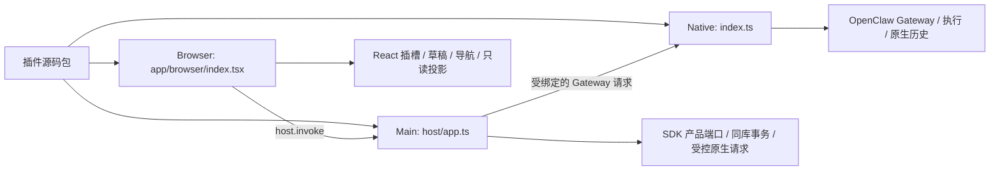

# 02 目录、清单与模块边界

## 一个包，三个执行位置



原生入口只注册原生能力；Main 入口只组合协调器；Browser 入口只注册视图、模式和投影。业务增长后按领域拆分，入口保持薄。不要为了目录对称把本来独立的协作、讨论、工作流和通用服务合并。

## 三个配置文件分别声明什么

### `package.json`：源码包与构建入口

以 [Hello Panel 的配置](examples/hello-panel/package.json)为例：

```json
{
  "name": "openclaw-hello-panel",
  "version": "1.0.0",
  "private": true,
  "type": "module",
  "license": "MIT",
  "openclaw": { "extensions": ["./index.ts"] },
  "app": {
    "main": "host/app.ts",
    "browser": "app/browser/index.tsx"
  }
}
```

上面只展示入口字段，实际还应像示例 `package.json` 一样声明并安装 SDK、构建器、React 和类型依赖，包内提供对应的 `LICENSE`。应用插件构建器要求一个原生入口，以及 Main / Browser 源码入口。源码入口不能逃出当前包；实际业务依赖可以由入口静态导入并打包，但不能导入应用 `src`。输出包会移除源码用的 `app` 字段，并把原生入口改为 `./index.js`。

### `openclaw.plugin.json`：原生声明

它描述原生插件 ID、名称、原生配置 schema，以及按实际能力需要声明的工具、技能、渠道、激活条件等。不要把 Main / Browser 的入口写在这里，也不要为了仿照 Team 声明不存在的渠道或工具。

配置 `configSchema` 必须与实际原生注册及 Main 配置投影一致。原生字段遵循锁定 OpenClaw 版本的合同；扩展 API 变化应按[升级检查清单](../../../upgrade-checklist/checklist.md)核对。

### `app.plugin.json`：应用接入声明

```json
{
  "manifestVersion": 1,
  "apiVersion": 1,
  "id": "hello-panel",
  "version": "1.0.0",
  "nativePluginId": "hello-panel",
  "entries": { "main": "main.mjs", "browser": "browser.mjs" },
  "capabilities": [],
  "commands": ["info.read"],
  "slots": ["plugin.settings"],
  "native": { "defaultEnabled": false, "userToggleable": true }
}
```

| 字段                             | 作者需要保证的事情                                                                     |
| -------------------------------- | -------------------------------------------------------------------------------------- |
| `manifestVersion` / `apiVersion` | 当前都固定为 `1`，修改数字不会自动获得新协议                                           |
| `id` / `nativePluginId`          | 当前必须相同，并与原生插件身份一致                                                     |
| `version`                        | 使用 `1.0.0` 或合法预发布版本等清单接受的格式；必须与 `package.json.version` 相同      |
| `entries`                        | 相对于应用产物根的 JS / MJS 文件名，支持 `main/index.mjs` 这样的嵌套路径；不是源码路径 |
| `capabilities`                   | 如实说明所用产品能力，供审核理解；不是按字符串逐项强制授权的权限表，更不是沙箱         |
| `commands`                       | Browser 可调用的 Main 命令名；实际注册的命令必须已声明且不得重复                       |
| `slots`                          | 实际使用的应用插槽，注册时必须已声明；当前宿主消费的插槽见 [04](04-browser-and-ui.md)  |
| `native`                         | 可选的捆绑默认策略；只有可信捆绑元数据参与默认设置，外部包不能据此自启或自行锁定开关   |

可选的 `entries.presentation` 必须与 `package.json.app.presentation` 同时声明，分别指定纯历史展示的产物和源码入口。它不等同于启用期间的 Browser 注册；用途和权限边界见 [04](04-browser-and-ui.md#原生历史和消息显示)。Hello Panel 不需要这个入口。

当前清单会拒绝未知顶层字段。ID、命令、插槽、能力名有长度和格式校验，数组不能包含重复值。插件包 ID 建议使用小写字母开头的 kebab-case，例如 `hello-panel`；构建器对包 ID 的要求比通用命令标识更严格。

全部规则以 [contracts.ts](../../../../plugins/sdk/app-plugin-sdk/contracts.ts) 和[构建工具](../../../../plugins/sdk/app-plugin-build/README.md)为准。不要在自定义清单中写一个宿主不消费的新插槽，然后假定界面会自动出现。

## 推荐目录和依赖方向

```text
my-plugin/
  index.ts
  contracts/            # 跨 Native / Main / Browser 的纯类型、校验和常量
  prompt/               # 纯提示构造
  execution/            # 原生执行领域，按实际业务命名
  host/                 # 产品协调、Main 注册、产品元数据与清理参与者
  app/browser/          # React 组件、发现状态、设置、历史和双语文案
  browser/              # 可选：纯浏览器辅助，不依赖 Main
  skills/               # 按需技能；在原生清单中声明
```

| 模块                         | 可以依赖                                    | 不应依赖                                           |
| ---------------------------- | ------------------------------------------- | -------------------------------------------------- |
| `contracts/`、纯 `prompt/`   | 纯类型、常量、数据校验                      | Electron、Node/DOM 状态、Main 控制器               |
| 原生 `index.ts` 及其领域模块 | 公共 OpenClaw SDK、纯合同、原生实现         | `host/`、Browser 实现、应用 `src`                  |
| `host/`                      | 公共 App SDK、纯合同、Main 领域实现         | React 界面、应用内部 service/controller            |
| `app/browser/` / `browser/`  | React、公共 Browser SDK、纯合同、浏览器辅助 | Node/Electron、Main 实现、`window.electron` 私有桥 |

Main 与 Browser 通过显式命令和事件交换有界数据。不要用相对路径、`@/`、`@shared/` 或新的路径别名绕过应用源码禁入规则。类型也优先使用公开 SDK，不把内部控制器类型泄漏成插件接口。

## Runtime Services 放什么

可选插件拥有自己的业务规则。独立通用执行保护、收据对账、holding custody、取消/清理及文件系统准入等能力可以归 Runtime Services，但它不能反向依赖 Team / Workflow，也不能在插件关闭后替它提供设置或历史入口。

复制现有示例时要检查实际 import 图。Team / Workflow 使用公开 npm 入口 `@runtime-services/sdk` 消费通用协议，使用 `@app-plugin/sdk/planning` 消费纯计划状态契约，不依赖相邻插件源码。独立项目仍必须取得并安装这些已打包 SDK、构建工具以及各自 `package.json` 中的业务依赖。npm 包存在不代表任意 OpenClaw 运行时都具有其要求的执行能力；能力准入仍以当前原生握手为准。

## 源码、安装包与运行身份

构建器产出三种不同对象：

- `build/app-plugins/<id>/<hash>/`：Main / Browser / CSS、原生 binding、应用校验清单。
- `build/app-plugins/packages/<id>/<hash>/`：可安装完整 Extension，包含原生 `index.js`、原生清单、`app/` 和技能。
- 全量构建的 `catalog.json`：捆绑产物索引；单包作者命令不会生成或更新这一索引。

`hash` 绑定清单及每个应用文件，`native.binding.json` 绑定实际原生入口字节。版本号相同也可能有不同 hash；只提高版本号不能修复字节不匹配。`epoch` 是本次业务准入的临时身份，关闭、重连或退休后不能继续复用旧回调。

安装包里不需要保留源码依赖树。Main 的 npm 业务依赖进入自己的包，Browser 使用宿主真实 React 单例。当前模块格式限制不支持任意动态加载器；细节见 [03](03-native-and-main.md)。

## 仓库捆绑与独立安装的区别

独立作者按 01 / 05 使用单包构建，并在产品已开放的环境中执行本地安装。若要把新插件加入应用捆绑资源，还需放入 `plugins/extensions/<id>`，保证目录名和 ID 一致，并接入当前通用资源同步约定。

应用插件通过通用 `package.json.app` 声明参与发现，不需要新增历史宿主专属 bundle 标记。资源装配消费已经构建的完整包，运行时不会读取源码依赖锁或现场安装 npm 依赖。独立示例默认不加入捆绑清单；捆绑链路见 [05](05-build-test-and-install.md)。
