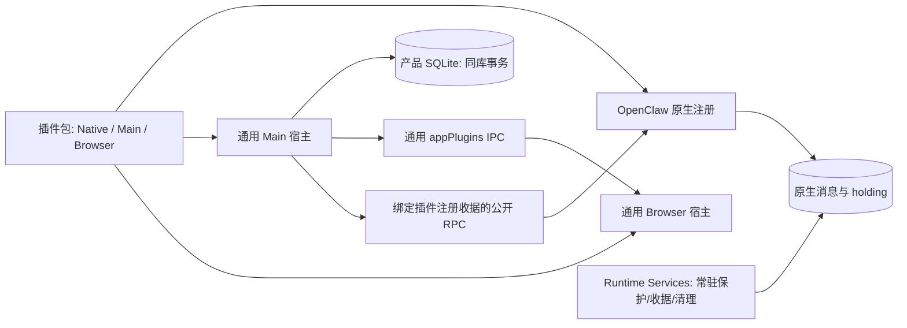

# 应用插件宿主（SDK v1）

插件的原生执行、Main 协调、数据规则、界面、设置、历史入口及翻译归插件包。OpenClaw 官方接口管理整个安装目录和 Native 生命周期；宿主按清单发现独立构建产物，负责 Main/UI 的清理、代码校验、信任登记及重新准入，不通过业务 import 或专属 IPC 组装。Main/UI 变化本身不要求重启 Gateway，原生应用确实需要重启时沿既有流程收敛。具体业务和验证由[插件包文档](../README.md)维护；本页只定义通用宿主机制。

## 所有权与运行边界



`plugins/sdk/app-plugin-sdk/` 是无应用源码依赖的公开契约。`src/main/plugins/app/` 只负责可信代码发现、产物校验和保留、生命周期、数据库端口、配置贡献、提交/删除参与者、代码审核和资源发布。`src/renderer/features/plugins/app/` 只负责 React 宿主、声明式插槽、模式选择、只读投影与资源生命周期。Core 保留产品会话、窗口、权限、执行连接、普通聊天和草稿；Core 不识别插件业务状态机。

Browser 视图和输入模式可提供自己的 React 图标，宿主保留通用缺省图标，不按插件 ID 选择业务图标。Main 的运行时 Goal 投影只读返回 `goalId`、`phase`、`identityPending` 等原生执行状态；插件据此区分普通会话的中性快照与实际 Goal，不能用投影建立终态或扩大权限。

Browser utility CSS 使用宿主完整 Tailwind 主题，禁用重复 preflight，并限定到本插件的 `data-ui-style-scope` 祖先。通用 Registry 给视图、模式选项及图标提供不产生布局盒的边界；SDK Portal 和 Core Modal 保留该上下文并在真实目标 DOM 中补齐边界。这样独立面板的 utility 不会改变宿主菜单，也不会被另一个插件的同名 shorthand 覆盖。插件手写 CSS 仍须使用自己的命名空间；这是当前独立 HTML 贡献面的样式约束，不是恶意 CSS 沙箱或任意嵌套插件、SVG/table 贡献的完整隔离。

Main SDK 的 execution facade 按真实路由实例复用，不能每次创建新的包装对象，否则插件自己的 `getRouter() === capturedRouter` 围栏会误拒绝同一实例。底层路由替换后旧 facade 失效。响应上下文只暴露 `isCurrent()`，同时核对原生响应上下文、当前运行时引用和插件 epoch；定向状态查询原样传递预期 session ID 与 lifecycle revision，不用空闲投影代替精确身份或终态。

SDK 1.1 的通用 Python 能力由宿主定位受管解释器，使用干净环境探测实际版本，并绑定核心文件哈希。Gateway 启动时由宿主覆盖 `APP_PLUGIN_PYTHON_RUNTIME`，Native 通过公开 `@app-plugin/sdk/runtimes` 获取同一描述并复核文件身份。Main 的 `getPythonRuntime()` 只读取当前 Gateway 实际发布的描述，并在异步读取前后核对业务寿命；启动时缺失或后来变更的描述保持不可用，直到正常重启 Gateway 后重新发布。不查找系统 Python、不安装依赖。该描述只证明运行时可用性，不授予工具执行或文件权限；插件继续通过公开进程接口、私有依赖和独立输入授权执行，且不向 Browser 暴露路径。接口与环境隔离要求见 [SDK 说明](app-plugin-sdk.md)。

插件包自行组织 Native、Main 与 Browser 源码和数据 schema，通过公开 SDK 返回配置、工具及技能贡献。Core 按贡献 ID 合并配置并保留用户显式开关，不按业务名称分支。插件不导入应用 src，原生入口不加载 Main/Browser 入口。

必需运行服务只维护通用执行准入、托管资源、执行收据和取消/清理，不读取可选插件的业务 schema，也不在可选插件关闭后提供其业务入口。

Custody 存储会话使用原生 harness 命名空间，以 `agentHarnessId` 和
`modelSelectionLocked: true` 固定到不可执行的 `inert-custody` harness。该 harness
声明不支持模型执行、不提供回退，直接调用 `runAttempt` 也拒绝；原生准入继续核对
锁、harness 和物理会话身份。此保护不注册全局 `before_agent_run`：原生恢复安全检查
将任何此类注册视为不安全，即使回调只拦截内部会话，也会阻止普通 Goal 启动和恢复。

## 清单、构建与授权

### 清单字段与发现

每个插件有 `openclaw.plugin.json` 和 `app.plugin.json`。应用清单固定 `manifestVersion:1`、`apiVersion:1`，声明相同的应用/原生 ID、版本、Main/Browser 文件、能力、命令与插槽；`package.json.app` 指向源码入口。清单 `native.defaultEnabled` 和 `native.userToggleable` 声明捆绑默认策略；宿主在 Main/schema 激活之前独立验证可信捆绑产物元数据，外部包不能凭这两个字段自动启用。构建脚本按文件发现清单，不维护业务入口列表。

历史批准产物中的可选 `entries.relocation` 仅保留为不可变索引与 hash 元数据，不调用或作为 Browser 资源开放。数据目录迁移直接复制退休后的文件，不需要插件声明专用迁移入口或接受业务内容审核。

### 纯历史展示入口

文本投影分为两个阶段：`text(source)` 处理归一化和草稿恢复前的传输包裹；
SDK 1.5 的可选 `displayText(source, context)` 只处理解码后的可见用户正文，
随后再由宿主应用通用原生选区引用投影。显示钩子不能改写发送、编辑恢复或原生历史。
宿主每次传入当前语言的只读上下文，并通过既有展示失效通知响应语言和字典变化；
没有显示贡献时不为此保留语言订阅。纯入口仍不获得命令、发送或其他业务能力。

可选 `entries.presentation` 对应独立的纯历史展示入口，源码由 `package.json.app.presentation` 指定，仅导出 `presentation`。它可提供文本清洗、原生输入身份展示、精确镜像识别和双语词典，不取得 Browser host、React、命令、导航、数据或发送端口。构建与模块图校验拒绝其引用 Main、Browser 入口或 Browser runtime；普通 Browser 图也拒绝引用 Main 入口。

独立浏览器模块与 `new URL('./worker.mjs', import.meta.url)` 的本地资源边继续验证和发布，Main 私有图不作为 HTTP 资源根。

### 不可变产物和安装审核

`npm run plugins:app:build` 独立构建 SDK 和插件。产物为 `build/app-plugins/<id>/<hash>`；可安装完整包位于其 `packages/<id>/<hash>`，包含单文件原生 ESM、技能及 `app/`。Main 的 npm 依赖进入自己的 ESM 包；Browser 的 React/ReactDOM 指向宿主真实单例，插件自行编译 CSS/Tailwind。产物逐文件 SHA-256 和清单共同生成身份，限制路径、链接、文件数、大小及可解析模块图。

保留目录复制后再校验，防止从可变安装目录执行 Main 代码。作者操作见 [SDK 说明](app-plugin-sdk.md)。

安装与删除继续使用原生扩展流程；安装时由 Main 自动接受原生能力声明，不再弹出人工确认。用户主动安装／更新也授权该次确切 Main/UI 产物的代码信任；原生安装已确认后，Main 在同一包变更 owner 内核对 canonical 安装路径、原生身份与绑定、逐文件产物 hash，保留不可变代码，再登记精确 hash。外部代码不复用原生 review token，不因市场来源或目录存在而获准；安装未知或校验失败不能登记信任。原生提交后登记失败明确返回已安装及具体原因，不能丢失回执或重放安装。审批文件位于 `state/plugin-data/.host/approvals.json`，只保存当前 hash 和有界历史批准；保留的不可变产物位于同一宿主目录的 `artifacts/<id>/<hash>`。损坏或不匹配的记录不能授权执行。安装目录同 ID 的自定义插件覆盖捆绑候选，不会退回执行另一个同名版本。

Main 先预留包变更顺序，在扩展队列内固定输入和精确包归属，再选择已连接 Gateway 的原生接口或必要的停止流程。App 身份不再单独决定停止 Gateway；损坏、未批准、保留清理和捆绑候选仍保护其既有资源责任，新包没有 `app/app.artifact.json` 不能抹去旧责任。在线变更只清理目标 Main/UI，不主动撤回无关应用插件，也不为普通原生包登记 App 信任。原本离线、显式删除私有数据或受管数据尚未完成必要准备时保留停止流程。

### 代码信任限制

首版运行可信 Main 进程内代码和同页面浏览器模块。contextIsolation 保护 preload 边界，不能隔离同页面插件。模块图和 SDK 门禁防止过期调用和格式错误，**不是恶意 JavaScript 沙箱**。新窗口种类、执行原语或不受 SDK 支持的宿主行为仍需要 SDK/宿主变更。

## 公开原生接口、注册收据与代码准入

### 源码独立构建与 Required 能力

公共 App SDK 和构建工具源码集中在 `plugins/sdk/`，分别保留 `app-plugin-sdk/` 与 `app-plugin-build/` 子包；根 npm workspace 使用 `plugins/sdk/*`。插件发现继续读取 `plugins/extensions/`。目录调整保持 npm 包名、公开 exports、构建命令和产物布局不变。

App SDK、`@runtime-services/sdk` 与 `@app-plugin/build` 分别分发契约、Required Service 的客户端/通用库和构建工具。宿主使用 npm workspaces 开发这些公开包，发布输出包含 ESM、声明和许可证；外部项目只安装打包后的依赖，不解析宿主源码或借宿主 `node_modules`。

构建工具使用自己的公共 Tailwind preset 和 React 单例 adapter，忽略祖先 tsconfig 的源码 aliases，验证实际 npm 输入与许可证。外部 desktop companion 保留完整 Native/Main/Browser 包结构，与 MCP App 流水线分别处理。

应用插件的 `package.json.app` 是通用源码构建声明，不再需要旧宿主专属 bundle 标记。运行时装配只消费已构建的完整包，不读取该源码目录的依赖锁、不执行 npm 安装，也不携带源码开发依赖或旧依赖缓存。其它 Native 扩展仍使用原有锁文件和生产依赖流程；应用声明及目录存在都不授予 Native trust。

插件从公开 SDK 导入通用准入、FIFO、文件准入和执行能力，业务协议及账本留在包内。Required 服务只维护精确原生身份、代次、owner 寿命、接纳及结算/清理事实；未登记资源的普通会话不产生插件业务锁。

### 只读握手与写租约

Native 客户端先通过公开 `api.lifecycle.runInBackgroundContext` 在原注册绑定的 Gateway 上完成只读能力握手，再以随机实例 token 绑定同步投影。能力协议使用通用 `executionAdmission`，只返回执行通道的 `clear/held/unknown` 和无正文身份，不发布业务模式。实例、路径或插件 ID 不能代替该握手。

同步 reader 也回到 Required 注册的公开上下文，不借外部 ambient Gateway；缺失、失败和退休均拒绝准入。新绑定使旧 handle 失效，旧工具闭包不附会新 provider。正常原生工具采用已启动 Gateway service 的注册；未采用准备好注册的 discovery factory 首次只触发合并的只读绑定并隐藏工具，后续合法 factory 才取得投影，不启动或重放业务。trusted tool policy、精确原生身份和副作用前校验继续独立生效。

写操作使用独立 owner 租约。客户端登记随机 proof RPC，Required 服务通过公开 Gateway method descriptor 核对实际插件归属，在同一绑定 Gateway 上完成单次 nonce 挑战；密钥只交给该注册的回调。只读 provider token、请求体中的插件 ID 和 Main 代码审核都不能授权写入。租约绑定原注册、provider scope 和真实 lifecycle，退休后旧回调不能写入。Required 服务继续保留已登记资源的收据与取消/清理围栏；owner 退休不构成执行已结算。

### 发布、quiesce 和迟到握手

热替换先启动候选 service，成功后才发布候选的 Gateway 方法表。因此 owner 客户端和 proof RPC 仍在注册期创建，但 service.start 只初始化本地资源，不能要求候选 proof 已能从当前 Gateway 调用。已发布的实际业务请求在副作用前等待 `ensureBound()`，并在握手前后重新核对调用权限、service 代次、停止状态及原生生命周期；失败直接拒绝该请求，不重放业务。停止后或跨越停止/重启的迟到握手不能恢复旧请求。只读回执快照不持久恢复状态，也不借查询取得写租约。

Native 客户端和 provider 在注册期捕获普通调用上下文，再通过原公开 background runner 核对当前准入。Native 开始 quiesce 后，信号尚未 abort 或已准入 cleanup 仍可运行都不延长业务权限；迟到握手被拒绝，已失效句柄和租约不会复活，恢复需要新的真实注册。不读取 Native 私有实例字段，也不新增运行时补丁。

### 托管执行与原生能力证明

Managed execution descriptor 明确声明 whole-run、run-owned cleanup 与精确 describe/cancel 协议。facade 始终调用原插件的 bound executor，并将 capability fence 与调用者 `assertCurrent` 合并；Runtime Services 不代执行。当前宿主的私有适配从公开 SDK 所属运行包、实际进程入口及交付 profile 核验预备 bundle 的版本/完整字节 hash 和既有执行能力基线。

profile 由冻结运行时验证后的资源装配生成，绑定目标平台实际 bundle，并随 Required 包交付；外部 SDK 不包含 patch 路径或宿主目录。无 profile、不兼容或 pristine 环境不声明该能力，不退化为 Stop ACK 或 `waitForRun` 推断结算。本机制不增加或调整原生 patch。

公开 `api.runtime.gateway.request` 继续受 OpenClaw 的 bundled / trusted official 安装准入约束。Main companion 的 hash 批准不能授予 Native trust；独立构建不代表任意手工安装包自动具备后台 RPC 权限。交付仍须通过既有可信安装或宿主显式捆绑流程，不新增权限绕过。能力握手测试证明路由与生命周期，不证明任意第三方分发策略已开放。

### 计划状态和源码分发边界

Plan Mode 不成为业务插件的源码/启用依赖。App SDK 的纯 planning 契约解释规划、待审核和异常状态；Runtime Services 不导入该解析器。Main 不能以 `sessions.describe` 省略投影证明无计划：Required 的只读 `runtimeServices.sessionNamespace` 在认证 backend、精确 SID/revision 下读取调用方指定的有界 namespace 快照，由消费者解释。该读取不写状态、不批准审核或扩大权限。

本次契约直接替换旧内部实现，不提供旧协议分支、旧目录扫描或迁移桥。已有业务数据文件保留，由所属插件读取；缺少插件不会自动恢复、重放或清理旧任务。

业务测试随插件独立配置运行；真实 Core 聊天控制器/历史边界的原有断言保留在显式宿主集成 profile。SDK 及宿主边界测试继续由 Core 测试运行器发现，不把缺少可选源码视为失败或转而搜索外部仓库。

### Native 注册收据与当前代码

`@app-plugin/sdk/native` 通过 OpenClaw 的公开 `registerGatewayMethod`、`api.lifecycle` 和 `openclaw/plugin-sdk/gateway-method-runtime` 接入。通用构建器自动包装 Native 入口，并在产物清单加入 `contracts.gatewayMethodDispatch: ["authenticated-request"]`；插件作者不需要修改宿主源码。原生入口不导入 Main/Browser。

每次 Native 注册产生独立的随机注册 ID，公开 `<plugin-id>.app.handshake` 返回插件 ID、注册 ID、实际进程 PID、canonical Native 入口、注册时固定的源码摘要，以及本实例自有 RPC 的绑定入口。Main 同时核对配置、所管理 Gateway 的 PID/进程代次、已批准产物中的 `native.binding.json`、入口路径和磁盘字节；等待握手时跨过进程代次或失效事件的结果不能激活插件。配置未知、来源不符或握手失败均撤回业务。

该收据是应用与插件注册之间的关联，**不是原生私有 instance/generation 权限，也不是实际 ESM namespace 执行字节证明**。

Gateway 的 HELLO 和健康检查不证明配置重载已经稳定。Main 对握手做有界的只读重查，并订阅原生公开的 `plugins.changed` / `config.changed` 重新核对注册；新代次、包变更和宿主释放都会撤销旧定时器。此机制只恢复可见性和准入，不重试业务命令或发送请求。

### 字节身份与原生包替换

支持 `single-file-v1`：业务依赖打包，只允许静态、字面量公开 OpenClaw SDK 模块和支持的 Node 内建导入，拒绝替代 loader。Main/UI 使用保留目录内按 hash 定址的产物。整个目录和 Native 更新交给 OpenClaw 官方安装事务及运行时应用；Main 校验已提交包的 Native binding 与当前注册。注册摘要不会随磁盘修改更新，运行时发现未经受管包操作确认的来源变化即撤回准入。不支持利用预热 namespace、自定义 loader 或私自原地改包获得新版本准入；代码审核与目录检查不是恶意本地代码隔离。

### 原生包与伴随代码生命周期

安装、更新、卸载及启停均调用 OpenClaw 官方管理接口，由原生验证整个目录、声明、依赖、兼容配置及 Native 运行时变更。Main 只从已确认提交的安装目录校验和加载伴随产物。首次 App 安装保持禁用；更新传递保留启停意图的原生选项，缺少新版本必需配置时仍服从原生校验后的状态，不回写未经验证的旧配置。

包变更先撤回目标业务 epoch、界面和回调，检查目标及其历史清理 owner；忙碌、未知资源和清理失败均可否决，不能借更新终止未知执行。旧清理回调继续通过既有清理 RPC 方法与参数权限执行，新的 Main/UI 不沿用旧业务注册绑定。原生操作固定当前客户端、PID 和进程代次，只对原生明确未进入操作的忙碌拒绝重新申请准入。

只有成功且提交已确认的安装结果才能登记新代码信任。Main 回读 canonical 安装目录，核对包身份、标准 App artifact 和 Native binding，保留确切 hash 的不可变 Main/UI，再加载模块并初始化其 schema。新的 `projectNativeConfig` 和 `nativePolicy` 在提交后走既有 `syncConfig`，不预先要求它们与旧版本相同。新业务只在当前 Native 认证握手通过后发布；没有独立的 Main/UI 当前版本指针，后续启动仍以原生安装目录和精确审批收据为准。

原生返回真正的 `restartRequired`，或既有配置与启动环境收敛确实需要重启时，由原有重启协调流程处理；Main/UI 代码改变本身不触发重启。原本离线、显式删除私有数据或受管数据尚未完成必要准备仍使用停止租约，已准备好的数据更新不重新迁移。在线操作不主动撤回无关插件，但必要的 Gateway 重启会撤回全部旧进程证明。

已发送但结果未知时保留目标围栏和既有未知结果保护，不重放、不切 CLI、不通过重启猜测提交。明确未提交时可重新核对旧准入；原生已提交后，信任、schema、配置同步或握手失败保留已提交事实及清理责任，不复活旧业务冒充成功。正式卸载由原生清理插件设置、名单、安装记录及所属 channel 配置，清除该包的槽位选择并恢复原生默认；原生可以保留禁用标记，该标记不是安装证据。宿主清理目标 Main/UI，默认保留私有数据、业务表、产品会话及原生历史，不删除非所属配置。

开发运行时的 `vendor/openclaw-runtime/current` 可以是指向平台运行时目录的符号链接或 Windows 目录联接。发现捆绑插件时先解析并固定该受管运行时根目录的真实路径，再拼接 `dist/extensions/<id>`；插件包内部的目录或入口链接仍拒绝，Native 字节摘要及注册握手检查保持不变。产物验证覆盖受管运行时目录联接，不放宽插件包内入口和字节身份检查。

### 请求分发与权限传递

SDK 用代理 API 观察插件的公开 `registerGatewayMethod` 登记，为插件自有 RPC 同时登记绑定本次注册 ID/PID 的直接入口。原参数保持原样，保留原方法的 scope、profileAccess、sessionAccess 及保留名称的权限要求；原 handler 看到的 `req.method` 仍为业务方法名。握手通过公开 handler context 的只读 Gateway 方法描述符核对原方法和绑定入口的实际 owner 与权限，原登记冲突或元数据不一致均不能发布映射。不读取其中的 opaque 插件 registry，不导入原生私有 registry/instance 模块。

Main 的 canonical Gateway client 用 `AsyncLocalStorage` 保留当前业务注册收据。自有 RPC 走收据中的直接入口，Core RPC 才转换为 `<plugin-id>.app.dispatch` 的普通参数并调用公开 `dispatchGatewayMethod`；不扩展 `RequestFrameSchema` 或客户端协议。Native helper 核对注册 ID、PID、后台客户端、真实注册生命周期、请求取消和调用者权限。

原生继续持有真实实例、会话 incarnation/generation、原始调用者与 profile/device 权限，并在授权等待及提交边界检查；应用注册收据不代替这些权威。清理请求不借用新业务注册，仍受插件清理方法和参数 predicate 约束。

### 配置重载不代替注册寿命

全局 `isConfigReloadSettled()` 不属于插件注册或请求的寿命证明，不作为握手、派发或响应的额外门禁。`agents.create/update` 等公开方法会写配置并自行确认应用；其成功响应可能早于全局重载收尾。只要真实注册和调用者仍有效，SDK 原样传递该响应，Main 重新核对同一注册收据时保持业务 epoch。实际关闭、调用者撤权、取消、实例更换或源码身份变化继续按既有围栏撤回，未知副作用不自动重发。

直接入口使真实 Native handler 的完整 Promise 归属实际外层请求：像讨论启动这样先返回受理结果、再等待后台任务的接口，不会因一次嵌套派发已取得首帧结果而提前释放 work-admission root。SDK 不把受理结果当执行完成，也不通过脱离调用者权限的后台上下文绕过这项约束。

这不替代 handler 自己的提交围栏。Native 是否提供 session mutation commit guard 取决于原方法的公开准入声明，不能假设每个自定义 RPC 都具有该 guard；插件仍须在异步等待后的副作用前检查实际调用者权限，并在 Native 提供 commit guard 时保留相应检查。绑定入口保持这些字段、getter 与权限上下文，不给原方法增加系统权限。

### 明确拒绝与未知结果

派发前的拒绝保持明确错误；派发后超时、取消或撤销可能已经产生副作用，helper 返回严格关联插件、注册、进程和方法的未知结果标记。Main 只对完整匹配当前调用的标记转换为既有 `CLIENT_TIMEOUT` / `requestSent: true` 未知结果，保留发送围栏并核对原生收据。原生明确返回的错误原样保留。任何路径都不自动重发未知操作，不以重启、空闲或 owner 更换建立执行终态。

### 子 Agent 的工具来源

Main 伴随插件可实现 `resolveExecutionSession(query)`，根据自身真实业务关系返回显示来源：
`ownerSessionId?` 与 `label?`。Query 包含原生会话 key、必需的 Native session ID，以及可用的
run ID、lifecycle revision 和原生 producer ID。宿主在异步查询前后核对插件实例、准入代次、
Native 注册和产品会话存续；多个插件同时认领视为未知。结果中的插件 ID、Native ID 和
epoch 由宿主盖章，插件不能自行指定。

投递回执尚未唯一关联实际 run 时，插件可返回 `pending: true`。这只声明归属待确认，
不放行问答回复或浏览器资源创建，也不借用当前会话。精确回执、停止或清理改变关联后，
插件通过 `host.executionSessionsChanged()` 通知宿主重新投影。通知绑定当前插件调用上下文，
不改变业务 epoch、不启动 Gateway、不重放工具或消息；过期调用不能恢复旧关联。
来源 resolver 的只读调用内禁止发布此通知，避免查询自身触发无限重新投影。

普通读取或刷新保持同一来源身份时，不发布生命周期撤回；宿主按完整 App/Native 身份及
库存准入条件去重该通知。真实启停、绑定替换或库存失效仍撤回，元数据通知与正常快照
广播继续独立发送，不能用通知签名缓存代替实时执行准入。

元数据通知与业务生命周期撤回分开：无关 Agent 的收据更新不先隐藏正在输入的已确认问答，
回复仍逐次核对精确来源；真正关闭、换代或卸载继续同步撤回。浏览器准入期间收到通知时，
只对本次来源做至多一次只读重核，身份、资源和工作区约束未变才执行一次操作。

该接口只定位问答与浏览器资源，不传消息正文、不授予父会话权限，不代替 Native V2
工具调用检查或全程终态。没有产品来源的独立群聊可以只返回成员标签；不能伪造产品会话。
Team 的房间、成员和执行关系由其自身 resolver 查询，Workflow 的节点与批次关系由其
只读原生 RPC 查询；Core 与 Runtime Services 不导入这两个可选业务的存储。

`execution-source` 是 SDK 的纯契约入口。需要复用已有原生会话的发起者通过公开
`GatewayRunToolBindings` 写入绑定，包含同一 Native key、session ID 和 revision。工具从
真实工厂上下文与 Native entry 取来源，拒绝过期绑定，不从模型参数或 key 命名推断归属。
普通 Native-only 插件可以保留独立问答和显式后台浏览；宿主仅在 App 候选发现完整且没有
待修复库存时确认这一分类。原生包只有在可读取的包元数据明确不声明 App companion 时，
才作为普通 Native 库存保留；缺损或不明确的包不能提供该分类的正证据。已知 App producer
的身份在卸载或退休后仍保留，关闭的 App 插件不能因查询返回空值而降成普通来源。

业务代次撤回同步否决旧交互与页面效果，再异步重新投影；此通知不表示 Native 执行已
结束，也不隐式停止独立 Workflow。浏览器资源 ID 与显示会话 ID 分离，实际目标注册、
ACK、文件策略和回收均使用资源 ID。详细用户行为与验证范围见
[多 Agent 工具与交互](../../features/execution/multi-agent-tools.md)。

## 启停、替换与恢复

| 操作          | 继续保留                     | 必须撤回或核对                             |
| ------------- | ---------------------------- | ------------------------------------------ |
| 同包关闭      | 数据、未知回执、既有合法清理 | 业务 epoch、命令、UI 和新工作准入          |
| 同包重开      | 同一产物及持久业务元数据     | 新业务 epoch，不重放未知输入               |
| 在线原生包替换 | 无关 Main/UI、数据和必要清理引用 | 原生提交与应用回执、目标旧 epoch、确切 hash、新 Native 关联 |
| 必要停止流程 | 数据和旧版本必要的清理引用 | 确认 Gateway 退出、离线／数据准备、重连后的当前 Native 握手 |
| 重连/实例变更 | 可恢复元数据和当前清理责任   | 旧收据和迟到响应，重新握手后才准入         |
| 明确卸载      | 业务表、历史和安全回执       | 通用宿主关联按 owner 清理，不误删共享资源  |

### 插件存储与私有数据目录

应用插件的可写代码保留、批准记录和私有数据统一归入 Gateway 状态目录下的
`plugin-data/`。默认完整路径是 `<userData>/openclaw/state/plugin-data/`：

```text
plugin-data/
  .host/
    approvals.json
    artifacts/<app-plugin-id>/<hash>/
  <native-plugin-id>/
    .owner.json
    ...插件私有数据
```

`.host` 为宿主保留名称，不符合插件数据 ID 格式，插件不能声明它，卸载数据清理
也不涉及它。已发布 SDK 的 `plugin-data/<native-plugin-id>/` 路径保持稳定。
构建目录 `build/app-plugins/`、安装资源和 HTTP `assets/app-plugins/` 是构建及分发入口，
不属于用户可写存储。

宿主只使用统一路径，由代码保留和批准记录写入入口按需创建目录。路径计算不读写
磁盘，也不增加启动准备步骤；代码校验、信任与历史资源保护继续由各自原有流程负责。

插件通过 `app.plugin.json.data.directory: managed-v1` 声明插件私有数据目录。
宿主在 Gateway 启动前或已停止的包变更租约内准备
`state/plugin-data/<nativePluginId>/`，以 `.owner.json` 绑定插件 ID 和独立数据身份。
Main 的 `getPluginDataDirectory()` 与公开 Native SDK 的
`resolvePluginDataDirectory(stateDirectory, pluginId)` 只校验并返回同一目录；
Native 不创建或迁移目录，缺少准备时不可用。旧 `getNativeStateDirectory()`
保持原有语义，已有业务表、原生历史和共享资源仍由各自的存储所有者管理。

SDK 1.3 的 `data.retention: retain` 用于插件自有的执行安全收据等必需保留数据。
宿主把该策略持久写入对应 `.owner.json`，即使插件包缺失或后续清单省略策略，也不允许
卸载清理；已有目录只可加强为保留，不能自动降级。默认可清理目录继续使用原三字段
归属记录，保留目录才增加 `retention: retain`，兼容既有 SDK 1.2 插件读取自己的数据目录。
整包任一 owner 存在保留策略时，卸载不提供数据清理；普通卸载和启停仍可继续。

SDK 1.4 的 `getRetainedPluginDataDirectory()` 提供保留型目录的只读路径查询，供当前
业务或合法清理回调读取元数据，包括插件关闭后的资源保护检查。它同时要求清单和
磁盘归属记录声明保留，继续核对实例及清理 lease 寿命；不授予写入、执行或 Gateway
权限。原 `getPluginDataDirectory()` 仍只用于当前业务寿命，不能借清理回调恢复下载。

插件可用 `data.migrateLegacyDirectory.requiredFiles` 显式声明同名旧目录的必要文件。
宿主仅在确认 Gateway 已停止时验证旧目录及完整文件树，并在同一状态根内重命名；
不扫描认领任意目录，不接受保留状态名称、链接或硬链接，不合并或覆盖目标目录。
源与目标同时存在或布局不匹配时拒绝准入并记录具体原因，原始文件保留。

更新和停用保留私有数据。卸载确认窗口读取整个原生包中符合受管数据 ID 规则的
owner 的可释放空间，不改变原生 ID 大小写。读取期间或确认没有数据目录时隐藏数据区域，
检查失败仍显示禁用提示。默认保留数据，用户可勾选“同时删除插件数据”。选择清理后使用停止 Gateway
的包变更流程，停止并等待插件任务，捕获所有 owner 的目录、归属收据及文件身份；
只有原生卸载明确成功后才再次验证并清理。未知卸载结果不删除；清理失败保留
已卸载事实和具体错误，不重发卸载。数据删除只包含当前收据拥有的普通文件及目录，
使用逐项非递归操作，拒绝链接、目录替换、内容变化及未识别条目。

`register`、`activate`、`onEnable` 和 Browser 注册为同步契约。无效 thenable 会被处理并阻止激活；同步 activation 的清理 lease 在返回时撤销，异步尾部无法继续删除或写数据库。`activate` 每实例一次；`onEnable` 每业务 epoch 一次并返回 disposer。异步工作通过命令、合法清理参与者和预检执行。

可选 Main `maintenance` 在实例激活后运行，不依赖业务启用状态。宿主每次给予新的、仅本次 Promise 有效的清理 lease，串行执行，释放实例时撤销；只能使用已声明且参数符合 predicate 的清理能力，不能恢复业务注册、启动 Gateway 或发起新执行。旧资源 owner 可保留维护，不能因此发布旧版本界面。

临时缺失 Native 业务证明只进入清理权限下的只读核对，不等同于用户取消授权。
尚未尝试的待发意图缺少原生收据时仍保持待发，未知发送继续保持未知；取消须有
所属插件的显式持久意图，不能因准入证明暂缺而取消或重新投递。

清理 RPC 的参数 predicate 也必须同步返回严格 `true`，其临时权限在返回时撤销。配置投影同步运行于只读作用域，不继承调用方的业务或清理权限。Gateway 离线时，保存成功的配置开关与实际原生运行证明分别记录；就绪后可以恢复业务，配置结果未知或运行身份未确认时拒绝业务调用。

关闭插件先撤回业务 epoch，围栏待发输入，保存必要元数据，再修改原生状态。Browser 移除业务插槽、历史/设置入口、打开的对话框、模式、样式和旧请求。重新启用产生新 epoch，不重开旧对话框、不重放未知发送。原生 transcript 保留，只在可选插件再次启用后恢复其业务历史入口。

当前已安装且获批产物的纯历史展示入口按插件 ID/hash 单独租用，关闭或临时断线不撤销，已挂载消息也会随展示规则变化刷新；不读取额外历史或赋予业务权限。真正卸载、选定包替换或清单身份未知会撤回旧展示，旧异步加载及 disposer 不能污染新版本。仅为清理保留的历史 owner 不发布展示。快照 `installed` 只表示当前已批准 UI 产物收据，不能证明 Native 安装、启用或运行。`presentationEntry` 只有验证后的同源不可变资源 URL，不接受安装目录直链。

用户停止产品会话时，先同步发起各插件的本地取消围栏，再立即执行原生 Stop，不等待插件的远端 guard 清理完成。清理失败不能阻塞来源停止，也不构成执行已结算或资源可删除的证据。侧栏相关活动通过插件自己的 `session.presentation` 投影，不根据业务回执推断运行。

插件通过 `publishSessionActivity` 发布成功读取的完整活动 ID 集合。通用 Browser 宿主仅保留各插件最后确认的活动正证据，关闭时继续显示运行提示；旧 resolver、历史、设置和导航全部撤回。新 epoch 的初始空状态、读取中或失败不能清除旧证据，只有当前插件取得完整成功快照后才替换其集合；多个插件分别维护，不互相清除。这是界面提示，不建立执行终态、发送许可或历史权威。

App companion 的安装、更新及删除按目标管理 Main/UI 寿命，Native 文件和运行时操作交给官方管理接口。普通资源预检否决且未触碰原生变更时可以恢复旧准入；资源清单、schema 或清理失败的安全阻塞继续保留。操作后读取真实清单，不重试未知变更；变更的 Main 模块通过新的不可变 hash 路径加载，旧业务、样式、资源 URL、UI 和 epoch 失效。

必要历史清理 owner 按原 hash 保留，非必要旧实例释放。新 schemas 在原产品库中初始化，仍使用同一数据库端口。

必要停止流程先撤回进程相关准入，停止实际 Gateway 并阻止并发启动；确认原进程退出后才执行离线文件或数据准备。停止超时保留活进程引用并阻止后续启动／替换。lease 释放后，原先存在的 Gateway 在后台恢复并重连，软件窗口、Core 和主进程保持运行；原本离线的应用不因包操作或只读审核准备而启动运行时。当前进程握手通过后才重新发布业务 UI。同包启停使用公开管理 API，关闭后立即隐藏历史和设置入口，重新启用不恢复旧对话框或重放请求。

安装入口不再要求人工能力确认，普通扩展优先在现有 Gateway 内热安装。可信市场
对普通扩展的安装后启用遵循实际热／冷路径：已连接时使用原生管理接口，只有持有停止租约
时才离线 enable；App companion 首次安装保持禁用，更新由原生保留兼容配置及启停意图。本次确切代码 hash
的校验与信任登记并入该次包事务；在线操作只重新准入目标 Main/UI，必要停止流程由原 owner 对账并恢复。受管安装流程之外的旧产物或
外部修改不会自动补登记信任，仍可使用显式代码确认入口或重新导入确切包。

Main 为 App 插件提供的 `ensureReady` 在组合点检查本次引擎准备返回值：只有经
原准备 owner 确认的 Running 才正常返回。Error 保留本次具体错误；Ready 或
Starting 使用未运行／仍在准备的受控说明，不能把正常停止状态当根因。非就绪
结果在读取插件清单前拒绝，避免后续“清单不可用”覆盖启动原因；原异常原样
透传，不取旧诊断、不重复启动或重放包变更。SDK 的通用返回类型和准备 owner
的代次、准入及返回合同保持不变。

捆绑及已批准的外部应用插件统一调用原生 `plugins.setEnabled`，保留其能力审核与运行态回执；不使用 CLI 作为失败后的替代路径，不使用 9.8 的 Skill 发现重启规避。附属 Skill 经 `skills.update` 同步后，只读核对 `config.get` 中技能开关及 `configRevisionHash === appliedConfigHash`，等待配置实际应用，避免紧接着的插件操作与尚在执行的配置监听争用 lease。

在线变更使用已连接的 Gateway 客户端，发送前核对原连接、进程和代次；断线或身份变化不进入通用请求的自动恢复流程。未知操作不重发，只有已确认操作的原生重启要求及实际配置／环境变化才进入既有重启协调。Main/UI 只在当前 Native 注册握手通过后发布。

出站策略变化可在已验证的同一本地代理路由上生效，不因策略文件存在就要求重启；实际启动环境或既有直通隧道不能复用时沿现有收敛处理并报告，不能重发已确认或未知的启停请求。

非应用扩展的离线恢复同时核对用户安装包及实际捆绑目录、清单身份和配置策略，不能把用户安装目录中没有条目等同于内置插件未安装。其管理 API 超时或断线后，也只有明确的未派发证明才允许命令行恢复；已发送或结果不明的启停保留待确认结果，不重发、不凭配置布尔值推断原生重载已完成。应用插件启停不使用这条 CLI 恢复路径。

热启停的收尾通知及 Renderer 列表重读同样只用现有连接，不调用通用自动恢复入口或 `plugins.refresh`。连接不可用时保留错误与最近确认的清单，不退回遗漏内置插件的局部目录；连接就绪后，只对先前不可用的读取补读，避免一次断线隐藏卡片或间接启动 Gateway。

参数保存不改变 Native/Main/Browser 的代码身份，不进入包替换的冷操作 lease。声明热配置的字段沿原生配置服务更新和确认，保留字段权限、进度及未确认结果；声明为热更新的数值配置不能因套用包变更流程而停止 Gateway，或因缺少应用 ACK 自动重启。

失去启停响应形成可恢复的业务围栏，与永久 schema/资源清理失败分别记录。后续只读刷新取得新的、完整且当前有效的 Native 绑定证明后，才恢复业务准入；配置布尔值、同一份旧证明或未确认状态均不能解除围栏，也不把原请求的未知结果改写为成功。资源与清理失败继续阻塞。

应用启动先完成历史保护和用户数据准备，再打开并赋值 Core Store，随后发现插件、初始化插件 schema，最后启动开发资源服务和主窗口。插件发现需要读取受管运行时目录，不能早于 Core Store 的访问门禁；发现与 schema 准备不启动 Gateway，也不提前准入 Native 业务。初始化进度窗口仍按原流程显示，Browser 偏好加载和历史恢复门禁继续约束后续激活。

Store 打开后和插件异步准备后都重新核对退出状态，退出期间不因发现插件而构造新的运行时服务。普通启动可以先开放工作区、在后台准备引擎；插件业务贡献仍须等待当前 Native 注册证明。扩展目录发现不持有应用配置队列，发现完成后的同步配置投影才进入该队列，避免等待引擎的目录读取反过来阻塞启动配置。

开发启动先构建伴随包，再在没有相关活 Gateway 的前提下准备同批 Native/Main/UI 产物，防止新清单与旧 Native 包不匹配时默默丢失入口；已有匹配产物不写运行时。Vite 会给变量动态导入附加 `?import`，代理仅剥离这个固定标记后向私有 Main 资源服务转发已验证路径，拒绝其它查询串；Main、binding、清单及私有 token 的保护不变。真实开发验证入口为 `node scripts/test/plugin-host/verify-development-application.mjs`。

Core 的生产与测试入口不静态导入可选插件源码。插件业务测试和专项探针保存在其自身 `tests/`、`scripts/`，随源码目录一起移动；Core 测试使用合成 SDK 贡献验证宿主行为。根 Vitest 配置按实际插件目录分流领域测试：有独立 `vitest.config.ts` 的包纳入其 `tests/host/` 宿主集成；其他包纳入领域测试及可选的包内 `tests/hostSetup.ts`，此路径相对各插件根目录，不是仓库根 `tests/`。各扩展 `sdk/` 下的测试另外由根配置的独立 glob 收集，不受上述分流排除。完整 `npm test` 还按 App 包清单运行各自的独立 suite；传入定向测试参数时不附带运行这些 suite。上述发现均不维护业务插件列表。

需要真实宿主的插件集成通过显式 `APP_PLUGIN_HOST_ROOT` 定位，并在未提供宿主时明确跳过；设置了错误宿主或现存插件文件损坏时直接失败。通用产物探针按实际清单验证生命周期，零个可选插件也是有效库存，不把缺席伪装成已验证某项业务。

已有源码分离验证使用移除可选业务包的隔离副本，覆盖应用构建、Core 回归及 Electron/Chromium 接纳空插件清单。它只证明对应宿主边界，不是当前整包或业务验收回执。独立插件项目须显式提供依赖，宿主不通过兄弟仓库路径回退加载源码。

临时目录清单读取/加载失败形成独立的包准入围栏。修复文件后，下一次显式包操作先在确认停止的 Gateway 下重读、验证和恢复当前清单，再恢复连接并重新选择热／冷路径；普通扩展随后热操作，不额外重启，不重放前次未知操作。该恢复不能清除数据库资源账本、schema 错误或历史 owner 不明的永久保护。未完成的多包准入保留新 schemas 的待初始化集合，避免部分失败后跳过初始化。

原 hash 的资源被显式采用或最后一项删除后，宿主释放不再有引用的本地清理实例及收据/停止订阅。重复切换同一 hash 也不能覆盖并遗失旧 disposer。释放必须等该精确实例的变更 lease 和删除 lease 都归还；从其他 registry 借入的 owner 仍由原 registry 在自己的清理上下文释放。

Gateway 关闭只有真实正常 close/exit 才证明退休。异常、超时、信号或非零退出保留本进程的关闭失败围栏，后来的退出观测不能重新准入或启动替代 Gateway；包变更 lease 及其他资源保护也继续独立生效。普通插件热启停不进入这条关闭流程。

旧批准产物只在当前仍安装的插件资源账本引用其精确 hash 时恢复清理，捆绑产物也可使用账本中的精确 owner/hash 收据。顺序是发现候选、当前 schemas/账本初始化、实际 runtime 建立，再激活旧清理 owner；不扫描目录以推断信任，不重跑旧 schema/adoption，不发布旧 UI 或业务命令。已知插件的坏包或缺失旧文件只保护其关联资源；完整清单读取失败、账本不可读或包变更结果未知仍保留全局保护。可信 Main 完整但 Native 身份不可核实时，仅允许其清理库存参与，不发布业务。

完整可信清单确认插件缺席后，宿主撤回其业务、界面、维护和提交/删除参与者，并仅解除该 owner 在 `app_plugin_resources` 中的关联。同一来源的其他插件保护保持不变，普通聊天、普通会话删除及其他插件操作不等待已移除插件的历史清理。卸载不删除插件业务元数据、助手、已关联产品会话、原生历史和执行安全回执；重新安装后由当前插件初始化并读取原有数据，重建资源关联，不重放未知发送。借用清理实例由其原 registry 退休，旧异步调用不能继续写入或调用 Native。

整个运行时或扩展目录不可用、清单损坏、权限错误和单个入口字节不匹配不构成卸载证据。只有完整清单不再包含该 owner，或可读取的实际扩展目录确认特定包目录不存在，才解除其参与。开发准备、资源同步和裁剪会核对已退出当前源码及构建清单的旧应用插件；仅在与保留构建包逐文件一致、路径无链接且确认没有相关 Gateway 进程时清除旧 Native 副本，同 ID 的第三方改包不按目录名删除。产品用户数据与保留构建收据不随该步骤删除。

## 提交、数据和界面契约

Composer 插件返回 `{prompt,input?}`，宿主填入 pluginId、epoch、mode 的有界结构化原生 envelope；提交者和 native 侧只接受当前精确 owner。宿主在真实发送边界重查当前草稿、选择、模式、普通 turn 与原生身份。取消和失败不能清空新草稿，也不能自动重放未知发送。

模型选择等异步准备之前捕获当前模式选择，等待结束及实际提交前再次校验。等待期间插件关闭、epoch 变化或用户切换模式均撤回原提交，不能因准备函数被替换而把原插件消息降为普通消息发送。

提交参与者的临时准入映射只绑定发送前守卫及当次 epoch；全部参与者成功完成 `markSubmissionStarted` 后回收同一映射，失败或未知仍保留，不能因历史会话累积耗尽新请求名额。精确确认删除后回收对应会话集合。该回收不推断发送或执行结果；持久收据、Native 身份及清理围栏继续由原参与者持有。

Browser `uiState.get/set` 提供当前插件 ID/hash 隔离的有界内存 plain-data 草稿，克隆读写并拒绝函数、访问器、循环和活对象。关闭、断线或可恢复的业务围栏保留正文、附件路径和未知请求定位；真正卸载或更换 hash 后清除。它不保存控制器、插件模式、回调、原生授权或 transcript，也不在重新启用后自动发送。

插件草稿的恢复锁和业务准备状态由插件管理；宿主提供的有界 uiState 不建立原生接纳或结算事实，缺失回执不能自动解除未知提交。

公开 SDK 的本地资源作用域统一持有订阅、定时器、DOM listener 和协作式后台任务。Browser 的 `host.resources` 随当前实例退休，组件用 child scope 兼顾 effect 卸载；Main 的 `onEnable(resources)` 每个业务 epoch 取得新 scope，关闭、围栏、失败和退休时释放，不能用保留实例的 `host.signal` 替代业务寿命。hook 返回的释放函数也纳入当前作用域管理。释放幂等且逆序，一个失败不阻断其他资源；排队回调和异步结果均核对 scope，但操作内部仍需遵守准确身份及现有权限围栏。取消本地任务不证明 Native 结算，也不重放未知业务。

插件作者通过完整示例、开发指南和公开 SDK 开发，编译和打包使用开发工具链；软件运行与插件管理走桌面界面。构建成功不代表原生授权、产品业务或安装验收通过。


插件资源参与者扩展删除集合至固定点；先获取所有删除 lease，再完成所有预检，最后删除。全部参与者冲突、失败或未知均否决删除，避免只清理一半。产品库新增 `app_plugin_resources` 保存 resource ID、owner ID 与 artifact hash；空投影不能删除旧保护记录，跨版本采用必须显式确认完整集合。插件使用同一个实际 SQLite 连接的受控端口，同库原子事务不拆分；产品表和插件原有表位置不变。

产品会话删除与包变更互斥，包括没有插件资源的普通会话。删除在任何插件回调前同步取得 lease，直到整个删除事务结束才归还；包变更从预检、库存修复、停止 Gateway 到最终重连期间拒绝新的删除。删除预检即使异步等待，也不能被换包切换到未取得本次 fence、未参与预检的新资源 owner。准入失败和操作异常均归还临时互斥 lease，既有未知结果和资源保护围栏继续独立生效。

### Browser 插槽和撤回

Browser 只有同步注册完整成功后才发布当前业务上下文。初始交互与会话展示贡献也会通知
已挂载的消费者重算；后续动态添加及释放同样通知。加载中、半注册或注册失败的实例
不能成为当前业务 epoch，迟到的旧加载不能重新显示问答、设置、历史或输入模式。

Browser 可声明 workspace、composer、plugin settings/history、chat action、session summary/details/presentation、application page 和 message/interaction presentation。主输入、普通详情和扩展列表只组合插槽。视图可声明有限数值 `order`，同序保留注册顺序；摘要按贡献顺序组合，计数与焦点由各视图拥有。

摘要容器用单列自然高度轨道和 gap，避免无布局盒的样式边界吞掉旧子元素 margin 或压缩滚动内容。SDK 暴露只读产品元数据和显式草稿/导航/文件效果。原生历史由 Core ChatController/Gateway 维护挂载投影；插件获得视图、状态及绑定当前挂载会话的受控发送端口，不获得控制器或新的 transcript 缓存。发送端口保留权限准备、原生身份与重连核验、运行计时及未知回执，旧挂载或插件 epoch 不能继续使用。插件的业务准备与停止代次核验由插件维护。

资源通过宿主同源 hash/epoch URL 发布；不发布 Main 或 binding。开发代理使用本机私有 token 和有界专用路径。

工作区面板保持挂载以保留草稿，实际可见性通过 `AppViewContext.active` 传给插件。
来源会话的插件视图通过 `workspace.tab` 进入工作区。
每次明确打开增加 `selectionRevision`，使默认打开可以清除上次成员/子视图，普通切换 Tab 则保留状态。
无来源的插件视图可使用 `application.page`，由当前 epoch 绑定的 `page.setVisible` 请求显示。

设置页临时遮住主内容但保留页面草稿；普通导航撤回页面和旧异步请求，插件关闭则卸载贡献。
插件视图只管理自身可见性和交互焦点；隐藏或关闭不能清除后来取得焦点的其他视图。
MCP App 面板由宿主稳定容器挂载，避免重复 iframe 注册和初始化。

`session.details` 可声明 append、replace 或 hidden；由当前插件贡献决定自身视图，不从插件名称推断。详情读取保留实际会话身份、统计及返回路径，贡献失效后不能提交旧读取。设置与历史窗口经 SDK 导航和 OwnerDocumentProvider 绑定真实窗口，窗口或导航变化撤销旧请求。

### 目录、摘要和原生历史视图

Browser SDK 的完整会话目录只含轻量元数据，不含标题或正文；历史入口按该目录判断来源和锚点是否存在，再经有界 `ensureSummaries` 按需读取标题，不能用分页摘要判定历史不存在。通用 Native 历史视图保留控制器的准备中与准备超时状态，准备中不显示空历史或开放发送，重试仍交给原控制器。纯消息展示贡献由当前批准产物的租约维护，不改写原生消息或建立执行结论。

摘要记录发现不依赖摘要是否展开。插件通过 session.presentation.summaryAvailable 及上下文变化报告存在摘要，Core 只以该通用提示执行一次自动展开；插件自行维护业务发现和工作区打开策略。

### 瞬时事件与视图刷新

插件 Main 可发布有界、瞬时元数据事件；通用桥填入 owner、产物 hash 和业务 epoch，Browser 仅投递给当前同版本插件，关闭或重启后旧监听立即失效。插件自行核对事件和会话身份并发布 revision；宿主不重建插件轮询或专属 IPC。Gateway 重连撤回旧业务 epoch，新视图重新读取权威状态。

## 验证入口与限制

宿主边界回归分别验证 SDK 消费、构建产物、资源发布、开发代理和真实原生桥。以下为可复现入口，运行条件与断言以脚本为准；脚本存在不表示本次或任意平台已通过：

```bash
node scripts/test/plugin-host/verify-portable-app-sdk.mjs
node scripts/test/plugin-host/verify-built-app-artifacts.mjs
node scripts/test/plugin-host/verify-built-browser-artifacts.mjs
node scripts/test/plugin-host/verify-development-assets.mjs
node scripts/test/plugin-host/verify-development-application.mjs --runtime <prepared-runtime>
node scripts/test/plugin-host/verify-native-gateway-bridge.mjs <prepared-runtime> --gateway-bundle --assistant-config-reload --block-public-network
<prepared-runtime>/node-runtime/node.exe scripts/test/plugin-host/verify-companion-hot-update.mjs <prepared-runtime> --runtime-proof-root <verified-source-view>
```

隔离探针采用真实 Main/UI 产物、SQLite、Electron/Chromium 或锁定 Gateway，并按场景替代模型或应用端口。它们证明指定边界，不能替代真实业务模型、正式安装包或所有平台的验收。业务回归与真实模型限制随对应插件包维护，阶段性修复过程由 Git 历史追溯。

包生命周期探针用于检查真实 SDK 完整包经官方接口安装、更新与重新准入，核对 Main/Browser、精确批准 hash、当前 Native 注册、旧 epoch／资源失效及配置与历史保留。结果以该次隔离回执为准；入口存在不表示当前源码或所有平台已经验收。`--runtime-proof-root` 必须指向与实际 Native 产物一致的已验证源码视图，不能用既有产物证明代替当前宿主代码验证；回执保留在忽略的 `build/plugin-probes/`。

### 尚未完成的生产验证

- 当前内置交付保持安装、卸载入口策略。未来开放外部安装前，在正式 Windows 安装包完成安装 → 自动代码校验与信任登记 → 显式启用 → 关闭 → 新版更新 → 卸载，并覆盖原生必要重启的收尾，整个过程软件保持打开。隔离公开 SDK／产物探针不等同于完整安装包验收。

- 用真实 UI 与模型验收所安装插件的业务流程、取消、来源删除和关闭恢复；宿主 smoke test 不代替业务验收。

- 验证签名安装包、macOS/Linux、升级后的持久化保留，以及长时间运行/反复启停的内存和监听器释放。Windows 开发代理的实际 Electron→Vite→Main 路径及同一 Gateway 中的启停已有专项覆盖，正式安装包与其它平台仍需分别验收。

- 在默认被动配置监听下继续验证任意配置文件改动与显式启停交错。插件和附属 Skill 的连续启停已通过实际 Gateway 验证，并以原生已应用配置修订确认收敛；任意外部改文件、跨窗口并发及长时间压力仍需单独验收。未知请求不自动重试。

- 复核 Windows MCP 进程树清理在负载下的确认：此前完整回归出现一次 `uncertain`，独立的 5 项握手/清理测试通过；保留原生严格判断，继续验证确认过程的稳定性。

- 若未来接入嵌入 worker/备用客户端，必须经同一公开插件请求桥及未知结果分类；当前 App Main 业务通过 canonical client，未宣称任意旁路客户端具有插件收据绑定。

- 独立设计低信任进程／iframe 隔离；当前接受可信插件，Native 热应用能力由 OpenClaw 官方生命周期决定，不将源码摘要称为原生执行字节证明。
